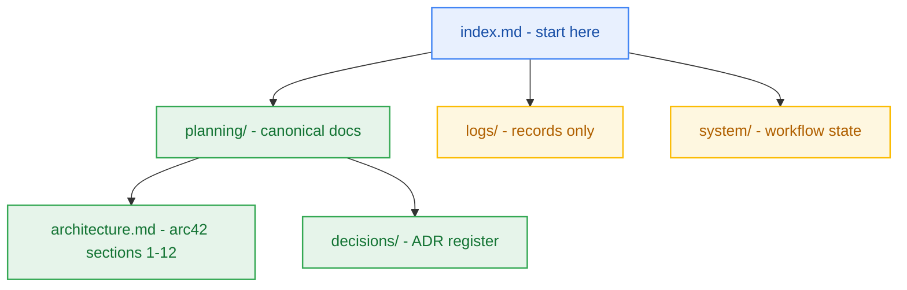

# Project Index

> Start here. Navigation hub for this project's documentation, refreshed by `hygiene-agent`. Ownership and authority rules: the `documentation-sync.md` reference shipped with every DBW skill.

## 1. Reading Order (fresh session)

1. This file, then [project-details.md](project-details.md) for what the project is.
2. `planning/project-brief.md` and `planning/prd.md` for what it must do.
3. `planning/architecture.md` for how it is built — §1–§12, each linking to its detail docs in `planning/architecture/`.
4. `planning/decisions/index.md` for why — the ADR register.
5. The active milestone in [milestone-status.yaml](planning/milestones/milestone-status.yaml).

Records in `logs/` are history, never a description of the current system. A path in backticks is a document that does not exist yet.

## 2. Document Map

| Document | Purpose | Class | Owner |
|---|---|---|---|
| [project-details.md](project-details.md) | Project overview | A | `pm-agent` |
| [project-brief.md](planning/project-brief.md) | Requirements, business rules & glossary | A | `analyst-agent` |
| [memo-001](logs/research-artifacts/memo-001-contextual-standards-and-free-tier-research.md) | Standards & cloud free-tier research | C | `analyst-agent` |
| [handoff-001](logs/handoff-documents/handoff-001-analyst-to-pm.md) | Stage 1 to Stage 2 Handoff | C | `analyst-agent` |
| [questionnaire.yaml](planning/questionnaire.yaml) | Open questions for the user | user | user |
| [milestone-status.yaml](planning/milestones/milestone-status.yaml) | Milestone board | B | `pm-agent` |
| [delivery-strategy.yaml](system/delivery-strategy.yaml) | Process depth and artifact budget | B | `delivery-strategy-agent` |
| [workflow-context.yaml](system/workflow-context.yaml) | Current workflow status | B | stage owners |

## 3. Closed Milestones

None yet.

## 4. Open Questions & Roadmap Gaps

None recorded. Open questions for the user live in [questionnaire.yaml](planning/questionnaire.yaml).
