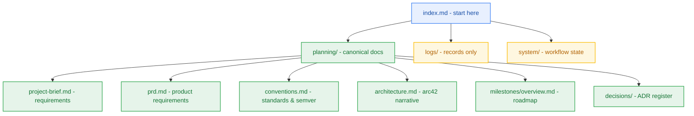

# Project Index

> Start here. Navigation hub for this project's documentation, refreshed by `hygiene-agent`. Ownership and authority rules: the `documentation-sync.md` reference shipped with every DBW skill.

## 1. Reading Order (fresh session)

1. This file, then [project-details.md](project-details.md) for what the project is.
2. [planning/project-brief.md](planning/project-brief.md) and [planning/prd.md](planning/prd.md) for what it must do.
3. [planning/conventions.md](planning/conventions.md) and [planning/milestones/overview.md](planning/milestones/overview.md) for engineering standards, SemVer ladder, and release roadmap.
4. [planning/architecture.md](planning/architecture.md) for how it is built — arc42 §1–§12, supported by [planning/architecture/04-tech-stack.md](planning/architecture/04-tech-stack.md), [planning/contracts/component-catalog.yaml](planning/contracts/component-catalog.yaml), and [planning/contracts/api-contract.openapi.yaml](planning/contracts/api-contract.openapi.yaml).
5. [planning/decisions/adr-0004-unified-upstash-serverless-architecture.md](planning/decisions/adr-0004-unified-upstash-serverless-architecture.md) for key architectural decisions.
6. The active milestone in [milestone-status.yaml](planning/milestones/milestone-status.yaml).

Records in `logs/` are history, never a description of the current system. A path in backticks is a document that does not exist yet.

## 2. Document Map

| Document | Purpose | Class | Owner |
|---|---|---|---|
| [project-details.md](project-details.md) | Project overview | A | `pm-agent` |
| [project-brief.md](planning/project-brief.md) | Requirements, business rules & glossary | A | `analyst-agent` |
| [prd.md](planning/prd.md) | Product Requirements Document (10 sections) | A | `pm-agent` |
| [conventions.md](planning/conventions.md) | Engineering standards & SemVer v0 to v1 | A | `pm-agent` |
| [milestones/overview.md](planning/milestones/overview.md) | Release roadmap, testing strategy & gates | A | `pm-agent` |
| [m0-workspace-foundation/milestone.md](planning/milestones/m0-workspace-foundation/milestone.md) | Milestone M0 Charter (Completed) | A | `pm-agent` |
| [m0-workspace-foundation/sprint-status.yaml](planning/milestones/m0-workspace-foundation/sprint-status.yaml) | Milestone M0 Sprint Board (Completed) | B | `sprint-agent` |
| [m0-workspace-foundation/git-plan.md](planning/milestones/m0-workspace-foundation/git-plan.md) | Milestone M0 Git & Branching Plan | A | `git-planner-agent` |
| [m0-workspace-foundation/dev-log.md](planning/milestones/m0-workspace-foundation/dev-log.md) | Milestone M0 Developer Execution Log | C | `developer-agent` |
| [m1-developer-golden-path/milestone.md](planning/milestones/m1-developer-golden-path/milestone.md) | Milestone M1 Charter (Completed) | A | `pm-agent` |
| [05-m1-developer-golden-path-and-auth.md](planning/architecture/05-m1-developer-golden-path-and-auth.md) | Milestone M1 Architectural Blueprint | A | `architect-agent` |
| [05-m2-metering-spine-and-quota-throttling.md](planning/architecture/05-m2-metering-spine-and-quota-throttling.md) | Milestone M2 Architectural Blueprint | A | `architect-agent` |
| [05-m3-transient-ingestion-pipeline.md](planning/architecture/05-m3-transient-ingestion-pipeline.md) | Milestone M3 Architectural Blueprint | A | `architect-agent` |
| [05-m4-notebook-workspace-and-domain-graph.md](planning/architecture/05-m4-notebook-workspace-and-domain-graph.md) | Milestone M4 Architectural Blueprint | A | `architect-agent` |
| [05-m5-grounded-reasoning-engine.md](planning/architecture/05-m5-grounded-reasoning-engine.md) | Milestone M5 Architectural Blueprint | A | `architect-agent` |
| [05-m6-pluggable-long-term-memory-store.md](planning/architecture/05-m6-pluggable-long-term-memory-store.md) | Milestone M6 Architectural Blueprint | A | `architect-agent` |
| [05-m7-autonomous-maintenance-and-observability.md](planning/architecture/05-m7-autonomous-maintenance-and-observability.md) | Milestone M7 Architectural Blueprint | A | `architect-agent` |
| [05-m8-public-marketing-landing-and-privacy-governance.md](planning/architecture/05-m8-public-marketing-landing-and-privacy-governance.md) | Milestone M8 Architectural Blueprint | A | `architect-agent` |
| [05-m9-benchmark-suite-hardening-and-security-audit.md](planning/architecture/05-m9-benchmark-suite-hardening-and-security-audit.md) | Milestone M9 Architectural Blueprint | A | `architect-agent` |
| [m1-developer-golden-path/sprint-status.yaml](planning/milestones/m1-developer-golden-path/sprint-status.yaml) | Milestone M1 Sprint Board (Completed) | B | `sprint-agent` |
| [m1-developer-golden-path/dev-log.md](planning/milestones/m1-developer-golden-path/dev-log.md) | Milestone M1 Developer Execution Log | C | `developer-agent` |
| [m2-metering-spine/milestone.md](planning/milestones/m2-metering-spine/milestone.md) | Milestone M2 Charter (Completed) | A | `pm-agent` |
| [m2-metering-spine/sprint-status.yaml](planning/milestones/m2-metering-spine/sprint-status.yaml) | Milestone M2 Sprint Board (Completed) | B | `sprint-agent` |
| [m2-metering-spine/git-plan.md](planning/milestones/m2-metering-spine/git-plan.md) | Milestone M2 Git & Branching Plan | A | `git-planner-agent` |
| [m2-metering-spine/dev-log.md](planning/milestones/m2-metering-spine/dev-log.md) | Milestone M2 Developer Execution Log | C | `developer-agent` |
| [m3-transient-ingestion/milestone.md](planning/milestones/m3-transient-ingestion/milestone.md) | Milestone M3 Charter (Architecture Finalized) | A | `pm-agent` |
| [m4-notebook-workspace/milestone.md](planning/milestones/m4-notebook-workspace/milestone.md) | Milestone M4 Charter (Approved with precondition P-1) | A | `pm-agent` |
| [m4-notebook-workspace/sprint-status.yaml](planning/milestones/m4-notebook-workspace/sprint-status.yaml) | Milestone M4 Sprint Board (S4.1..S4.6) | B | `sprint-agent` |
| [m4-notebook-workspace/pm-approval.md](planning/milestones/m4-notebook-workspace/pm-approval.md) | M4 PM Verification & Approval Record | A | `pm-agent` |
| [m5-reasoning-engine/milestone.md](planning/milestones/m5-reasoning-engine/milestone.md) | Milestone M5 Charter (Completed) | A | `pm-agent` |
| [m5-reasoning-engine/sprint-status.yaml](planning/milestones/m5-reasoning-engine/sprint-status.yaml) | Milestone M5 Sprint Board (Completed) | B | `sprint-agent` |
| [m5-reasoning-engine/pm-approval.md](planning/milestones/m5-reasoning-engine/pm-approval.md) | M5 PM Verification & Approval Record | A | `pm-agent` |
| [m6-pluggable-memory/milestone.md](planning/milestones/m6-pluggable-memory/milestone.md) | Milestone M6 Charter (Completed) | A | `pm-agent` |
| [m6-pluggable-memory/sprint-status.yaml](planning/milestones/m6-pluggable-memory/sprint-status.yaml) | Milestone M6 Sprint Board (Completed) | B | `sprint-agent` |
| [m6-pluggable-memory/pm-approval.md](planning/milestones/m6-pluggable-memory/pm-approval.md) | M6 PM Verification & Approval Record | A | `pm-agent` |
| [m7-maintenance-observability/milestone.md](planning/milestones/m7-maintenance-observability/milestone.md) | Milestone M7 Charter (Ready for Implementation) | A | `pm-agent` |
| [m7-maintenance-observability/sprint-status.yaml](planning/milestones/m7-maintenance-observability/sprint-status.yaml) | Milestone M7 Sprint Board (Ready for Dev) | B | `sprint-agent` |
| [m7-maintenance-observability/pm-approval.md](planning/milestones/m7-maintenance-observability/pm-approval.md) | M7 PM Verification & Approval Record | A | `pm-agent` |
| [m8-landing-disclosure/milestone.md](planning/milestones/m8-landing-disclosure/milestone.md) | Milestone M8 Charter (Approved for Implementation) | A | `pm-agent` |
| [m8-landing-disclosure/sprint-status.yaml](planning/milestones/m8-landing-disclosure/sprint-status.yaml) | Milestone M8 Sprint Board (Ready for Dev) | B | `sprint-agent` |
| [m8-landing-disclosure/pm-approval.md](planning/milestones/m8-landing-disclosure/pm-approval.md) | M8 PM Verification & Approval Record | A | `pm-agent` |
| [m9-hardening-benchmark/milestone.md](planning/milestones/m9-hardening-benchmark/milestone.md) | Milestone M9 Charter (Approved for Implementation) | A | `pm-agent` |
| [m9-hardening-benchmark/sprint-status.yaml](planning/milestones/m9-hardening-benchmark/sprint-status.yaml) | Milestone M9 Sprint Board (Ready for Dev) | B | `sprint-agent` |
| [m9-hardening-benchmark/pm-approval.md](planning/milestones/m9-hardening-benchmark/pm-approval.md) | M9 PM Verification & Approval Record | A | `pm-agent` |
| [ga-production-release/milestone.md](planning/milestones/ga-production-release/milestone.md) | Milestone GA Charter (Approved for Implementation) | A | `pm-agent` |
| [ga-production-release/sprint-status.yaml](planning/milestones/ga-production-release/sprint-status.yaml) | Milestone GA Sprint Board (Ready for Dev) | B | `sprint-agent` |
| [ga-production-release/pm-approval.md](planning/milestones/ga-production-release/pm-approval.md) | GA PM Verification & Approval Record | A | `pm-agent` |
| [epic-010](planning/epics/epic-010-ga-production-release.md) | EPIC-010: GA Production Release & Deployment Pipeline | A | `pm-agent` |
| [05-ga-deployment](planning/architecture/05-ga-general-availability-production-release.md) | Milestone GA Production Release & Deployment Architecture | A | `architect-agent` |
| [quality/verification.md](planning/quality/verification.md) | M2 Verification Plan & Truth Tables | A | `test-agent` |
| [quality/test-audit.md](planning/quality/test-audit.md) | M0 Test Audit & Baseline Inventory | A | `test-agent` |
| [milestone-status.yaml](planning/milestones/milestone-status.yaml) | Milestone board (M0..M9/GA) | B | `pm-agent` |
| [architecture.md](planning/architecture.md) | Canonical arc42 system architecture (§1–§12) | A | `architect-agent` |
| [04-tech-stack.md](planning/architecture/04-tech-stack.md) | 23-layer tech stack & framework evaluation matrix | A | `architect-agent` |
| [component-catalog.yaml](planning/contracts/component-catalog.yaml) | C4 module map & dependency contracts | A | `architect-agent` |
| [api-contract.openapi.yaml](planning/contracts/api-contract.openapi.yaml) | OpenAPI 3.1 HTTP contract | A | `architect-agent` |
| [config-schema.yaml](planning/contracts/config-schema.yaml) | Canonical typed configuration schema contract | A | `governance-specialist` |
| [deployment-config.yaml](planning/contracts/deployment-config.yaml) | Deployment & container configuration contract | A | `deployment-agent` |
| [package-dependency-plan.md](planning/registers/package-dependency-plan.md) | Package dependency plan & monorepo topology | A | `code-maintenance-specialist` |
| [raw-sql-exceptions.md](planning/registers/raw-sql-exceptions.md) | Raw SQL exception register (0 in M1/M2) | A | `data-architect` |
| [failure-mode-register.md](planning/registers/failure-mode-register.md) | Failure mode register (FMEA & Action Priorities) | A | `failure-mode-specialist` |
| [adr-0004](planning/decisions/adr-0004-unified-upstash-serverless-architecture.md) | Unified Upstash Serverless Architecture | A | `architect-agent` |
| [sizing-estimate.md](planning/registers/sizing-estimate.md) | Project sizing, cognitive load & effort register | A | `delivery-strategy-agent` |
| [party-mode-log.md](logs/party-mode/party-mode-log.md) | Party-Mode End-to-End Planning Log | C | `pm-agent` / `architect-agent` |
| [planning-dispatch-log.md](logs/handoff-documents/planning-dispatch-log.md) | Planning Inter-Agent Dispatch Audit Log | C | `architect-agent` |
| [memo-001](logs/research-artifacts/memo-001-contextual-standards-and-free-tier-research.md) | Standards & cloud free-tier research | C | `analyst-agent` |
| [handoff-001](logs/handoff-documents/handoff-001-analyst-to-pm.md) | Stage 1 to Stage 2 Handoff | C | `analyst-agent` |
| [handoff-002](logs/handoff-documents/handoff-002-pm-to-architect.md) | Stage 2 to Stage 3 Handoff | C | `pm-agent` |
| [handoff-003](logs/handoff-documents/handoff-003-architect-to-pm-dev.md) | Stage 3 to Stage 4 Handoff | C | `architect-agent` |
| [handoff-004](logs/handoff-documents/handoff-004-pm-to-developer.md) | Stage 4 to Implementation Handoff | C | `sprint-agent` |
| [handoff-005](logs/handoff-documents/handoff-005-test-to-deployment-pm.md) | Stage 4 to Stage 5 M0 Closeout Handoff | C | `test-agent` |
| [handoff-006](logs/handoff-documents/handoff-006-architect-to-sprint-developer.md) | Stage 3 to Stage 4 M1 Planning Handoff | C | `architect-agent` |
| [handoff-007](logs/handoff-documents/handoff-007-sprint-to-developer.md) | Stage 4 Sprint Breakdown to Implementation Handoff | C | `sprint-agent` |
| [handoff-008](logs/handoff-documents/handoff-008-developer-to-test.md) | Stage 4 Clean Implementation to Test Verification Handoff | C | `developer-agent` |
| [handoff-009](logs/handoff-documents/handoff-009-architect-to-sprint-developer.md) | Stage 3 to Stage 4 M2 Planning Handoff | C | `architect-agent` |
| [handoff-010](logs/handoff-documents/handoff-010-developer-to-test.md) | Stage 4 M2 Implementation to Test Gate Handoff | C | `developer-agent` |
| [handoff-011](logs/handoff-documents/handoff-011-architect-to-sprint-developer.md) | Stage 3 to Stage 4 M3 Planning Handoff | C | `architect-agent` |
| [handoff-012](logs/handoff-documents/handoff-012-sprint-to-developer-m4.md) | Stage 4 M4 Sprint Breakdown to Implementation Handoff | C | `sprint-agent` |
| [handoff-013](logs/handoff-documents/handoff-013-developer-to-test-m4.md) | Stage 4 M4 Implementation to Test Verification Handoff | C | `developer-agent` |
| [handoff-014](logs/handoff-documents/handoff-014-sprint-to-developer-m5.md) | Stage 4 M5 Sprint Breakdown to Implementation Handoff | C | `sprint-agent` |
| [handoff-015](logs/handoff-documents/handoff-015-developer-to-test-m5.md) | Stage 4 M5 Implementation to Test Gate Handoff | C | `developer-agent` |
| [handoff-016](logs/handoff-documents/handoff-016-sprint-to-developer-m6.md) | Stage 4 M6 Sprint Breakdown to Implementation Handoff | C | `sprint-agent` |
| [handoff-017](logs/handoff-documents/handoff-017-sprint-to-developer-m7.md) | Stage 4 M7 Sprint Breakdown to Implementation Handoff | C | `sprint-agent` |
| [handoff-018](logs/handoff-documents/handoff-018-developer-to-test-m7.md) | Stage 4 M7 Implementation to Test Gate Handoff | C | `developer-agent` |
| [handoff-019](logs/handoff-documents/handoff-019-sprint-to-developer-m8.md) | Stage 4 M8 Sprint Breakdown to Implementation Handoff | C | `sprint-agent` |
| [handoff-020](logs/handoff-documents/handoff-020-developer-to-test-m8.md) | Stage 4 M8 Implementation to Test Gate Handoff | C | `developer-agent` |
| [handoff-021](logs/handoff-documents/handoff-021-sprint-to-developer-m9.md) | Stage 4 M9 Sprint Breakdown to Implementation Handoff | C | `sprint-agent` |
| [handoff-022](logs/handoff-documents/handoff-022-developer-to-test-m9.md) | Stage 4 M9 Implementation to Test Gate Handoff | C | `developer-agent` |
| [handoff-023](logs/handoff-documents/handoff-023-sprint-to-developer-ga.md) | Stage 4 GA Sprint Breakdown to Implementation Handoff | C | `sprint-agent` |
| [handoff-024](logs/handoff-documents/handoff-024-developer-to-test-ga.md) | Stage 4 GA Implementation to Stage 5 Verification Closeout Handoff | C | `developer-agent` |
| [m5-dev-log.md](planning/milestones/m5-reasoning-engine/dev-log.md) | Milestone M5 Developer Execution Log | C | `developer-agent` |
| [m6-dev-log.md](planning/milestones/m6-pluggable-memory/dev-log.md) | Milestone M6 Developer Execution Log | C | `developer-agent` |
| [m7-dev-log.md](planning/milestones/m7-maintenance-observability/dev-log.md) | Milestone M7 Developer Execution Log | C | `developer-agent` |
| [m8-dev-log.md](planning/milestones/m8-landing-disclosure/dev-log.md) | Milestone M8 Developer Execution Log | C | `developer-agent` |
| [m9-dev-log.md](planning/milestones/m9-hardening-benchmark/dev-log.md) | Milestone M9 Developer Execution Log | C | `developer-agent` |
| [ga-dev-log.md](planning/milestones/ga-production-release/dev-log.md) | Milestone GA Developer Execution Log | C | `developer-agent` |
| [zero-cost-attestation.md](planning/registers/zero-cost-attestation.md) | Signed Zero-Dollar Cost Ceiling Attestation Report | A | `site-reliability-architect` |
| [questionnaire.yaml](planning/questionnaire.yaml) | Open questions for the user (0 pending) | user | user |
| [delivery-strategy.yaml](system/delivery-strategy.yaml) | Process depth and artifact budget | B | `delivery-strategy-agent` |
| [workflow-context.yaml](system/workflow-context.yaml) | Current workflow status | B | stage owners |

## 3. Closed Milestones

- **M0: Workspace Foundation & Scaffolding (`v0.1.0-alpha.1`)** — Closed 2026-10-23. Established Turborepo monorepo layout, Bun toolchain, and core shared packages (`@repo/config`, `@repo/contracts`, `@repo/db`, `@repo/ui`). Verified with 10 unit and build tests across 3 suites. Gate G6 PASS. Certified by `test-agent`.
- **M1: Developer Golden Path & Core Authentication (`v0.1.0`)** — Closed 2026-10-26. Delivered containerized local stack (`infra/compose.yaml`), 8-layer `dev:doctor` diagnostic, Clerk OAuth RS256 JWT auth middleware, and Kysely Neon Postgres schemas for users/threads/notebooks. Verified with full suite 50/50 passing, 543 assertions, 6/6 build, 6/6 typecheck. Gates G5 & G6 PASS. Verified by `devprod-specialist`.
- **M2: Metering Spine & Quota Throttling (`v0.2.0`)** — Closed 2026-10-26. Delivered atomic Upstash Redis Lua credit ledger, 5 RPS sliding window rate limiter, HTTP 402 short-circuit ingress guard, upstream quota classifier with IETF rate-limit headers, closed 17-member RFC 9457 error catalogue, and idempotent daily 08:00 UTC reset. Verified with full suite 50/50 passing, 543 assertions, 6/6 build, 6/6 typecheck. Gate G4 PASS. Verified by `devprod-specialist`.
- **M4: Notebook Workspace & Domain Graph (`v0.4.0`)** — Closed 2026-10-27. Delivered interactive personal knowledge graph with hierarchical text nodes, document reference cards (< 10ms resolution), typed edges (`cites`/`related`), and ownership-first scoped retrieval. Baseline repaired (precondition P-1). Verified with full monorepo suite 101/101 pass, 784 expect() calls, 8/8 build, 8/8 typecheck. Gate G5 PASS. Certified by `test-agent`.
- **M5: 6-Phase Grounded Reasoning Engine (`v0.5.0`)** — Closed 2026-10-27. Delivered query decomposition into 2-5 sub-questions, HyDE passage generation, top-3 scoped vector retrieval, Gemini Flash primary synthesis with inline citations, and transparent Groq Llama-3.3-70B circuit breaker failover. Verified with full suite 154/154 pass, 1,021 expect() calls, 9/9 build, 9/9 typecheck. Gate G6 PASS. Certified by `test-agent`.
- **M6: Pluggable Long-Term Memory Store (`v0.6.0`)** — Closed 2026-10-27. Delivered abstract MemoryStore interface, in-process Mem0 backed by Upstash Redis and Upstash Vector, extraction seam for standalone worker, and pre-synthesis memory recall. Verified with 204/204 pass, 1,396 expect() calls, 10/10 build, 10/10 typecheck. Gate G6 PASS. Certified by `test-agent`.
- **M7: Autonomous Maintenance Crons & Observability (`v0.7.0`)** — Closed 2026-10-27. Delivered Upstash QStash scheduled crons driver with HMAC SHA-256 signature verification, 7-day retention cascade sweeper with Upstash Vector point purge and Neon Postgres tombstone (RFC 9457 HTTP 410 NOTEBOOK_EXPIRED), centralized structured JSON logging with correlation_id and W3C traceparent, deep secret/PII redactor, OpenTelemetry Node SDK tracer exporting via OTLP/HTTP to Better Stack with 500ms timeout guard, and heartbeat liveness monitor (NFR-031). Verified with 259/259 pass, 1,647 expect() calls, 11/11 build, 11/11 typecheck. Gate G6 PASS. Certified by `developer-agent`.
- **M8: Public Marketing Landing & Dynamic Privacy Governance (`v0.8.0`)** — Closed 2026-10-27. Delivered public marketing surface in @repo/ui, Vanilla CSS design token system adhering to WCAG 2.1 AA (0 critical/serious violations in axe-core), un-dismissible AI provider training disclosure banner (FR-030, BR-030), zero-cost pricing transparency, and lightweight performance budget (< 50KB CSS, LCP < 2.0s, CLS < 0.1). Verified with full monorepo suite 313/313 pass, 1,923 expect() calls, 11/11 build, 11/11 typecheck. Gate G6 PASS. Certified by `test-agent`.
- **M9: Benchmark Suite, Hardening & Security Audit (`v0.9.0-rc.1`)** — Closed 2026-10-27. Delivered 50 CCU concurrency stress testing (< 1% error rate on calibrated mock harness), latency SLA verification (vector search p95 = 75.40ms < 100ms, LLM TTFT p90 = 1,114.70ms < 1,500ms, E2E reasoning p90 = 3,354.10ms < 4,500ms, RFC 9457 error serialization p99 = 0.01ms < 50ms), adversarial multi-tenant penetration testing across SQL, Vector, and Mem0 with zero cross-tenant leakage, zero credential leakage in logs, and signed zero-cost attestation certifying $0.00/mo spend across all 8 cloud vendors (NFR-016). Verified with 339/339 monorepo tests pass, 11/11 build/typecheck clean. Gate G6 PASS. Certified by `test-agent`.
- **GA: General Availability Production Release (`v1.0.0`)** — Closed 2026-10-27. Delivered production release automation including GitHub Actions CI/CD pipeline (`.github/workflows/ci.yml`) with frozen lockfile, strict typecheck, and RFC 9457 error catalogue verification; Vercel serverless deployment config (`vercel.json`) pinned to `iad1` with strict security headers under $0.00/mo free tier; automated post-deployment 4-phase smoke verification harness (`scripts/production-smoke.ts`); curated `CHANGELOG.md` documenting milestones M0 through GA with migration guide; and annotated Git release tag automation (`scripts/cut-release-tag.ts`) enforcing 5 pre-flight invariants. Checkpoint 5 closeout complete. Verified with 367/367 monorepo tests pass, 3,379 expect() calls across 63 test files, 11/11 packages build, 11/11 typecheck clean. Gate G6 PASS. Certified by `test-agent` and `developer-agent`.

## 4. Open Questions & Roadmap Gaps

None recorded. All architectural and product questions have been answered and ratified ([Q-001], [Q-002]). Open questions for the user live in [questionnaire.yaml](planning/questionnaire.yaml).
