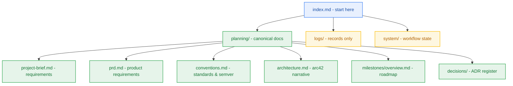

# Project Index

> Start here. Navigation hub for this project's documentation, refreshed by `hygiene-agent`. Ownership and authority rules: the `documentation-sync.md` reference shipped with every DBW skill.

## 1. Reading Order (fresh session)

1. This file, then [project-details.md](project-details.md) for what the project is.
2. [planning/project-brief.md](planning/project-brief.md) and [planning/prd.md](planning/prd.md) for what it must do.
3. [planning/conventions.md](planning/conventions.md) and [planning/milestones/overview.md](planning/milestones/overview.md) for engineering standards, SemVer ladder, and release roadmap.
4. [planning/architecture.md](planning/architecture.md) for how it is built — arc42 §1–§12, supported by [planning/architecture/04-tech-stack.md](planning/architecture/04-tech-stack.md), [planning/contracts/component-catalog.yaml](planning/contracts/component-catalog.yaml), and [planning/contracts/api-contract.openapi.yaml](planning/contracts/api-contract.openapi.yaml).
5. [planning/decisions/adr-0004-unified-upstash-serverless-architecture.md](planning/decisions/adr-0004-unified-upstash-serverless-architecture.md) for key architectural decisions.
6. The active milestone in [milestone-status.yaml](planning/milestones/milestone-status.yaml).

Records in `logs/` are history, never a description of the current system. A path in backticks is a document that does not exist yet.

## 2. Document Map

| Document | Purpose | Class | Owner |
|---|---|---|---|
| [project-details.md](project-details.md) | Project overview | A | `pm-agent` |
| [project-brief.md](planning/project-brief.md) | Requirements, business rules & glossary | A | `analyst-agent` |
| [prd.md](planning/prd.md) | Product Requirements Document (10 sections) | A | `pm-agent` |
| [conventions.md](planning/conventions.md) | Engineering standards & SemVer v0 to v1 | A | `pm-agent` |
| [milestones/overview.md](planning/milestones/overview.md) | Release roadmap, testing strategy & gates | A | `pm-agent` |
| [m0-workspace-foundation/milestone.md](planning/milestones/m0-workspace-foundation/milestone.md) | Milestone M0 Charter (Active) | A | `pm-agent` |
| [m0-workspace-foundation/sprint-status.yaml](planning/milestones/m0-workspace-foundation/sprint-status.yaml) | Milestone M0 Sprint Board (Ready) | B | `sprint-agent` |
| [m0-workspace-foundation/git-plan.md](planning/milestones/m0-workspace-foundation/git-plan.md) | Milestone M0 Git & Branching Plan | A | `git-planner-agent` |
| [m1-developer-golden-path/milestone.md](planning/milestones/m1-developer-golden-path/milestone.md) | Milestone M1 Charter (Planned) | A | `pm-agent` |
| [m2-metering-spine/milestone.md](planning/milestones/m2-metering-spine/milestone.md) | Milestone M2 Charter (Planned) | A | `pm-agent` |
| [m2-metering-spine/sprint-status.yaml](planning/milestones/m2-metering-spine/sprint-status.yaml) | Milestone M2 Sprint Board | B | `sprint-agent` |
| [m2-metering-spine/git-plan.md](planning/milestones/m2-metering-spine/git-plan.md) | Milestone M2 Git & Branching Plan | A | `git-planner-agent` |
| [m3-transient-ingestion/milestone.md](planning/milestones/m3-transient-ingestion/milestone.md) | Milestone M3 Charter (Planned) | A | `pm-agent` |
| [m4-notebook-workspace/milestone.md](planning/milestones/m4-notebook-workspace/milestone.md) | Milestone M4 Charter (Planned) | A | `pm-agent` |
| [m5-reasoning-engine/milestone.md](planning/milestones/m5-reasoning-engine/milestone.md) | Milestone M5 Charter (Planned) | A | `pm-agent` |
| [m6-pluggable-memory/milestone.md](planning/milestones/m6-pluggable-memory/milestone.md) | Milestone M6 Charter (Planned) | A | `pm-agent` |
| [m7-maintenance-observability/milestone.md](planning/milestones/m7-maintenance-observability/milestone.md) | Milestone M7 Charter (Planned) | A | `pm-agent` |
| [m8-landing-disclosure/milestone.md](planning/milestones/m8-landing-disclosure/milestone.md) | Milestone M8 Charter (Planned) | A | `pm-agent` |
| [m9-hardening-benchmark/milestone.md](planning/milestones/m9-hardening-benchmark/milestone.md) | Milestone M9 Charter (Planned) | A | `pm-agent` |
| [ga-production-release/milestone.md](planning/milestones/ga-production-release/milestone.md) | Milestone GA Charter (Planned) | A | `pm-agent` |
| [quality/verification.md](planning/quality/verification.md) | M2 Verification Plan & Truth Tables | A | `test-agent` |
| [milestone-status.yaml](planning/milestones/milestone-status.yaml) | Milestone board (M0..M9/GA) | B | `pm-agent` |
| [architecture.md](planning/architecture.md) | Canonical arc42 system architecture (§1–§12) | A | `architect-agent` |
| [04-tech-stack.md](planning/architecture/04-tech-stack.md) | 23-layer tech stack & framework evaluation matrix | A | `architect-agent` |
| [component-catalog.yaml](planning/contracts/component-catalog.yaml) | C4 module map & dependency contracts | A | `architect-agent` |
| [api-contract.openapi.yaml](planning/contracts/api-contract.openapi.yaml) | OpenAPI 3.1 HTTP contract | A | `architect-agent` |
| [adr-0004](planning/decisions/adr-0004-unified-upstash-serverless-architecture.md) | Unified Upstash Serverless Architecture | A | `architect-agent` |
| [sizing-estimate.md](planning/registers/sizing-estimate.md) | Project sizing, cognitive load & effort register | A | `delivery-strategy-agent` |
| [party-mode-log.md](logs/party-mode/party-mode-log.md) | Party-Mode End-to-End Planning Log | C | `pm-agent` / `architect-agent` |
| [memo-001](logs/research-artifacts/memo-001-contextual-standards-and-free-tier-research.md) | Standards & cloud free-tier research | C | `analyst-agent` |
| [handoff-001](logs/handoff-documents/handoff-001-analyst-to-pm.md) | Stage 1 to Stage 2 Handoff | C | `analyst-agent` |
| [handoff-002](logs/handoff-documents/handoff-002-pm-to-architect.md) | Stage 2 to Stage 3 Handoff | C | `pm-agent` |
| [handoff-003](logs/handoff-documents/handoff-003-architect-to-pm-dev.md) | Stage 3 to Stage 4 Handoff | C | `architect-agent` |
| [handoff-004](logs/handoff-documents/handoff-004-pm-to-developer.md) | Stage 4 to Implementation Handoff | C | `sprint-agent` |
| [questionnaire.yaml](planning/questionnaire.yaml) | Open questions for the user (0 pending) | user | user |
| [delivery-strategy.yaml](system/delivery-strategy.yaml) | Process depth and artifact budget | B | `delivery-strategy-agent` |
| [workflow-context.yaml](system/workflow-context.yaml) | Current workflow status | B | stage owners |

## 3. Closed Milestones

None. (Milestones M0 and M1 were previously noted as closed due to reference template drift; reconciled on 2026-10-23 to reflect current workspace reality where implementation has not yet commenced).

## 4. Open Questions & Roadmap Gaps

None recorded. All architectural and product questions have been answered and ratified ([Q-001], [Q-002]). Open questions for the user live in [questionnaire.yaml](planning/questionnaire.yaml).
