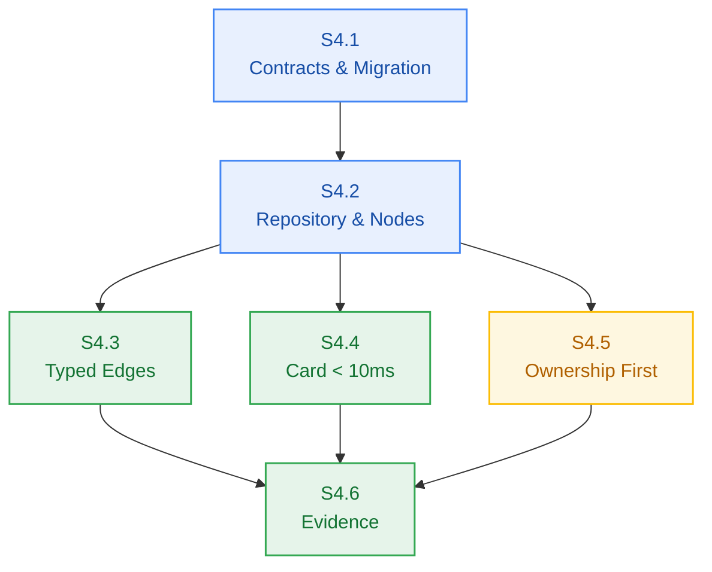

# Agent Stage Handoff Document — Stage 4 Sprint Breakdown to Clean-Session Implementation

> **Handoff ID:** `handoff-012-sprint-to-developer-m4`  
> **From:** `sprint-agent` (Tactical Story Decomposer & Sprint Governor)  
> **To:** `developer-agent` (Downstream Clean-Session Builder)  
> **Timestamp:** 2026-10-26T15:20:00Z  
> **Workflow ID:** `wf-contextual-001` · **Delivery Mode:** Balanced · **Target Maturity:** MVP  
> **Milestone:** M4 — Notebook Workspace & Domain Graph (`v0.4.0`)

---

## 1. Handoff Field Block

```text
From -> To: sprint-agent → developer-agent
Objective: Implement Milestone M4 in clean developer sessions strictly bound to frozen Change Matrices for Stories S4.1, S4.2, S4.3, S4.4, S4.5, and S4.6.
Status: READY_FOR_HANDOFF
Risk tier: MEDIUM (S4.5 carries HIGH)
Accepted criteria: Sprint board authored at m4-notebook-workspace/sprint-status.yaml decomposing EPIC-004 into 6 atomic single-session stories; each story carries a frozen Change Matrix (new_files, allowed_files, forbidden_files), build_vs_buy_ref, tests, observability, a verification hook, and a risk tier; dependency graph verified as a DAG; story cards created in m4-notebook-workspace/stories/; AC-4.1..AC-4.4 each bound to a story-level test.
Artifacts:
  - _documentation/planning/milestones/m4-notebook-workspace/sprint-status.yaml (final)
  - _documentation/planning/milestones/m4-notebook-workspace/stories/story-s4.1-graph-contracts-and-migration.md (final)
  - _documentation/planning/milestones/m4-notebook-workspace/stories/story-s4.2-tenant-repository-and-node-crud.md (final)
  - _documentation/planning/milestones/m4-notebook-workspace/stories/story-s4.3-typed-edge-write-path.md (final)
  - _documentation/planning/milestones/m4-notebook-workspace/stories/story-s4.4-document-card-resolution.md (final)
  - _documentation/planning/milestones/m4-notebook-workspace/stories/story-s4.5-scoped-retrieval-ownership-first.md (final)
  - _documentation/planning/milestones/m4-notebook-workspace/stories/story-s4.6-verification-evidence-and-sync.md (final)
  - _documentation/planning/architecture/05-m4-notebook-workspace-and-domain-graph.md (final)
  - _documentation/planning/contracts/api-contract.openapi.yaml (UPDATED — 5 new graph paths, 8 new schemas, Forbidden response, shared parameters)
Dependencies and risks:
  - S4.5 (HIGH) meets the metering boundary: the ownership predicate must structurally gate the debit call; any test showing credits_balance change on an unowned scope halts the story and returns it to architect-agent (FM-403, AP=H).
  - AC-4.1 depends on a live local Postgres from infra/compose.yaml being healthy before the latency measurement is meaningful.
  - No apps/ HTTP layer exists in this repository; AC-4.2/4.3/4.4 are asserted at the service layer through the typed result contract, which maps to the documented status codes.
Assumptions made:
  - Dependency DAG: S4.1 -> S4.2 -> {S4.3, S4.4, S4.5} -> S4.6.
  - S4.3/S4.4/S4.5 may proceed in any order once S4.2 is merged.
  - Migration 002 is expand-only; no contract-phase change is planned for v0.4.0.
Open issues: None blocking.
Verification:
  - Story Atomicity: 6 stories checked for single-session scope and bounded file counts -> PASS (max 8 new files)
  - Two-Floor Boundary: no root-level file appears in any allowed_files; packages never import next/server -> PASS
  - Change Matrix Conflicts: no two stories claim the same new_file; forbidden lists do not intersect their own allowed lists -> PASS
  - Dependency DAG: S4.1 -> S4.2 -> {S4.3,S4.4,S4.5} -> S4.6, zero cycles -> PASS (validated by script)
  - Board YAML parses; 6 stories, 6 story cards present -> PASS
  - OpenAPI contract parses as YAML: 17 paths, 23 schemas, 9 responses, 3 parameters -> PASS
  - Contract lint against a project OpenAPI validator -> NOT_VERIFIED (no OpenAPI lint script exists in package.json)
Resume condition: pm-agent approves the M4 sprint plan (pm-approval.md), then developer-agent starts with Story S4.1 inside its Change Matrix.
Documentation impact:
  - _documentation/planning/milestones/m4-notebook-workspace/sprint-status.yaml — CREATED
  - _documentation/planning/milestones/m4-notebook-workspace/stories/* (6 files) — CREATED
  - _documentation/planning/architecture/05-m4-notebook-workspace-and-domain-graph.md — CREATED
  - _documentation/planning/architecture.md — UPDATED (§5 responsibility #10, §6 Primary Scenario 3, §11 two risk rows)
  - _documentation/planning/contracts/api-contract.openapi.yaml — UPDATED (M4 graph paths/schemas/responses/parameters)
  - _documentation/planning/contracts/component-catalog.yaml — UPDATED (comp-workspace + 3 dependency rules)
  - _documentation/planning/registers/failure-mode-register.md — UPDATED (FM-401..FM-404)
  - _documentation/planning/milestones/m4-notebook-workspace/milestone.md — UPDATED (grounding corrected, implementation plan added)
  - _documentation/planning/epics/epic-004-notebook-workspace-graph.md — UPDATED (AC-3 aligned to M4-PM-001)
  - _documentation/logs/handoff-documents/planning-dispatch-log.md — UPDATED (DSP-016..DSP-020)
  - _documentation/index.md — UPDATED (4 new M4 rows)
  - _documentation/system/workflow-context.yaml — UPDATED (active_milestone M4, gate PASS_WITH_PRECONDITION, handoff-012, decisions M4-PM-001..M4-SPR-001)
  - _documentation/planning/prd.md — UPDATED (dated delta DRIFT-AUDIT-002)
  - _documentation/planning/milestones/milestone-status.yaml — UPDATED (M4 in-progress, G5 PASS_WITH_PRECONDITION, precondition P-1)
  - _documentation/logs/party-mode/party-mode-log.md — UPDATED (Session 2, 8 sealed decisions)
```

---

## 2. Story Summary Matrix

| Story | Title | Scope / Packages | New Files | Tier | Verification Command |
|---|---|---|---|:---:|---|
| **S4.1** | Graph contracts & expand migration | `@repo/contracts`, `@repo/db` | 3 | LOW | `bun test tests/workspace/migration.test.ts` |
| **S4.2** | Tenant repository & node CRUD | new `@repo/workspace`, `@repo/db` | 8 | MEDIUM | `bun test tests/workspace/node-*.test.ts` |
| **S4.3** | Typed edge write path | `@repo/workspace` | 3 | MEDIUM | `bun test tests/workspace/edge-*.test.ts` |
| **S4.4** | Document card < 10ms | `@repo/workspace`, `@repo/db` | 3 | MEDIUM | `bun test tests/workspace/card-*.test.ts` |
| **S4.5** | Ownership before debit | `@repo/workspace` | 3 | **HIGH** | `bun test tests/workspace/scoped-search-*.test.ts` |
| **S4.6** | Evidence & contract sync | `tests/`, `_documentation/` | 2 | LOW | `bun test && bun run build && bun run typecheck` |



---

*Sealed by sprint-agent for Milestone M4 implementation readiness. This is a DBW documentation/planning record; execution proceeds from these artifacts, not from the chat turn.*
