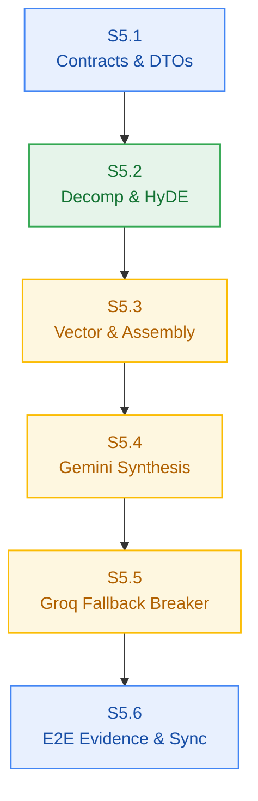

# Agent Stage Handoff Document — Stage 4 Sprint Breakdown to Clean-Session Implementation

> **Handoff ID:** `handoff-014-sprint-to-developer-m5`  
> **From:** `sprint-agent` (Tactical Story Decomposer & Sprint Governor)  
> **To:** `developer-agent` (Downstream Clean-Session Builder)  
> **Timestamp:** 2026-10-27T08:25:00Z  
> **Workflow ID:** `wf-contextual-001` · **Delivery Mode:** Balanced · **Target Maturity:** MVP  
> **Milestone:** M5 — 6-Phase Grounded Reasoning Engine & Dual-Provider Inference (`v0.5.0`)

---

## 1. Handoff Field Block

```text
From -> To: sprint-agent → developer-agent
Objective: Implement Milestone M5 in clean developer sessions strictly bound to frozen Change Matrices for Stories S5.1, S5.2, S5.3, S5.4, S5.5, and S5.6.
Status: ACCEPTED
Risk tier: HIGH (S5.3, S5.4, S5.5 carry HIGH)
Accepted criteria: Sprint board authored at m5-reasoning-engine/sprint-status.yaml decomposing EPIC-005 into 6 atomic single-session stories; each story carries a frozen Change Matrix (new_files, allowed_files, forbidden_files), build_vs_buy_ref, tests, observability, a verification hook, and a risk tier; dependency graph verified as a DAG; story cards created in m5-reasoning-engine/stories/; AC-5.1..AC-5.5 each bound to a story-level test; PM approval granted unconditionally in pm-approval.md.
Artifacts:
  - _documentation/planning/milestones/m5-reasoning-engine/sprint-status.yaml (final)
  - _documentation/planning/milestones/m5-reasoning-engine/stories/story-s5.1-reasoning-contracts.md (final)
  - _documentation/planning/milestones/m5-reasoning-engine/stories/story-s5.2-query-decomposition-and-hyde.md (final)
  - _documentation/planning/milestones/m5-reasoning-engine/stories/story-s5.3-multi-vector-retrieval-and-assembly.md (final)
  - _documentation/planning/milestones/m5-reasoning-engine/stories/story-s5.4-grounded-synthesis-stream-gemini.md (final)
  - _documentation/planning/milestones/m5-reasoning-engine/stories/story-s5.5-groq-fallback-circuit-breaker.md (final)
  - _documentation/planning/milestones/m5-reasoning-engine/stories/story-s5.6-e2e-verification-and-latency-benchmark.md (final)
  - _documentation/planning/architecture/05-m5-grounded-reasoning-engine.md (final)
  - _documentation/planning/milestones/m5-reasoning-engine/pm-approval.md (approved)
  - _documentation/planning/contracts/api-contract.openapi.yaml (UPDATED — /chat with x-fallback-provider header)
  - _documentation/planning/contracts/component-catalog.yaml (UPDATED — comp-reasoning milestone M5, interfaces, dependencies)
Dependencies and risks:
  - External dual-provider availability (Google Gemini Flash and Groq Llama-3.3-70B); mocked provider test harnesses must be used in CI to avoid rate-limiting during testing (M5-SPR-002).
  - Parallel vector queries across sub-questions must enforce strict p95 < 100ms latency SLA (NFR-001) and strictly <=3 chunks per question (BR-008).
  - Grounded prompt envelope must strictly prevent hallucination outside context (BR-009) and emit numeric citation anchors [1], [2] with document preview metadata.
  - S5.4 and S5.5 meet the metering boundary: synthesis debits 0.5 credits atomically via Lua; insufficient balance must short-circuit with HTTP 402 with zero downstream provider calls.
Assumptions made:
  - Sequential DAG: S5.1 -> S5.2 -> S5.3 -> S5.4 -> S5.5 -> S5.6.
  - No SQL migration required for M5; reasoning operations operate on existing tables and Upstash Vector.
  - Failover from Gemini to Groq is transparent to client, indicated via x-fallback-provider: groq header.
Open issues: None blocking. Baseline is 100% green (101/101 pass, 8/8 build/typecheck clean).
Verification:
  - Story Atomicity: 6 stories checked for single-session scope and bounded file counts -> PASS (max 7 new files in S5.2)
  - Two-Floor Boundary: no root-level file appears in any allowed_files -> PASS
  - Change Matrix Conflicts: no two stories claim the same new_file; forbidden lists do not intersect allowed lists -> PASS
  - Dependency DAG: S5.1 -> S5.2 -> S5.3 -> S5.4 -> S5.5 -> S5.6, zero cycles -> PASS
  - Board YAML parses; 6 stories, 6 story cards present -> PASS
  - Contracts compile: bun test packages/contracts/tests/errors.test.ts -> PASS (5/5 pass, catalogue intact)
  - Workspace health: bun test (101/101 pass), bun run build (8/8 pass), bun run typecheck (8/8 pass) -> PASS
Resume condition: developer-agent starts with Story S5.1 inside its Change Matrix.
Documentation impact:
  - _documentation/planning/milestones/m5-reasoning-engine/sprint-status.yaml — CREATED
  - _documentation/planning/milestones/m5-reasoning-engine/stories/* (6 files) — CREATED
  - _documentation/planning/milestones/m5-reasoning-engine/pm-approval.md — CREATED
  - _documentation/planning/architecture/05-m5-grounded-reasoning-engine.md — CREATED
  - _documentation/planning/contracts/api-contract.openapi.yaml — UPDATED (/chat x-fallback-provider)
  - _documentation/planning/contracts/component-catalog.yaml — UPDATED (comp-reasoning M5)
  - _documentation/planning/registers/failure-mode-register.md — UPDATED (FM-501..FM-505)
  - _documentation/planning/milestones/m5-reasoning-engine/milestone.md — UPDATED (plan approved, gate G5 PASS)
  - _documentation/planning/milestones/milestone-status.yaml — UPDATED (M5 in-progress/ready, gate G5 PASS)
  - _documentation/logs/handoff-documents/planning-dispatch-log.md — UPDATED (DSP-021..DSP-025)
  - _documentation/logs/party-mode/party-mode-log.md — UPDATED (Session 3, 8 sealed decisions)
  - _documentation/index.md — UPDATED (M5 rows)
```

---

## 2. Story Summary Matrix

| Story | Title | Scope / Packages | New Files | Tier | Verification Command |
|---|---|---|---|:---:|---|
| **S5.1** | Shared reasoning contracts & streaming DTOs | `@repo/contracts` | 2 | LOW | `bun test tests/reasoning/contracts.test.ts` |
| **S5.2** | Query decomposition (P1) & HyDE generator (P2) | new `@repo/reasoning` | 7 | MEDIUM | `bun test tests/reasoning/decomposition.test.ts` |
| **S5.3** | Multi-vector retrieval & context assembly (P3..5) | `@repo/reasoning` | 4 | **HIGH** | `bun test tests/reasoning/vector-retrieval.test.ts` |
| **S5.4** | Grounded synthesis streaming via Gemini (P6) | `@repo/reasoning` | 4 | **HIGH** | `bun test tests/reasoning/synthesis-stream.test.ts` |
| **S5.5** | Groq Llama-3.3 fallback circuit-breaker | `@repo/reasoning` | 3 | **HIGH** | `bun test tests/reasoning/circuit-breaker.test.ts` |
| **S5.6** | E2E integration, latency benchmark & sync | `tests/`, `_documentation/` | 3 | LOW | `bun test tests/reasoning/e2e-*.test.ts` |



---

*Sealed by sprint-agent for Milestone M5 implementation readiness. This is a DBW documentation/planning record; execution proceeds from these artifacts, not from the chat turn.*
