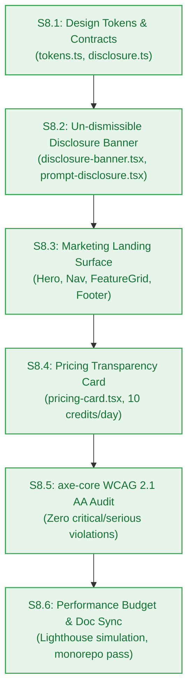

# Agent Stage Handoff Document — Stage 4 Sprint Breakdown to Clean-Session Implementation

> **Handoff ID:** `handoff-019-sprint-to-developer-m8`  
> **From:** `sprint-agent` (Tactical Story Decomposer & Sprint Governor)  
> **To:** `developer-agent` (Downstream Clean-Session Builder)  
> **Timestamp:** 2026-10-27T11:45:00Z  
> **Workflow ID:** `wf-contextual-001` · **Delivery Mode:** Balanced · **Target Maturity:** MVP  
> **Milestone:** M8 — Public Marketing Landing & Dynamic Privacy Governance (`v0.8.0`)

---

## 1. Handoff Field Block

```text
From -> To: sprint-agent → developer-agent
Objective: Implement Milestone M8 in clean developer sessions strictly bound to frozen Change Matrices for Stories S8.1, S8.2, S8.3, S8.4, S8.5, and S8.6.
Status: ACCEPTED
Risk tier: MEDIUM
Accepted criteria: Sprint board authored at m8-landing-disclosure/sprint-status.yaml decomposing EPIC-008 into 6 atomic single-session stories; each story carries a frozen Change Matrix (new_files, allowed_files, forbidden_files), build_vs_buy_ref, tests, observability, a verification hook, and a risk tier; dependency graph verified as a DAG (S8.1 -> S8.2 -> S8.3 -> S8.4 -> S8.5 -> S8.6); story cards created in m8-landing-disclosure/stories/; AC-8.1..AC-8.4 each bound to a story-level test; PM approval granted unconditionally in pm-approval.md.
Artifacts:
  - _documentation/planning/milestones/m8-landing-disclosure/sprint-status.yaml (final)
  - _documentation/planning/milestones/m8-landing-disclosure/stories/story-s8.1-shared-ui-tokens-and-disclosure-contracts.md (final)
  - _documentation/planning/milestones/m8-landing-disclosure/stories/story-s8.2-undismissible-training-disclosure-banner.md (final)
  - _documentation/planning/milestones/m8-landing-disclosure/stories/story-s8.3-marketing-landing-hero-and-value-props.md (final)
  - _documentation/planning/milestones/m8-landing-disclosure/stories/story-s8.4-pricing-transparency-and-quota-display.md (final)
  - _documentation/planning/milestones/m8-landing-disclosure/stories/story-s8.5-accessibility-and-wcag-aa-axe-core-audit.md (final)
  - _documentation/planning/milestones/m8-landing-disclosure/stories/story-s8.6-e2e-lighthouse-audit-and-doc-synchronization.md (final)
  - _documentation/planning/architecture/05-m8-public-marketing-landing-and-privacy-governance.md (final)
  - _documentation/planning/milestones/m8-landing-disclosure/pm-approval.md (approved)
  - _documentation/planning/contracts/component-catalog.yaml (UPDATED — comp-ui definition and M8 governance rules)
  - _documentation/planning/registers/failure-mode-register.md (UPDATED — FM-801..FM-804)
  - _documentation/planning/milestones/milestone-status.yaml (UPDATED — M8 status ready-for-dev)
  - _documentation/index.md (UPDATED — M8 documents and handoffs mapped)
Dependencies and risks:
  - Public Page Isolation: Public landing components must accept pure props with zero access to Clerk cookies, auth tokens, or user database state (BR-024).
  - Un-dismissible Invariant: AI provider training disclosure banner must be permanently rendered with zero close buttons, dismiss hooks, or localStorage suppressions (BR-030, FR-030).
  - Accessibility SLA: All public marketing components and disclosure banners must achieve zero critical/serious violations in automated axe-core scans (NFR-019).
  - Performance SLA: Critical CSS and JS bundle must remain lightweight (< 50KB) to guarantee Lighthouse Performance score >= 90 and LCP < 2.0s on simulated 4G profile (NFR-018).
  - Closed Catalogue Integrity: Closed 17-member RFC 9457 error catalogue must remain strictly intact with zero modifications.
Assumptions made:
  - Sequential DAG: S8.1 -> S8.2 -> S8.3 -> S8.4 -> S8.5 -> S8.6.
  - Public components are encapsulated cleanly within @repo/ui using pure Vanilla CSS stylesheets and typed design tokens.
  - Zero TailwindCSS dependencies required.
Open issues: None blocking. Monorepo baseline is 100% green (259/259 pass across 47 files; 11/11 build/typecheck clean).
Verification:
  - Story Atomicity: 6 stories checked for single-session scope and bounded file counts -> PASS
  - Two-Floor Boundary: no root-level file appears in any allowed_files -> PASS
  - Change Matrix Conflicts: no two stories claim the same new_file; forbidden lists do not intersect allowed lists -> PASS
  - Dependency DAG: S8.1 -> S8.2 -> S8.3 -> S8.4 -> S8.5 -> S8.6, zero cycles -> PASS
  - Board YAML parses; 6 stories, 6 story cards present -> PASS
  - Contracts compile: bun test packages/contracts/tests/errors.test.ts -> PASS (5/5 pass, catalogue intact at 17 members)
  - Workspace health: bun test (259/259 pass), bun run build (11/11 pass), bun run typecheck (11/11 pass) -> PASS
Resume condition: developer-agent starts with Story S8.1 inside its Change Matrix.
Documentation impact:
  - _documentation/planning/milestones/m8-landing-disclosure/sprint-status.yaml — CREATED
  - _documentation/planning/milestones/m8-landing-disclosure/stories/* (6 files) — CREATED
  - _documentation/planning/milestones/m8-landing-disclosure/pm-approval.md — CREATED
  - _documentation/planning/architecture/05-m8-public-marketing-landing-and-privacy-governance.md — CREATED
  - _documentation/planning/contracts/component-catalog.yaml — UPDATED (comp-ui, M8 rules)
  - _documentation/planning/registers/failure-mode-register.md — UPDATED (FM-801..FM-804)
  - _documentation/planning/milestones/milestone-status.yaml — UPDATED (M8 ready-for-dev)
  - _documentation/index.md — UPDATED
  - _documentation/logs/party-mode/party-mode-log.md — UPDATED (Session 6 recorded)
  - _documentation/logs/handoff-documents/planning-dispatch-log.md — UPDATED (DSP-037..DSP-041 recorded)
```

---

## 2. Work Unit Mapping & Execution Sequence



| Story ID | Title | Work Unit | Target Files | Verification Hook |
|---|---|---|---|---|
| **S8.1** | Shared UI design tokens, component types, and provider disclosure contracts | `WU-M8-1` | `packages/contracts/src/disclosure.ts`<br/>`packages/ui/src/tokens.ts`<br/>`tests/ui/contracts-tokens.test.ts` | `bun test tests/ui/contracts-tokens.test.ts && bun test packages/contracts/tests/errors.test.ts && bun run typecheck` |
| **S8.2** | Dynamic un-dismissible AI provider training disclosure banner and prompt wrapper | `WU-M8-2` | `packages/ui/src/components/disclosure-banner.tsx`<br/>`packages/ui/src/components/prompt-disclosure.tsx`<br/>`packages/ui/src/styles/disclosure.css`<br/>`tests/ui/disclosure-banner.test.ts` | `bun test tests/ui/disclosure-banner.test.ts && turbo run build --filter=@repo/ui && turbo run typecheck --filter=@repo/ui` |
| **S8.3** | Public marketing landing hero, navigation, feature grid, and public footer | `WU-M8-3` | `packages/ui/src/components/landing-hero.tsx`<br/>`packages/ui/src/components/navigation-header.tsx`<br/>`packages/ui/src/components/feature-grid.tsx`<br/>`packages/ui/src/components/public-footer.tsx`<br/>`packages/ui/src/styles/landing.css`<br/>`tests/ui/landing-components.test.ts` | `bun test tests/ui/landing-components.test.ts && turbo run build --filter=@repo/ui && turbo run typecheck --filter=@repo/ui` |
| **S8.4** | Zero-cost pricing transparency and daily quota breakdown card | `WU-M8-4` | `packages/ui/src/components/pricing-card.tsx`<br/>`tests/ui/pricing-transparency.test.ts` | `bun test tests/ui/pricing-transparency.test.ts && turbo run build --filter=@repo/ui && turbo run typecheck --filter=@repo/ui` |
| **S8.5** | Automated WCAG 2.1 AA accessibility audit suite using axe-core | `WU-M8-5` | `tests/ui/accessibility.test.ts` | `bun test tests/ui/accessibility.test.ts` |
| **S8.6** | Performance budget simulation suite, component catalog update, and documentation synchronization | `WU-M8-6` | `tests/ui/performance-budget.test.ts`<br/>documentation files | `bun test tests/ui/performance-budget.test.ts && bun test && bun run build && bun run typecheck` |

---

## 3. Preconditions & Implementation Directives

1. **Clean Developer Sessions:** `developer-agent` implements one story per clean session, strictly respecting the Change Matrix.
2. **Two-Floor Boundary Invariant:** No story may open, edit, or modify root-level configuration files (`turbo.json`, root `package.json`, `.gitignore`).
3. **Evidence-Based Closure:** Every story closes only upon unified automated test pass certified with concrete command outputs.
4. **Anti-Tampering Invariant (`BR-030`):** The AI provider training disclosure banner must remain un-dismissible across all test assertions.
