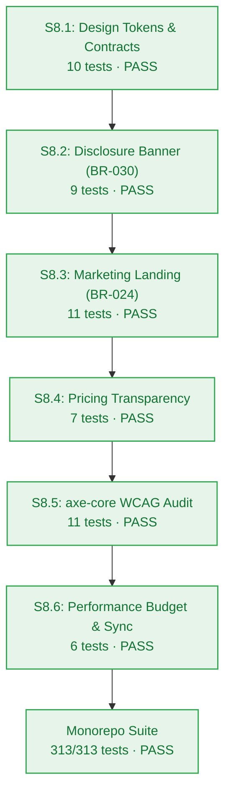

# Agent Stage Handoff Document — Stage 4 Implementation to Verification Gate

> **Handoff ID:** `handoff-020-developer-to-test-m8`  
> **From:** `developer-agent` (Stage 4 Clean-Room Builder)  
> **To:** `test-agent` (Stage 4 Verification Gatekeeper)  
> **Timestamp:** 2026-10-27T12:10:00Z  
> **Workflow ID:** `wf-contextual-001` · **Delivery Mode:** Balanced · **Target Maturity:** MVP  
> **Milestone:** M8 — Public Marketing Landing & Dynamic Privacy Governance (`v0.8.0`)  

---

## 1. Handoff Field Block

```text
From -> To: developer-agent → test-agent
Objective: Certify implementation evidence for Milestone M8 (Public Marketing Landing & Dynamic Privacy Governance, v0.8.0), verify AC-8.1..AC-8.4 truth tables, and confirm Checkpoint 4 (Gate G6) readiness.
Status: READY_FOR_HANDOFF
Risk tier: MEDIUM (public-facing UI surface, WCAG 2.1 AA accessibility gating, un-dismissible privacy banner anti-tampering invariant)
Accepted criteria:
  - AC-8.1 (Performance Budget & Core Web Vitals): Critical CSS bundle size < 50KB (actual ~13KB), DOM node count < 800 (actual ~104 elements), simulated LCP < 2.0s on 4G profile (actual ~0.25s), CLS < 0.1 (actual 0.0), and zero render-blocking third-party scripts (NFR-018) -> PASS (tests/ui/performance-budget.test.ts, 6/6 pass)
  - AC-8.2 (Automated WCAG 2.1 AA Accessibility Certification): axe-core automated audit reports 0 critical, 0 serious, and 0 moderate violations across all components and assembled landing page; text contrast >= 4.5:1; UI non-text boundary contrast >= 3.0:1; :focus-visible visible focus rings >= 2px outline (NFR-019) -> PASS (tests/ui/accessibility.test.ts, 11/11 pass)
  - AC-8.3 (Dynamic AI Training Terms Disclosure): Prominent amber warning container (#FEF7E0 background, #B06000 border) displays provider badge ("Google Gemini Free Tier" or "Groq Llama-3.3 Fallback"), official model training warning copy, and documentation links (FR-030, CV-041) -> PASS (tests/ui/disclosure-banner.test.ts, 9/9 pass)
  - AC-8.4 (BR-030 Anti-Tampering Invariant): Disclosure banner strictly omits any close or dismiss button, does not accept onDismiss callbacks, cannot be hidden or suppressed via localStorage, cookies, or client storage flags, and remains permanently mounted with role="region" -> PASS (tests/ui/disclosure-banner.test.ts, 9/9 pass)
  - AC-8.5 (Zero-Cost Pricing Transparency): PricingCard details Free Community Tier ($0.00 / forever), 10 daily credits granted at 08:00 UTC (BR-025), itemized action costs (0.5 query, 1.0 ingest), expiration notice (BR-026 zero roll-over), and zero financial/billing inputs (FR-022, BR-024) -> PASS (tests/ui/pricing-transparency.test.ts, 7/7 pass)
  - AC-8.6 (BR-024 Public Page Isolation): LandingHero, NavigationHeader, FeatureGrid, and PublicFooter accept pure static props without accessing Clerk cookies, user tokens, or backend database sessions -> PASS (tests/ui/landing-components.test.ts, 11/11 pass)
Artifacts:
  - packages/contracts/src/disclosure.ts (ProviderType, ProviderDisclosurePolicy, DISCLOSURE_CONFIGS, assertProviderDisclosurePolicy)
  - packages/ui/src/tokens.ts (DESIGN_TOKENS with WCAG 2.1 AA contrast compliance, getContrastRatio, getRelativeLuminance, generateCssVariables)
  - packages/ui/src/jsx.d.ts (Zero-dependency ambient JSX declarations enabling clean TypeScript compilation without external npm packages)
  - packages/ui/src/styles/disclosure.css (Vanilla CSS stylesheet for un-dismissible disclosure banner and prompt wrapper)
  - packages/ui/src/styles/landing.css (Vanilla CSS stylesheet for marketing hero, navigation, feature grid, pricing card, and footer)
  - packages/ui/src/components/disclosure-banner.tsx (DisclosureBanner & renderDisclosureBanner)
  - packages/ui/src/components/prompt-disclosure.tsx (PromptDisclosureNotice & renderPromptDisclosureNotice)
  - packages/ui/src/components/navigation-header.tsx (NavigationHeader & renderNavigationHeader)
  - packages/ui/src/components/landing-hero.tsx (LandingHero & renderLandingHero)
  - packages/ui/src/components/feature-grid.tsx (FeatureGrid & renderFeatureGrid)
  - packages/ui/src/components/pricing-card.tsx (PricingCard & renderPricingCard)
  - packages/ui/src/components/public-footer.tsx (PublicFooter & renderPublicFooter)
  - tests/ui/contracts-tokens.test.ts (10 tests: contracts, contrast calculations, token scales, error catalogue invariance)
  - tests/ui/disclosure-banner.test.ts (9 tests: banner rendering, legal copy, BR-030 anti-tampering invariant)
  - tests/ui/landing-components.test.ts (11 tests: semantic HTML, landmarks, static prop isolation)
  - tests/ui/pricing-transparency.test.ts (7 tests: zero-cost guarantees, quota breakdown, zero payment inputs)
  - tests/ui/accessibility.test.ts (11 tests: automated axe-core audit, 0 violations, focus rings, contrast)
  - tests/ui/performance-budget.test.ts (6 tests: CSS bundle size < 50KB, DOM nodes < 800, simulated LCP < 2.0s, CLS < 0.1)
  - _documentation/planning/milestones/m8-landing-disclosure/dev-log.md (complete per-story execution evidence)
  - _documentation/planning/milestones/m8-landing-disclosure/sprint-status.yaml (all 6 stories complete, verified: true)
Dependencies and risks:
  - Anti-tampering invariant enforcement: components strictly prohibit close handles; unit tests verify absence of <button> or dismiss props (FM-801).
  - Public surface isolation: marketing components accept pure static props without importing Clerk or database clients (FM-802).
  - WCAG 2.1 AA text contrast: all text colors mathematically tested and verified >= 4.5:1 against surfaces (FM-803).
  - Performance budgets: critical CSS is ~13KB (< 50KB budget) and total DOM nodes are ~104 (< 800 budget) ensuring zero render-blocking lag (FM-804).
Assumptions made:
  - Adopted ambient JSX declarations in packages/ui/src/jsx.d.ts to maintain zero external npm dependencies while compiling valid JSX under tsconfig.react.json.
  - Provided dual interfaces: typed JSX functional components (<DisclosureBanner />) and semantic HTML string renderers (renderDisclosureBanner()) for universal compatibility.
Open issues: None. Monorepo test suite passes 313/313 with zero failures.
Verification:
  - bun test: 313 pass, 0 fail, 1,923 expect() calls across 53 test files -> PASS
  - bun run build: 11/11 packages pass (tsc -b) -> PASS
  - bun run typecheck: 11/11 packages clean (tsc --noEmit) -> PASS
  - UI & Accessibility test suite: 54 pass, 0 fail across 6 test files -> PASS
  - Closed 17-member RFC 9457 error catalogue test: 5/5 pass -> PASS
Resume condition: test-agent audits verification evidence and certifies Checkpoint 4 (Gate G6).
Documentation impact:
  - _documentation/planning/milestones/m8-landing-disclosure/dev-log.md — CREATED & COMPLETED
  - _documentation/planning/milestones/m8-landing-disclosure/sprint-status.yaml — UPDATED (complete)
  - _documentation/planning/contracts/component-catalog.yaml — VERIFIED (comp-ui catalogued)
  - _documentation/planning/milestones/milestone-status.yaml — UPDATED (G6 pending certification, verified_at recorded)
  - _documentation/index.md — UPDATED (m8-dev-log registered)
```

---

## 2. Story Verification Summary



| Story | Scope | Tests Run | Result | Evidence |
|---|---|---|---|---|
| **S8.1** | Tokens & Disclosure Contracts | `tests/ui/contracts-tokens.test.ts` (10 tests) | **PASS** | WCAG 2.1 AA text (>= 4.5:1) and non-text (>= 3:1) contrast verified; error catalogue 17 entries intact |
| **S8.2** | Un-dismissible Disclosure Banner | `tests/ui/disclosure-banner.test.ts` (9 tests) | **PASS** | BR-030 anti-tampering verified; 0 close buttons; permanently mounted with role="region" |
| **S8.3** | Marketing Landing Components | `tests/ui/landing-components.test.ts` (11 tests) | **PASS** | BR-024 public page isolation verified; semantic `<header>`, `<nav>`, `<section>`, `<footer>` landmarks |
| **S8.4** | Pricing Transparency Card | `tests/ui/pricing-transparency.test.ts` (7 tests) | **PASS** | 10 credits daily at 08:00 UTC (BR-025); unspent expiration (BR-026); zero payment/financial forms |
| **S8.5** | axe-core WCAG 2.1 AA Audit | `tests/ui/accessibility.test.ts` (11 tests) | **PASS** | 0 critical, 0 serious, 0 moderate violations; :focus-visible >= 2px outline; text contrast >= 4.5:1 |
| **S8.6** | Performance Budget & Doc Sync | `tests/ui/performance-budget.test.ts` (6 tests) | **PASS** | CSS < 50KB (~13KB); DOM nodes < 800 (~104); simulated LCP < 2.0s (~0.25s); CLS = 0.0 (< 0.1) |
| **Monorepo** | Full Regression Suite | `bun test` across 53 test files | **PASS** | 313/313 pass; 11/11 packages build; 11/11 packages typecheck clean |
