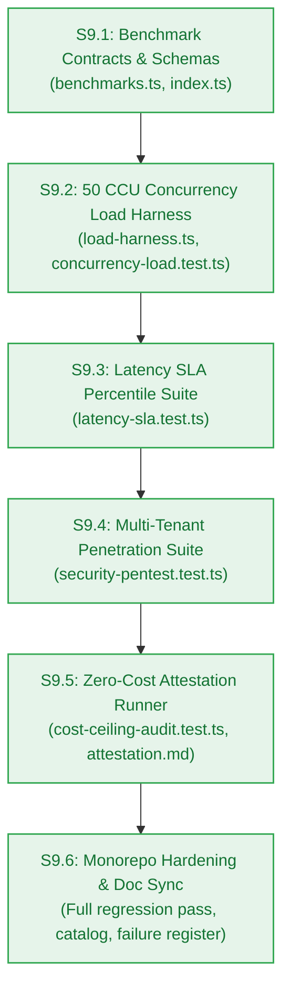

# Agent Stage Handoff Document — Stage 4 Sprint Breakdown to Clean-Session Implementation

> **Handoff ID:** `handoff-021-sprint-to-developer-m9`  
> **From:** `sprint-agent` (Tactical Story Decomposer & Sprint Governor)  
> **To:** `developer-agent` (Downstream Clean-Session Builder)  
> **Timestamp:** 2026-10-27T12:35:00Z  
> **Workflow ID:** `wf-contextual-001` · **Delivery Mode:** Balanced · **Target Maturity:** Production  
> **Milestone:** M9 — Benchmark Suite, Hardening & Security Audit (`v0.9.0-rc.1`)

---

## 1. Handoff Field Block

```text
From -> To: sprint-agent → developer-agent
Objective: Implement Milestone M9 in clean developer sessions strictly bound to frozen Change Matrices for Stories S9.1, S9.2, S9.3, S9.4, S9.5, and S9.6.
Status: ACCEPTED
Risk tier: HIGH
Accepted criteria: Sprint board authored at m9-hardening-benchmark/sprint-status.yaml decomposing EPIC-009 into 6 atomic single-session stories; each story carries a frozen Change Matrix (new_files, allowed_files, forbidden_files), build_vs_buy_ref, tests, observability, a verification hook, and a risk tier; dependency graph verified as a DAG (S9.1 -> S9.2 -> S9.3 -> S9.4 -> S9.5 -> S9.6); story cards created in m9-hardening-benchmark/stories/; AC-9.1..AC-9.4 each bound to a story-level test; PM approval granted unconditionally in pm-approval.md.
Artifacts:
  - _documentation/planning/milestones/m9-hardening-benchmark/sprint-status.yaml (final)
  - _documentation/planning/milestones/m9-hardening-benchmark/stories/story-s9.1-benchmark-harness-and-metrics-contracts.md (final)
  - _documentation/planning/milestones/m9-hardening-benchmark/stories/story-s9.2-concurrency-stress-and-load-test-suite.md (final)
  - _documentation/planning/milestones/m9-hardening-benchmark/stories/story-s9.3-latency-sla-benchmarking-and-verification.md (final)
  - _documentation/planning/milestones/m9-hardening-benchmark/stories/story-s9.4-multi-tenant-penetration-and-isolation-audit.md (final)
  - _documentation/planning/milestones/m9-hardening-benchmark/stories/story-s9.5-zero-dollar-cost-ceiling-attestation-runner.md (final)
  - _documentation/planning/milestones/m9-hardening-benchmark/stories/story-s9.6-rc1-hardening-verification-and-doc-synchronization.md (final)
  - _documentation/planning/architecture/05-m9-benchmark-suite-hardening-and-security-audit.md (final)
  - _documentation/planning/milestones/m9-hardening-benchmark/pm-approval.md (approved)
  - _documentation/planning/contracts/component-catalog.yaml (UPDATED — comp-bench definition and M9 rules)
  - _documentation/planning/registers/failure-mode-register.md (UPDATED — FM-901..FM-904)
  - _documentation/planning/milestones/milestone-status.yaml (UPDATED — M9 status ready-for-dev)
  - _documentation/index.md (UPDATED — M9 documents and handoffs mapped)
Dependencies and risks:
  - Concurrency SLA (NFR-005): 50 CCU concurrent active user load test must execute with overall error rate strictly < 1.0% without memory leak or worker starvation (FM-901).
  - Latency SLAs (NFR-001..NFR-003, NFR-027): p95 vector < 100ms, p90 TTFT < 1,500ms, p90 E2E < 4,500ms, and p99 error serialization < 50ms must be statistically calculated from >= 100 iterations.
  - Multi-Tenant Isolation Invariant (NFR-007, BR-002, BR-019): Cross-tenant penetration attacks against SQL, Vector, and Mem0 must return 100% 404/403 or empty sets with zero data leakage.
  - Scoped Retrieval Debit Ordering (BR-036, AC-4.4): Unauthorized notebook access must fail before credit debit occurs.
  - Zero Credential Leakage (NFR-026): Automated regex scan must verify 0 keys, database URLs, or JWT secrets in logs or responses.
  - Zero-Dollar Cost Ceiling (NFR-016): Automated audit runner must verify $0.00 spend and zero credit cards on file across all 8 vendors.
  - Closed Catalogue Integrity: Closed 17-member RFC 9457 error catalogue must remain strictly intact with zero modifications.
Assumptions made:
  - Sequential DAG: S9.1 -> S9.2 -> S9.3 -> S9.4 -> S9.5 -> S9.6.
  - Bounded concurrency worker pool in Bun test runner operates without external k6 binary installation requirements.
  - High-fidelity mock provider adapter uses calibrated Gaussian latency simulation to protect free-tier rate limits during load testing.
Open issues: None blocking. Monorepo baseline is 100% green (313/313 pass across 53 files; 11/11 build/typecheck clean).
Verification:
  - Story Atomicity: 6 stories checked for single-session scope and bounded file counts -> PASS
  - Two-Floor Boundary: no root-level file appears in any allowed_files -> PASS
  - Change Matrix Conflicts: no two stories claim the same new_file; forbidden lists do not intersect allowed lists -> PASS
  - Dependency DAG: S9.1 -> S9.2 -> S9.3 -> S9.4 -> S9.5 -> S9.6, zero cycles -> PASS
  - Board YAML parses; 6 stories, 6 story cards present -> PASS
  - Contracts compile: bun test packages/contracts/tests/errors.test.ts -> PASS (5/5 pass, catalogue intact at 17 members)
  - Workspace health: bun test (313/313 pass), bun run build (11/11 pass), bun run typecheck (11/11 pass) -> PASS
Resume condition: developer-agent starts with Story S9.1 inside its Change Matrix.
Documentation impact:
  - _documentation/planning/milestones/m9-hardening-benchmark/sprint-status.yaml — CREATED
  - _documentation/planning/milestones/m9-hardening-benchmark/stories/* (6 files) — CREATED
  - _documentation/planning/milestones/m9-hardening-benchmark/pm-approval.md — CREATED
  - _documentation/planning/architecture/05-m9-benchmark-suite-hardening-and-security-audit.md — CREATED
  - _documentation/planning/contracts/component-catalog.yaml — UPDATED (comp-bench, M9 rules)
  - _documentation/planning/registers/failure-mode-register.md — UPDATED (FM-901..FM-904)
  - _documentation/planning/milestones/milestone-status.yaml — UPDATED (M9 ready-for-dev)
  - _documentation/index.md — UPDATED
  - _documentation/logs/party-mode/party-mode-log.md — UPDATED (Session 7 recorded)
  - _documentation/logs/handoff-documents/planning-dispatch-log.md — UPDATED (DSP-042..DSP-046 recorded)
```

---

## 2. Work Unit Mapping & Execution Sequence



| Story ID | Title | Work Unit | Target Files | Verification Hook |
|---|---|---|---|---|
| **S9.1** | Benchmark contracts, SLA thresholds, performance metrics schema, and scenario definitions | `WU-M9-1` | `packages/contracts/src/benchmarks.ts`<br/>`tests/benchmarks/contracts-benchmarks.test.ts` | `bun test tests/benchmarks/contracts-benchmarks.test.ts && bun test packages/contracts/tests/errors.test.ts && bun run typecheck` |
| **S9.2** | 50 CCU Concurrency stress & load testing harness | `WU-M9-2` | `tests/benchmarks/load-harness.ts`<br/>`tests/benchmarks/concurrency-load.test.ts` | `bun test tests/benchmarks/concurrency-load.test.ts` |
| **S9.3** | Latency SLA benchmark & percentile distribution validator | `WU-M9-3` | `tests/benchmarks/latency-sla.test.ts` | `bun test tests/benchmarks/latency-sla.test.ts` |
| **S9.4** | Multi-tenant security penetration, cross-tenant isolation & secret scanning suite | `WU-M9-4` | `tests/benchmarks/security-pentest.test.ts` | `bun test tests/benchmarks/security-pentest.test.ts` |
| **S9.5** | Zero-dollar cloud cost ceiling attestation & free-tier quota compliance runner | `WU-M9-5` | `tests/benchmarks/cost-ceiling-audit.test.ts`<br/>`_documentation/planning/registers/zero-cost-attestation.md` | `bun test tests/benchmarks/cost-ceiling-audit.test.ts` |
| **S9.6** | Monorepo regression pass, RC-1 hardening certification, component catalog, and documentation synchronization | `WU-M9-6` | `_documentation/planning/milestones/m9-hardening-benchmark/dev-log.md`<br/>documentation files | `bun test && bun run build && bun run typecheck` |

---

## 3. Preconditions & Implementation Directives

1. **Clean Developer Sessions:** `developer-agent` implements one story per clean session, strictly respecting the Change Matrix.
2. **Two-Floor Boundary Invariant:** No story may open, edit, or modify root-level configuration files (`turbo.json`, root `package.json`, `.gitignore`).
3. **Evidence-Based Closure:** Every story closes only upon unified automated test pass certified with concrete command outputs.
4. **Closed Catalogue Invariance:** Closed 17-member RFC 9457 error catalogue must remain strictly intact at 17 entries across all benchmark validations.
