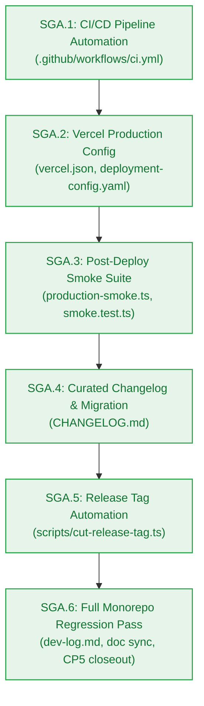

# Agent Stage Handoff Document — Stage 4 Sprint Breakdown to Clean-Session Implementation

> **Handoff ID:** `handoff-023-sprint-to-developer-ga`  
> **From:** `sprint-agent` (Tactical Story Decomposer & Sprint Governor)  
> **To:** `developer-agent` (Downstream Clean-Session Builder)  
> **Timestamp:** 2026-10-27T13:20:00Z  
> **Workflow ID:** `wf-contextual-001` · **Delivery Mode:** Balanced · **Target Maturity:** Production  
> **Milestone:** GA — General Availability Production Release (`v1.0.0`)

---

## 1. Handoff Field Block

```text
From -> To: sprint-agent → developer-agent
Objective: Implement Milestone GA in clean developer sessions strictly bound to frozen Change Matrices for Stories SGA.1, SGA.2, SGA.3, SGA.4, SGA.5, and SGA.6.
Status: ACCEPTED
Risk tier: HIGH
Accepted criteria: Sprint board authored at ga-production-release/sprint-status.yaml decomposing EPIC-010 into 6 atomic single-session stories; each story carries a frozen Change Matrix (new_files, allowed_files, forbidden_files), build_vs_buy_ref, tests, observability, a verification hook, and a risk tier; dependency graph verified as a DAG (SGA.1 -> SGA.2 -> SGA.3 -> SGA.4 -> SGA.5 -> SGA.6); story cards created in ga-production-release/stories/; AC-GA.1..AC-GA.4 each bound to a story-level test; PM approval granted unconditionally in pm-approval.md.
Artifacts:
  - _documentation/planning/milestones/ga-production-release/sprint-status.yaml (final)
  - _documentation/planning/milestones/ga-production-release/stories/story-sga.1-github-actions-ci-cd-pipeline.md (final)
  - _documentation/planning/milestones/ga-production-release/stories/story-sga.2-vercel-production-deployment-config.md (final)
  - _documentation/planning/milestones/ga-production-release/stories/story-sga.3-post-deployment-smoke-verification-suite.md (final)
  - _documentation/planning/milestones/ga-production-release/stories/story-sga.4-production-changelog-and-migration-guide.md (final)
  - _documentation/planning/milestones/ga-production-release/stories/story-sga.5-annotated-git-release-tag-automation.md (final)
  - _documentation/planning/milestones/ga-production-release/stories/story-sga.6-ga-monorepo-regression-and-doc-synchronization.md (final)
  - _documentation/planning/epics/epic-010-ga-production-release.md (final)
  - _documentation/planning/architecture/05-ga-general-availability-production-release.md (final)
  - _documentation/planning/milestones/ga-production-release/milestone.md (approved)
  - _documentation/planning/milestones/ga-production-release/pm-approval.md (approved)
  - _documentation/planning/contracts/deployment-config.yaml (UPDATED — production release governance)
  - _documentation/planning/contracts/component-catalog.yaml (UPDATED — comp-ci, comp-deploy, comp-smoke)
  - _documentation/planning/registers/failure-mode-register.md (UPDATED — FM-1001..FM-1004)
  - _documentation/planning/milestones/milestone-status.yaml (UPDATED — GA status ready-for-dev)
  - _documentation/planning/milestones/overview.md (UPDATED — GA status Ready for Dev)
  - _documentation/index.md (UPDATED — GA documents and handoffs mapped)
Dependencies and risks:
  - CI Quality Gates (AC-GA.1): GitHub Actions workflow must enforce zero-warning linting, zero-error typechecking, test pass, closed RFC 9457 error catalogue verification, and clean build on all PRs.
  - Zero-Dollar Serverless Ceiling (NFR-016): Vercel Hobby configuration must operate strictly on free tier without paid add-ons or billable integrations.
  - Live Smoke Verification (AC-GA.2): Post-deployment smoke runner must support dual execution modes (live cloud or local calibrated simulation) and exercise the full 4-phase transaction chain.
  - Transient Storage Invariant (BR-046): Staged test PDF in Filebase S3 must be deleted in a guaranteed finally block immediately upon vector upsert.
  - Release Tag Governance (AC-GA.3): scripts/cut-release-tag.ts must assert all 5 mandatory pre-flight invariants before cutting annotated tag v1.0.0.
  - Closed Error Catalogue Invariant: The closed 17-member RFC 9457 catalogue must remain strictly unmodified.
Assumptions made:
  - Sequential DAG: SGA.1 -> SGA.2 -> SGA.3 -> SGA.4 -> SGA.5 -> SGA.6.
  - Official oven-sh/setup-bun@v2 provides fast, reproducible CI execution with frozen lockfile.
  - Lightweight TypeScript smoke runner operates using native fetch with zero heavy browser binary overhead.
Open issues: None blocking. Monorepo baseline is 100% green (339/339 pass across 58 test files; 11/11 build/typecheck clean).
Verification:
  - Story Atomicity: 6 stories checked for single-session scope and bounded file counts -> PASS
  - Two-Floor Boundary: no root-level build/config file appears in any allowed_files -> PASS
  - Change Matrix Conflicts: no two stories claim the same new_file; forbidden lists do not intersect allowed lists -> PASS
  - Dependency DAG: SGA.1 -> SGA.2 -> SGA.3 -> SGA.4 -> SGA.5 -> SGA.6, zero cycles -> PASS
  - Board YAML parses; 6 stories, 6 story cards present -> PASS
  - Contracts compile: bun test packages/contracts/tests/errors.test.ts -> PASS (5/5 pass, catalogue intact at 17 members)
  - Workspace health: bun test (339/339 pass), bun run build (11/11 pass), bun run typecheck (11/11 pass) -> PASS
Resume condition: developer-agent starts with Story SGA.1 inside its Change Matrix.
Documentation impact:
  - _documentation/planning/milestones/ga-production-release/sprint-status.yaml — CREATED
  - _documentation/planning/milestones/ga-production-release/stories/* (6 files) — CREATED
  - _documentation/planning/milestones/ga-production-release/pm-approval.md — CREATED
  - _documentation/planning/epics/epic-010-ga-production-release.md — CREATED
  - _documentation/planning/architecture/05-ga-general-availability-production-release.md — CREATED
  - _documentation/planning/milestones/ga-production-release/milestone.md — UPDATED (approved)
  - _documentation/planning/contracts/deployment-config.yaml — UPDATED (production governance)
  - _documentation/planning/contracts/component-catalog.yaml — UPDATED (comp-ci, comp-deploy, comp-smoke)
  - _documentation/planning/registers/failure-mode-register.md — UPDATED (FM-1001..FM-1004)
  - _documentation/planning/milestones/milestone-status.yaml — UPDATED (GA ready-for-dev)
  - _documentation/planning/milestones/overview.md — UPDATED (GA ready-for-dev)
  - _documentation/index.md — UPDATED (GA documents, handoff-023, M9 closed)
  - _documentation/logs/party-mode/party-mode-log.md — UPDATED (Session 8 recorded)
  - _documentation/logs/handoff-documents/planning-dispatch-log.md — UPDATED (DSP-047..DSP-051 recorded)
```

---

## 2. Work Unit Mapping & Execution Sequence



| Story ID | Title | Work Unit | Target Files | Verification Hook |
|---|---|---|---|---|
| **SGA.1** | GitHub Actions CI/CD Pipeline workflow and automated pre-merge verification suite | `WU-GA-1` | `.github/workflows/ci.yml`<br/>`tests/ci/ci-workflow.test.ts` | `bun test tests/ci/ci-workflow.test.ts && bun test packages/contracts/tests/errors.test.ts && bun run typecheck` |
| **SGA.2** | Vercel production serverless deployment configuration and deployment contract alignment | `WU-GA-2` | `vercel.json`<br/>`tests/deployment/vercel-config.test.ts` | `bun test tests/deployment/vercel-config.test.ts && bun test packages/contracts/tests/errors.test.ts && bun run typecheck` |
| **SGA.3** | Automated post-deployment production smoke verification suite and runner script | `WU-GA-3` | `scripts/production-smoke.ts`<br/>`tests/e2e/production-smoke.test.ts` | `bun test tests/e2e/production-smoke.test.ts && bun test packages/contracts/tests/errors.test.ts && bun run typecheck` |
| **SGA.4** | Curated production release changelog and migration guide documenting M0 through GA evolution | `WU-GA-4` | `CHANGELOG.md`<br/>`tests/documentation/changelog-integrity.test.ts` | `bun test tests/documentation/changelog-integrity.test.ts && bun test packages/contracts/tests/errors.test.ts && bun run typecheck` |
| **SGA.5** | Annotated Git release tagging automation script and Checkpoint 5 governance assertions | `WU-GA-5` | `scripts/cut-release-tag.ts`<br/>`tests/deployment/release-tag.test.ts` | `bun test tests/deployment/release-tag.test.ts && bun test packages/contracts/tests/errors.test.ts && bun run typecheck` |
| **SGA.6** | Milestone GA full monorepo regression pass, Checkpoint 5 closeout verification, and doc synchronization | `WU-GA-6` | `_documentation/planning/milestones/ga-production-release/dev-log.md`<br/>documentation files | `bun test && bun run build && bun run typecheck` |

---

## 3. Preconditions & Implementation Directives

1. **Clean Developer Sessions:** `developer-agent` implements one story per clean session, strictly respecting the Change Matrix.
2. **Two-Floor Boundary Invariant:** No story may open, edit, or modify root-level build/config files (`turbo.json`, root `package.json`, `bunfig.toml`).
3. **Closed Error Catalogue Invariant:** The closed 17-member RFC 9457 error catalogue in `@repo/contracts` must remain intact at 17 entries (`packages/contracts/tests/errors.test.ts` passes 5/5).
4. **Zero-Dollar Ceiling Invariant:** All deployment and infrastructure configs must adhere to the $0.00/month free tier ceiling (`NFR-016`).
5. **Transient Storage Invariant:** Test PDFs in Filebase S3 must be deleted in a guaranteed `finally` block (`BR-046`).
