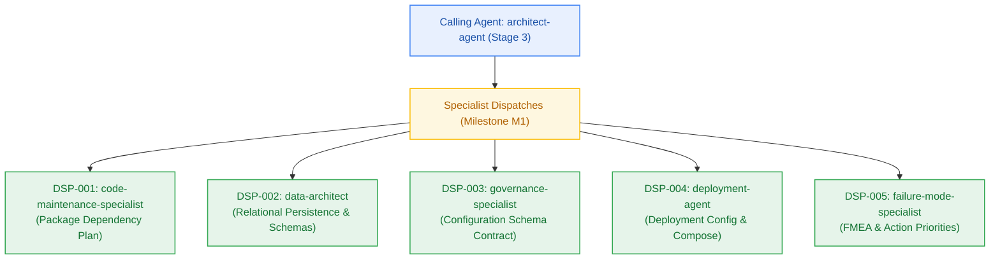

# Planning Inter-Agent Dispatch & Consultation Log

> **Canonical Planning Phase Audit Log (`_documentation/logs/handoff-documents/planning-dispatch-log.md`)**  
> *Authoritative audit trail recording inter-agent specialist dispatches, rationale, inputs consumed, and deliverables produced during project planning (Stages 1–3 / Phases 2–4). Captures why specialists were engaged and how they supported project reliability, maintainability, scalability, and deployment readiness.*

---

## 1. Dispatch Summary Register

| ID | Timestamp | Caller | Target Specialist | Domain / Goal | Output Artifact | Status |
|---|---|---|---|---|---|---|
| **DSP-001** | 2026-10-23T11:35:00Z | `architect-agent` | `code-maintenance-specialist` | Repository structure, two-floor boundaries, package matrix | `_documentation/planning/registers/package-dependency-plan.md` | ACCEPTED |
| **DSP-002** | 2026-10-23T11:38:00Z | `architect-agent` | `data-architect` | Kysely relational schema, foreign keys, tenant indexes, migrations | `_documentation/planning/architecture/05-m1-developer-golden-path-and-auth.md` §3.7 | ACCEPTED |
| **DSP-003** | 2026-10-23T11:40:00Z | `architect-agent` | `governance-specialist` | Typed configuration schema, secret classification | `_documentation/planning/contracts/config-schema.yaml` | ACCEPTED |
| **DSP-004** | 2026-10-23T11:42:00Z | `architect-agent` | `deployment-agent` | Multi-environment deployment, container specs, .env.example | `_documentation/planning/contracts/deployment-config.yaml` | ACCEPTED |
| **DSP-005** | 2026-10-23T11:45:00Z | `architect-agent` | `failure-mode-specialist` | M1 FMEA analysis, JWKS rotation failure, Action Priority scoring | `_documentation/planning/registers/failure-mode-register.md` | ACCEPTED |

---

## 2. Dispatch Detail Ledger

### DSP-001: Repository Structure & Package Dependency Graph
- **Timestamp:** 2026-10-23T11:35:00Z
- **Calling Agent:** `architect-agent` (Stage 3 Owner)
- **Target Specialist:** `code-maintenance-specialist`
- **Architectural Dimension:** Maintainability & Structure
- **Why Invoked (Rationale):**
  > Establish strict package boundaries for internal monorepo dependencies (`@repo/auth`, `@repo/db`, `@repo/config`, `@repo/contracts`, `@repo/ui`) ensuring two-floor separation and zero lateral imports.
- **Inputs Provided:**
  - `_documentation/planning/prd.md`
  - `_documentation/planning/milestones/m1-developer-golden-path/milestone.md`
- **How Supported (Deliverables & Recommendations):**
  - Delivered artifact: `_documentation/planning/registers/package-dependency-plan.md`
  - Recommendations: Mandated single entry points (`index.ts`), strict type imports, and prohibition of binary ORMs.
- **Status:** ACCEPTED

---

### DSP-002: Relational Persistence Foundation & Multi-Tenant Isolation
- **Timestamp:** 2026-10-23T11:38:00Z
- **Calling Agent:** `architect-agent`
- **Target Specialist:** `data-architect`
- **Architectural Dimension:** Persistence & Consistency
- **Why Invoked (Rationale):**
  > Plan relational schemas for `users`, `conversation_threads`, `conversation_messages`, and `notebooks` in Neon PostgreSQL using Kysely, with foreign keys and tenant isolation indexes on `user_id`.
- **Inputs Provided:**
  - `_documentation/planning/prd.md` (§5)
  - `_documentation/planning/architecture.md` (§4)
- **How Supported (Deliverables & Recommendations):**
  - Delivered design: `05-m1-developer-golden-path-and-auth.md` §3.7
  - Recommendations: Use atomic transactions for migrations, enforce `ON DELETE CASCADE`, zero raw SQL exceptions registered.
- **Status:** ACCEPTED

---

### DSP-003: Typed Configuration Schema Contract
- **Timestamp:** 2026-10-23T11:40:00Z
- **Calling Agent:** `architect-agent`
- **Target Specialist:** `governance-specialist`
- **Architectural Dimension:** Governance & Secret Security
- **Why Invoked (Rationale):**
  > Establish typed configuration contract distinguishing runtime constants, deploy variables, and secrets across local, test, and production environments.
- **Inputs Provided:**
  - `_documentation/planning/conventions.md`
  - `_documentation/planning/milestones/m1-developer-golden-path/milestone.md`
- **How Supported (Deliverables & Recommendations):**
  - Delivered artifact: `_documentation/planning/contracts/config-schema.yaml`
  - Recommendations: Mandatory Zod validation at application boot; zero secrets allowed in production without external vault/env binding.
- **Status:** ACCEPTED

---

### DSP-004: Multi-Environment Deployment & Local Container Orchestration
- **Timestamp:** 2026-10-23T11:42:00Z
- **Calling Agent:** `architect-agent`
- **Target Specialist:** `deployment-agent`
- **Architectural Dimension:** Deployment & Infrastructure Balance
- **Why Invoked (Rationale):**
  > Author the deployment configuration contract for local Docker Compose (`infra/compose.yaml`), pre-flight hygiene, and `.env.example`.
- **Inputs Provided:**
  - `_documentation/planning/architecture/04-tech-stack.md`
  - `_documentation/planning/milestones/m1-developer-golden-path/milestone.md`
- **How Supported (Deliverables & Recommendations):**
  - Delivered artifact: `_documentation/planning/contracts/deployment-config.yaml`
  - Recommendations: Minimal Alpine images (`postgres:16-alpine`, `redis:7-alpine`), liveness/readiness probes at `/api/health`.
- **Status:** ACCEPTED

---

### DSP-005: Failure Mode & Effects Analysis (FMEA)
- **Timestamp:** 2026-10-23T11:45:00Z
- **Calling Agent:** `architect-agent`
- **Target Specialist:** `failure-mode-specialist`
- **Architectural Dimension:** Reliability & Fault Tolerance
- **Why Invoked (Rationale):**
  > Enumerate failure modes for Clerk JWKS offline validation, Docker daemon reachability, port conflicts, and database connection timeouts during `dev:doctor`.
- **Inputs Provided:**
  - `_documentation/planning/architecture/05-m1-developer-golden-path-and-auth.md`
- **How Supported (Deliverables & Recommendations):**
  - Delivered artifact: `_documentation/planning/registers/failure-mode-register.md`
  - Recommendations: Identified single point of failure in cold JWKS fetch; recommended disk/build fallback cache.
- **Status:** ACCEPTED
