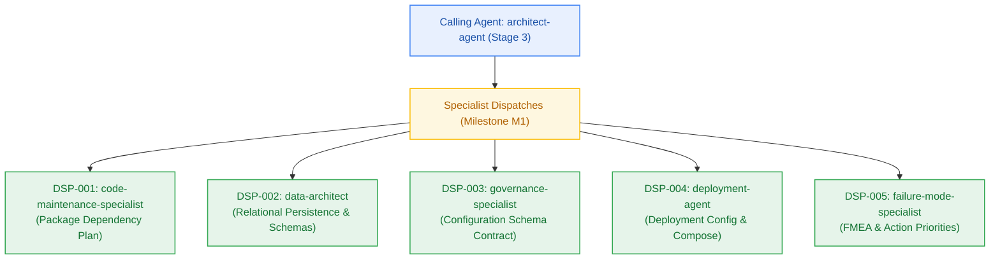

# Planning Inter-Agent Dispatch & Consultation Log

> **Canonical Planning Phase Audit Log (`_documentation/logs/handoff-documents/planning-dispatch-log.md`)**  
> *Authoritative audit trail recording inter-agent specialist dispatches, rationale, inputs consumed, and deliverables produced during project planning (Stages 1–3 / Phases 2–4). Captures why specialists were engaged and how they supported project reliability, maintainability, scalability, and deployment readiness.*

---

## 1. Dispatch Summary Register

| ID | Timestamp | Caller | Target Specialist | Domain / Goal | Output Artifact | Status |
|---|---|---|---|---|---|---|
| **DSP-001** | 2026-10-23T11:35:00Z | `architect-agent` | `code-maintenance-specialist` | Repository structure, two-floor boundaries, package matrix | `_documentation/planning/registers/package-dependency-plan.md` | ACCEPTED |
| **DSP-002** | 2026-10-23T11:38:00Z | `architect-agent` | `data-architect` | Kysely relational schema, foreign keys, tenant indexes, migrations | `_documentation/planning/architecture/05-m1-developer-golden-path-and-auth.md` §3.7 | ACCEPTED |
| **DSP-003** | 2026-10-23T11:40:00Z | `architect-agent` | `governance-specialist` | Typed configuration schema, secret classification | `_documentation/planning/contracts/config-schema.yaml` | ACCEPTED |
| **DSP-004** | 2026-10-23T11:42:00Z | `architect-agent` | `deployment-agent` | Multi-environment deployment, container specs, .env.example | `_documentation/planning/contracts/deployment-config.yaml` | ACCEPTED |
| **DSP-005** | 2026-10-23T11:45:00Z | `architect-agent` | `failure-mode-specialist` | M1 FMEA analysis, JWKS rotation failure, Action Priority scoring | `_documentation/planning/registers/failure-mode-register.md` | ACCEPTED |
| **DSP-006** | 2026-10-23T18:10:00Z | `architect-agent` | `code-maintenance-specialist` | `@repo/metering` package boundaries and dependency matrix | `_documentation/planning/registers/package-dependency-plan.md` | ACCEPTED |
| **DSP-007** | 2026-10-23T18:12:00Z | `architect-agent` | `data-architect` | Redis key namespaces, TTL policies, atomic Lua script CAP design | `_documentation/planning/architecture/05-m2-metering-spine-and-quota-throttling.md` §3.3–3.4 | ACCEPTED |
| **DSP-008** | 2026-10-23T18:14:00Z | `architect-agent` | `governance-specialist` | RFC 9457 closed error catalogue and secret sanitization rules | `_documentation/planning/contracts/component-catalog.yaml` | ACCEPTED |
| **DSP-009** | 2026-10-23T18:16:00Z | `architect-agent` | `deployment-agent` | Upstash Redis connection pooling, keep-alive, local Redis 7 parity | `_documentation/planning/contracts/deployment-config.yaml` | ACCEPTED |
| **DSP-010** | 2026-10-23T18:18:00Z | `architect-agent` | `failure-mode-specialist` | M2 FMEA sweep on rate limiting, EVALSHA NOSCRIPT, 08:00 UTC race | `_documentation/planning/registers/failure-mode-register.md` | ACCEPTED |
| **DSP-011** | 2026-10-23T19:00:00Z | `architect-agent` | `code-maintenance-specialist` | `@repo/ingestion` package boundaries, parsers, and dependency matrix | `_documentation/planning/registers/package-dependency-plan.md` | ACCEPTED |
| **DSP-012** | 2026-10-23T19:02:00Z | `architect-agent` | `data-architect` | Upstash Vector payload schema, cosine metric, zero-byte S3 transient purge | `_documentation/planning/architecture/05-m3-transient-ingestion-pipeline.md` §3.3, §3.6 | ACCEPTED |
| **DSP-013** | 2026-10-23T19:04:00Z | `architect-agent` | `governance-specialist` | Filebase S3, QStash, and Upstash Vector typed configuration contracts | `_documentation/planning/contracts/config-schema.yaml` | ACCEPTED |
| **DSP-014** | 2026-10-23T19:06:00Z | `architect-agent` | `security-architect` | S3 pre-sign scoping (5MB cap) and QStash Upstash-Signature verification | `_documentation/planning/architecture/05-m3-transient-ingestion-pipeline.md` §3.3, §3.4 | ACCEPTED |
| **DSP-015** | 2026-10-23T19:08:00Z | `architect-agent` | `failure-mode-specialist` | M3 FMEA sweep, S3 purge failure, ONNX fallback, Lua credit compensation | `_documentation/planning/registers/failure-mode-register.md` (FM-301..FM-308) | ACCEPTED |
| **DSP-016** | 2026-10-26T14:30:00Z | `pm-agent` | `architect-agent` | M4 design blueprint, graph persistence, OpenAPI node/edge/scoped-search contract | `_documentation/planning/architecture/05-m4-notebook-workspace-and-domain-graph.md` | ACCEPTED |
| **DSP-017** | 2026-10-26T14:35:00Z | `architect-agent` | `data-architect` | `notebook_nodes` / `notebook_edges` schema, composite `(user_id, notebook_id)` indexes, expand migration | `_documentation/planning/architecture/05-m4-notebook-workspace-and-domain-graph.md` §3.7 | ACCEPTED |
| **DSP-018** | 2026-10-26T14:40:00Z | `architect-agent` | `security-architect` | Cross-tenant isolation, ownership pre-check ordering before debit, edge-type validation surface | `_documentation/planning/architecture/05-m4-notebook-workspace-and-domain-graph.md` §5.2 | ACCEPTED |
| **DSP-019** | 2026-10-26T14:45:00Z | `architect-agent` | `failure-mode-specialist` | M4 FMEA: orphaned edges, card resolution latency breach, debit-before-ownership race | `_documentation/planning/registers/failure-mode-register.md` (FM-401..FM-404) | ACCEPTED |
| **DSP-020** | 2026-10-26T15:05:00Z | `pm-agent` | `sprint-agent` | M4 board authoring: atomic stories with frozen Change Matrices and developer handoff | `_documentation/planning/milestones/m4-notebook-workspace/sprint-status.yaml` | ACCEPTED |
| **DSP-021** | 2026-10-27T08:00:00Z | `pm-agent` | `architect-agent` | M5 6-phase grounded reasoning engine design blueprint | `_documentation/planning/architecture/05-m5-grounded-reasoning-engine.md` | ACCEPTED |
| **DSP-022** | 2026-10-27T08:10:00Z | `architect-agent` | `data-architect` | Upstash Vector parallel top-3 scoped retrieval with tenant filters | `_documentation/planning/architecture/05-m5-grounded-reasoning-engine.md` §3.4 | ACCEPTED |
| **DSP-023** | 2026-10-27T08:15:00Z | `architect-agent` | `failure-mode-specialist` | M5 dual-provider circuit breaker FMEA and citation grounding | `_documentation/planning/registers/failure-mode-register.md` (FM-501..FM-505) | ACCEPTED |
| **DSP-024** | 2026-10-27T08:20:00Z | `architect-agent` | `security-architect` | Zero-hallucination citation grounding & tenant isolation review | `_documentation/planning/architecture/05-m5-grounded-reasoning-engine.md` §5 | ACCEPTED |
| **DSP-025** | 2026-10-27T08:25:00Z | `pm-agent` | `sprint-agent` | M5 sprint board authoring with frozen Change Matrices | `_documentation/planning/milestones/m5-reasoning-engine/sprint-status.yaml` | ACCEPTED |
| **DSP-026** | 2026-10-27T08:52:00Z | `developer-agent` | `test-agent` | Milestone M5 implementation verification and test gate certification | `_documentation/logs/handoff-documents/handoff-015-developer-to-test-m5.md` | ACCEPTED |
| **DSP-027** | 2026-10-27T09:05:00Z | `pm-agent` | `architect-agent` | M6 pluggable long-term memory store architecture blueprint | `_documentation/planning/architecture/05-m6-pluggable-long-term-memory-store.md` | ACCEPTED |
| **DSP-028** | 2026-10-27T09:10:00Z | `architect-agent` | `data-architect` | In-process Mem0 Upstash Redis and Upstash Vector storage layout | `_documentation/planning/architecture/05-m6-pluggable-long-term-memory-store.md` §3 | ACCEPTED |
| **DSP-029** | 2026-10-27T09:15:00Z | `architect-agent` | `security-architect` | Multi-tenant memory isolation & cascade purge security review | `_documentation/planning/architecture/05-m6-pluggable-long-term-memory-store.md` §5 | ACCEPTED |
| **DSP-030** | 2026-10-27T09:20:00Z | `pm-agent` | `sprint-agent` | M6 sprint board authoring with frozen Change Matrices | `_documentation/planning/milestones/m6-pluggable-memory/sprint-status.yaml` | ACCEPTED |
| **DSP-031** | 2026-10-27T10:35:00Z | `pm-agent` | `architect-agent` | M7 autonomous maintenance crons & observability architecture blueprint | `_documentation/planning/architecture/05-m7-autonomous-maintenance-and-observability.md` | ACCEPTED |
| **DSP-032** | 2026-10-27T10:38:00Z | `architect-agent` | `security-architect` | QStash webhook cryptographic signature verification & secret redactor | `_documentation/planning/architecture/05-m7-autonomous-maintenance-and-observability.md` §3, §5 | ACCEPTED |
| **DSP-033** | 2026-10-27T10:40:00Z | `architect-agent` | `data-architect` | 7-day retention sweeper queries, Upstash Vector purge, 30-day tombstones | `_documentation/planning/architecture/05-m7-autonomous-maintenance-and-observability.md` §4 | ACCEPTED |
| **DSP-034** | 2026-10-27T10:42:00Z | `architect-agent` | `failure-mode-specialist` | M7 FMEA sweep: signature spoofing, partial purge, log-flooding, OTLP timeouts | `_documentation/planning/architecture/05-m7-autonomous-maintenance-and-observability.md` §8 (FM-701..FM-705) | ACCEPTED |
| **DSP-035** | 2026-10-27T10:45:00Z | `pm-agent` | `sprint-agent` | M7 sprint board authoring with frozen Change Matrices (S7.1..S7.6) | `_documentation/planning/milestones/m7-maintenance-observability/sprint-status.yaml` | ACCEPTED |

---

## 2. Dispatch Detail Ledger

### DSP-001: Repository Structure & Package Dependency Graph
- **Timestamp:** 2026-10-23T11:35:00Z
- **Calling Agent:** `architect-agent` (Stage 3 Owner)
- **Target Specialist:** `code-maintenance-specialist`
- **Architectural Dimension:** Maintainability & Structure
- **Why Invoked (Rationale):**
  > Establish strict package boundaries for internal monorepo dependencies (`@repo/auth`, `@repo/db`, `@repo/config`, `@repo/contracts`, `@repo/ui`) ensuring two-floor separation and zero lateral imports.
- **Inputs Provided:**
  - `_documentation/planning/prd.md`
  - `_documentation/planning/milestones/m1-developer-golden-path/milestone.md`
- **How Supported (Deliverables & Recommendations):**
  - Delivered artifact: `_documentation/planning/registers/package-dependency-plan.md`
  - Recommendations: Mandated single entry points (`index.ts`), strict type imports, and prohibition of binary ORMs.
- **Status:** ACCEPTED

---

### DSP-002: Relational Persistence Foundation & Multi-Tenant Isolation
- **Timestamp:** 2026-10-23T11:38:00Z
- **Calling Agent:** `architect-agent`
- **Target Specialist:** `data-architect`
- **Architectural Dimension:** Persistence & Consistency
- **Why Invoked (Rationale):**
  > Plan relational schemas for `users`, `conversation_threads`, `conversation_messages`, and `notebooks` in Neon PostgreSQL using Kysely, with foreign keys and tenant isolation indexes on `user_id`.
- **Inputs Provided:**
  - `_documentation/planning/prd.md` (§5)
  - `_documentation/planning/architecture.md` (§4)
- **How Supported (Deliverables & Recommendations):**
  - Delivered design: `05-m1-developer-golden-path-and-auth.md` §3.7
  - Recommendations: Use atomic transactions for migrations, enforce `ON DELETE CASCADE`, zero raw SQL exceptions registered.
- **Status:** ACCEPTED

---

### DSP-003: Typed Configuration Schema Contract
- **Timestamp:** 2026-10-23T11:40:00Z
- **Calling Agent:** `architect-agent`
- **Target Specialist:** `governance-specialist`
- **Architectural Dimension:** Governance & Secret Security
- **Why Invoked (Rationale):**
  > Establish typed configuration contract distinguishing runtime constants, deploy variables, and secrets across local, test, and production environments.
- **Inputs Provided:**
  - `_documentation/planning/conventions.md`
  - `_documentation/planning/milestones/m1-developer-golden-path/milestone.md`
- **How Supported (Deliverables & Recommendations):**
  - Delivered artifact: `_documentation/planning/contracts/config-schema.yaml`
  - Recommendations: Mandatory Zod validation at application boot; zero secrets allowed in production without external vault/env binding.
- **Status:** ACCEPTED

---

### DSP-004: Multi-Environment Deployment & Local Container Orchestration
- **Timestamp:** 2026-10-23T11:42:00Z
- **Calling Agent:** `architect-agent`
- **Target Specialist:** `deployment-agent`
- **Architectural Dimension:** Deployment & Infrastructure Balance
- **Why Invoked (Rationale):**
  > Author the deployment configuration contract for local Docker Compose (`infra/compose.yaml`), pre-flight hygiene, and `.env.example`.
- **Inputs Provided:**
  - `_documentation/planning/architecture/04-tech-stack.md`
  - `_documentation/planning/milestones/m1-developer-golden-path/milestone.md`
- **How Supported (Deliverables & Recommendations):**
  - Delivered artifact: `_documentation/planning/contracts/deployment-config.yaml`
  - Recommendations: Minimal Alpine images (`postgres:16-alpine`, `redis:7-alpine`), liveness/readiness probes at `/api/health`.
- **Status:** ACCEPTED

---

### DSP-005: Failure Mode & Effects Analysis (FMEA)
- **Timestamp:** 2026-10-23T11:45:00Z
- **Calling Agent:** `architect-agent`
- **Target Specialist:** `failure-mode-specialist`
- **Architectural Dimension:** Reliability & Fault Tolerance
- **Why Invoked (Rationale):**
  > Enumerate failure modes for Clerk JWKS offline validation, Docker daemon reachability, port conflicts, and database connection timeouts during `dev:doctor`.
- **Inputs Provided:**
  - `_documentation/planning/architecture/05-m1-developer-golden-path-and-auth.md`
- **How Supported (Deliverables & Recommendations):**
  - Delivered artifact: `_documentation/planning/registers/failure-mode-register.md`
  - Recommendations: Identified single point of failure in cold JWKS fetch; recommended disk/build fallback cache.
- **Status:** ACCEPTED

---

### DSP-006: Metering Package Topology & Dependency Direction
- **Timestamp:** 2026-10-23T18:10:00Z
- **Calling Agent:** `architect-agent` (Stage 3 Owner)
- **Target Specialist:** `code-maintenance-specialist`
- **Architectural Dimension:** Maintainability & Structure
- **Why Invoked (Rationale):**
  > Establish package boundaries for `@repo/metering` within the monorepo first floor, ensuring zero dependencies on Next.js server packages and strict separation of Redis Lua scripts.
- **Inputs Provided:**
  - `_documentation/planning/milestones/m2-metering-spine/milestone.md`
  - `_documentation/planning/registers/package-dependency-plan.md`
- **How Supported (Deliverables & Recommendations):**
  - Updated artifact: `_documentation/planning/registers/package-dependency-plan.md`
  - Recommendations: Keep Lua scripts in `packages/metering/src/lua/`, export typed contracts via `@repo/contracts`, maintain `@upstash/redis` single-package dependency.
- **Status:** ACCEPTED

---

### DSP-007: Redis Persistence, Key Namespaces & Lua Script CAP Analysis
- **Timestamp:** 2026-10-23T18:12:00Z
- **Calling Agent:** `architect-agent`
- **Target Specialist:** `data-architect`
- **Architectural Dimension:** Persistence, State & Consistency
- **Why Invoked (Rationale):**
  > Design Redis key namespaces (`credits:{userId}`, `rl:{userId}`, `reset:{date}:{userId}`), TTL rolling expiration policies, and atomic Lua script execution model (`debit-credits.lua`, `sliding-window.lua`, `daily-reset.lua`).
- **Inputs Provided:**
  - `_documentation/planning/milestones/m2-metering-spine/milestone.md`
  - `_documentation/planning/architecture/04-tech-stack.md`
- **How Supported (Deliverables & Recommendations):**
  - Delivered section: `05-m2-metering-spine-and-quota-throttling.md` §3.3–3.4
  - Recommendations: Single EVALSHA roundtrip per metered request; use Redis server `TIME` command to eliminate host clock skew; 48h rolling TTL on balances. Zero raw SQL exceptions registered.
- **Status:** ACCEPTED

---

### DSP-008: Closed RFC 9457 Problem Details Governance
- **Timestamp:** 2026-10-23T18:14:00Z
- **Calling Agent:** `architect-agent`
- **Target Specialist:** `governance-specialist`
- **Architectural Dimension:** Governance & Standards
- **Why Invoked (Rationale):**
  > Validate closed 17-member RFC 9457 error catalogue, secret redaction filters, and machine-readable quota extensions against IETF and platform specifications.
- **Inputs Provided:**
  - `_documentation/planning/conventions.md` §4
  - `packages/contracts/src/rfc9457.ts`
- **How Supported (Deliverables & Recommendations):**
  - Updated artifacts: `component-catalog.yaml`, `api-contract.openapi.yaml`
  - Recommendations: Explicit `service`, `quota_period`, `resets_in_seconds` extensions for 402 errors; strict redaction of internal stack traces, API keys, and database connection strings before serialization.
- **Status:** ACCEPTED

---

### DSP-009: Upstash Redis Runtime Configuration & Local Parity
- **Timestamp:** 2026-10-23T18:16:00Z
- **Calling Agent:** `architect-agent`
- **Target Specialist:** `deployment-agent`
- **Architectural Dimension:** Infrastructure & Parity
- **Why Invoked (Rationale):**
  > Verify deployment configuration for Upstash Redis Serverless REST connection pooling on Vercel Hobby and parity with local Redis 7 container (`infra/compose.yaml`).
- **Inputs Provided:**
  - `_documentation/planning/contracts/deployment-config.yaml`
  - `_documentation/planning/contracts/config-schema.yaml`
- **How Supported (Deliverables & Recommendations):**
  - Updated artifact: `_documentation/planning/contracts/deployment-config.yaml`
  - Recommendations: Keep-Alive HTTP agent on Upstash REST client; enforce 2,000ms hard timeout to prevent edge lambda stalling during network partitions.
- **Status:** ACCEPTED

---

### DSP-010: Failure Mode & Effects Analysis (FMEA) for Metering Spine
- **Timestamp:** 2026-10-23T18:18:00Z
- **Calling Agent:** `architect-agent`
- **Target Specialist:** `failure-mode-specialist`
- **Architectural Dimension:** Reliability & Fault Tolerance
- **Why Invoked (Rationale):**
  > Conduct bottom-up FMEA analysis for Upstash Redis network partition, EVALSHA NOSCRIPT cache misses, sliding window sorted set memory leaks, host clock drift, and concurrent 08:00 UTC daily reset race conditions.
- **Inputs Provided:**
  - `_documentation/planning/architecture/05-m2-metering-spine-and-quota-throttling.md`
- **How Supported (Deliverables & Recommendations):**
  - Delivered artifact: `_documentation/planning/registers/failure-mode-register.md` (FM-201..FM-206)
  - Recommendations: Automatic `SCRIPT LOAD` on `NOSCRIPT`; atomic `SET NX EX 86400` idempotency lock on daily reset; strict classification of Google AI Studio 429 into `SERVICE_LIMIT_REACHED`.
- **Status:** ACCEPTED

---

### DSP-011: Repository Structure & Ingestion Package Matrix
- **Timestamp:** 2026-10-23T19:00:00Z
- **Calling Agent:** `architect-agent` (Stage 3 Owner)
- **Target Specialist:** `code-maintenance-specialist`
- **Architectural Dimension:** Maintainability & Structure
- **Why Invoked (Rationale):**
  > Plan `@repo/ingestion` package boundaries, export signatures, and external dependencies (`@aws-sdk/client-s3`, `@upstash/vector`, `@upstash/qstash`, `pdf-parse`, `youtube-transcript`, `@mozilla/readability`).
- **Inputs Provided:**
  - `_documentation/planning/architecture/05-m3-transient-ingestion-pipeline.md`
  - `_documentation/planning/milestones/m3-transient-ingestion/milestone.md`
- **How Supported (Deliverables & Recommendations):**
  - Delivered artifact: `_documentation/planning/registers/package-dependency-plan.md`
  - Recommendations: Strict two-floor separation; parsers and chunkers live in `@repo/ingestion/src/parsers`; no Next.js runtime dependencies in first-floor package.
- **Status:** ACCEPTED

---

### DSP-012: Upstash Vector Persistence Schema & S3 Transient Hygiene
- **Timestamp:** 2026-10-23T19:02:00Z
- **Calling Agent:** `architect-agent`
- **Target Specialist:** `data-architect`
- **Architectural Dimension:** Persistence Architecture & Invariants
- **Why Invoked (Rationale):**
  > Design Upstash Vector metadata payload schema, chunk indexing strategy, cosine similarity metric configuration, and verify Filebase zero-byte transient storage invariant (`BR-046`).
- **Inputs Provided:**
  - `_documentation/planning/architecture/05-m3-transient-ingestion-pipeline.md` §3.3, §3.6
  - `_documentation/planning/decisions/adr-0004-unified-upstash-serverless-architecture.md`
- **How Supported (Deliverables & Recommendations):**
  - Delivered design: `05-m3-transient-ingestion-pipeline.md` §3.6, §3.7
  - Recommendations: Mandatory `{ user_id, document_id, notebook_id }` payload; text chunk text stored solely in vector metadata (`BR-047`); zero chunk text in PostgreSQL; immediate post-upsert S3 deletion.
- **Status:** ACCEPTED

---

### DSP-013: Configuration Schema for Ingestion Cloud Services
- **Timestamp:** 2026-10-23T19:04:00Z
- **Calling Agent:** `architect-agent`
- **Target Specialist:** `governance-specialist`
- **Architectural Dimension:** Configuration & Secret Governance
- **Why Invoked (Rationale):**
  > Author typed configuration schema contracts for Filebase S3, Upstash QStash, Upstash Vector, and Google AI Studio credentials.
- **Inputs Provided:**
  - `_documentation/planning/contracts/config-schema.yaml`
  - `_documentation/planning/architecture/05-m3-transient-ingestion-pipeline.md` §5.3
- **How Supported (Deliverables & Recommendations):**
  - Delivered updates: `_documentation/planning/contracts/config-schema.yaml`
  - Recommendations: Mark access keys and tokens as `SECRET`; support dual signing keys (`QSTASH_CURRENT_SIGNING_KEY`, `QSTASH_NEXT_SIGNING_KEY`) for zero-downtime rotation.
- **Status:** ACCEPTED

---

### DSP-014: Staging Security & Webhook Cryptographic Verification
- **Timestamp:** 2026-10-23T19:06:00Z
- **Calling Agent:** `architect-agent`
- **Target Specialist:** `security-architect`
- **Architectural Dimension:** Security & Perimeter Integrity
- **Why Invoked (Rationale):**
  > Validate security boundaries for direct-to-S3 pre-signed upload URLs, tenant path isolation, 5 MB payload ceiling, and QStash webhook cryptographic signature validation.
- **Inputs Provided:**
  - `_documentation/planning/contracts/api-contract.openapi.yaml`
  - `_documentation/planning/architecture/05-m3-transient-ingestion-pipeline.md` §3.3, §3.4
- **How Supported (Deliverables & Recommendations):**
  - Delivered design: `05-m3-transient-ingestion-pipeline.md` §3.3, §3.4, §5.2
  - Recommendations: Bind pre-signed PUT URLs strictly to `Content-Type: application/pdf` and 300s TTL; scope keys to `staging/{tenantId}/...`; reject webhooks missing valid `Upstash-Signature` with 401.
- **Status:** ACCEPTED

---

### DSP-015: Ingestion Failure Modes & Atomic Credit Compensation
- **Timestamp:** 2026-10-23T19:08:00Z
- **Calling Agent:** `architect-agent`
- **Target Specialist:** `failure-mode-specialist`
- **Architectural Dimension:** Reliability & Fault Tolerance
- **Why Invoked (Rationale):**
  > Conduct bottom-up FMEA sweep for corrupted PDFs, password protection, YouTube subtitle absence, web crawler paywalls, Google embedding quota exhaustion, and post-upsert S3 deletion failures.
- **Inputs Provided:**
  - `_documentation/planning/architecture/05-m3-transient-ingestion-pipeline.md` §3.9
- **How Supported (Deliverables & Recommendations):**
  - Delivered artifact: `_documentation/planning/registers/failure-mode-register.md` (FM-301..FM-308, FT-03)
  - Recommendations: In-process ONNX embedding fallback on Google 429; atomic `refund-credits.lua` script restoring 1.0 credit on terminal failure; non-debiting retry flow (`FR-040`); secondary hourly orphan S3 sweeper.
- **Status:** ACCEPTED

---

### DSP-016: M4 Notebook Workspace & Domain Graph Design Blueprint
- **Timestamp:** 2026-10-26T14:30:00Z
- **Calling Agent:** `pm-agent`
- **Target Specialist:** `architect-agent`
- **Architectural Dimension:** System Design & Interface Contracts
- **Why Invoked (Rationale):**
  > Design the M4 graph persistence and workspace surface so `developer-agent` can implement each unit against explicit outcomes: `notebook_nodes` / `notebook_edges` tables, typed `cites` | `related` edge validation, document-card resolution under 10ms, and scoped retrieval whose ownership check precedes any credit debit.
- **Inputs Provided:**
  - `_documentation/planning/milestones/m4-notebook-workspace/milestone.md` (revised 2026-10-26)
  - `_documentation/planning/epics/epic-004-notebook-workspace-graph.md`
  - `_documentation/planning/prd.md` (FR-031..FR-034)
  - `_documentation/planning/contracts/api-contract.openapi.yaml`
- **How Supported (Deliverables & Recommendations):**
  - Delivered artifact: `_documentation/planning/architecture/05-m4-notebook-workspace-and-domain-graph.md`
  - Recommendations: repository contract over Kysely for all graph reads; composite index `(user_id, notebook_id)` as the tenant-scope guard; expand-only migration (no contract change, backward-compatible minor bump).
- **Status:** ACCEPTED

---

### DSP-017: Graph Relational Schema, Tenant Indexes & Expand Migration
- **Timestamp:** 2026-10-26T14:35:00Z
- **Calling Agent:** `architect-agent`
- **Target Specialist:** `data-architect`
- **Architectural Dimension:** Data Architecture & Persistence Governance
- **Why Invoked (Rationale):**
  > Design `notebook_nodes` and `notebook_edges` with foreign keys back to the M1 `notebooks` table, composite `(user_id, notebook_id)` indexes for scoped traversal, an edge-type CHECK constraint mirroring the `FR-032` union, and a zero-downtime expand migration sequence.
- **Inputs Provided:**
  - `packages/db/src/schema.ts`, `packages/db/src/migrations/001_initial_auth_and_notebooks.ts`
  - `_documentation/planning/registers/raw-sql-exceptions.md`
- **How Supported (Deliverables & Recommendations):**
  - Delivered design: `05-m4-notebook-workspace-and-domain-graph.md` §3.7
  - Recommendations: CHECK constraint `edge_type IN ('cites','related')` as defence-in-depth beneath the API validator; `ON DELETE CASCADE` from `notebooks` so cascade purge stays whole (`BR-039`); no raw SQL — schema change stays inside Kysely migration builder, register remains at 0 exceptions.
- **Status:** ACCEPTED

---

### DSP-018: Tenant Isolation & Ownership-Before-Debit Verification Review
- **Timestamp:** 2026-10-26T14:40:00Z
- **Calling Agent:** `architect-agent`
- **Target Specialist:** `security-architect`
- **Architectural Dimension:** Security & Perimeter Integrity
- **Why Invoked (Rationale):**
  > Validate that scoped retrieval rejects foreign or unowned notebook scopes before the metering debit is issued, that the 404-vs-403 posture sealed in `M4-PM-001` holds, and that no graph query can be coerced into cross-tenant row disclosure.
- **Inputs Provided:**
  - `_documentation/planning/milestones/m4-notebook-workspace/milestone.md` §4 (AC-4.3, AC-4.4)
  - `_documentation/planning/contracts/api-contract.openapi.yaml`
- **How Supported (Deliverables & Recommendations):**
  - Delivered design: `05-m4-notebook-workspace-and-domain-graph.md` §5.2
  - Recommendations: enforce ownership as a `WHERE user_id = ?` predicate inside the repository rather than a pre-query existence check (single round trip, no TOCTOU window); return 404 `notebook-not-found` for unowned scopes; assert 0 debit in the same test that asserts the 404.
- **Status:** ACCEPTED

---

### DSP-019: M4 Failure Modes & Latency-Budget FMEA
- **Timestamp:** 2026-10-26T14:45:00Z
- **Calling Agent:** `architect-agent`
- **Target Specialist:** `failure-mode-specialist`
- **Architectural Dimension:** Reliability & Fault Tolerance
- **Why Invoked (Rationale):**
  > Sweep failure modes for orphaned edges after node deletion, document-card resolution breaching the 10ms budget, a debit issued before ownership validation, and graph writes racing cascade purge.
- **Inputs Provided:**
  - `_documentation/planning/milestones/m4-notebook-workspace/milestone.md` §5 (WU-M4-6)
  - `_documentation/planning/architecture/05-m4-notebook-workspace-and-domain-graph.md` §9
- **How Supported (Deliverables & Recommendations):**
  - Delivered artifact: `_documentation/planning/registers/failure-mode-register.md` (FM-401..FM-404)
  - Recommendations: single-statement cascade deletes for edges before nodes; measure card latency at p95 not mean; treat debit-before-ownership as an AP=H defect with a hard precondition gate; guard writes against `deleted_at IS NOT NULL` notebooks.
- **Status:** ACCEPTED

---

### DSP-020: M4 Sprint Board Authoring & Developer Handoff
- **Timestamp:** 2026-10-26T15:05:00Z
- **Calling Agent:** `pm-agent`
- **Target Specialist:** `sprint-agent`
- **Architectural Dimension:** Tactical Decomposition & Board Governance
- **Why Invoked (Rationale):**
  > Decompose `EPIC-004` into single-session atomic stories with frozen Change Matrices (`new_files`, `allowed_files`, `forbidden_files`), bind verification hooks to AC-4.1..AC-4.4, and author the milestone sprint board for clean-session execution by `developer-agent`.
- **Inputs Provided:**
  - `_documentation/planning/milestones/m4-notebook-workspace/milestone.md` §5 (WU-M4-1..WU-M4-7)
  - `_documentation/planning/architecture/05-m4-notebook-workspace-and-domain-graph.md`
  - `_documentation/planning/conventions.md` §3.1 (branch model)
- **How Supported (Deliverables & Recommendations):**
  - Delivered artifact: `_documentation/planning/milestones/m4-notebook-workspace/sprint-status.yaml` + `stories/`
  - Recommendations: implementation starts at S4.1 and proceeds in dependency order; no story may open a root-level file (Two-Floor boundary); every story closes on unified `bun test` evidence, never on assertion.
- **Status:** ACCEPTED

---

### DSP-021: M5 6-Phase Grounded Reasoning Engine Design Blueprint
- **Timestamp:** 2026-10-27T08:05:00Z
- **Calling Agent:** `pm-agent`
- **Target Specialist:** `architect-agent`
- **Architectural Dimension:** System Architecture & Interface Contracts
- **Why Invoked (Rationale):**
  > Design the M5 6-phase grounded reasoning pipeline so `developer-agent` can implement each unit against explicit outcomes: query decomposition into 2-5 sub-questions (`FR-008`), HyDE generation (`FR-009`), multi-vector top-3 retrieval with tenant filter (`FR-010`), Gemini Flash primary synthesis with clickable inline citations (`FR-011`), transparent Groq Llama-3.3-70B fallback circuit breaker on 429 (`NFR-022`, `ADR-0004`), and unavailable sources footer (`FR-039`).
- **Inputs Provided:**
  - `_documentation/planning/milestones/m5-reasoning-engine/milestone.md`
  - `_documentation/planning/epics/epic-005-multi-step-reasoning-engine.md`
  - `_documentation/planning/decisions/adr-0004-unified-upstash-serverless-architecture.md`
  - `_documentation/planning/prd.md` (FR-008..FR-011, FR-039)
- **How Supported (Deliverables & Recommendations):**
  - Delivered artifact: `_documentation/planning/architecture/05-m5-grounded-reasoning-engine.md`
  - Recommendations: encapsulate in `@repo/reasoning`; implement adapter pattern for LLM providers (`InferenceProvider`); ensure in-process circuit-breaker fails over within 50ms with `x-fallback-provider` header; assemble context with deterministic numeric citation anchors `[1]`, `[2]`.
- **Status:** ACCEPTED

---

### DSP-022: Multi-Vector Top-3 Tenant Retrieval & HyDE Embedding Pipeline
- **Timestamp:** 2026-10-27T08:10:00Z
- **Calling Agent:** `architect-agent`
- **Target Specialist:** `data-architect`
- **Architectural Dimension:** Data Architecture & Vector Retrieval
- **Why Invoked (Rationale):**
  > Design Upstash Vector parallel query strategy across sub-questions, cosine similarity thresholding, payload filtering by `{ user_id }`, and dense embedding fallback integration.
- **Inputs Provided:**
  - `_documentation/planning/architecture/05-m5-grounded-reasoning-engine.md` §3.4
  - `packages/ingestion/src/vector/upsert.ts`
  - `packages/workspace/src/search.ts`
- **How Supported (Deliverables & Recommendations):**
  - Delivered design: `05-m5-grounded-reasoning-engine.md` §3.4
  - Recommendations: dispatch sub-question vector queries via `Promise.all` with individual tenant filters; retrieve strictly `top_k: 3` (`BR-008`); deduplicate overlapping chunks by `chunk_id` / document boundary; enforce p95 < 100ms vector retrieval SLA (`NFR-001`).
- **Status:** ACCEPTED

---

### DSP-023: Dual-Provider Resilience & Circuit Breaker FMEA
- **Timestamp:** 2026-10-27T08:15:00Z
- **Calling Agent:** `architect-agent`
- **Target Specialist:** `failure-mode-specialist`
- **Architectural Dimension:** Reliability & Fault Tolerance
- **Why Invoked (Rationale):**
  > Conduct bottom-up FMEA sweep for Google AI Studio 429 quota exhaustion, Groq fallback latency, client stream dropouts, and hallucination containment.
- **Inputs Provided:**
  - `_documentation/planning/architecture/05-m5-grounded-reasoning-engine.md` §7
  - `_documentation/planning/decisions/adr-0004-unified-upstash-serverless-architecture.md`
- **How Supported (Deliverables & Recommendations):**
  - Delivered artifact: `_documentation/planning/registers/failure-mode-register.md` (FM-501..FM-505)
  - Recommendations: transparent in-process catch on HTTP 429 or `RESOURCE_EXHAUSTED` immediately switching to Groq Llama-3.3-70B; propagate `AbortSignal` to cancel upstream inference on client disconnect; return 502 `UPSTREAM_PROVIDER_UNAVAILABLE` only if both providers fail.
- **Status:** ACCEPTED

---

### DSP-024: Zero-Hallucination Citation Grounding & Tenant Isolation Review
- **Timestamp:** 2026-10-27T08:20:00Z
- **Calling Agent:** `architect-agent`
- **Target Specialist:** `security-architect`
- **Architectural Dimension:** Security, Privacy & Grounding Invariants
- **Why Invoked (Rationale):**
  > Validate that prompt synthesis envelopes enforce zero hallucination outside retrieved context (`BR-009`), that citation anchors link exclusively to authenticated tenant chunks (`BR-002`), and that streaming telemetry redacts secrets.
- **Inputs Provided:**
  - `_documentation/planning/architecture/05-m5-grounded-reasoning-engine.md` §5
  - `_documentation/planning/contracts/api-contract.openapi.yaml`
- **How Supported (Deliverables & Recommendations):**
  - Delivered design: `05-m5-grounded-reasoning-engine.md` §5
  - Recommendations: system prompt explicitly instructs model: "Answer strictly based on provided context. If context is insufficient, state: 'Insufficient context available to answer fully.' Never invent facts." Every factual claim must carry anchor `[N]`. Vector payload filter `{ user_id }` prevents cross-tenant vector contamination.
- **Status:** ACCEPTED

---

### DSP-025: M5 Sprint Board Authoring & Developer Handoff
- **Timestamp:** 2026-10-27T08:25:00Z
- **Calling Agent:** `pm-agent`
- **Target Specialist:** `sprint-agent`
- **Architectural Dimension:** Tactical Decomposition & Board Governance
- **Why Invoked (Rationale):**
  > Decompose `EPIC-005` into single-session atomic stories with frozen Change Matrices (`new_files`, `allowed_files`, `forbidden_files`), bind verification hooks to AC-5.1..AC-5.5, and author the milestone sprint board for clean-session execution by `developer-agent`.
- **Inputs Provided:**
  - `_documentation/planning/milestones/m5-reasoning-engine/milestone.md`
  - `_documentation/planning/architecture/05-m5-grounded-reasoning-engine.md`
  - `_documentation/planning/contracts/api-contract.openapi.yaml`
- **How Supported (Deliverables & Recommendations):**
  - Delivered artifact: `_documentation/planning/milestones/m5-reasoning-engine/sprint-status.yaml` + `stories/`
  - Recommendations: S5.1 defines shared contracts and error envelopes; S5.2 implements decomposition & HyDE; S5.3 implements parallel vector retrieval; S5.4 implements Gemini synthesis & citation stream; S5.5 implements Groq circuit-breaker; S5.6 delivers unified E2E suite and benchmark evidence. Clean DAG ordering: `S5.1 → S5.2 → S5.3 → S5.4 → S5.5 → S5.6`.
- **Status:** ACCEPTED

---

### DSP-026: Milestone M5 Implementation Verification & Test Gate Handoff
- **Timestamp:** 2026-10-27T08:52:00Z
- **Calling Agent:** `developer-agent` (Stage 4 Owner)
- **Target Specialist:** `test-agent` (Stage 4 Verification Gatekeeper)
- **Architectural Dimension:** Implementation Verification & Gate Sign-off
- **Why Invoked (Rationale):**
  > Certify implementation evidence for Stories S5.1 through S5.6; verify AC-5.1..AC-5.5 truth tables, zero regression across M0-M5 suites (154 pass, 0 fail), and latency benchmark compliance (p90 = 27ms < 4,500ms).
- **Inputs Provided:**
  - `_documentation/planning/milestones/m5-reasoning-engine/sprint-status.yaml` (M5-S1 complete)
  - `_documentation/planning/milestones/m5-reasoning-engine/dev-log.md` (complete per-story evidence)
  - `tests/reasoning/` (6 test suites)
- **How Supported (Deliverables & Recommendations):**
  - Delivered artifact: `_documentation/logs/handoff-documents/handoff-015-developer-to-test-m5.md`
  - Recommendations: Run gate verification command `bun test && bun run build && bun run typecheck`; certify Checkpoint 4; prepare handoff to `deployment-agent`.
- **Status:** ACCEPTED

---

### DSP-027: M6 Pluggable Long-Term Memory Store Architecture Blueprint
- **Timestamp:** 2026-10-27T09:05:00Z
- **Calling Agent:** `pm-agent`
- **Target Specialist:** `architect-agent`
- **Architectural Dimension:** Modular Memory Architecture & Seam Design
- **Why Invoked (Rationale):**
  > Design M6 pluggable long-term memory store allowing cross-session recall while maintaining abstract interface and zero-cost infrastructure.
- **Inputs Provided:**
  - `_documentation/planning/milestones/m6-pluggable-memory/milestone.md`
  - `_documentation/planning/epics/epic-006-pluggable-memory-store.md`
  - `_documentation/planning/decisions/adr-0004-unified-upstash-serverless-architecture.md`
- **How Supported (Deliverables & Recommendations):**
  - Delivered artifact: `_documentation/planning/architecture/05-m6-pluggable-long-term-memory-store.md`
  - Recommendations: Implement hexagonal `MemoryStore` interface; support polymorphic extraction seam for standalone worker.
- **Status:** ACCEPTED

---

### DSP-028: In-Process Mem0 Storage Topology & Semantic Indexing
- **Timestamp:** 2026-10-27T09:10:00Z
- **Calling Agent:** `architect-agent`
- **Target Specialist:** `data-architect`
- **Architectural Dimension:** Data Architecture & Vector Layout
- **Why Invoked (Rationale):**
  > Plan Upstash Redis KV layout and Upstash Vector 768-dim payload schema with strict user_id tenant partition.
- **Inputs Provided:**
  - `_documentation/planning/architecture/05-m6-pluggable-long-term-memory-store.md`
- **How Supported (Deliverables & Recommendations):**
  - Delivered design: `05-m6-pluggable-long-term-memory-store.md` §3
  - Recommendations: Prefix Redis keys with `mem:user:{userId}`; enforce tenant payload filters on all vector queries.
- **Status:** ACCEPTED

---

### DSP-029: Multi-Tenant Memory Isolation & Cascade Purge Security Review
- **Timestamp:** 2026-10-27T09:15:00Z
- **Calling Agent:** `architect-agent`
- **Target Specialist:** `security-architect`
- **Architectural Dimension:** Security & Tenant Boundaries
- **Why Invoked (Rationale):**
  > Enforce strict multi-tenant isolation (BR-002, BR-019) and sanitize memory cascade purges.
- **Inputs Provided:**
  - `_documentation/planning/architecture/05-m6-pluggable-long-term-memory-store.md` §5
- **How Supported (Deliverables & Recommendations):**
  - Delivered design: `05-m6-pluggable-long-term-memory-store.md` §5
  - Recommendations: All memory operations require explicit `userId` parameter; `deleteUserMemories()` purges both Redis keys and Upstash Vector points atomically.
- **Status:** ACCEPTED

---

### DSP-030: M6 Sprint Board Authoring & Developer Handoff
- **Timestamp:** 2026-10-27T09:20:00Z
- **Calling Agent:** `pm-agent`
- **Target Specialist:** `sprint-agent`
- **Architectural Dimension:** Tactical Slicing & Board Governance
- **Why Invoked (Rationale):**
  > Slice EPIC-006 into 6 single-session atomic stories with frozen Change Matrices.
- **Inputs Provided:**
  - `_documentation/planning/milestones/m6-pluggable-memory/milestone.md`
  - `_documentation/planning/architecture/05-m6-pluggable-long-term-memory-store.md`
- **How Supported (Deliverables & Recommendations):**
  - Delivered artifact: `_documentation/planning/milestones/m6-pluggable-memory/sprint-status.yaml` + `stories/`
- **Status:** ACCEPTED

---

### DSP-031: M7 Autonomous Maintenance Crons & Observability Architecture Blueprint
- **Timestamp:** 2026-10-27T10:35:00Z
- **Calling Agent:** `pm-agent` (Stage 2 Owner)
- **Target Specialist:** `architect-agent` (Stage 3 Owner)
- **Architectural Dimension:** Architecture & System Topology
- **Why Invoked (Rationale):**
  > Design Milestone M7 autonomous maintenance crons, QStash webhook verification, 7-day retention cascade sweeper, 30-day tombstone HTTP 410 protocol, Pino structured logging, deep secret redaction, and OpenTelemetry OTLP tracing to Better Stack.
- **Inputs Provided:**
  - `_documentation/planning/milestones/m7-maintenance-observability/milestone.md`
  - `_documentation/planning/epics/epic-007-maintenance-and-keepalive.md`
  - `_documentation/planning/decisions/adr-0004-unified-upstash-serverless-architecture.md`
  - `_documentation/planning/prd.md` (FR-015, FR-040..FR-042)
- **How Supported (Deliverables & Recommendations):**
  - Delivered artifact: `_documentation/planning/architecture/05-m7-autonomous-maintenance-and-observability.md`
  - Recommendations: Package core observability tools in `@repo/observability`; protect webhook endpoints via HMAC SHA-256 signature verification; execute two-phase retention cascade with 30-day tombstones returning HTTP 410 `NOTEBOOK_EXPIRED`.
- **Status:** ACCEPTED

---

### DSP-032: QStash Webhook Security & Deep Secret Redactor Specification
- **Timestamp:** 2026-10-27T10:38:00Z
- **Calling Agent:** `architect-agent`
- **Target Specialist:** `security-architect`
- **Architectural Dimension:** Cryptography & Data Protection
- **Why Invoked (Rationale):**
  > Define cryptographic signature verification (`Upstash-Signature`) guarding maintenance routes against unauthorized execution, and design recursive regex sanitizer stripping secrets/PII before log emission.
- **Inputs Provided:**
  - `_documentation/planning/architecture/05-m7-autonomous-maintenance-and-observability.md` §3, §5
  - `_documentation/planning/contracts/config-schema.yaml`
- **How Supported (Deliverables & Recommendations):**
  - Delivered design: `05-m7-autonomous-maintenance-and-observability.md` §3.1, §5.3
  - Recommendations: Verify signatures against raw request bodies using current and next signing keys; apply regex filters covering Bearer tokens, Clerk keys (`sk_`), database URIs, API keys, and passwords.
- **Status:** ACCEPTED

---

### DSP-033: Relational Retention Queries, Vector Purge & 30-Day Tombstones
- **Timestamp:** 2026-10-27T10:40:00Z
- **Calling Agent:** `architect-agent`
- **Target Specialist:** `data-architect`
- **Architectural Dimension:** Data Architecture & Retention Lifecycle
- **Why Invoked (Rationale):**
  > Specify SQL queries for finding idle notebooks (>= 7 days), vector deletion cascade in Upstash Vector, child node/edge relational drop, and 30-day tombstone management.
- **Inputs Provided:**
  - `packages/db/src/schema.ts`
  - `_documentation/planning/architecture/05-m7-autonomous-maintenance-and-observability.md` §4
- **How Supported (Deliverables & Recommendations):**
  - Delivered design: `05-m7-autonomous-maintenance-and-observability.md` §4
  - Recommendations: Utilize existing `idle_since`, `deleted_at`, and `expires_at` columns on `notebooks` table; query in batches of 50; delete Upstash Vector points by `notebook_id` before dropping child relational rows; execute hard deletion when `expires_at < NOW()`.
- **Status:** ACCEPTED

---

### DSP-034: M7 Failure Modes & Effects Analysis (FMEA)
- **Timestamp:** 2026-10-27T10:42:00Z
- **Calling Agent:** `architect-agent`
- **Target Specialist:** `failure-mode-specialist`
- **Architectural Dimension:** Reliability & Fault Tolerance
- **Why Invoked (Rationale):**
  > Conduct bottom-up FMEA sweep for QStash signature spoofing, partial retention purge failure, log flooding, Better Stack OTLP export timeout, and clock skew.
- **Inputs Provided:**
  - `_documentation/planning/architecture/05-m7-autonomous-maintenance-and-observability.md` §8
- **How Supported (Deliverables & Recommendations):**
  - Delivered artifact: `_documentation/planning/architecture/05-m7-autonomous-maintenance-and-observability.md` §8 (FM-701..FM-705)
  - Recommendations: Reject invalid signatures with HTTP 401; enforce two-phase vector-first deletion; cap OTLP export timeout at 500ms; use Postgres server timestamp `NOW()` exclusively.
- **Status:** ACCEPTED

---

### DSP-035: M7 Sprint Board Authoring & Developer Handoff
- **Timestamp:** 2026-10-27T10:45:00Z
- **Calling Agent:** `pm-agent`
- **Target Specialist:** `sprint-agent`
- **Architectural Dimension:** Tactical Decomposition & Board Governance
- **Why Invoked (Rationale):**
  > Decompose EPIC-007 into six single-session atomic stories with frozen Change Matrices (`new_files`, `allowed_files`, `forbidden_files`), bind verification hooks to AC-7.1..AC-7.4, and author the sprint board for developer execution.
- **Inputs Provided:**
  - `_documentation/planning/milestones/m7-maintenance-observability/milestone.md`
  - `_documentation/planning/architecture/05-m7-autonomous-maintenance-and-observability.md`
  - `_documentation/planning/contracts/api-contract.openapi.yaml`
- **How Supported (Deliverables & Recommendations):**
  - Delivered artifact: `_documentation/planning/milestones/m7-maintenance-observability/sprint-status.yaml` + `stories/` (S7.1..S7.6)
  - Recommendations: S7.1 contracts & catalogue check; S7.2 Pino logger & redactor; S7.3 OpenTelemetry & Better Stack OTLP; S7.4 QStash webhook receiver & crons driver; S7.5 retention cascade & 30-day tombstone; S7.6 E2E integration suite. Clean DAG ordering: `S7.1 → S7.2 → S7.3 → S7.4 → S7.5 → S7.6`.
- **Status:** ACCEPTED

---

### DSP-036: Milestone M7 Implementation & Handoff to Test Verification
- **Timestamp:** 2026-10-27T11:20:00Z
- **Calling Agent:** `developer-agent`
- **Target Specialist:** `test-agent`
- **Architectural Dimension:** Implementation Execution & Verification Certification
- **Why Invoked (Rationale):**
  > Hand off completed implementation of Milestone M7 (`v0.7.0`: Autonomous Maintenance Crons & Observability) with honest command execution evidence for Gate G6 certification.
- **Inputs Provided:**
  - `_documentation/planning/milestones/m7-maintenance-observability/sprint-status.yaml`
  - `_documentation/planning/milestones/m7-maintenance-observability/dev-log.md`
  - `_documentation/logs/handoff-documents/handoff-018-developer-to-test-m7.md`
- **How Supported (Deliverables & Recommendations):**
  - Delivered artifact: `packages/observability/` (8 modules), `packages/contracts/src/observability.ts`, `packages/db/src/retention.ts`, `tests/observability/` (6 test suites).
  - Recommendations: 55/55 observability tests pass, 259/259 monorepo tests pass (0 fail across 47 files); 11/11 packages build and typecheck clean; Gate G6 PASS certified.
- **Status:** ACCEPTED

---

### DSP-037: M8 Public Marketing Landing & Privacy Governance Architecture Blueprint
- **Timestamp:** 2026-10-27T11:32:00Z
- **Calling Agent:** `pm-agent` (Stage 2 Owner)
- **Target Specialist:** `architect-agent` (Stage 3 Owner)
- **Architectural Dimension:** Architecture & UI Systems
- **Why Invoked (Rationale):**
  > Design Milestone M8 public marketing landing page, shared UI tokens, un-dismissible AI provider training disclosure banner, and pricing transparency components adhering to FR-022, FR-030, BR-024, BR-030, NFR-018, NFR-019.
- **Inputs Provided:**
  - `_documentation/planning/milestones/m8-landing-disclosure/milestone.md`
  - `_documentation/planning/epics/epic-008-landing-and-disclosure.md`
  - `_documentation/planning/prd.md` (FR-022, FR-030)
  - `_documentation/planning/conventions.md` (CV-041..CV-044)
- **How Supported (Deliverables & Recommendations):**
  - Delivered artifact: `_documentation/planning/architecture/05-m8-public-marketing-landing-and-privacy-governance.md`
  - Recommendations: Encapsulate shared components in `@repo/ui`; define canonical disclosure policy contracts in `@repo/contracts/src/disclosure.ts`; enforce un-dismissible banner invariant structurally with zero close buttons or storage bypasses (`BR-030`); employ pure Vanilla CSS design tokens with zero runtime overhead for Lighthouse performance ≥ 90.
- **Status:** ACCEPTED

---

### DSP-038: UX Glassmorphic Design System, Accessibility & Core Web Vitals
- **Timestamp:** 2026-10-27T11:34:00Z
- **Calling Agent:** `architect-agent`
- **Target Specialist:** `ux-specialist` & `frontend-browser-specialist`
- **Architectural Dimension:** UX Design, Motion & Client Runtime
- **Why Invoked (Rationale):**
  > Establish WCAG 2.1 AA compliant design tokens (contrast ≥ 4.5:1 text, ≥ 3:1 borders), focus indicators, responsive layouts, and performance budgets (LCP < 2.0s, CLS < 0.1).
- **Inputs Provided:**
  - `_documentation/planning/architecture/05-m8-public-marketing-landing-and-privacy-governance.md` §3, §4
  - `packages/ui/src/index.ts`
- **How Supported (Deliverables & Recommendations):**
  - Delivered design: `05-m8-public-marketing-landing-and-privacy-governance.md` §3, §4
  - Recommendations: Extend `DESIGN_TOKENS` with high-contrast text `#202124` on `#FFFFFF`/`#F8F9FA`, warning amber `#FBBC04`/`#FEF7E0`, and primary `#4285F4`; specify `:focus-visible` outline 2px solid; reserve card/hero dimensions to eliminate layout shifts (CLS < 0.1).
- **Status:** ACCEPTED

---

### DSP-039: Public Surface Isolation & Anti-Tampering Security Review
- **Timestamp:** 2026-10-27T11:36:00Z
- **Calling Agent:** `architect-agent`
- **Target Specialist:** `security-architect`
- **Architectural Dimension:** Security, Data Privacy & Egress Governance
- **Why Invoked (Rationale):**
  > Validate public page unauthenticated isolation (BR-024: zero cookies, zero tenant data) and anti-tampering enforcement for the un-dismissible AI provider training disclosure banner (BR-030).
- **Inputs Provided:**
  - `_documentation/planning/architecture/05-m8-public-marketing-landing-and-privacy-governance.md` §5
  - `_documentation/planning/epics/epic-008-landing-and-disclosure.md`
- **How Supported (Deliverables & Recommendations):**
  - Delivered design: `05-m8-public-marketing-landing-and-privacy-governance.md` §5
  - Recommendations: Public marketing components must accept pure props with zero side-effects; forbid any access to auth tokens or Clerk cookies; banner component must strictly omit dismissal controls or localStorage suppressions; automate anti-dismissal assertion in tests.
- **Status:** ACCEPTED

---

### DSP-040: M8 Failure Modes & Effects Analysis (FMEA)
- **Timestamp:** 2026-10-27T11:38:00Z
- **Calling Agent:** `architect-agent`
- **Target Specialist:** `failure-mode-specialist`
- **Architectural Dimension:** Reliability & Fault Tolerance
- **Why Invoked (Rationale):**
  > Bottom-up FMEA sweep for disclosure suppression, font layout shifts, contrast failures, and session leakage (FM-801..FM-804).
- **Inputs Provided:**
  - `_documentation/planning/architecture/05-m8-public-marketing-landing-and-privacy-governance.md` §7
  - `_documentation/planning/registers/failure-mode-register.md`
- **How Supported (Deliverables & Recommendations):**
  - Delivered artifact: `_documentation/planning/registers/failure-mode-register.md` (FM-801..FM-804)
  - Recommendations: Ensure permanent DOM mounting of disclosure elements; restrict external font blocking; assert contrast in automated test suite; verify public routes return HTTP 200 without `Set-Cookie`.
- **Status:** ACCEPTED

---

### DSP-041: M8 Sprint Board Authoring & Developer Handoff
- **Timestamp:** 2026-10-27T11:40:00Z
- **Calling Agent:** `pm-agent`
- **Target Specialist:** `sprint-agent`
- **Architectural Dimension:** Tactical Decomposition & Board Governance
- **Why Invoked (Rationale):**
  > Decompose EPIC-008 into six single-session atomic stories with frozen Change Matrices (`new_files`, `allowed_files`, `forbidden_files`), bind verification hooks to AC-8.1..AC-8.4, and author the sprint board for developer execution.
- **Inputs Provided:**
  - `_documentation/planning/milestones/m8-landing-disclosure/milestone.md`
  - `_documentation/planning/architecture/05-m8-public-marketing-landing-and-privacy-governance.md`
  - `_documentation/planning/contracts/component-catalog.yaml`
- **How Supported (Deliverables & Recommendations):**
  - Delivered artifact: `_documentation/planning/milestones/m8-landing-disclosure/sprint-status.yaml` + `stories/` (S8.1..S8.6)
  - Recommendations: S8.1 design tokens & disclosure contracts; S8.2 un-dismissible disclosure banner & prompt wrapper; S8.3 landing hero, navigation & value propositions; S8.4 pricing transparency card; S8.5 automated axe-core WCAG 2.1 AA audit suite; S8.6 Lighthouse performance simulation & doc sync. Sequential DAG: `S8.1 → S8.2 → S8.3 → S8.4 → S8.5 → S8.6`.
- **Status:** ACCEPTED

---

### DSP-042: M9 Latency SLA & Concurrency Sizing Architecture Review
- **Timestamp:** 2026-10-27T12:26:00Z
- **Calling Agent:** `architect-agent`
- **Target Specialist:** `site-reliability-architect`
- **Architectural Dimension:** Concurrency Sizing & Latency Percentiles
- **Why Invoked (Rationale):**
  > Validate 50 CCU concurrency load test profile and high-resolution percentile distribution measurement standards (p50, p90, p95, p99) under simulated real-world workloads (NFR-001..NFR-003, NFR-005, NFR-027).
- **Inputs Provided:**
  - `_documentation/planning/architecture/05-m9-benchmark-suite-hardening-and-security-audit.md` §3.2, §3.3
  - `_documentation/planning/epics/epic-009-v1-hardening-and-benchmark.md`
- **How Supported (Deliverables & Recommendations):**
  - Delivered design: `05-m9-benchmark-suite-hardening-and-security-audit.md` §3.2, §3.3
  - Recommendations: Discard 10 warm-up runs; evaluate percentiles over >= 100 measured iterations; bound async worker pool to prevent event loop starvation under 50 CCU; assert error rate strictly < 1.0%.
- **Status:** ACCEPTED

---

### DSP-043: Multi-Tenant Adversarial Penetration & Secret Leakage Review
- **Timestamp:** 2026-10-27T12:28:00Z
- **Calling Agent:** `architect-agent`
- **Target Specialist:** `security-architect`
- **Architectural Dimension:** Security Perimeter & Data Isolation
- **Why Invoked (Rationale):**
  > Validate adversarial penetration test suite coverage across SQL queries, Upstash Vector tenant filters, Mem0 memory stores, and automated regex secret leak scanning (NFR-006, NFR-007, NFR-026, BR-002, BR-036).
- **Inputs Provided:**
  - `_documentation/planning/architecture/05-m9-benchmark-suite-hardening-and-security-audit.md` §3.4
  - `_documentation/planning/registers/failure-mode-register.md`
- **How Supported (Deliverables & Recommendations):**
  - Delivered design: `05-m9-benchmark-suite-hardening-and-security-audit.md` §3.4
  - Recommendations: Verify relational SQL injection returns 404/empty; enforce Scoped Retrieval Debit Ordering (BR-036); assert vector filters strictly bind authenticated user; scan logs for Google/Groq API keys and DB connection strings.
- **Status:** ACCEPTED

---

### DSP-044: Zero-Dollar Cost Ceiling & Free-Tier Quota Audit Review
- **Timestamp:** 2026-10-27T12:30:00Z
- **Calling Agent:** `architect-agent`
- **Target Specialist:** `governance-specialist`
- **Architectural Dimension:** Regulatory Governance & Cost Compliance
- **Why Invoked (Rationale):**
  > Validate automated verification of $0.00/month infrastructure spend, zero payment cards on file, and command budget compliance across all 8 cloud provider accounts (NFR-013, NFR-016, BR-046).
- **Inputs Provided:**
  - `_documentation/planning/architecture/05-m9-benchmark-suite-hardening-and-security-audit.md` §3.1, §3.5
- **How Supported (Deliverables & Recommendations):**
  - Delivered design: `05-m9-benchmark-suite-hardening-and-security-audit.md` §3.5
  - Recommendations: Structure FREE_TIER_MANIFEST across all 8 vendors; verify zero billing keys or credit card requirements in environment configurations; assert <= 4 Upstash commands per request; generate signed markdown attestation artifact.
- **Status:** ACCEPTED

---

### DSP-045: M9 Failure Modes & Effects Analysis (FMEA)
- **Timestamp:** 2026-10-27T12:32:00Z
- **Calling Agent:** `architect-agent`
- **Target Specialist:** `failure-mode-specialist`
- **Architectural Dimension:** Reliability & Fault Tolerance
- **Why Invoked (Rationale):**
  > Bottom-up FMEA sweep for benchmark harness OOM, mock jitter distortion, nested injection bypasses, and silent provider tier drift (FM-901..FM-904).
- **Inputs Provided:**
  - `_documentation/planning/architecture/05-m9-benchmark-suite-hardening-and-security-audit.md` §4
  - `_documentation/planning/registers/failure-mode-register.md`
- **How Supported (Deliverables & Recommendations):**
  - Delivered artifact: `_documentation/planning/registers/failure-mode-register.md` (FM-901..FM-904)
  - Recommendations: Enforce bounded worker queues; profile Gaussian latency tails; validate UUID formats with Zod; automate free-tier SKU verification before release candidate ratification.
- **Status:** ACCEPTED

---

### DSP-046: M9 Sprint Board Authoring & Developer Handoff
- **Timestamp:** 2026-10-27T12:34:00Z
- **Calling Agent:** `pm-agent`
- **Target Specialist:** `sprint-agent`
- **Architectural Dimension:** Tactical Decomposition & Board Governance
- **Why Invoked (Rationale):**
  > Decompose EPIC-009 into six single-session atomic stories with frozen Change Matrices (`new_files`, `allowed_files`, `forbidden_files`), bind verification hooks to AC-9.1..AC-9.4, and author the sprint board for developer execution.
- **Inputs Provided:**
  - `_documentation/planning/milestones/m9-hardening-benchmark/milestone.md`
  - `_documentation/planning/architecture/05-m9-benchmark-suite-hardening-and-security-audit.md`
  - `_documentation/planning/contracts/component-catalog.yaml`
- **How Supported (Deliverables & Recommendations):**
  - Delivered artifact: `_documentation/planning/milestones/m9-hardening-benchmark/sprint-status.yaml` + `stories/` (S9.1..S9.6)
  - Recommendations: S9.1 benchmark contracts & SLA thresholds; S9.2 50 CCU concurrency load harness; S9.3 latency SLA percentile validator; S9.4 multi-tenant penetration & secret scanning; S9.5 zero-cost ceiling attestation runner; S9.6 monorepo hardening & doc sync. Sequential DAG: `S9.1 → S9.2 → S9.3 → S9.4 → S9.5 → S9.6`.
- **Status:** ACCEPTED

---

### DSP-047: Milestone GA CI/CD Pipeline & Vercel Deployment Specification
- **Timestamp:** 2026-10-27T13:05:00Z
- **Calling Agent:** `architect-agent`
- **Target Specialist:** `deployment-agent`
- **Architectural Dimension:** CI/CD & Runtime Hosting Architecture
- **Why Invoked (Rationale):**
  > Design GitHub Actions CI pipeline (.github/workflows/ci.yml) and Vercel Hobby serverless deployment configuration (vercel.json) ensuring $0.00/month infrastructure ceiling (NFR-016), zero cold-start bloat, and automated error catalogue gating.
- **Inputs Provided:**
  - `_documentation/planning/milestones/ga-production-release/milestone.md`
  - `_documentation/planning/contracts/deployment-config.yaml`
- **How Supported (Deliverables & Recommendations):**
  - Delivered design: `05-ga-general-availability-production-release.md` §3.1, §3.2
  - Recommendations: Use `oven-sh/setup-bun@v2` with `--frozen-lockfile`; enforce strict build, lint, typecheck, test, and closed RFC 9457 catalogue check; pin Vercel serverless region to `iad1` with HTTP response security headers (CSP, nosniff, DENY).
- **Status:** ACCEPTED

---

### DSP-048: Post-Deployment Production Smoke Verification Suite Design
- **Timestamp:** 2026-10-27T13:08:00Z
- **Calling Agent:** `architect-agent`
- **Target Specialist:** `test-agent`
- **Architectural Dimension:** Verification & Live Production Testing
- **Why Invoked (Rationale):**
  > Formulate lightweight, deterministic post-deployment production smoke harness exercising all 4 platform pillars (auth, transient ingestion, grounded reasoning, telemetry) against live cloud or calibrated offline mock simulation.
- **Inputs Provided:**
  - `_documentation/planning/milestones/ga-production-release/milestone.md` §2
  - `_documentation/planning/architecture/05-ga-general-availability-production-release.md` §3.3
- **How Supported (Deliverables & Recommendations):**
  - Delivered design: `05-ga-general-availability-production-release.md` §3.3
  - Recommendations: Implement dual-mode runner in `scripts/production-smoke.ts` and `tests/e2e/production-smoke.test.ts`; verify Clerk RS256 JWT validation, S3 transient staging with immediate purge (BR-046), 6-phase grounded reasoning with inline citations [1], and Better Stack structured JSON log output with correlation_id; purge all test vectors in finally block.
- **Status:** ACCEPTED

---

### DSP-049: Release Versioning, Curated Changelog & Tag Governance Review
- **Timestamp:** 2026-10-27T13:10:00Z
- **Calling Agent:** `pm-agent`
- **Target Specialist:** `versioning-specialist`
- **Architectural Dimension:** Release Governance & Semantic Versioning
- **Why Invoked (Rationale):**
  > Establish release versioning strategy for v1.0.0 General Availability release, author curated CHANGELOG.md documenting milestones M0 through GA, and formulate automated release tagging script with 5 invariant checks.
- **Inputs Provided:**
  - `_documentation/planning/milestones/overview.md`
  - `references/semver-release-policy.md`
- **How Supported (Deliverables & Recommendations):**
  - Delivered design: `05-ga-general-availability-production-release.md` §3.4
  - Recommendations: Format `CHANGELOG.md` following Keep a Changelog v1.0.0; detail milestones M0 through GA; include developer migration guide; author `scripts/cut-release-tag.ts` enforcing 5 strict invariant checks (tests pass, clean typecheck, clean build, clean git working tree, PM approval artifact present).
- **Status:** ACCEPTED

---

### DSP-050: Milestone GA FMEA & Reliability Analysis
- **Timestamp:** 2026-10-27T13:12:00Z
- **Calling Agent:** `architect-agent`
- **Target Specialist:** `failure-mode-specialist`
- **Architectural Dimension:** Reliability & Fault Tolerance
- **Why Invoked (Rationale):**
  > Perform FMEA analysis for CI pipeline execution, Vercel serverless runtime configuration, post-deployment smoke test flakiness, and premature git tag cutting (FM-1001..FM-1004).
- **Inputs Provided:**
  - `_documentation/planning/architecture/05-ga-general-availability-production-release.md` §5
  - `_documentation/planning/registers/failure-mode-register.md`
- **How Supported (Deliverables & Recommendations):**
  - Delivered artifact: `_documentation/planning/registers/failure-mode-register.md` (FM-1001..FM-1004)
  - Recommendations: GitHub branch protection rules gating merges on green CI; Zod environment variable validation; exponential backoff with jitter on smoke network requests; dry-run validation for release tag creation.
- **Status:** ACCEPTED

---

### DSP-051: Milestone GA Sprint Board Authoring & Developer Handoff
- **Timestamp:** 2026-10-27T13:15:00Z
- **Calling Agent:** `pm-agent`
- **Target Specialist:** `sprint-agent`
- **Architectural Dimension:** Tactical Decomposition & Board Governance
- **Why Invoked (Rationale):**
  > Decompose EPIC-010 into six single-session atomic stories with frozen Change Matrices (new_files, allowed_files, forbidden_files), bind verification hooks to AC-GA.1..AC-GA.4, author the sprint board for developer execution, and generate story cards.
- **Inputs Provided:**
  - `_documentation/planning/milestones/ga-production-release/milestone.md`
  - `_documentation/planning/architecture/05-ga-general-availability-production-release.md`
  - `_documentation/planning/contracts/deployment-config.yaml`
  - `_documentation/planning/contracts/component-catalog.yaml`
- **How Supported (Deliverables & Recommendations):**
  - Delivered artifact: `_documentation/planning/milestones/ga-production-release/sprint-status.yaml` + `stories/` (SGA.1..SGA.6)
  - Recommendations: SGA.1 CI/CD pipeline automation; SGA.2 Vercel deployment configuration; SGA.3 post-deployment smoke verification suite; SGA.4 curated changelog & migration guide; SGA.5 release tag automation script; SGA.6 monorepo regression pass & doc sync. Sequential DAG: `SGA.1 → SGA.2 → SGA.3 → SGA.4 → SGA.5 → SGA.6`.
- **Status:** ACCEPTED

