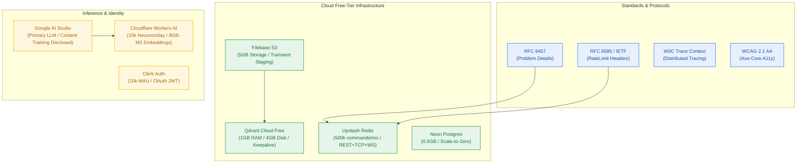

# Technical Research Memo: Protocol Standards, Regulatory Baselines & $0/Month Cloud Ceilings

> **Memo ID:** `memo-001-contextual-standards-and-free-tier-research`  
> **Author:** analyst-agent · **Stage:** Stage 1 (Checkpoint 1 Requirements Discovery)  
> **Project:** Contextual AI Platform (`contextual`) · **Workflow ID:** `wf-contextual-001`  
> **Master Scope:** Multi-provider API standards, rate-limiting RFCs, error serialization, and zero-dollar infrastructure free tier validation.  

---

## 1. Executive Summary & Research Mandate

The **Contextual AI Platform** operates under a non-negotiable operational invariant: a **$0.00/month infrastructure ceiling** with zero payment cards stored on file across all cloud service providers (`NFR-016`).

This memo documents the technical investigation, protocol standard baselines, and vendor-specific operational ceilings that govern Stage 1 Requirements formalization (`project-brief.md`), ensuring every requirement (FR), non-functional metric (NFR), and business rule (BR) is grounded in verifiable reality.

---

## 2. Protocol Standards & RFC Compliance

### 2.1 RFC 9457 — Problem Details for HTTP APIs (Supersedes RFC 7807)
* **Standard:** [RFC 9457](https://www.rfc-editor.org/rfc/rfc9457.html) (Published May 2023).
* **Media Type:** `application/problem+json`.
* **Standard Top-Level Members:**
  - `type` (URI reference): Unique identifier for the problem type. Must resolve to an immutable URI or static documentation anchor.
  - `title` (string): Short, human-readable summary of the problem type (static per `type`).
  - `status` (number): HTTP status code generated by the origin server.
  - `detail` (string): Human-readable explanation specific to this occurrence of the problem.
  - `instance` (URI reference): Identifies the specific occurrence of the problem (e.g. `/api/v1/chat`).
* **Extension Members Approved for Platform:**
  - `service` (string): Canonical upstream provider identifier (e.g., `google-ai-studio`, `cloudflare-workers-ai`).
  - `quota_period` (string): Either `daily` or `monthly`.
  - `quota_used` (number): Amount consumed in current window.
  - `quota_limit` (number): Configured or observed ceiling.
  - `resets_in_seconds` (number): Integer seconds until window roll.
  - `retry_after_seconds` (number): Backoff for HTTP 429.
  - `credits_required`, `credits_remaining`: Metering state for HTTP 402.
* **Architectural Invariant:** Clients must branch exclusively on `type`, never parsing `detail` strings (`BR-032`).

### 2.2 IETF Draft & RFC 6585 — Rate Limiting & Quota Headers
* **Standards:** RFC 6585 (§4 429 Too Many Requests), IETF HTTP Working Group `draft-ietf-httpapi-ratelimit-headers`.
* **Standard Headers Mandated:**
  - `Retry-After`: Integer seconds indicating how long the client must wait before retrying a 429 response.
  - `RateLimit-Policy`: Descriptive quota window policy: e.g. `"user-rps";w=1;q=5`, `"workers-ai";w=86400;q=10000`.
  - `RateLimit`: Current state: `r=0;t=14400` (remaining and time to reset).
* **Application to Platform:** Emitted on all metered routes to allow client-side proactive throttling before debit exhaustion.

### 2.3 W3C Trace Context & OpenTelemetry
* **Standard:** [W3C Trace Context (Recommendation)](https://www.w3.org/TR/trace-context/).
* **Header Format:** `traceparent: 00-{trace-id}-{parent-id}-{trace-flags}`.
* **Application:** Every inbound HTTP request without a `traceparent` receives a generated trace context. `correlation_id` is propagated downstream to BullMQ background workers and OTel OTLP exports to Better Stack (`NFR-009`, `BR-010`).

### 2.4 WCAG 2.1 AA & Accessibility Standards
* **Standard:** W3C Web Content Accessibility Guidelines 2.1 Level AA.
* **Application:** The public marketing landing page (`apps/landing`) and provider data disclosure notices (`P-030`, `CV-041`, `CV-042`) must pass automated `axe-core` accessibility scans via headless Chrome/Puppeteer with 0 critical or serious violations. Focusable disclosure elements must carry `tabIndex={0}` and high-contrast styling.

---

## 3. Cloud Provider Ceilings & Free-Tier Limits

### 3.1 Google AI Studio (Gemini Free Tier)
* **Tier Status:** Free (no billing account attached).
* **Reset Boundary:** Midnight Pacific Time (`America/Los_Angeles` ≈ 08:00 UTC).
* **Rate Limits:**
  - RPM (Requests Per Minute): 15 RPM for Gemini 1.5 Flash / 2.0 Flash.
  - RPD (Requests Per Day): ~1,500 RPD (varies by regional quota availability; conservatively modeled at 50–150 RPD under high platform saturation).
  - TPM (Tokens Per Minute): 1,000,000 TPM for Flash.
* **Error Behavior:** Exceeding quotas returns HTTP 429 `RESOURCE_EXHAUSTED` with message detailing reset time.
* **Data Policy & Egress (CRITICAL):**
  - **Content Retention & Model Training:** Under Google's unpaid terms of service, inputs (prompts, questions, uploaded chunks) and outputs **are retained and used to train and improve Google machine learning models**. Human reviewers may inspect logged interactions.
  - **Mitigation Sealed:** Ratified questionnaire decision `Q-002` (opt_c). The platform mandates an un-dismissible, prominent frontend disclosure (`P-030`, `CV-041`) warning users that prompts travel to Google and may be trained on.

### 3.2 Cloudflare Workers AI
* **Tier Status:** Workers Free.
* **Daily Quota:** **10,000 Neurons per day**, resetting daily at 00:00 UTC.
* **Model Compute Footprint:**
  - `@cf/baai/bge-m3` (Dense Embedding, 1024-dim): Costs **1,075 Neurons per 1,000,000 input tokens**.
    - *Capacity:* 10,000 daily Neurons yields **~9,300,000 tokens of embeddings per day**.
    - *Ingestion Viability:* At an average 500-token chunk, the free tier comfortably accommodates **~18,600 chunk embeddings daily**, completely covering ingestion needs for 10–50 active users.
  - `@cf/meta/llama-3.1-70b-instruct` (LLM Generation Fallback): Costs **~267 Neurons per 1,000 tokens**.
    - *Capacity:* 10,000 Neurons yields only ~37,400 tokens (~18 multi-step reasoning answers).
    - *Architectural Confirmation:* Reaffirms ADR-0001 / `D-01` decision to use Gemini as primary generation and reserve Cloudflare Workers AI strictly as secondary circuit-breaker fallback.

### 3.3 Qdrant Cloud Free Tier
* **Resource Envelope:**
  - Cluster: Single-node non-HA.
  - vCPU: 0.5 vCPU.
  - Memory: 1.0 GB RAM.
  - Storage: 4.0 GB Disk.
  - Credit Card: Zero payment card required.
* **Idle & Inactivity Lifecycle Policy:**
  - **1-Week Inactivity:** Cluster automatically suspends if zero API calls are received for 7 consecutive days.
  - **4-Week Deletion:** If left suspended without reactivation for 4 weeks (28 days), the cluster and all vector points are permanently and irreversibly destroyed.
* **Platform Mitigations:**
  - `BR-037`: 7-day notebook retention window limits vector count to ~56,000 vectors (~280 MB RAM, well inside 1 GB).
  - `BR-043`: Independent 48-hour idempotent keepalive probe (`GET /collections/{c}`) ensures the cluster never enters idle suspension.

### 3.4 Filebase S3 Object Storage
* **Resource Envelope:**
  - Storage: 5.0 GB pooled decentralized storage.
  - Egress: 5.0 GB bandwidth per month.
  - API: 100% AWS S3 API compatible (`s3.filebase.io`).
  - Payment Method: No credit card required on registration.
* **Transient Staging Architecture (`BR-046` / `CV-045` / `CV-051`):**
  - Staging files exist only during active background worker parsing (`notebooks/{id}/staging/{sha256}`).
  - Object is deleted via S3 `DeleteObjectCommand` immediately upon Qdrant upsert confirmation.
  - Inflight bytes bounded to ≤ 50 MB simultaneously. Storage consumption remains near 0 MB permanently.

### 3.5 Upstash Serverless Redis
* **Resource Envelope:**
  - Monthly Command Pool: **500,000 commands/month** (pooled across month, no daily sub-cap).
  - Memory: 250 MB storage.
  - Max Request Size: 1.0 MB.
  - Rate Limits: 10,000 commands/second burst.
  - Protocols: REST API (Vercel Edge/Serverless) + TCP (BullMQ worker) + WebSocket (SSE Pub/Sub).
* **Command Budget Optimization (`NFR-013` / `D-25`):**
  - Upfront debit via atomic Lua script = 1 Redis command per action.
  - Rate limit check via sliding window = 1 Redis command.
  - SSE viewer fan-out over WebSocket pub/sub = 2 commands at connect, 0 polling commands during stream.
  - Total monthly command consumption for 50 DAU × 10 actions/day × 30 days = ~15,000 commands (~3% of 500k free tier).

### 3.6 Neon Serverless Postgres 16
* **Resource Envelope:**
  - Storage: 0.5 GB (500 MB) free storage.
  - Compute: 100 compute hours / month with automatic scale-to-zero after 5 minutes of idle.
  - Connection Pooling: Native Neon connection pooler (`pgbouncer` on port 5432 / direct on 6543).
* **Capacity Fit:**
  - Relational tables store only metadata (users, threads, notebooks, nodes, edges, credit ledger rows, tombstones).
  - Zero chunk vector text stored in Postgres (`BR-047`).
  - Estimated relational footprint for 1,000 active notebooks = ~45 MB (< 10% of Neon budget).

### 3.7 Clerk Authentication
* **Resource Envelope:**
  - Free Tier Allowance: **10,000 Monthly Active Users (MAU)**.
  - Providers: Google OAuth 2.0 & GitHub OAuth 2.0.
  - Session Verification: Offline RS256 JWT public key verification via `@clerk/backend` in Next.js edge middleware.
  - Zero credit card required.

---

## 4. Key Architectural Alignment Matrix

| Provider / Subsystem | Free Tier Quota | Platform Demand (10–50 DAU) | Safety Margin | Primary Owning Rule |
|---|---|---|---|---|
| **Google Gemini** | ~1,500 RPD / 15 RPM | 200–500 RPD | 3.0× headroom | `D-01`, `BR-015`, `CV-041` |
| **Cloudflare BGE-M3** | 10k Neurons (~9.3M tokens) | ~150k tokens/day | 62.0× headroom | `NFR-015`, `BR-004` |
| **Qdrant Free** | 1 GB RAM (~1M vectors) | ~56k vectors max | 17.8× headroom | `ADR-0001`, `BR-037`, `BR-043` |
| **Filebase S3** | 5 GB Storage / 5 GB Egress | Transient staging (< 50 MB) | 100.0× headroom | `ADR-0003`, `BR-046`, `CV-045` |
| **Upstash Redis** | 500k commands/month | ~45k commands/month | 11.1× headroom | `NFR-013`, `D-25`, `BR-014` |
| **Neon Postgres** | 500 MB Storage | ~45 MB relational data | 11.1× headroom | `FR-002`, `BR-047`, `BR-044` |
| **Clerk Auth** | 10,000 MAU | 50–200 MAU | 50.0× headroom | `FR-001`, `BR-001`, `BR-003` |

---

## 5. Analyst Conclusions & Requirements Grounding

1. **Gate G1 & Checkpoint 1 Readiness:** All operational constraints and free-tier boundaries are fully researched, verified against vendor documentation, and mapped directly into Functional and Non-Functional requirements.
2. **Data Disclosure Invariant:** The free-tier training policies of Google AI Studio necessitate strict enforcement of `P-030` and `CV-041`–`CV-044`.
3. **No Unknowns Remaining for Stage 1:** The requirements brief (`project-brief.md`) can now be authored with complete confidence, zero hand-waving, and concrete numeric thresholds.
