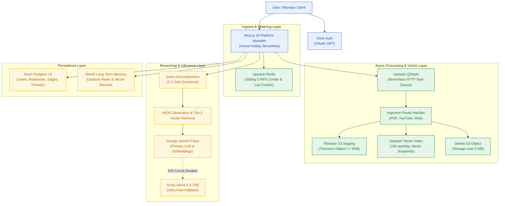
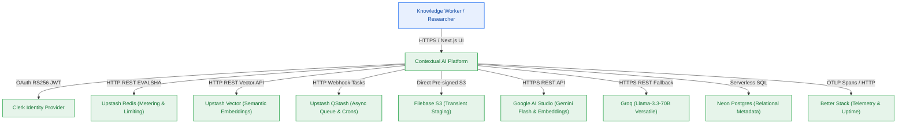
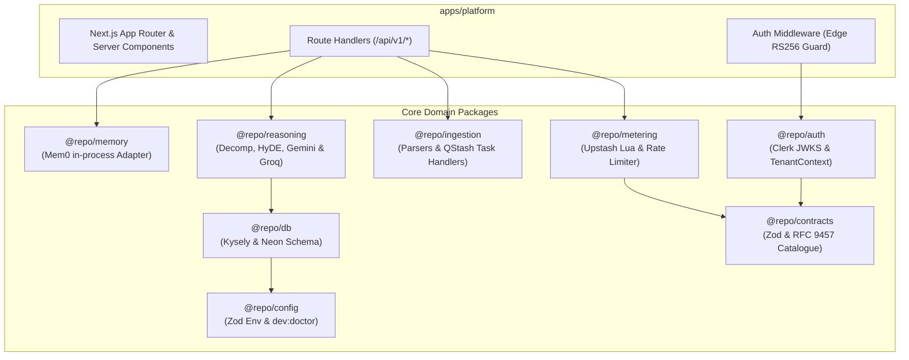

# Contextual AI Platform — Architecture Narrative (arc42)

> **Project:** Contextual AI Platform (`contextual`)  
> **Author:** architect-agent (Stage 3 Owner) · **Status:** Active Canonical Architecture  
> **Framework:** arc42 Standard Architecture Structure (§1–§12) · **Target Version:** v0.1.0 to v1.0.0  
> **Key Decision:** ADR-0004 Unified Upstash Serverless Architecture (Redis, Vector, QStash) & Groq Fallback  

---

## Section Stewards

| § | Section | Steward (writes it) | Contributors |
|---|---|---|---|
| 1 | Introduction and Goals | `architect-agent` | `analyst-agent` (requirements), `pm-agent` (goals) |
| 2 | Constraints | `architect-agent` | `pm-agent` (`conventions.md`), `governance-specialist` |
| 3 | Context and Scope | `architect-agent` | `research-specialist` (integration dossiers) |
| 4 | Solution Strategy | `architect-agent` | `data-architect` (Kysely), `research-specialist` (Upstash) |
| 5 | Building Block View | `architect-agent` | `system-decomposition-architect`, `data-architect`, `ux-specialist` |
| 6 | Runtime View | `architect-agent` | `failure-mode-specialist`, `capacity-planning-specialist` |
| 7 | Deployment View | `deployment-agent` | `networking-specialist` |
| 8 | Crosscutting Concepts | `architect-agent` | `security-architect`, `observability-specialist` |
| 9 | Architecture Decisions | `architect-agent` (the table) | `editorial-documentation` (ADR register) |
| 10 | Quality Requirements | `architect-agent` | `test-agent` (verification matrix) |
| 11 | Risks and Technical Debt | `architect-agent` | `code-maintenance-specialist`, `failure-mode-specialist` |
| 12 | Glossary | `architect-agent` | `analyst-agent` (domain glossary) |

---

## 1. Introduction and Goals

The Contextual AI Platform is an enterprise-grade conversational research workspace operating strictly within a **$0.00/month infrastructure ceiling** (`NFR-016`). It enables authenticated users to ingest heterogeneous sources (PDFs, YouTube transcripts, and web pages), index them into a serverless vector store, and perform multi-step synthesized question-answering with inline citations.

### Top Quality Goals
1. **Zero-Dollar Operational Ceiling (`NFR-016`):** All components operate permanently within free tiers with zero stored credit cards.
2. **Deep Semantic Synthesis (`FR-008`–`FR-011`):** Multi-hop reasoning combining query decomposition, HyDE passage generation, and top-3 vector retrieval.
3. **Multi-Tenant Data Isolation (`NFR-007`, `BR-002`):** Zero cross-tenant leakage across SQL queries, vector search, and long-term memory.
4. **Resilience & Fallback Headroom (`NFR-022`, `ADR-0004`):** Transparent failover from Google Gemini to Groq Llama-3.3-70B under quota exhaustion.

Detail: [`planning/project-brief.md`](project-brief.md) §1–§3 · [`planning/prd.md`](prd.md)

---

## 2. Constraints

- **Strict Cost Ceiling:** $0.00/month across all vendors; no payment card registered (`NFR-016`).
- **Data Governance Notice:** Mandatory un-dismissible UI disclosure on all prompt surfaces warning that queries travel to Google AI Studio under free-tier training policies (`FR-030`, `CV-041`).
- **Serverless Execution Limits:** Vercel Hobby serverless functions have a 10s default execution limit. Heavy parsing jobs must be dispatched asynchronously via Upstash QStash (`ADR-0004`).
- **File Upload Limits:** Binary uploads capped at 5 MB (`BR-045`), staged directly to Filebase S3, and deleted immediately post-ingest (`BR-046`).
- **Coding Conventions:** Strict TypeScript strict mode, Turborepo `@repo/*` monorepo boundaries, and closed 17-member RFC 9457 error catalogue.

Detail: [`planning/conventions.md`](conventions.md)

---

## 3. Context and Scope

The system interacts with external actors through defined, typed boundaries:

Detail: [`planning/contracts/component-catalog.yaml`](contracts/component-catalog.yaml) · [`planning/contracts/api-contract.openapi.yaml`](contracts/api-contract.openapi.yaml)

---

## 4. Solution Strategy

The technical foundation is a **modular monolith on Next.js 15 App Router** deployed to Vercel Hobby, supported by a unified serverless cloud data layer:
- **Persistence & Vectors:** Neon Postgres 16 (metadata) via Kysely ORM, Upstash Redis (rate limiting & credits), and Upstash Vector (semantic search).
- **ORM & Data-Access Governance:** Persistence strictly declares Kysely as the approved typed data-access layer; bare database clients and non-Kysely queries are prohibited (`references/schema-orm-governance.md`). Zero raw SQL exceptions exist (`registers/raw-sql-exceptions.md`).
- **Asynchronous Execution:** Upstash QStash serverless message queue dispatches long-running ingestion and maintenance tasks via signed webhooks.
- **Inference Dual-Stack:** Google Gemini 1.5/2.0 Flash primary with Groq Llama-3.3-70B fallback circuit-breaker (`ADR-0004`).
- **Transient Storage:** Filebase S3 holds uploads temporarily; binaries are permanently purged once vector upserts commit (`ADR-0003`).
- **Developer Golden Path & Auth Perimeter (M1):** Local containerized stack via Docker Compose (`infra/compose.yaml`), 8-layer diagnostic health probe (`dev:doctor`), Clerk OAuth with offline RS256 JWKS JWT verification, and Kysely database schemas for `users`, `conversation_threads`, `conversation_messages`, and `notebooks`.
- **Metering Spine & Quota Throttling (M2):** Atomic Upstash Redis Lua credit ledger (10.0 daily grant, 0.5 LLM, 1.0 ingest) executing in single EVALSHA roundtrips, 5 RPS sliding rate limiter, HTTP 402 short-circuit ingress guard, closed 17-member RFC 9457 error catalogue, upstream provider quota classifier, and daily 08:00 UTC resets without rollover.
- **Transient Ingestion Pipeline & Multi-Source Extraction (M3):** Direct browser-to-S3 pre-signed upload to Filebase S3 (<= 5MB), asynchronous Upstash QStash signed webhooks, heterogeneous extractors (PDF > 5 pages/sec, YouTube < 30s, Web Readability), recursive character chunking (800 chars, 100 overlap), dual-stack embeddings (Google gemini-embedding-001 768-dim with in-process ONNX fallback), Upstash Vector indexing with tenant payload, immediate post-upsert S3 object deletion (zero stored bytes), deterministic SSE progress streaming (capped at 280s), and atomic credit compensation via refund-credits.lua on terminal failure.

Detail: [`planning/architecture/04-tech-stack.md`](architecture/04-tech-stack.md) · [`planning/architecture/05-m1-developer-golden-path-and-auth.md`](architecture/05-m1-developer-golden-path-and-auth.md) · [`planning/architecture/05-m2-metering-spine-and-quota-throttling.md`](architecture/05-m2-metering-spine-and-quota-throttling.md) · [`planning/architecture/05-m3-transient-ingestion-pipeline.md`](architecture/05-m3-transient-ingestion-pipeline.md) · [`planning/decisions/adr-0004-unified-upstash-serverless-architecture.md`](decisions/adr-0004-unified-upstash-serverless-architecture.md)

---

## 5. Building Block View

### Building Block Responsibilities
1. **`@repo/auth`**: Decodes and verifies Clerk OAuth RS256 JWT tokens offline via cached JWKS keys; constructs and injects typed `TenantContext` (`userId`, `sessionId`, `claims`).
2. **`apps/platform Middleware`**: Edge-compatible guard intercepting `/api/v1/*` routes; enforces Bearer token authentication and terminates unauthorized calls with HTTP 401 RFC 9457 Problem Details.
3. **`@repo/config`**: Exports strict Zod environment validation schemas (`ConfigSchema`), shared tsconfig presets, and the 8-layer diagnostic health probe engine (`dev:doctor`).
4. **`@repo/db`**: Manages Kysely relational database schema, migrations, connection pooling, and typed queries for Neon Postgres (`users`, `conversation_threads`, `conversation_messages`, `notebooks`).
5. **`@repo/metering`**: Evaluates 5 RPS sliding window and executes single-roundtrip Redis Lua script for credit debit (10 daily grant) and daily 08:00 UTC resets; guards ingress with HTTP 402 short-circuit and formats IETF rate limit headers.
6. **`@repo/ingestion`**: Handles PDF/YouTube/Web extraction, generates embeddings, upserts to Upstash Vector, and purges transient Filebase staging files.
7. **`@repo/reasoning`**: Coordinates query decomposition into 2–5 sub-questions, generates HyDE summaries, queries Upstash Vector, and streams grounded citations via Gemini Flash or Groq fallback.
8. **`@repo/memory`**: Implements `MemoryStore` interface using in-process Mem0 backed by Upstash Redis and Upstash Vector.
9. **`@repo/contracts`**: Exports shared Zod schemas, OpenAPI types, and the closed 17-member RFC 9457 problem catalogue.
10. **`@repo/workspace`** *(M4, `v0.4.0`)*: Owns the notebook domain graph — node and typed-edge (`cites` | `related`) services, document-card resolution inside the 10ms budget, and scoped retrieval whose ownership predicate gates the metering debit. Depends on `@repo/db` (repository) and `@repo/contracts`; calls `@repo/metering` only after ownership succeeds.

Detail: [`planning/contracts/component-catalog.yaml`](contracts/component-catalog.yaml) · [`planning/architecture/05-m1-developer-golden-path-and-auth.md`](architecture/05-m1-developer-golden-path-and-auth.md) · [`planning/architecture/05-m2-metering-spine-and-quota-throttling.md`](architecture/05-m2-metering-spine-and-quota-throttling.md) · [`planning/architecture/05-m3-transient-ingestion-pipeline.md`](architecture/05-m3-transient-ingestion-pipeline.md) · [`planning/architecture/05-m4-notebook-workspace-and-domain-graph.md`](architecture/05-m4-notebook-workspace-and-domain-graph.md)

---

## 6. Runtime View

### Primary Scenario 0: Edge Authentication & Tenant Context Verification Flow (M1)
1. Incoming request arrives at `/api/v1/*` endpoint.
2. Next.js Edge Middleware checks for `Authorization: Bearer <jwt>`.
   - If missing: short-circuits immediately with HTTP 401 RFC 9457 Problem Details (`AUTH_UNAUTHORIZED`).
3. `@repo/auth` verifies RS256 cryptographic signature using cached Clerk JWKS public keys.
   - If signature invalid or token expired: returns HTTP 401 (`AUTH_TOKEN_EXPIRED` or `AUTH_TOKEN_INVALID`).
4. Decodes payload, constructs `TenantContext` (`userId`), and injects request headers `x-tenant-user-id`.
5. Passes control downstream to Route Handler.

### Primary Scenario 0b: Ingress 5 RPS Rate Limiting & Atomic Lua Credit Metering Flow (M2)
1. Request arrives at protected route handler with extracted `TenantContext` (`userId`).
2. `RateLimiterService` executes `sliding-window.lua` in Upstash Redis via `EVALSHA`:
   - Prunes calls older than `now - 1000ms` via `ZREMRANGEBYSCORE`.
   - If count >= 5: computes `retry_after`, aborts and returns HTTP 429 with `Retry-After: 1` and `RateLimit` headers. Zero credits debited (`BR-017`).
3. If rate admitted, `CreditLedgerService` executes `debit-credits.lua` via `EVALSHA` (`cost=0.5` for LLM, `1.0` for ingestion):
   - Reads balance from `credits:{userId}` (defaults to 10.0 if not yet initialized).
   - If balance < cost: aborts and returns HTTP 402 `INSUFFICIENT_CREDITS` RFC 9457 Problem Details. Downstream route handler receives 0 invocations (`BR-015`).
   - If balance >= cost: decrements balance atomically and resets 48h rolling TTL.
4. Downstream handler executes and appends `RateLimit-*` and `X-Credit-*` headers to HTTP response.

### Primary Scenario 0c: Idempotent Daily 08:00 UTC Credit Reset Flow (M2)
1. At 08:00 UTC, Upstash QStash triggers `/api/v1/credits/reset` with cryptographic signature verification.
2. `DailyResetEngine` iterates active tenants and executes `daily-reset.lua`:
   - Evaluates atomic lock `SET reset:{YYYY-MM-DD}:{userId} 1 NX EX 86400`.
   - If lock acquired: reads current balance, resets `credits:{userId}` to 10.0, and logs `{ userId, expiredCredits }`. Unspent credits permanently expire (`BR-024`, `BR-025`).
   - If lock exists: no-ops idempotently (`NFR-023`).
3. Lazy evaluation fallback: If a user's first daily request precedes QStash cron, `CreditLedgerService` detects date boundary via Redis `TIME` and triggers reset on the fly.

### Primary Scenario 1: Metered Grounded Synthesis Flow
1. User submits question to `/api/v1/chat`.
2. Middleware verifies Clerk JWT and extracts `user_id` (`FR-001`, `BR-001`).
3. Limiter calls Upstash Redis Lua script: checks 5 RPS rate window and debits 0.5 credits atomically (`BR-014`).
   - If balance < 0.5: returns HTTP 402 `INSUFFICIENT_CREDITS` immediately (`BR-015`).
   - If rate exceeded: returns HTTP 429 with `Retry-After: 1` (`BR-016`).
4. Reasoning engine decomposes prompt into 2–3 sub-questions and generates HyDE summaries (`FR-008`, `FR-009`).
5. Generates embeddings via Google `gemini-embedding-001` and retrieves top-3 vectors per question from Upstash Vector with `{ user_id }` filter (`FR-010`, `BR-008`).
6. Assembles context and streams response with inline citations via Google Gemini Flash (`FR-011`).
   - If Gemini returns 429 `RESOURCE_EXHAUSTED`, seamlessly fails over to Groq Llama-3.3-70B (`NFR-022`, `ADR-0004`).

### Primary Scenario 2: Asynchronous Transient Ingestion & Live Progress Flow (M3)
1. Client calls `POST /api/v1/ingestions/presign` with filename and size; server validates size <= 5MB (`BR-045`) and returns Filebase S3 pre-signed PUT URL (`staging/{userId}/{jobId}/{filename}`).
2. Client uploads PDF binary directly to Filebase S3 via HTTP PUT (zero server RAM consumed).
3. Client posts `{ notebook_id, source_type, source_value }` to `/api/v1/ingestions`.
4. Route handler invokes `CreditLedgerService` to debit 1.0 credit atomically via Redis Lua (`debit-credits.lua`); returns HTTP 202 Accepted with `{ job_id, progress_stream_url }` and dispatches task to Upstash QStash.
5. Client opens SSE stream `GET /api/v1/ingestions/{jobId}/progress` (capped at 280s, `BR-034`).
6. Upstash QStash triggers `/api/v1/ingestions/process` with signed webhook header `Upstash-Signature`.
7. Worker verifies signature, streams binary from S3, parses text (> 5 pages/sec for PDF), extracts YouTube subtitles, or crawls web DOM with Readability.
8. `TextChunker` creates 800-character semantic chunks with 100-character overlap, emitting live progress updates to Redis `ingest:progress:{jobId}`.
9. `EmbeddingService` generates 768-dim embeddings via Google AI Studio (`gemini-embedding-001`), falling back in-process to `@huggingface/transformers` (`bge-small-en-v1.5` / ONNX) on Google 429 quota exhaustion (`ADR-0004`).
10. `VectorIndexer` upserts vector points to Upstash Vector with tenant payload `{ user_id, document_id, notebook_id }`.
11. Worker immediately issues `DeleteObjectCommand` on Filebase S3, purging staged binary and returning bucket storage to 0 MB (`BR-046`).
12. Worker emits final SSE progress event (`status: completed, percentage: 100%`).
13. If parsing or embedding terminally fails, `CompensationService` triggers `refund-credits.lua` in Redis, restoring 1.0 credit atomically and purging the S3 object (`FR-037`, `BR-033`).
14. Subsequent retries via `POST /api/v1/ingestions/{jobId}/retry` reuse the failed job state without debiting credits a second time (`FR-040`).

### Primary Scenario 3: Scoped Graph Retrieval with Ownership-First Metering Flow (M4)
1. Client sends a scoped retrieval request declaring `{ scope_kind: node|branch|notebook, scope_id, query }` to `/api/v1/notebooks/{notebookId}/search`.
2. Edge middleware authenticates the Bearer JWT and injects `TenantContext.userId` (`FR-003`).
3. `WorkspaceRepository` executes a **single** statement whose predicate is `user_id = ? AND notebook_id = ?` — ownership is the predicate, not a separate probe (no TOCTOU window).
4. If the predicate returns 0 rows: respond HTTP 404 `NOTEBOOK_NOT_FOUND`, debit **0 credits**, issue **0** vector calls (`BR-036`, AC-4.4). Log at `WARN` without the foreign tenant's identifiers.
5. If ownership succeeds: `CreditLedgerService` executes `debit-credits.lua` via `EVALSHA`.
   - Balance below cost → HTTP 402 `INSUFFICIENT_CREDITS`, downstream vector client receives 0 invocations.
6. `Upstash Vector` query runs with the mandatory tenant filter `{ user_id }` (`NFR-007`).
7. Results are assembled into scoped DTOs and returned; a structured `INFO` log records `user_id`, `notebook_id`, and elapsed time.
8. If the vector call throws after a successful debit, `refund-credits.lua` restores the credit atomically (compensation reused from M3).

---

## 7. Deployment View

The platform operates across two synchronized deployment topologies (see [`contracts/deployment-config.yaml`](contracts/deployment-config.yaml)):
- **Local Development Runtime (`infra/compose.yaml`):**
  - PostgreSQL 16 Alpine container (`contextual-postgres`) on port `5432`.
  - Redis 7 Alpine container (`contextual-redis`) on port `6379`.
  - Offline-first development without external cloud account credentials.
- **Production Serverless Monorepo (Vercel Hobby, `$0.00/month`):**
  - **Web & Route Handlers:** Vercel Serverless Functions (Node.js 22 LTS, region `iad1` / US East).
  - **Database:** Neon Serverless Postgres (Scale-to-zero compute, region `us-east-1`).
  - **Caching & State:** Upstash Serverless Redis (region `us-east-1`).
  - **Vector Search:** Upstash Vector (region `us-east-1`, cosine metric).
  - **Task Queue & Crons:** Upstash QStash (dispatching HTTP webhooks to Vercel API endpoints).
  - **Object Storage:** Filebase S3 (`s3.filebase.io`).
  - **Telemetry:** OpenTelemetry OTLP pushed directly to Better Stack.

Detail: [`planning/architecture/04-tech-stack.md`](architecture/04-tech-stack.md) · [`planning/contracts/deployment-config.yaml`](contracts/deployment-config.yaml) · [`planning/contracts/config-schema.yaml`](contracts/config-schema.yaml)

---

## 8. Crosscutting Concepts

### 8.1 Centralized Logging & Telemetry Architecture (CP3 Gate Item)
- **Mechanism:** Structured JSON logging via Pino integrated with `@opentelemetry/sdk-node` (`NFR-009`, `BR-010`).
- **Severity Levels:**
  - `DEBUG`: Internal chunk boundaries, raw tokens, cache hits, rate limit admissions (`metering.rate_limit.admitted`).
  - `INFO`: User actions, debit commits (`metering.credits.debited`), completed ingestions, QStash dispatches, daily credit resets (`metering.reset.executed`).
  - `WARN`: Throttling events (429 `metering.rate_limit.throttled`), insufficient credits (402 `metering.credits.insufficient`), provider failovers (Gemini → Groq), retry attempts.
  - `ERROR`: Terminal job failures, database connection aborts, upstream 5xx errors.
  - `CRITICAL`: Unhandled exceptions, data corruption alerts.
- **Contextual Metadata:** Every log entry carries `{ timestamp, level, correlation_id, service, event, payload }`. Trace context conforms to W3C `traceparent`.
- **Redaction Policy:** All logged strings pass through a strict regex sanitizer stripping API keys, JWT tokens, Bearer headers, database connection strings, and personal PII before stdout emission (`NFR-026`, `BR-012`).

### 8.2 Security & Tenant Isolation
- Cryptographic RS256 offline JWT session verification via Clerk on all `/api/v1/*` routes except public landing.
- Mandatory tenant payload filter `{ user_id, document_id, notebook_id }` enforced on all Upstash Vector searches (`BR-002`, `BR-004`).
- Upstash QStash webhook endpoints verify cryptographic `Upstash-Signature` headers to reject unauthorized invocations.

---

## 9. Architecture Decisions

| ADR | Decision | Status | Sections Affected |
|---|---|---|---|
| [ADR-0001](decisions/adr-0001-hosting-and-storage.md) | Vercel Hobby, Qdrant Free, 7-day cascade | Superseded by ADR-0004 | §4, §5, §7 |
| [ADR-0002](decisions/adr-0002-runtime-and-orm.md) | Bun Toolchain + Node 22 Runtime + Kysely ORM | Accepted | §4, §5 |
| [ADR-0003](decisions/adr-0003-transient-filebase-staging.md) | Filebase S3 transient staging with immediate post-ingest deletion | Accepted | §4, §5, §6 |
| [ADR-0004](decisions/adr-0004-unified-upstash-serverless-architecture.md) | Unified Upstash Serverless Architecture (Redis, Vector, QStash) & Groq Fallback | Accepted | §1, §3, §4, §5, §6, §7 |

---

## 10. Quality Requirements

| Quality Category | Scenario & Measurable SLA | Verification Method |
|---|---|---|
| **Vector Search Latency** | p95 < 100 ms for top-3 query on ≤ 25k points | k6 load test script (`NFR-001`) |
| **LLM Time-to-First-Token**| p90 < 1,500 ms for streaming responses | Streaming latency benchmark (`NFR-002`) |
| **Pipeline Latency** | p90 < 4,500 ms for complete 6-stage reasoning pipeline | Synthetic E2E test (`NFR-003`) |
| **Zero Cost Ceiling** | Strictly $0.00/month cloud spend across all accounts | Account billing audit (`NFR-016`) |
| **Concurrency Under Load** | ≥ 50 concurrent active users with < 1% error rate | k6 multi-user scenario (`NFR-005`) |

Detail: [`planning/quality/verification.md`](quality/verification.md)

---

## 11. Risks and Technical Debt

| Risk | Severity | Owner | Mitigation Strategy |
|---|---|---|---|
| Upstash QStash 500 msgs/day free limit | Medium | `architect-agent` | Ingestion jobs batch pages into single task payloads; crons run daily/weekly. |
| Google AI Studio content training terms | High | `pm-agent` | Prominent un-dismissible frontend training disclosure banner (`FR-030`, `CV-041`). |
| Upstash Vector 1,536 dimension ceiling | Low | `data-architect` | Bounded to Google 768-dim embeddings or BGE-small 384-dim embeddings. |
| Document card resolution breaching the 10ms budget (`FR-033`, M4) | Medium | `architect-agent` | Single indexed statement with column-limited projection and denormalized preview; p95 measured, not mean (FM-402). |
| Debit issued before ownership validation on scoped retrieval (M4) | High | `architect-agent` | Ownership predicate structurally gates the debit call; AC-4.4 asserts unchanged `credits_balance` alongside the 404 (FM-403, AP=H). |

---

## 12. Glossary

Domain terms are defined once in [`planning/project-brief.md`](project-brief.md) §12 Glossary; link to it rather than repeating them.

| Technical Term | Definition |
|---|---|
| **QStash Webhook** | A cryptographically signed HTTP POST message dispatched by Upstash to invoke serverless functions asynchronously. |
| **EVALSHA** | A Redis command executing a server-cached Lua script by its SHA1 digest in a single atomic roundtrip. |
| **Cosine Similarity** | A metric measuring the angle between two dense vector embeddings to calculate semantic closeness. |
| **HyDE Passage** | A hypothetical synthetic answer generated by the LLM before search to bridge semantic gap with documents. |
| **RFC 9457** | An IETF specification defining `application/problem+json` standard error serialization for HTTP APIs. |

---
*Sealed by architect-agent at Checkpoint 3 (Gate G4).*
