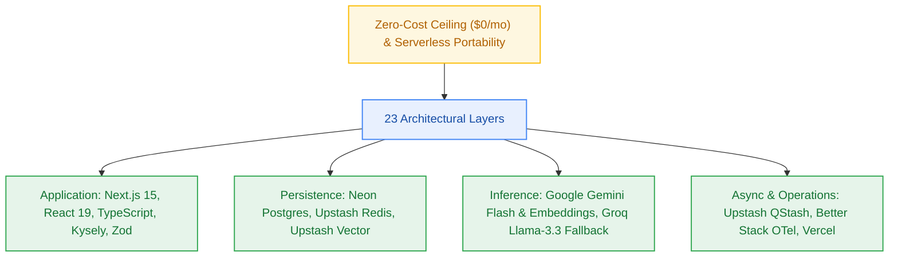

# Technology Stack Specification & Evaluation Matrix (23 Layers)

> **Canonical Solution Strategy Deliverable (`_documentation/planning/architecture.md` §4 Solution Strategy)**  
> *Authoritative mapping of the 23 foundational technology layers. Every choice cites a Build-vs-Buy decision record (`R-xx`), an existing repository invariant, or explicitly states why it is not applicable.*  

---

## 1. Complete 23-Layer Technology Stack Mapping

| # | Architectural Layer | Selected Technology / Library | Version / Pin | Decision Ref / Provenance | Technical Rationale & Maintenance Profile |
|---|---|---|---|---|---|
| 1 | **Language / Runtime** | TypeScript / Node.js 22 LTS (Bun 1.1+ toolchain) | `node@>=22.0.0`, `bun@>=1.1.0` | `ADR-0002` / `Repo Fact` | Dual execution: Bun provides sub-second package resolution; Node 22 LTS provides serverless production stability on Vercel. |
| 2 | **Core Application Framework** | Next.js 15 (App Router) + Turborepo | `next@^15.0.0`, `turbo@^2.0.0` | `R-01` / `FR-021` | Native React Server Components, Route Handlers, Edge middleware, and unified monorepo orchestration. |
| 3 | **Primary Relational Store** | Neon Serverless PostgreSQL 16 | `pg@16` (Serverless HTTP/TCP) | `R-02` / `FR-002` | Serverless auto-scaling and scale-to-zero; free 0.5 GB storage accommodates metadata without chunk bloat. |
| 4 | **ORM / Data Access Layer** | Kysely (Type-safe SQL Query Builder) | `kysely@^0.27.0` | `ADR-0002` / `R-03` | Zero runtime overhead, pure TypeScript type safety, explicit migrations without heavy ORM memory footprint. |
| 5 | **Authentication & Identity** | Clerk Authentication (Google & GitHub OAuth) | `@clerk/backend@^1.0.0`, `@clerk/nextjs` | `R-04` / `FR-001` | Generous 10,000 MAU free tier; client-side OAuth flow and offline RS256 JWT cryptographic verification in middleware. |
| 6 | **API Style & Contract Validation** | REST API + Zod + RFC 9457 Problem Details | `zod@^3.23.0` | `R-05` / `FR-025` | OpenAPI 3.1 contract synchronization, runtime DTO validation, and closed 17-member RFC 9457 error catalogue. |
| 7 | **Background Jobs & Scheduling** | Upstash QStash (Serverless HTTP Queues & Crons) | `@upstash/qstash@^2.7.0` | `ADR-0004` / `R-06` | True serverless asynchronous job dispatch; sends signed HTTP callbacks to Vercel route handlers with retries; 500 msgs/day free. |
| 8 | **Caching & Rate Limiting State** | Upstash Serverless Redis (Lua Scripting) | `@upstash/redis@^1.34.0` | `ADR-0004` / `FR-018` | Single-command Lua script handles 5 RPS sliding rate limiting and atomic credit debiting; 500k commands/mo free. |
| 9 | **Vector Database & Search** | Upstash Vector (10k queries/day, 1,536 dim) | `@upstash/vector@^1.2.0` | `ADR-0004` / `R-07` | Serverless REST vector index with tenant filtering; zero idle suspension (eliminates 48h keepalive probe); $0.00/mo. |
| 10 | **Primary LLM Inference** | Google AI Studio (Gemini 1.5 Flash / 2.0 Flash) | `@google/genai@^0.1.0` | `Q-002` / `FR-011` | 1,500 RPD free tier with 1,000,000 TPM; fast time-to-first-token (< 1.5s); dynamic UI training notice displayed. |
| 11 | **Fallback LLM Inference** | Groq Free Tier (Llama-3.3-70B Versatile) | `groq-sdk@^0.9.0` | `ADR-0004` / `NFR-022` | Ultra-fast LPUs; 1,000 RPD free (Llama-70B) or 14,400 RPD (8B); replaces Cloudflare's fragile 18 answers/day limit. |
| 12 | **Vector Embeddings** | Google AI Studio `gemini-embedding-001` | `@google/genai@^0.1.0` | `ADR-0004` / `FR-007` | 1,500 RPD free; 768 dimensions fits cleanly within Upstash Vector's 1,536 free dimension ceiling. |
| 13 | **In-Process Embeddings Fallback** | `@huggingface/transformers` (`bge-small-en-v1.5`) | `@huggingface/transformers@^3.0.0` | `ADR-0004` / `R-08` | Local in-process WASM/ONNX embeddings (384-dim); executes offline with zero API calls and zero rate limits. |
| 14 | **Transient Binary Staging** | Filebase Decentralized S3 Storage | `@aws-sdk/client-s3@^3.600.0` | `ADR-0003` / `BR-046` | Direct browser-to-S3 uploads; binary objects deleted immediately post-ingest, keeping storage usage near 0 MB. |
| 15 | **Document Parsing & Text Extraction** | `unpdf` (PDF), `youtube-transcript`, `cheerio` | `unpdf@^0.1.0`, `cheerio@^1.0.0` | `R-09` / `FR-004` | Lightweight, pure JavaScript parsers without heavy C++ native binary dependencies. |
| 16 | **Long-Term Memory Store** | Mem0 in-process with Upstash Adapters | `mem0ai@^0.1.0` | `ADR-0004` / `FR-019` | In-process execution backed by Upstash Redis and Upstash Vector; zero vendor memory SaaS fees. |
| 17 | **Frontend UI & Styling** | Next.js App Router + React 19 + Vanilla CSS | `react@^19.0.0` | `Repo Fact` / `CV-023` | Clean Vanilla CSS design system with rich glassmorphism, fluid dark theme, and zero Tailwind runtime overhead. |
| 18 | **Testing Frameworks** | Vitest + Playwright + MSW (WireMock) | `vitest@^2.0.0`, `playwright@^1.45.0` | `R-10` / `FR-013` | Fast ESM unit testing (< 15s), local mock server handlers, and headless browser E2E user verification. |
| 19 | **Linting, Formatting & Types** | ESLint + TypeScript Strict + Prettier | `typescript@^5.5.0`, `eslint@^9.0.0` | `Repo Fact` / `CV-001` | Strict typechecking across packages; zero `any` types permitted in public contracts. |
| 20 | **Logging & Observability** | OpenTelemetry Node SDK + Pino | `@opentelemetry/sdk-node@^0.52.0`, `pino` | `R-11` / `NFR-009` | Structured JSON output tagged with `correlation_id` and W3C traceparent; OTLP direct export to Better Stack. |
| 21 | **Accessibility (A11y) & SEO** | `axe-core` + Google Lighthouse CI | `@axe-core/playwright@^4.9.0` | `memo-001` / `NFR-018` | Automated WCAG 2.1 AA audits reporting 0 violations; Lighthouse Performance score ≥ 90. |
| 22 | **Compute & Hosting Runtime** | Vercel Hobby Platform (Serverless) | Vercel Edge / Node.js 22 Serverless | `ADR-0001` / `NFR-016` | $0.00/month hosting; git-triggered automated preview and production deployments. |
| 23 | **CI / CD Pipeline** | GitHub Actions | `actions/checkout@v4`, `setup-bun@v2` | `Repo Fact` | Automated lint, build, unit test, and verification gating on all pull requests. |

---

## 2. Framework & Ecosystem Evaluation Matrix

Authoritative evaluation comparing the unified **Upstash Serverless Ecosystem** against the previous **Cloudflare + Qdrant** baseline:

| Evaluation Criterion | Weight | Candidate A: Unified Upstash + Groq (Selected) | Candidate B: Cloudflare Workers AI + Qdrant (Superseded) | Candidate C: Self-Hosted Docker Cluster (Bespoke) |
|---|:---:|:---:|:---:|:---:|
| **$0.00 Cost Invariant Compliance** | **0.25** | **5 / 1.25** (Zero credit card on file across all services) | **4 / 1.00** (Free, but 10k neuron quota cliff triggers 429) | **1 / 0.25** (Always-on VPS requires ongoing payment) |
| **Operational Simplicity & Maintenance** | **0.20** | **5 / 1.00** (One Upstash account for Redis, Vector, QStash; no keepalive) | **2 / 0.40** (Qdrant 7d sleep requires keepalive; CF requires Wrangler) | **1 / 0.20** (High maintenance; updates, backups, monitoring) |
| **Serverless Architecture Fit** | **0.20** | **5 / 1.00** (100% HTTP REST; QStash webhooks fit Vercel serverless) | **3 / 0.60** (BullMQ requires long-running worker container) | **2 / 0.40** (Requires managing stateful server processes) |
| **Headroom for 10–50 DAU** | **0.15** | **4 / 0.60** (10k vector ops/day; 1,000 Groq 70B req/day; 500 QStash) | **2 / 0.30** (CF Llama 70B gives only 18 answers/day) | **4 / 0.60** (Bounded by hardware RAM/CPU) |
| **User Bias / Stated Preference** | **0.10** | **5 / 0.50** (User directive: "check with Upstash rather than Cloudflare") | **1 / 0.10** (Explicitly requested to move away from Cloudflare) | **1 / 0.10** (Rejected due to cost ceiling) |
| **Security & Tenant Isolation** | **0.10** | **5 / 0.50** (Strict tenant payload filtering; signed webhook signatures) | **5 / 0.50** (Tenant payload filtering supported) | **4 / 0.40** (Self-managed security perimeter) |
| **TOTAL WEIGHTED SCORE** | **1.00** | **4.85 (Clear Winner)** | **2.90** | **1.95** |

---

## 3. Maintainability Profile & Exit Strategy

- **Zero-Glue Serverless Architecture:** By utilizing Upstash's official `@upstash/redis`, `@upstash/vector`, and `@upstash/qstash` SDKs, the platform eliminates hundreds of lines of bespoke keepalive crons, TCP pool connection retry wrappers, and worker lifecycle daemons.
- **Hexagonal Port-and-Adapter Isolation:** All upstream services sit behind domain interfaces:
  - `VectorStore` isolates Upstash Vector (can swap back to Qdrant or Pinecone without touching retrieval logic).
  - `TaskQueue` isolates Upstash QStash (can swap to Inngest or BullMQ).
  - `LLMProvider` isolates Gemini and Groq behind unified streaming completions.
  - `MemoryStore` isolates Mem0 behind domain memory contracts.
- **Provider Redundancy:** If Google AI Studio encounters regional exhaustion, Groq immediately handles generation fallback, while local `@huggingface/transformers` handles embedding fallback in-memory.

---
*Sealed by architect-agent at Checkpoint 3 (Gate G4).*
