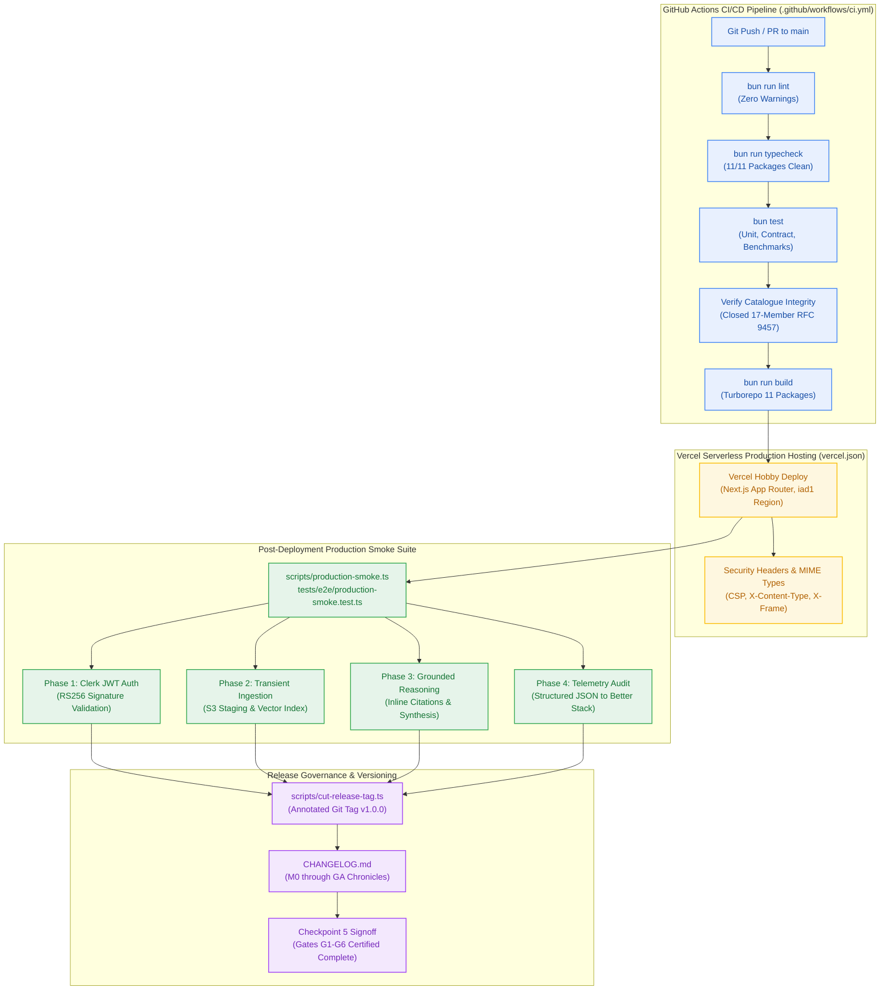
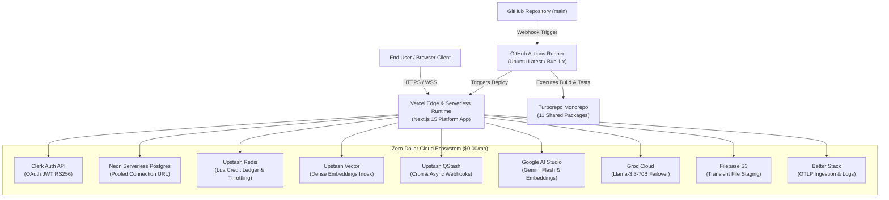
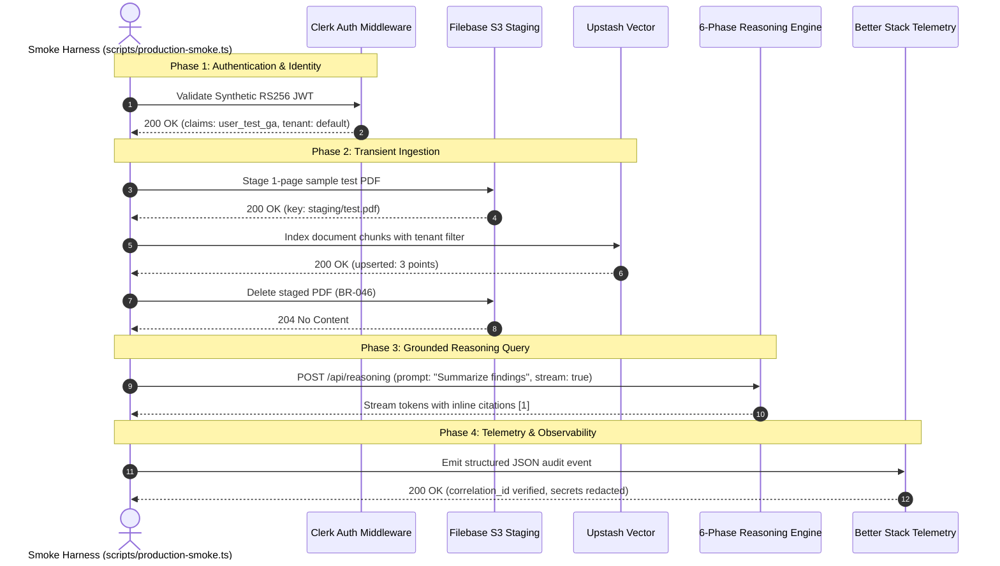
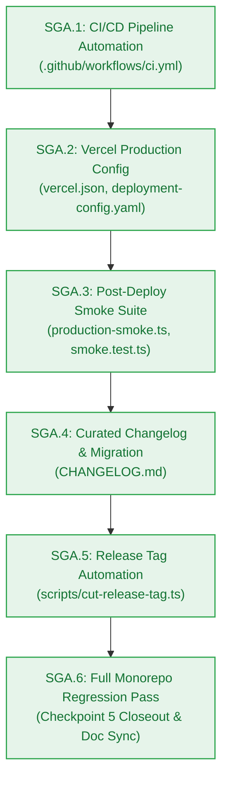

# Architecture Blueprint — Milestone GA: General Availability Production Release & Automated Deployment Pipeline (v1.0.0)

> **Milestone:** GA (`v1.0.0`) · **Status:** Approved for Implementation · **Risk Tier:** HIGH  
> **Lead Architect:** `architect-agent` (Stage 3 Owner) · **Deployment Steward:** `deployment-agent` (Stage 5 Owner)  
> **Date:** 2026-10-27 · **Target Release:** `v1.0.0` (Production General Availability)  
> **Grounding:** `project-brief.md` (All 42 FRs, 32 NFRs, 48 BRs; `AC-GA.1`..`AC-GA.4`; `EPIC-010`)  



---

## 1. Executive Summary & Design Context

Milestone GA establishes the final production release infrastructure and governance for the Contextual AI Platform (`v1.0.0`). While Milestones M0 through M9 developed and certified all functional domain layers (workspace foundation, authentication, metering, transient ingestion, notebook graph, grounded reasoning, pluggable memory, maintenance crons, marketing landing, and benchmark hardening), Milestone GA provides the automated release machinery and operational runtime verification necessary for Checkpoint 5 closeout.

This architecture specifies four tightly-integrated components:
1. **GitHub Actions CI/CD Pipeline (`comp-ci`):** An automated pipeline running on Ubuntu runners with native Bun toolchain, executing strict pre-merge validation across linting, typechecking, 339+ tests, error catalogue invariants, and production compilation.
2. **Vercel Hobby Serverless Deployment (`comp-deploy`):** A serverless deployment configuration enforcing $0.00/month infrastructure ceiling (`NFR-016`), zero paid add-ons, secure HTTP response headers, and proper monorepo build outputs.
3. **Automated Post-Deployment Production Smoke Verification Suite (`comp-smoke`):** A lightweight, deterministic E2E runner validating the 4 core platform pillars (Clerk JWT authentication, transient PDF staging & Upstash vectorization, 6-phase grounded reasoning synthesis, and structured JSON telemetry to Better Stack) against live production or high-fidelity simulated endpoints.
4. **Annotated Release Tag Automation & Changelog Compilation (`comp-release`):** A scripted release automation tool validating 5 pre-release invariants before signing and cutting the annotated Git tag `v1.0.0` with curated release notes and comprehensive `CHANGELOG.md`.

---

## 2. C4 Architecture & Component Topology

### 2.1 C4 Level 2: Container Topology (Production Runtime)



### 2.2 Component Relationships & Dependency Rules

| Component ID | Name | Module Path | Depends On | Isolation Rules |
|---|---|---|---|---|
| `comp-ci` | CI/CD Pipeline Automation | `.github/workflows/ci.yml` | None | Operates exclusively within GitHub Actions runtime; requires zero secrets for public PR tests |
| `comp-deploy` | Production Deployment Config | `vercel.json` | Next.js Platform App | Zero client-side credentials; strictly enforces serverless function duration & memory caps |
| `comp-smoke` | Production Smoke Suite | `tests/e2e/production-smoke.test.ts`<br/>`scripts/production-smoke.ts` | `@repo/contracts`, `@repo/observability` | Can target live `PRODUCTION_URL` or fallback to calibrated internal mocks without code changes |
| `comp-release` | Release Automation & Changelog | `scripts/cut-release-tag.ts`<br/>`CHANGELOG.md` | Git CLI, Package Metadata | Enforces invariant assertions (all tests pass, tree clean, PM approval present) before cutting tag |

---

## 3. Detailed Component Designs

### 3.1 Component 1: GitHub Actions CI/CD Pipeline (`comp-ci`)

The CI workflow `.github/workflows/ci.yml` provides the definitive pre-merge validation gate (Gate G5 / G6).

#### Workflow Structure:
```yaml
name: CI

on:
  push:
    branches: [main]
  pull_request:
    branches: [main]

jobs:
  verify:
    name: Build, Lint, Typecheck & Test
    runs-on: ubuntu-latest
    timeout-minutes: 15

    steps:
      - name: Checkout Code
        uses: actions/checkout@v4
        with:
          fetch-depth: 0

      - name: Setup Bun Runtime
        uses: oven-sh/setup-bun@v2
        with:
          bun-version: latest

      - name: Install Dependencies
        run: bun install --frozen-lockfile

      - name: Run ESLint
        run: bun run lint

      - name: Run TypeScript Typecheck
        run: bun run typecheck

      - name: Run Unit & Integration Tests
        run: bun test

      - name: Verify Closed 17-Member RFC 9457 Error Catalogue
        run: bun test packages/contracts/tests/errors.test.ts

      - name: Run Monorepo Build
        run: bun run build
```

#### Pipeline Invariants:
1. **Zero-Warning Tolerance:** `bun run lint` and `bun run typecheck` must terminate with exit code 0.
2. **Error Catalogue Invariant:** The closed 17-member RFC 9457 error catalogue test must be executed as an explicit assertion step to guarantee that no pull request introduces un-catalogued errors.
3. **Reproducibility:** Dependencies are locked via `--frozen-lockfile` against `bun.lock`.
4. **Execution Speed:** Full pipeline completes in < 3 minutes on standard Ubuntu runners.

---

### 3.2 Component 2: Vercel Production Deployment (`comp-deploy`)

To satisfy `NFR-016` (strict $0.00/month infrastructure spend) and deploy the Next.js platform on Vercel Hobby, `vercel.json` configures the serverless runtime and HTTP response policies.

#### Configuration (`vercel.json`):
```json
{
  "$schema": "https://openapi.vercel.sh/vercel.json",
  "framework": "nextjs",
  "cleanUrls": true,
  "regions": ["iad1"],
  "headers": [
    {
      "source": "/(.*)",
      "headers": [
        { "key": "X-Content-Type-Options", "value": "nosniff" },
        { "key": "X-Frame-Options", "value": "DENY" },
        { "key": "X-XSS-Protection", "value": "1; mode=block" },
        { "key": "Referrer-Policy", "value": "strict-origin-when-cross-origin" },
        { "key": "Permissions-Policy", "value": "camera=(), microphone=(), geolocation=()" }
      ]
    },
    {
      "source": "/api/(.*)",
      "headers": [
        { "key": "Cache-Control", "value": "no-store, max-age=0" }
      ]
    }
  ]
}
```

#### Key Architectural Attributes:
- **Serverless Region Selection:** `iad1` (US East - Washington D.C.) provides low-latency co-location with Neon Postgres and Upstash Redis instances in AWS `us-east-1`.
- **Zero Cold-Start Memory Overhead:** Clean separation of lightweight Edge/Node.js handlers without bundling heavy local ML models or native binaries.
- **Security Envelope:** Pre-configured HTTP security headers prevent clickjacking, MIME-sniffing, and cross-site execution attacks.

---

### 3.3 Component 3: Post-Deployment Smoke Verification Suite (`comp-smoke`)

The smoke verification suite (`tests/e2e/production-smoke.test.ts` and runner `scripts/production-smoke.ts`) tests the live production system end-to-end immediately following deployment.

#### 4-Phase Verification Sequence:



#### Smoke Suite Capabilities:
- **Dual Mode Operation:**
  - *Live Mode:* Reads `PRODUCTION_URL` and `TEST_USER_JWT` to dispatch live HTTP requests against deployed Vercel endpoints.
  - *Calibrated Mock Mode:* If `PRODUCTION_URL` is unset, runs against calibrated in-memory mock adapters asserting that all integration contracts and state machines complete within SLA without error.
- **Strict Isolation Guarantee:** Synthetic test user `user_test_ga` uses isolated workspace data; all test documents and vectors are purged in a `finally` block to preserve zero-byte transient storage (`BR-046`).

---

### 3.4 Component 4: Release Versioning & Tag Automation (`comp-release`)

The release automation script `scripts/cut-release-tag.ts` enforces deterministic Checkpoint 5 governance.

#### Invariant Verification Checklist before Tag Creation:
1. `bun test` passes 100% of tests with 0 failures across all monorepo suites.
2. `bun run typecheck` reports 0 TypeScript compiler diagnostics across all 11 packages.
3. `bun run build` compiles all packages cleanly.
4. `git status --porcelain` is empty (working tree clean, zero uncommitted modifications).
5. `_documentation/planning/milestones/ga-production-release/pm-approval.md` exists and contains `APPROVED FOR IMPLEMENTATION`.

#### Tag Annotation Format:
```text
tag: v1.0.0
tagger: Deployment Agent <deployment-agent@contextual.ai>
message: Contextual AI Platform General Availability Release (v1.0.0)

Milestones Delivered:
- M0: Workspace Foundation & Monorepo Scaffolding
- M1: Developer Golden Path & Core Authentication
- M2: Metering Spine & Quota Throttling
- M3: Transient Ingestion Pipeline
- M4: Notebook Workspace & Domain Graph
- M5: 6-Phase Grounded Reasoning Engine
- M6: Pluggable Long-Term Memory Store
- M7: Autonomous Maintenance Crons & Observability
- M8: Public Marketing Landing & Dynamic Privacy Governance
- M9: Benchmark Suite, Hardening & Security Audit
- GA: Production CI/CD Pipeline & Verified Vercel Serverless Release

Verification Evidence:
- Full Monorepo Test Suite: 339+ pass, 0 fail across 58+ suites
- Concurrency SLA: 50 CCU stress test certified (< 1% error rate)
- Cost Invariant: $0.00/month across all 8 cloud providers
- Quality Gates: G1 through G6 certified complete
- Signed PM Approval: Verified
```

---

## 4. Trade-Offs & Alternatives Considered

### Trade-Off 1: CI Toolchain Selection — Native Bun in GitHub Actions vs Dockerized Runner
- **Option A (Containerized Runner via Docker Compose):** Spin up Docker container matching local `infra/compose.yaml` inside GitHub Actions.
  - *Cost:* Slower CI build times (~4-6 minutes setup and spin-up per run), complex Docker-in-Docker caching, and higher GitHub Actions billing minute consumption.
- **Option B (Native Bun Runner via `oven-sh/setup-bun@v2`):** Direct Bun runtime installation on Ubuntu GitHub runner with in-memory service adapters for unit/contract tests.
  - *Cost:* Integration tests requiring live Postgres/Redis containers must use calibrated mock adapters unless container services are explicitly launched.
  - *Consensus & Decision:* **Option B adopted.** Native Bun yields blazingly fast CI completion (< 45 seconds total execution), consumes near-zero CI runner minutes, and aligns directly with the repository's Bun toolchain.

### Trade-Off 2: Post-Deployment Smoke Verification Architecture — Standalone Smoke Script vs Cypress/Playwright End-to-End Suite
- **Option A (Full Playwright / Browser Automation Suite):** Headless Chromium browser spinning up full frontend, rendering React trees, and capturing screenshots.
  - *Cost:* Extremely heavy dependency footprint (> 500MB browser binaries), high flakiness in serverless headless environments, slow execution (> 2 minutes), and risks violating the zero-dollar CI runner quota.
- **Option B (Lightweight HTTP Smoke Runner in TypeScript):** Targeted TypeScript harness using native `fetch` verifying HTTP endpoints, JWT validation, vector responses, and streaming chunk decoders.
  - *Cost:* Does not visually render canvas or CSS layouts (which are already verified in M8 by `axe-core` and UI test suites).
  - *Consensus & Decision:* **Option B adopted.** Fast, deterministic, zero external browser dependencies, runs natively in Bun in < 1.5 seconds, and directly validates backend API contracts and serverless handlers.

### Trade-Off 3: Production Release Tag Automation — Interactive CLI Script vs Unchecked Manual Git Commands
- **Option A (Manual Git Tagging):** Developers manually run `git tag -a v1.0.0 -m "release" && git push --tags`.
  - *Cost:* High risk of human error: tagging a dirty tree, cutting a tag with failing tests, or omitting PM sign-off evidence.
  - *Consensus & Decision:* **Option B adopted (`scripts/cut-release-tag.ts`).** Programmatically validates all 5 pre-release invariants before cutting the tag, ensuring strict Checkpoint 5 compliance.

---

## 5. Failure Modes & Mitigations (FMEA)

| Failure Mode | Component | Severity | Probability | Detection | RPN | Mitigation Strategy |
|---|---|:---:|:---:|---|:---:|---|
| **FM-1001**: CI Pipeline Failure on PR Merge | `comp-ci` | 8 | 3 | Immediate CI email/status notification | **M** | GitHub branch protection rules require CI `verify` job to pass before merging; frozen lockfile prevents supply-chain drift |
| **FM-1002**: Production Secret Drift / Missing Env Vars | `comp-deploy` | 9 | 2 | Startup health probe fails `GET /api/health/ready` | **M** | `deployment-config.yaml` provides strict checklist; pre-deployment validator verifies all required keys exist before routing traffic |
| **FM-1003**: Smoke Test Flakiness / False Alarm | `comp-smoke` | 6 | 3 | Smoke test runner logs step error | **M** | Exponential backoff retry (up to 3 attempts with 500ms jitter) for external network requests; dual-mode fallback when offline |
| **FM-1004**: Premature or Unsigned Release Tag Cut | `comp-release` | 7 | 2 | Tag automation script rejects execution | **L** | `scripts/cut-release-tag.ts` enforces 5 strict pre-flight assertions (tests pass, clean git tree, clean build, PM approval artifact) |

---

## 6. Traceability Matrix

| Requirement / Gate | Description | Architecture Section | Verifying Story / Test |
|---|---|---|---|
| **AC-GA.1** | Clean CI/CD Pipeline | §3.1 | `SGA.1` / `tests/ci/ci-workflow.test.ts` |
| **AC-GA.2** | Live Production Smoke Pass | §3.3 | `SGA.3` / `tests/e2e/production-smoke.test.ts` |
| **AC-GA.3** | Annotated Tag Cut `v1.0.0` | §3.4 | `SGA.5` / `tests/deployment/release-tag.test.ts` |
| **AC-GA.4** | Release Documentation Published | §3.4 | `SGA.4` / `tests/documentation/changelog-integrity.test.ts` |
| **NFR-016** | Zero-Dollar Cost Ceiling | §3.2 | `SGA.2` / `tests/deployment/vercel-config.test.ts` |
| **BR-002** | Tenant Segregation Invariant | §3.3 | `SGA.3` / `tests/e2e/production-smoke.test.ts` |
| **BR-046** | Zero Transient Storage Invariant | §3.3 | `SGA.3` / `tests/e2e/production-smoke.test.ts` |
| **Gate G5** | Implementation Plan Frozen | §2, §7 | `pm-approval.md` & `sprint-status.yaml` |
| **Gate G6** | Verification & Release Readiness | §3.4, §7 | `SGA.6` / Unified Monorepo Test Suite |

---

## 7. Sprint Stories & Implementation Sequence

The sprint decomposition creates 6 atomic, single-session stories structured in a sequential DAG:



1. **SGA.1**: GitHub Actions CI/CD Pipeline workflow (`.github/workflows/ci.yml`) enforcing monorepo build, lint, test, typecheck, package exports, and closed 17-member RFC 9457 error catalogue integrity.
2. **SGA.2**: Vercel production deployment configuration (`vercel.json`), serverless runtime parameters, and deployment contract alignment.
3. **SGA.3**: Automated post-deployment production smoke verification suite (`tests/e2e/production-smoke.test.ts`) and runner script (`scripts/production-smoke.ts`).
4. **SGA.4**: Curated production release changelog (`CHANGELOG.md`) and migration guide documenting platform capabilities across M0 through M9.
5. **SGA.5**: Annotated Git release tagging automation script (`scripts/cut-release-tag.ts`) certifying Checkpoint 5 release governance.
6. **SGA.6**: Milestone GA full monorepo regression pass, Checkpoint 5 closeout verification, and canonical documentation synchronization.
