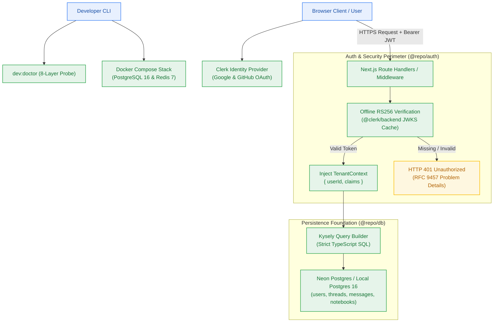
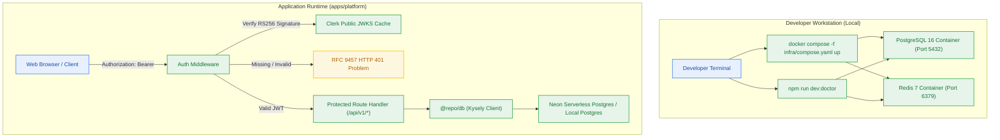

# Design — Milestone M1: Developer Golden Path & Core Authentication

> **Author:** architect-agent (Stage 3 Owner) · 2026-10-23 · **Status:** Final  
> **Grounding:** `_documentation/planning/prd.md` (§3, §5), `_documentation/planning/milestones/m1-developer-golden-path/milestone.md`, `project-brief.md` (FR-001..FR-003, FR-012, FR-022, FR-034; BR-001..BR-004; NFR-006, NFR-010)  
> **Target Version:** `v0.1.0` · **Risk Tier:** MEDIUM · **Checkpoint:** CP3  



---

## 1. Context and Scope

Following the successful completion of Milestone M0 (Workspace Foundation & Scaffolding, `v0.1.0-alpha.1`), the repository possesses a validated Turborepo layout, Bun toolchain, and baseline shared internal packages (`@repo/config`, `@repo/contracts`, `@repo/db`, `@repo/ui`). 

Milestone M1 establishes the reproducible developer runtime and core multi-tenant security perimeter (`v0.1.0`). It addresses four foundational requirements:
1. **Containerized Local Stack:** Fully offline development via `infra/compose.yaml` (PostgreSQL 16 and Redis 7) without requiring cloud credentials.
2. **Developer Diagnostic Golden Path:** An 8-layer diagnostic health probe (`npm run dev:doctor`) validating the developer workstation in < 5 minutes (`NFR-010`, `FR-012`).
3. **Core Authentication & Tenant Perimeter:** Clerk OAuth integration (restricted strictly to Google and GitHub), edge-compatible middleware verifying RS256 JWTs offline via public JWKS keys, and strict HTTP 401 RFC 9457 rejection on all protected routes (`FR-001`, `FR-003`, `NFR-006`, `BR-001`).
4. **Relational Persistence Foundation:** Kysely typed query layer and migrations for Neon Postgres covering core entities: users, conversation threads, messages, and notebooks (`FR-002`, `FR-022`, `BR-002`).

---

## 2. Goals and Non-Goals

### Goals
- **G-1:** Enable 100% offline, zero-cloud-credential developer onboarding via `docker compose -f infra/compose.yaml up -d` in < 30 seconds.
- **G-2:** Implement an 8-layer `dev:doctor` probe verifying Node/Bun versions, Docker, database, Redis, environment variables, ports, monorepo dependencies, and build pipeline in < 5 minutes (`FR-012`, `NFR-010`).
- **G-3:** Enforce a zero-trust multi-tenant security perimeter rejecting 100% of unauthenticated or tampered requests with HTTP 401 Problem Details (`NFR-006`, `BR-001`, `BR-003`).
- **G-4:** Provide an offline-first cryptographic JWT verification mechanism using cached Clerk JWKS public keys without per-request roundtrips to Clerk servers.
- **G-5:** Author typed Kysely relational schemas and idempotent migration files for `users`, `conversation_threads`, `conversation_messages`, and `notebooks` with strict foreign keys and tenant indexes on `user_id`.

### Non-Goals
- ❌ **Commercial Payments & Credit Card Processing:** Out of scope for v1.0.0; violates the $0.00/month infrastructure ceiling (`NFR-016`).
- ❌ **Rate Limiting & Credit Debiting:** Handled exclusively in Milestone M2 (`@repo/metering`).
- ❌ **Document Ingestion & Vector Storage:** Deferred to Milestone M3 (`@repo/ingestion`, Upstash Vector).
- ❌ **Email / Password Authentication:** Explicitly forbidden by architecture invariants (`[Q-002]`); only Google and GitHub OAuth social logins are supported.

---

## 3. The Design

### 3.1 Overview
The M1 architecture decomposes into three cohesive subsystems:
1. **Developer Tooling & Infrastructure (`infra/`):** Docker Compose orchestration and the 8-layer diagnostic doctor probe.
2. **Authentication & Identity (`@repo/auth`):** Clerk JWKS verification, session token decoding, `TenantContext` injection, and Next.js middleware guards.
3. **Relational Persistence (`@repo/db`):** Kysely schema models, PostgreSQL connection pooling (with scale-to-zero serverless driver compatibility), and schema migration runner.

### 3.2 System Context Diagram



### 3.3 Container & Component Topology (C4 L2 / L3)

#### C4 Level 2: Container Diagram
- **Local Database Container:** `postgres:16-alpine` exposed on `127.0.0.1:5432`, initialized with database `contextual_dev`, credentials `postgres:postgres`, and healthcheck `pg_isready -U postgres`.
- **Local Cache Container:** `redis:7-alpine` exposed on `127.0.0.1:6379`, initialized with healthcheck `redis-cli ping`.
- **Developer Doctor CLI:** Standalone Node/Bun TypeScript executable `packages/config/src/doctor/index.ts` invoking 8 discrete diagnostic probes.
- **Application Middleware:** Next.js Edge-compatible middleware intercepting requests to `/api/v1/*`.
- **Database Access Package (`@repo/db`):** Kysely instance configured with `pg.Pool` for local execution or `@neondatabase/serverless` connection pooler for production.

### 3.4 Local Developer Infrastructure (`infra/compose.yaml`)
The local container topology provides an identical environment to cloud serverless backends:

```yaml
# Specification for infra/compose.yaml
services:
  postgres:
    image: postgres:16-alpine
    container_name: contextual-postgres
    restart: unless-stopped
    environment:
      POSTGRES_USER: postgres
      POSTGRES_PASSWORD: postgrespassword
      POSTGRES_DB: contextual_dev
    ports:
      - "5432:5432"
    volumes:
      - postgres_data:/var/lib/postgresql/data
    healthcheck:
      test: ["CMD-SHELL", "pg_isready -U postgres -d contextual_dev"]
      interval: 5s
      timeout: 5s
      retries: 5

  redis:
    image: redis:7-alpine
    container_name: contextual-redis
    restart: unless-stopped
    ports:
      - "6379:6379"
    volumes:
      - redis_data:/data
    healthcheck:
      test: ["CMD", "redis-cli", "ping"]
      interval: 5s
      timeout: 5s
      retries: 5

volumes:
  postgres_data:
  redis_data:
```

### 3.5 8-Layer Doctor Diagnostic Architecture (`dev:doctor`)
The `npm run dev:doctor` diagnostic suite executes sequentially through 8 independent diagnostic layers. Each layer returns a typed result `{ layer: number, name: string, status: 'PASS' | 'FAIL' | 'WARN', message: string, durationMs: number }`:

1. **Layer 1: Runtime Engine Version Check**
   - Asserts Node.js version is `>= 22.0.0` or Bun version is `>= 1.1.0`.
   - Failure: Halts immediately; outputs installation instructions via Volta/mise.
2. **Layer 2: Container Runtime Availability**
   - Executes `docker info` / ping to verify Docker daemon is running.
   - Fallback: Warns if remote connection strings are detected in `.env`.
3. **Layer 3: Environment Variable & Secret Validation**
   - Evaluates `.env` against `@repo/config` Zod schema (`ConfigSchema`).
   - Asserts mandatory presence of `DATABASE_URL`, `NEXT_PUBLIC_CLERK_PUBLISHABLE_KEY`, `CLERK_SECRET_KEY`.
4. **Layer 4: Relational Database Connectivity**
   - Initiates TCP connection to `DATABASE_URL` and executes `SELECT 1 AS alive`.
   - Verifies connection latency is < 500 ms.
5. **Layer 5: In-Memory Cache Connectivity**
   - Dispatches `PING` to local or remote Redis; expects `PONG`.
6. **Layer 6: Network Port Conflict Detection**
   - Asserts ports `3000` (web), `5432` (postgres), and `6379` (redis) are either bound to our containers or available.
7. **Layer 7: Monorepo Package Resolution**
   - Verifies symlinks and exports for `@repo/config`, `@repo/contracts`, `@repo/db`, `@repo/ui`, `@repo/auth`.
8. **Layer 8: Monorepo Build & Strict Typecheck Health**
   - Runs `turbo run build typecheck --dry-run` to verify DAG integrity without circular dependencies.

Budget: Maximum execution time < 5 minutes (`NFR-010`); typical local execution < 15 seconds.

### 3.6 Core Authentication & Security Architecture

#### Identity Provider Constraints (`[Q-002]`)
- Identity is managed via Clerk.
- **Allowed Social Providers:** Google OAuth and GitHub OAuth only.
- **Disallowed Authentication Methods:** Email/password, magic links, SMS OTP, SAML/Enterprise SSO.
- Free tier limit: 10,000 MAU ($0.00/month).

#### Offline RS256 JWT Verification & JWKS Cache
To avoid incurring network latency (100–300 ms) and rate limits against Clerk's REST API on every request:
1. `@repo/auth` uses `@clerk/backend` with `jwtKey` or the Clerk JWKS public key cache URL (`https://<clerk-domain>/.well-known/jwks.json`).
2. The JWKS key set is cached in memory with a 1-hour TTL and stale-while-revalidate strategy.
3. Incoming requests to protected routes must supply `Authorization: Bearer <token>`.
4. The middleware validates:
   - Token signature matches cached Clerk public key.
   - Current timestamp is between `nbf` (not before) and `exp` (expiry).
   - Issuer (`iss`) matches the configured Clerk instance URL.
5. Upon successful validation, the middleware extracts the payload and constructs a typed `TenantContext`:
   ```typescript
   export interface TenantContext {
     userId: string;          // Clerk User ID (e.g., "user_2xyz...")
     sessionId: string;       // Clerk Session ID
     claims: Record<string, unknown>;
   }
   ```
6. The `TenantContext` is injected into request headers (`x-tenant-user-id`, `x-tenant-session-id`) for downstream Route Handlers.

#### Route Guarding & HTTP 401 Rejection
- **Public Routes:** `/`, `/api/health`, `/sign-in`, `/sign-up`, `/terms`, `/privacy`.
- **Protected Routes:** `/api/v1/*` (all API endpoints).
- If `Authorization` header is missing, malformed, expired, or carries an invalid signature:
  The middleware terminates the request immediately and returns HTTP 401 with an RFC 9457 Problem Details body:
  ```json
  {
    "type": "https://contextual.ai/errors/unauthorized",
    "title": "Unauthorized",
    "status": 401,
    "detail": "Missing, expired, or invalid bearer token.",
    "instance": "/api/v1/notebooks",
    "code": "AUTH_UNAUTHORIZED",
    "correlation_id": "req_01jabc123"
  }
  ```

### 3.7 Database Persistence Foundation (`@repo/db`)

#### CAP Analysis
- **Consistency vs Availability:** For user accounts, conversation history, and notebooks, we prioritize **Consistency (C)** over Availability (A) — standard CP profile in ACID relational stores.
- Reads and writes require strict multi-tenant isolation. A user must never observe stale or cross-tenant data.

#### Kysely Relational Schema Design
Four core tables are established in `packages/db/src/schema.ts` and managed via Kysely migrations:

1. **`users` Table**
   - `id`: `VARCHAR(128) PRIMARY KEY` (Stores Clerk `userId`, e.g., `user_2...`).
   - `email`: `VARCHAR(255) NOT NULL UNIQUE`.
   - `display_name`: `VARCHAR(255)`.
   - `avatar_url`: `TEXT`.
   - `created_at`: `TIMESTAMPTZ NOT NULL DEFAULT NOW()`.
   - `updated_at`: `TIMESTAMPTZ NOT NULL DEFAULT NOW()`.

2. **`conversation_threads` Table**
   - `id`: `UUID PRIMARY KEY DEFAULT gen_random_uuid()`.
   - `user_id`: `VARCHAR(128) NOT NULL REFERENCES users(id) ON DELETE CASCADE`.
   - `title`: `VARCHAR(255) NOT NULL`.
   - `created_at`: `TIMESTAMPTZ NOT NULL DEFAULT NOW()`.
   - `updated_at`: `TIMESTAMPTZ NOT NULL DEFAULT NOW()`.
   - *Index:* `CREATE INDEX idx_threads_user_id ON conversation_threads(user_id)`.

3. **`conversation_messages` Table**
   - `id`: `UUID PRIMARY KEY DEFAULT gen_random_uuid()`.
   - `thread_id`: `UUID NOT NULL REFERENCES conversation_threads(id) ON DELETE CASCADE`.
   - `user_id`: `VARCHAR(128) NOT NULL REFERENCES users(id) ON DELETE CASCADE`.
   - `role`: `VARCHAR(32) NOT NULL CHECK (role IN ('user', 'assistant', 'system'))`.
   - `content`: `TEXT NOT NULL`.
   - `tokens`: `INTEGER DEFAULT 0`.
   - `metadata`: `JSONB DEFAULT '{}'::jsonb`.
   - `created_at`: `TIMESTAMPTZ NOT NULL DEFAULT NOW()`.
   - *Index:* `CREATE INDEX idx_messages_thread_user ON conversation_messages(thread_id, user_id)`.

4. **`notebooks` Table**
   - `id`: `UUID PRIMARY KEY DEFAULT gen_random_uuid()`.
   - `user_id`: `VARCHAR(128) NOT NULL REFERENCES users(id) ON DELETE CASCADE`.
   - `title`: `VARCHAR(255) NOT NULL`.
   - `description`: `TEXT`.
   - `idle_since`: `TIMESTAMPTZ NOT NULL DEFAULT NOW()`.
   - `deleted_at`: `TIMESTAMPTZ NULL`.
   - `created_at`: `TIMESTAMPTZ NOT NULL DEFAULT NOW()`.
   - `updated_at`: `TIMESTAMPTZ NOT NULL DEFAULT NOW()`.
   - *Index:* `CREATE INDEX idx_notebooks_user_id ON notebooks(user_id)`.
   - *Index:* `CREATE INDEX idx_notebooks_idle ON notebooks(idle_since) WHERE deleted_at IS NULL`.

#### Migration Strategy (Expand/Contract)
- Migrations are authored as TypeScript files in `packages/db/src/migrations/`.
- Execution is handled via `packages/db/src/migrator.ts` using Kysely's `FileMigrationProvider`.
- All migrations are additive (expand) during initial rollout; drop operations (contract) are deferred until all readers migrate.

### 3.8 owns/depends Contracts

| Component | owns | depends | DI severity |
|---|---|---|---|
| `@repo/auth` | JWT signature verification, `TenantContext` generation | `@clerk/backend`, `@repo/contracts` | **FATAL** |
| Next.js Auth Middleware | Edge route filtering, HTTP 401 generation | `@repo/auth`, `@repo/contracts` | **FATAL** |
| `@repo/db` (Kysely) | Type-safe SQL client, migration runner | `pg`, `kysely`, `@repo/config` | **FATAL** |
| `dev:doctor` | 8-layer diagnostic health probe | `docker-cli`, `pg`, `ioredis`, `@repo/config` | **WARN** |
| `infra/compose.yaml` | Local container runtime (Postgres 16, Redis 7) | Docker Engine / OrbStack | **ERROR** (for offline dev) |

---

## 4. Alternatives Considered

| Decision Area | Option | Trade-off | Why Lost |
|---|---|---|---|
| **Local Infrastructure** | **Option A: Containerized Docker Compose (Selected)** | Requires Docker daemon; identical to cloud services. | — **CHOSEN** |
| | Option B: In-Memory SQLite + Mock Redis | Zero installation overhead; divergent SQL dialect. | Fails PostgreSQL dialect fidelity; cannot test JSONB or UUID gen. |
| | Option C: Direct Cloud-Only Dev (Neon + Upstash) | Requires internet; consumes free tier quotas during tests. | Breaks offline development; risks exhaust quotas during dev loops. |
| **Authentication Flow** | **Option A: Clerk Offline RS256 JWKS (Selected)** | Generous 10k MAU; offline verification is fast (< 2 ms). | — **CHOSEN** |
| | Option B: Clerk Online Session Validation (`verifySession`) | Always reflects revocation immediately; 150 ms network penalty. | Incurs severe network latency on every API call; risks rate limits. |
| | Option C: Bespoke Auth.js (NextAuth) | Full control over credentials and session tables. | Requires email provider or custom OAuth setup; higher maintenance burden. |
| **ORM / Query Builder** | **Option A: Kysely Query Builder (Selected)** | Type-safe SQL, zero runtime overhead, pure TypeScript. | — **CHOSEN** (ADR-0002) |
| | Option B: Prisma ORM | Heavy Rust query engine binary; memory overhead in serverless. | High cold starts (> 1s) and connection pool exhaustion on scale-to-zero. |
| | Option C: Drizzle ORM | Modern, lightweight, good TypeScript support. | Kysely was ratified in ADR-0002; changing ORM adds zero architectural gain. |
| **Diagnostic Tool** | **Option A: In-Repo TypeScript Doctor Script (Selected)** | Zero external CLI deps; deeply coupled to `@repo/config` Zod schema. | — **CHOSEN** |
| | Option B: Generic Shell Script (`doctor.sh`) | Bash dependencies differ across macOS and Linux. | Fragile cross-platform portability; cannot cleanly import Zod schemas. |
| | Option C: Third-Party CLI Tool (e.g. clinic) | Generic performance tool; lacks contextual project checks. | Cannot check Neon connection string validity or monorepo package DAG. |

---

## 5. Cross-Cutting Concerns

- **Security:**
  - RS256 cryptographic signature validation on all `/api/v1/*` routes.
  - Zero token, secret key, or database connection string exposure in stdout logs or error payloads (`NFR-026`, `BR-012`).
  - Strict tenant isolation enforced at SQL layer via `user_id` foreign keys and indexed queries (`BR-002`).
- **Observability:**
  - `dev:doctor` logs structured step outcomes with elapsed duration in milliseconds.
  - Auth middleware attaches W3C `traceparent` and correlation ID (`x-correlation-id`) to every request.
  - Log redaction regex masks any Bearer token or connection string before logging.
- **Deployment:**
  - Local: `infra/compose.yaml` (Postgres 16, Redis 7).
  - Production: Neon Serverless Postgres via scale-to-zero pooler; Clerk Cloud Identity.
- **Migration & Rollout Ordering:**
  - Schema expansion order:
    1. Apply migration `001_initial_auth_and_notebooks.ts` (creates `users`, `conversation_threads`, `conversation_messages`, `notebooks`).
    2. Deploy `@repo/auth` and middleware.
    3. Deploy protected Route Handlers.
  - All migrations are backwards-compatible (expand phase).
- **Breaking Change:**
  - `none` — Milestone M1 introduces additive foundation packages (`@repo/auth`, `infra/compose.yaml`, `@repo/db` schemas) without breaking any existing M0 monorepo contracts.

---

## 6. Verification Hooks

Milestone M1 verification binds to four concrete verification suites:
1. **Containerized Stack Boot:** `docker compose -f infra/compose.yaml up -d` boots healthy Postgres and Redis in < 30 seconds (`AC-1.1`).
2. **8-Layer Doctor Diagnostic:** `npm run dev:doctor` runs all 8 layers and exits with code 0 in < 5 minutes (`AC-1.2`, `NFR-010`).
3. **Auth Middleware Rejection:** Integration tests verify that 100% of unauthenticated calls to `/api/v1/*` receive HTTP 401 with RFC 9457 body (`AC-1.3`, `NFR-006`).
4. **Relational Schema Migrations:** Kysely migration runner applies `001_initial_auth_and_notebooks` to a fresh database, asserts all 4 tables and 4 indexes exist, and verifies tenant isolation filters (`AC-1.4`, `BR-002`).

---
*Sealed by architect-agent at Checkpoint 3 (Gate G4).*
