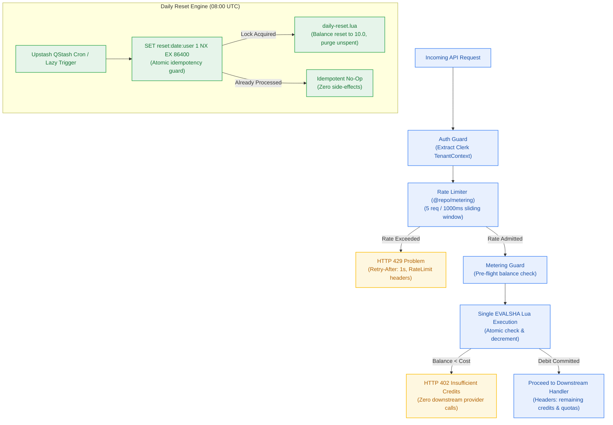
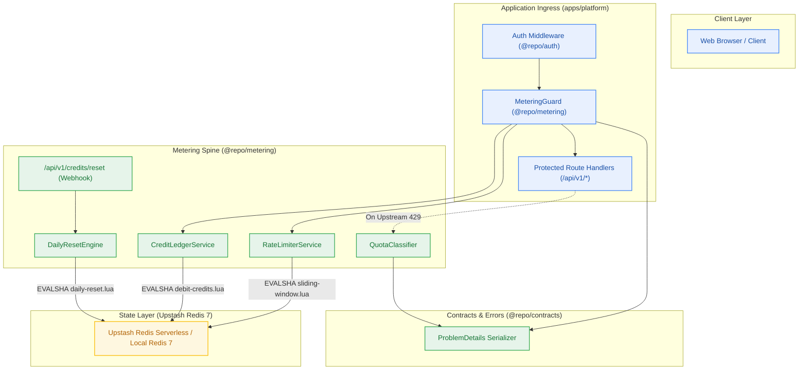
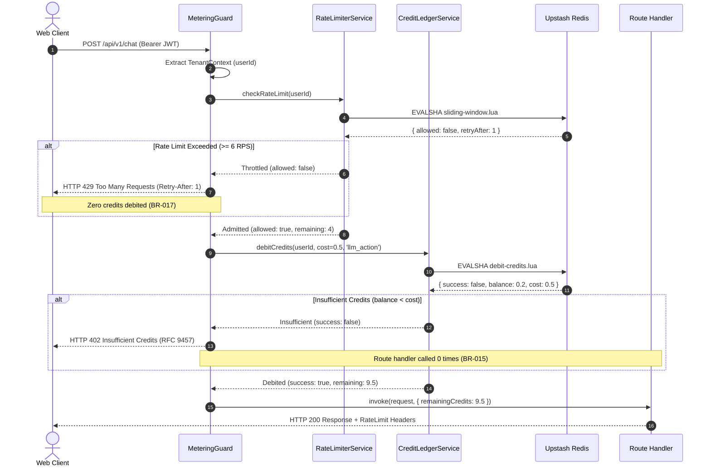
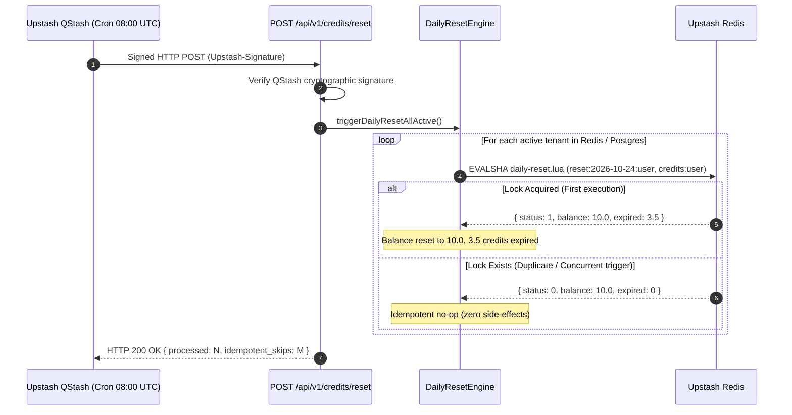

# Design — Milestone M2: Metering Spine & Quota Throttling

> **Author:** architect-agent (Stage 3 Owner) · 2026-10-23 · **Status:** Final  
> **Grounding:** `_documentation/planning/prd.md` (§3, §5), `_documentation/planning/milestones/m2-metering-spine/milestone.md`, `project-brief.md` (FR-014..FR-018, FR-024..FR-029; BR-013..BR-017, BR-025..BR-032; NFR-011..NFR-013, NFR-020, NFR-023..NFR-030)  
> **Target Version:** `v0.2.0` · **Risk Tier:** HIGH · **Checkpoint:** CP3  



---

## 1. Context and Scope

Following the successful completion of Milestone M0 (Workspace Foundation) and Milestone M1 (Developer Golden Path & Core Authentication, `v0.1.0`), the platform features offline-first local Docker Compose infrastructure, an 8-layer diagnostic health probe (`dev:doctor`), Clerk OAuth integration with offline RS256 JWKS JWT verification, and Kysely relational persistence for users, conversation threads, and notebooks.

**Milestone M2: Metering Spine & Quota Throttling (`v0.2.0`)** introduces the platform's core economic governor and upstream abuse prevention system. Operating under a strict **$0.00/month infrastructure ceiling** (`NFR-016`), the platform must prevent multi-tenant race conditions from exhausting external cloud free tiers (such as Google AI Studio's 15 RPM / 1,500 RPD and Upstash's 500,000 monthly command allowance).

Milestone M2 addresses six foundational capabilities:
1. **Atomic Redis Lua Credit Ledger:** Multi-threaded credit debiting (10.0 daily grant, 0.5 LLM action, 1.0 document ingest) executing in a single `EVALSHA` roundtrip without negative balances (`FR-014`, `FR-015`, `FR-018`, `NFR-011`, `BR-013`, `BR-014`).
2. **Per-User 5 RPS Sliding Window Rate Limiter:** High-precision millisecond-based sliding window rate limiter rejecting burst traffic exceeding 5 requests/sec with HTTP 429 and `Retry-After: 1` (`FR-017`, `BR-016`, `NFR-012`). Throttled requests never debit user credits (`BR-017`).
3. **Ingress Credit Guard & HTTP 402 Short-Circuit:** Edge-compatible pre-flight guard returning RFC 9457 HTTP 402 `INSUFFICIENT_CREDITS` immediately when balance is insufficient, guaranteeing zero calls to downstream LLMs or vector stores (`FR-016`, `BR-015`).
4. **Closed 17-Member RFC 9457 Problem Details Error Catalogue:** Comprehensive, typed error serialization with immutable type URIs (`https://contextual.ai/errors/*`), machine-readable quota fields (`service`, `quota_period`, `resets_in_seconds`), and secret/stack trace sanitization (`FR-025`, `FR-027`, `NFR-027`, `BR-028`..`BR-032`).
5. **Upstream Provider Quota Classifier & RateLimit Headers:** Typed classifier mapping upstream provider errors (Google `RESOURCE_EXHAUSTED`) to RFC 9457 `SERVICE_LIMIT_REACHED` (HTTP 402) rather than misleading generic 5xx errors, accompanied by standardized `RateLimit-Limit`, `RateLimit-Remaining`, `RateLimit-Reset`, and `RateLimit-Policy` response headers (`FR-026`, `FR-028`, `FR-029`, `BR-028`..`BR-030`).
6. **Idempotent Daily 08:00 UTC Reset Engine:** Automated reset resetting balances to 10.0 credits at 08:00 UTC (aligned with Google AI Studio's reset boundary), permanently dropping unspent credits without carry-over, protected by `SET NX EX 86400` against duplicate execution (`FR-024`, `BR-025`, `BR-026`, `NFR-023`, `NFR-024`).

---

## 2. Goals and Non-Goals

### Goals
- **G-1 (Zero Negative Balances):** 100 concurrent debit requests against an account with 10.0 credits result in strictly zero negative balance readings and zero lost updates (`NFR-011`, `BR-013`).
- **G-2 (Sub-10ms Decision Latency):** Rate limiter and credit balance evaluation p99 latency is < 10 ms (`NFR-012`); the 6th request within a 1-second window returns HTTP 429 (`BR-016`).
- **G-3 (Zero Downstream Provider Calls on Exhaustion):** Requests with balance < action cost terminate at the ingress guard; downstream route handlers and upstream APIs receive 0 invocations (`FR-016`, `BR-015`).
- **G-4 (Redis Command Budget Optimization):** The entire rate limit check and credit debit operation consumes strictly ≤ 2 Redis commands per request via Lua script (`NFR-013`).
- **G-5 (Strict Idempotency for Daily Reset):** Parallel concurrent executions of daily reset for the same user execute exactly once, leaving balance at 10.0 with zero credit rollover (`NFR-023`, `NFR-024`, `BR-025`).
- **G-6 (Strict RFC 9457 Uniformity):** 100% of API error responses adhere to the closed 17-member problem details catalogue with full context and redacted secrets (`FR-027`, `BR-031`).

### Non-Goals
- ❌ **Commercial Payments & Credit Top-Ups:** Selling credits via Stripe/LemonSqueezy is explicitly forbidden for v0.2.0; the platform operates strictly within free-tier allowances (`NFR-016`).
- ❌ **Credit Roll-Over Banking:** Unspent credits expire at 08:00 UTC daily; credit accumulation across days is prohibited (`BR-024`).
- ❌ **Per-Tenant Custom Rate Limiting:** Dynamic per-user rate limit tiers are out of scope; all authenticated users share a uniform 5 RPS sliding limit in M2.
- ❌ **LLM Inference Execution:** M2 provides the metering guard and quota classification; actual Google Gemini / Groq reasoning execution belongs to Milestone M5.

---

## 3. The Design

### 3.1 Subsystem Decomposition
The M2 architecture introduces `@repo/metering` (`packages/metering`) and enhances `@repo/contracts` (`packages/contracts`) across five cohesive modules:
1. **`CreditLedgerService` (`packages/metering/src/credit-ledger.ts`):** Evaluates, allocates, and debits credits using the atomic `debit-credits.lua` script via Redis `EVALSHA`. Handles automatic `SCRIPT LOAD` on cache misses.
2. **`RateLimiterService` (`packages/metering/src/rate-limiter.ts`):** Enforces 5 RPS sliding window using millisecond timestamps in Redis sorted sets via `sliding-window.lua`.
3. **`MeteringGuard` (`packages/metering/src/metering-guard.ts`):** Edge-compatible request guard evaluating auth context, checking rate limits, debiting credits, and short-circuiting on failure.
4. **`RFC 9457 Error System` (`packages/contracts/src/error-catalog.ts`, `errors.ts`):** Closed 17-member enum catalogue, TypeScript types, and serializer enforcing mandatory members, machine-readable quota fields, and secret redaction.
5. **`QuotaClassifier & Headers` (`packages/metering/src/quota-classifier.ts`, `headers.ts`):** Maps upstream provider error payloads to `SERVICE_LIMIT_REACHED` and constructs IETF `RateLimit-*` headers.
6. **`DailyResetEngine` (`packages/metering/src/daily-reset.ts`, `lua/daily-reset.lua`):** Orchestrates 08:00 UTC credit resets with atomic idempotency locks and unspent credit expiration.

### 3.2 System Context Diagram



---

### 3.3 Redis Key Namespaces & Storage Layout

To guarantee isolation, predictable TTL management, and sub-10ms query performance, keys in Redis follow strict namespacing:

| Key Pattern | Data Structure | TTL Policy | Purpose |
|---|---|---|---|
| `credits:{userId}` | String (Float) | 172,800s (48h rolling) | Account credit balance (e.g. `"10.0"`). Initialized to 10.0 on first access. |
| `rl:{userId}` | Sorted Set (ZSET) | 2s (rolling expiry) | Sliding window rate limiter. Scores are millisecond epoch timestamps (`now_ms`), members are unique request IDs (`now_ms:random`). |
| `reset:{YYYY-MM-DD}:{userId}` | String (`"1"`) | 86,400s (24h) | Daily reset idempotency lock. Written via `SET NX EX 86400`. |
| `scripts:sha:{scriptName}` | String | None (in-memory client cache) | SHA1 digest of pre-loaded Lua scripts for `EVALSHA` execution. |

---

### 3.4 Atomic Lua Script Design

#### 1. Credit Debit Script (`debit-credits.lua`)
Atomic credit deduction script executed via `EVALSHA`. Guarantees that if the account does not exist, it is initialized to `10.0` credits before the debit is evaluated.

```lua
-- KEYS[1]: credits:{userId}
-- ARGV[1]: debit_amount (e.g. 0.5 or 1.0)
-- ARGV[2]: default_grant (e.g. 10.0)
-- ARGV[3]: ttl_seconds (e.g. 172800)

local current = redis.call('GET', KEYS[1])
local balance

if not current then
    balance = tonumber(ARGV[2])
else
    balance = tonumber(current)
end

local cost = tonumber(ARGV[1])

if balance < cost then
    -- Return 0 (failure), current balance, and cost
    return {0, tostring(balance), tostring(cost)}
end

balance = balance - cost
redis.call('SET', KEYS[1], tostring(balance), 'EX', tonumber(ARGV[3]))

-- Return 1 (success), remaining balance, and cost debited
return {1, tostring(balance), tostring(cost)}
```

#### 2. Sliding Window Rate Limiter Script (`sliding-window.lua`)
Enforces a 5 RPS limit over a rolling 1,000ms window using a Redis Sorted Set. Automatically prunes records older than `now - 1000ms`.

```lua
-- KEYS[1]: rl:{userId}
-- ARGV[1]: now_ms (current timestamp from Redis TIME or client)
-- ARGV[2]: window_ms (1000)
-- ARGV[3]: max_requests (5)
-- ARGV[4]: request_id (unique string now_ms:rand)

local now = tonumber(ARGV[1])
local window = tonumber(ARGV[2])
local max_requests = tonumber(ARGV[3])
local clear_before = now - window

-- Prune requests outside rolling window
redis.call('ZREMRANGEBYSCORE', KEYS[1], 0, clear_before)

local current_count = redis.call('ZCARD', KEYS[1])

if current_count >= max_requests then
    -- Rate limit exceeded.
    -- Fetch oldest element in window to calculate exact retry-after
    local oldest = redis.call('ZRANGE', KEYS[1], 0, 0, 'WITHSCORES')
    local retry_after = 1
    if #oldest > 0 then
        local oldest_ts = tonumber(oldest[2])
        local remaining_window_ms = (oldest_ts + window) - now
        if remaining_window_ms > 0 then
            retry_after = math.ceil(remaining_window_ms / 1000)
        end
    end
    return {0, current_count, retry_after}
end

-- Admit request
redis.call('ZADD', KEYS[1], now, ARGV[4])
redis.call('EXPIRE', KEYS[1], 2)

return {1, current_count + 1, 0}
```

#### 3. Idempotent Daily Reset Script (`daily-reset.lua`)
Resets account balance to 10.0 credits at 08:00 UTC, permanently discarding unspent credits without carry-over.

```lua
-- KEYS[1]: reset:{date}:{userId}
-- KEYS[2]: credits:{userId}
-- ARGV[1]: default_grant (10.0)
-- ARGV[2]: lock_ttl_seconds (86400)
-- ARGV[3]: balance_ttl_seconds (172800)

-- Check if reset was already applied for this user on this date
local locked = redis.call('SET', KEYS[1], '1', 'NX', 'EX', tonumber(ARGV[2]))

if not locked then
    -- Already reset today; return 0 (skipped) and current balance
    local current = redis.call('GET', KEYS[2]) or ARGV[1]
    return {0, tostring(current), 0}
end

-- Read old balance before resetting to compute expired credits
local old_balance = tonumber(redis.call('GET', KEYS[2]) or ARGV[1])
local expired = math.max(0, old_balance)

redis.call('SET', KEYS[2], ARGV[1], 'EX', tonumber(ARGV[3]))

-- Return 1 (reset executed), new balance (10.0), and expired credits amount
return {1, ARGV[1], tostring(expired)}
```

#### EVALSHA NOSCRIPT Resilience
Every script execution is wrapped by `executeLua(scriptName, luaSource, keys, args)`:
1. Computes or retrieves cached SHA1 digest.
2. Dispatches `EVALSHA <sha> <key_count> <keys...> <args...>`.
3. If Redis responds with `NOSCRIPT No matching script`, catches error, executes `SCRIPT LOAD <luaSource>`, caches returned SHA1, and retries `EVALSHA` immediately.

---

### 3.5 Ingress Metering Guard Execution Flow

The `MeteringGuard` acts as an edge-compatible guard intercepting metered routes (e.g. `/api/v1/chat`, `/api/v1/ingestions`):



---

### 3.6 Closed 17-Member RFC 9457 Problem Details Catalogue

All platform errors format as `application/problem+json` according to RFC 9457 (`conventions.md` §4, `FR-025`, `FR-027`). The 17 members form an immutable closed union:

```typescript
export const ERROR_TYPE_PREFIX = "https://contextual.ai/errors/";

export const ERROR_CATALOGUE = {
  AUTHENTICATION_REQUIRED: {
    type: `${ERROR_TYPE_PREFIX}authentication-required`,
    title: "Authentication Required",
    status: 401,
  },
  FORBIDDEN_TENANT_ACCESS: {
    type: `${ERROR_TYPE_PREFIX}forbidden-tenant-access`,
    title: "Forbidden Tenant Access",
    status: 403,
  },
  INSUFFICIENT_CREDITS: {
    type: `${ERROR_TYPE_PREFIX}insufficient-credits`,
    title: "Insufficient Credits",
    status: 402,
  },
  SERVICE_LIMIT_REACHED: {
    type: `${ERROR_TYPE_PREFIX}service-limit-reached`,
    title: "Service Limit Reached",
    status: 402,
  },
  RATE_LIMIT_EXCEEDED: {
    type: `${ERROR_TYPE_PREFIX}rate-limit-exceeded`,
    title: "Rate Limit Exceeded",
    status: 429,
  },
  UPLOAD_SIZE_EXCEEDED: {
    type: `${ERROR_TYPE_PREFIX}upload-size-exceeded`,
    title: "Upload Size Exceeded",
    status: 413,
  },
  UNSUPPORTED_MEDIA_TYPE: {
    type: `${ERROR_TYPE_PREFIX}unsupported-media-type`,
    title: "Unsupported Media Type",
    status: 415,
  },
  DOCUMENT_PARSING_FAILED: {
    type: `${ERROR_TYPE_PREFIX}document-parsing-failed`,
    title: "Document Parsing Failed",
    status: 422,
  },
  PASSWORD_PROTECTED_PDF: {
    type: `${ERROR_TYPE_PREFIX}password-protected-pdf`,
    title: "Password Protected PDF",
    status: 422,
  },
  NO_TEXT_LAYER_PDF: {
    type: `${ERROR_TYPE_PREFIX}no-text-layer-pdf`,
    title: "No Text Layer Found in PDF",
    status: 422,
  },
  PROGRESS_STREAM_UNAVAILABLE: {
    type: `${ERROR_TYPE_PREFIX}progress-stream-unavailable`,
    title: "Progress Stream Unavailable",
    status: 503,
  },
  PROGRESS_STREAM_TIMEOUT: {
    type: `${ERROR_TYPE_PREFIX}progress-stream-timeout`,
    title: "Progress Stream Timeout",
    status: 504,
  },
  NOTEBOOK_EXPIRED: {
    type: `${ERROR_TYPE_PREFIX}notebook-expired`,
    title: "Notebook Expired",
    status: 410,
  },
  NOTEBOOK_NOT_FOUND: {
    type: `${ERROR_TYPE_PREFIX}notebook-not-found`,
    title: "Notebook Not Found",
    status: 404,
  },
  INVALID_NODE_RELATION: {
    type: `${ERROR_TYPE_PREFIX}invalid-node-relation`,
    title: "Invalid Node Relation",
    status: 400,
  },
  UPSTREAM_PROVIDER_UNAVAILABLE: {
    type: `${ERROR_TYPE_PREFIX}upstream-provider-unavailable`,
    title: "Upstream Provider Unavailable",
    status: 502,
  },
  INTERNAL_SERVER_ERROR: {
    type: `${ERROR_TYPE_PREFIX}internal-server-error`,
    title: "Internal Server Error",
    status: 500,
  },
} as const;
```

#### Quota Fields Serialization Structure
When emitting `INSUFFICIENT_CREDITS` or `SERVICE_LIMIT_REACHED`, the problem payload exposes structured machine-readable fields:

```json
{
  "type": "https://contextual.ai/errors/service-limit-reached",
  "title": "Service Limit Reached",
  "status": 402,
  "detail": "Google AI Studio daily quota exhausted (1,500 requests/day).",
  "instance": "/api/v1/chat",
  "service": "google-ai-studio",
  "quota_period": "daily",
  "quota_used": 1500,
  "quota_limit": 1500,
  "resets_in_seconds": 18450,
  "credits_remaining": 6.5,
  "correlation_id": "req_01jabc123"
}
```

---

### 3.7 Upstream Quota Classification & Standard Headers

#### 1. Quota Classification Logic
Upstream errors from AI providers (Google AI Studio, Groq, Upstash) are inspected by `QuotaClassifier`:
- **Google AI Studio HTTP 429 (`RESOURCE_EXHAUSTED`):** Classified as `SERVICE_LIMIT_REACHED` (HTTP 402) with `service: "google-ai-studio"`, `quota_period: "daily"`, and computed `resets_in_seconds` targeting 08:00 UTC.
- **Upstream Network/500 Errors:** Classified as `UPSTREAM_PROVIDER_UNAVAILABLE` (HTTP 502). Zero occurrences of `SERVICE_LIMIT_REACHED` for non-quota conditions (`NFR-025`, `BR-028`).
- **Internal Platform Quota (Credits):** Emits `INSUFFICIENT_CREDITS` (HTTP 402).

#### 2. HTTP Response Headers
All API responses across metered routes inject standardized IETF rate limiting headers:

```http
RateLimit-Limit: 5
RateLimit-Remaining: 3
RateLimit-Reset: 1
RateLimit-Policy: 5;w=1
X-Credit-Balance: 9.5
X-Credit-Daily-Grant: 10.0
X-Credit-Resets-At: 2026-10-24T08:00:00Z
```

On rate limit throttling (HTTP 429):
```http
Retry-After: 1
RateLimit-Remaining: 0
RateLimit-Reset: 1
```

---

### 3.8 Idempotent Daily 08:00 UTC Reset Flow



In addition to scheduled QStash cron execution, lazy evaluation is supported: if a user makes their first request of the day and their last reset was before 08:00 UTC, `CreditLedgerService` checks Redis `TIME` and triggers `daily-reset.lua` on the fly before debiting.

---

### 3.9 owns/depends Contracts

| Component | owns | depends | DI severity |
|---|---|---|---|
| `CreditLedgerService` | Credit balance state, atomic debiting, `debit-credits.lua` | `@upstash/redis` (or local Redis client), `@repo/contracts` | **FATAL** |
| `RateLimiterService` | 5 RPS sliding window limiter, `sliding-window.lua` | `@upstash/redis`, `@repo/contracts` | **FATAL** |
| `MeteringGuard` | Ingress request interception, short-circuit rejection | `RateLimiterService`, `CreditLedgerService`, `@repo/contracts` | **FATAL** |
| `DailyResetEngine` | 08:00 UTC reset cycle, idempotency lock, `daily-reset.lua` | `@upstash/redis`, `@repo/contracts` | **ERROR** |
| `QuotaClassifier` | Provider error mapping, RFC 9457 quota payload synthesis | `@repo/contracts` | **WARN** |
| `ProblemDetails` | RFC 9457 error serialization, secret sanitization | `@repo/contracts` | **FATAL** |

---

## 4. Alternatives Considered

| Decision Area | Option | Trade-off | Why Lost |
|---|---|---|---|
| **Credit Ledger Engine** | **Option A: Upstash Redis Lua Script (Selected)** | Atomic, single roundtrip (`< 8ms`), zero negative balances under concurrency (`PTY-010`). | — **CHOSEN** |
| | Option B: PostgreSQL Relational Row Lock (`SELECT FOR UPDATE`) | ACID consistency; transaction overhead on Neon compute wakes database and incurs cold starts. | Neon scale-to-zero compute has 1-2s cold resume latency; high concurrency saturates database pool. |
| | Option C: In-Memory Client Mutex (Node.js Lock) | Zero network hops; works only within a single Node process. | Fails completely on multi-instance serverless functions (Vercel Edge); causes massive double spending. |
| **Rate Limiter Algorithm** | **Option A: Redis Sorted Set Sliding Window (Selected)** | True millisecond rolling window precision; accurate `Retry-After` estimation. | — **CHOSEN** |
| | Option B: Fixed Window Counter (`INCR` + `EXPIRE`) | Minimal memory overhead (single integer key). | Vulnerable to 2x burst traffic across window boundaries (e.g. 5 reqs at 0.99s and 5 reqs at 1.01s). |
| | Option C: Token Bucket with Sleep | Smooth pacing; requires sleeping thread. | Serverless functions cannot sleep or hold persistent background timers without billing penalties. |
| **Error Serialization** | **Option A: RFC 9457 Closed 17-Member Catalogue (Selected)** | Standardized `application/problem+json`; machine-readable quota fields; immutable URIs. | — **CHOSEN** |
| | Option B: Bespoke JSON `{ success: false, error: "..." }` | Trivially easy to write; non-standard. | Inconsistent client error handling; lacks standardized quota period and reset headers. |
| | Option C: GraphQL Error Array | Rich path tracking; requires full GraphQL runtime. | Adds heavy runtime complexity to a clean REST / Server Component architecture. |
| **Reset Execution** | **Option A: Upstash QStash Cron + Lazy Redis Check (Selected)** | Automated 08:00 UTC dispatch with lazy fallback on first request; fully serverless ($0.00/month). | — **CHOSEN** |
| | Option B: Persistent Node.js cron process (`node-cron`) | Simple in long-running container. | Impossible on Vercel Hobby serverless runtime where instances spin down when idle. |
| | Option C: Client-driven reset on every GET | Moves trigger to user; requires complex client clock sync. | Vulnerable to client device clock spoofing; violates single authority principle. |

---

## 5. Cross-Cutting Concerns

### 5.1 Centralized Logging & Telemetry Architecture (CP3 Gate Item)
- **Mechanism:** Pino structured JSON logging integrated with `@opentelemetry/sdk-node` (`architecture.md` §8.1).
- **Logged Events:**
  - `metering.credits.debited` (`INFO`): `{ userId, cost, balance, action, correlation_id }`
  - `metering.credits.insufficient` (`WARN`): `{ userId, cost, balance, correlation_id }`
  - `metering.rate_limit.admitted` (`DEBUG`): `{ userId, remaining, window_ms }`
  - `metering.rate_limit.throttled` (`WARN`): `{ userId, retryAfterSeconds, correlation_id }`
  - `metering.reset.executed` (`INFO`): `{ userId, newBalance: 10.0, expiredCredits }`
  - `metering.reset.skipped_idempotent` (`DEBUG`): `{ userId, date }`
- **Redaction Policy:** All user identifiers and keys pass through regex sanitization; secret keys, tokens, and database credentials are permanently stripped before emission (`BR-012`, `NFR-026`).

### 5.2 Security & Multi-Tenant Isolation
- Redis keys strictly prefix tenant identity (`credits:{userId}`, `rl:{userId}`).
- Cross-tenant credit manipulation is impossible: `userId` is supplied exclusively by the cryptographically verified `TenantContext` injected by `@repo/auth`.
- Internal reset endpoints (`/api/v1/credits/reset`) require cryptographic `Upstash-Signature` validation, rejecting unauthorized invocations.

### 5.3 Deployment & Upstash Connection Management
- **Local Dev:** Connects to local Redis 7 container (`contextual-redis` on `localhost:6379`) via `@upstash/redis` in compatibility mode or local client.
- **Production:** Uses `@upstash/redis` REST client over HTTPS with connection Keep-Alive, optimized for Vercel Hobby serverless runtime.
- **Zero Cost Ceiling:** Upstash free tier allows 10,000 commands/day and 500,000 commands/month. Single-script Lua execution consumes strictly 1 command per check/debit, guaranteeing the platform stays well within free quotas (`NFR-013`).

### 5.4 Migration & Rollout Sequencing (CP3 Gate Item)
- **Deployment Ordering:**
  1. **Deploy Contract Extensions:** Publish updated `@repo/contracts` with closed 17-member error catalogue and `ProblemDetails` serializer.
  2. **Deploy Metering Package:** Deploy `@repo/metering` with Lua scripts pre-loaded or dynamic `SCRIPT LOAD` on first invocation.
  3. **Activate Ingress Guard:** Integrate `MeteringGuard` into protected `/api/v1/*` route handlers.
  4. **Register QStash Schedule:** Configure daily 08:00 UTC QStash cron trigger for `/api/v1/credits/reset`.
- **Compatibility:** Fully backwards-compatible (expand phase). No breaking changes to existing M0 or M1 contracts.

### 5.5 Breaking Change Signal (CP3 Gate Item)
- **Breaking Change Status:** `NONE` (Additive release).
- **Consumer Impact:** Existing routes `/health` and `/users/me` continue functioning unchanged. Protected routes gain rate limiting and credit debiting headers (`RateLimit-*`, `X-Credit-*`). Clients receive standard HTTP 402/429 problem details on quota exhaustion.

---

## 6. Verification Hooks

Milestone M2 verification binds strictly to six automated test suites:
1. **Credit Ledger Concurrency:** `bun test packages/metering/tests/credit-ledger.test.ts` asserts 100 concurrent debits result in zero negative balances (`TC-2.1.1`–`TC-2.1.3`, `NFR-011`).
2. **Sliding Rate Limiter:** `bun test packages/metering/tests/rate-limiter.test.ts` asserts 5 RPS limit, 6th request 429 throttling, and zero credit debiting on throttle (`TC-2.2.1`–`TC-2.2.3`, `NFR-012`).
3. **Ingress Guard Short-Circuit:** `bun test packages/metering/tests/metering-guard.test.ts` asserts HTTP 402 with RFC 9457 payload and zero calls to downstream mock handlers (`TC-2.3.1`–`TC-2.3.2`, `BR-015`).
4. **RFC 9457 Error Catalogue:** `bun test packages/contracts/tests/errors.test.ts` asserts closed 17-member catalogue validation, secret stripping, and serialization latency < 50ms (`TC-2.4.1`–`TC-2.4.3`, `NFR-027`).
5. **Quota Classifier & Headers:** `bun test packages/metering/tests/quota-classifier.test.ts` asserts Gemini 429 mapping to `SERVICE_LIMIT_REACHED` and IETF headers generation (`TC-2.5.1`–`TC-2.5.3`, `NFR-025`).
6. **Daily Reset Idempotency:** `bun test packages/metering/tests/daily-reset.test.ts` asserts 10.0 credit reset, unspent credit expiry, and concurrent execution idempotency (`TC-2.6.1`–`TC-2.6.3`, `NFR-023`).

---
*Sealed by architect-agent at Checkpoint 3 (Gate G4).*
