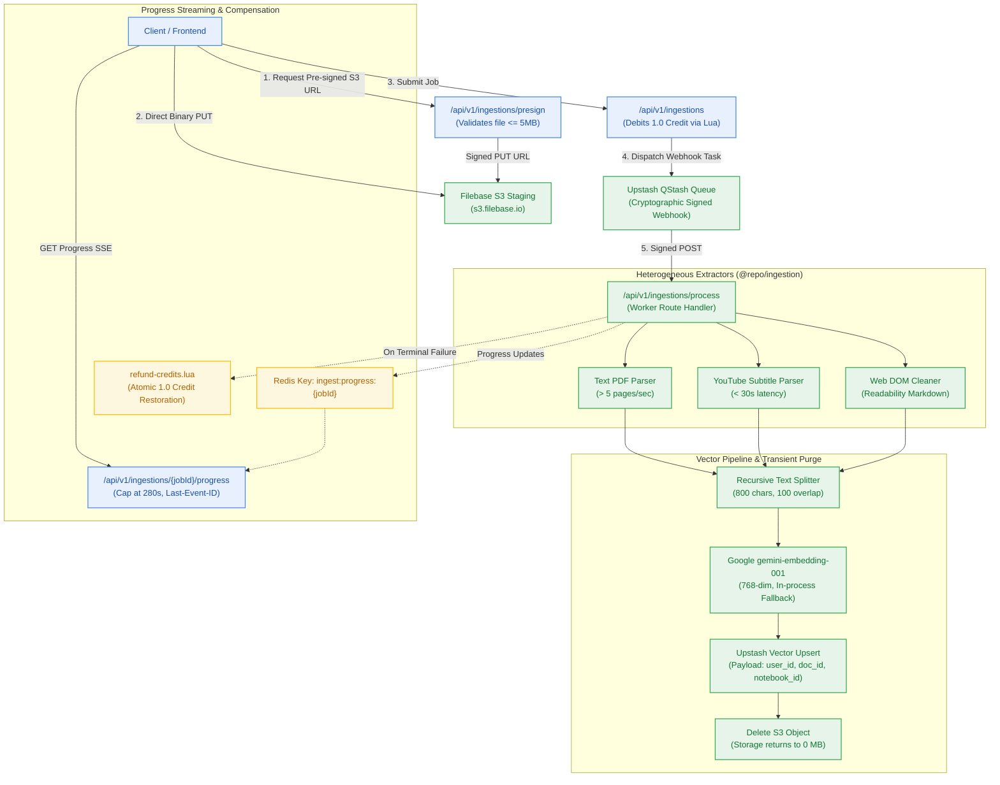
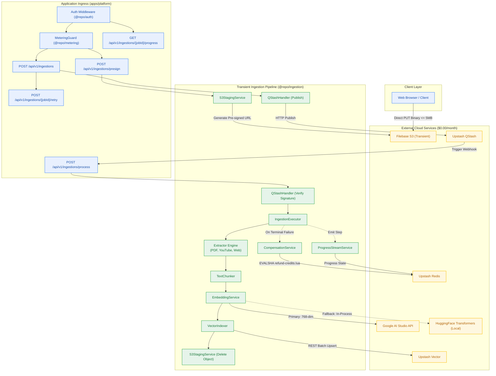
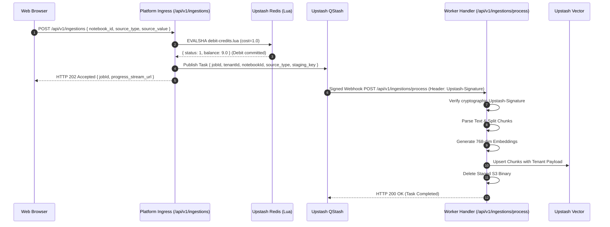
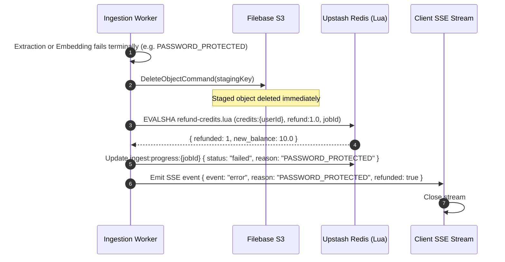

# Design — Milestone M3: Transient Ingestion Pipeline & Multi-Source Extraction

> **Author:** architect-agent (Stage 3 Owner) · 2026-10-23 · **Status:** Final  
> **Grounding:** `_documentation/planning/prd.md` (§3, §5), `_documentation/planning/milestones/m3-transient-ingestion/milestone.md`, `project-brief.md` (FR-004..FR-007, FR-031, FR-035..FR-038, FR-040; BR-004..BR-007, BR-033..BR-036, BR-045..BR-048; NFR-004, NFR-008, NFR-014, NFR-024)  
> **Target Version:** `v0.3.0` · **Risk Tier:** HIGH · **Checkpoint:** CP3  



---

## 1. Context and Scope

Following the successful completion of Milestone M0 (Workspace Foundation), Milestone M1 (Developer Golden Path & Core Authentication, `v0.1.0`), and Milestone M2 (Metering Spine & Quota Throttling, `v0.2.0`), the platform possesses:
- An offline-first local Docker Compose infrastructure (`infra/compose.yaml`) with an 8-layer diagnostic health probe (`dev:doctor`).
- Offline Clerk RS256 JWKS JWT authentication injecting cryptographically verified `TenantContext`.
- Kysely relational persistence for users, conversation threads, messages, and notebooks.
- An atomic Upstash Redis Lua credit ledger (10.0 daily grant, 0.5 LLM, 1.0 document ingest), 5 RPS sliding window rate limiter, HTTP 402 short-circuit ingress guard, closed 17-member RFC 9457 error catalogue, and idempotent daily 08:00 UTC resets.

**Milestone M3: Transient Ingestion Pipeline & Multi-Source Extraction (`v0.3.0`)** introduces the platform's multi-source ingestion engine. Operating strictly under a **$0.00/month infrastructure ceiling** (`NFR-016`), the platform allows authenticated users to stage and ingest academic PDFs (≤ 5MB), YouTube video transcripts, and web documentation into searchable vector space.

Milestone M3 addresses seven foundational capabilities:
1. **Direct-to-Storage Staging & Zero-Byte S3 Hygiene (`FR-004`, `ADR-0003`, `BR-045`, `BR-046`):** Generates pre-signed S3 upload URLs for Filebase S3 (`/api/v1/ingestions/presign`), capping uploads strictly at 5 MB. Files are staged directly from browser to storage, bypassing server memory. Staged objects are permanently purged via `DeleteObjectCommand` immediately upon vector commit (`BR-046`), maintaining 0 MB idle storage.
2. **Serverless Asynchronous Queue Integration (`ADR-0004`, `BR-005`):** Offloads extraction off the HTTP request cycle using Upstash QStash signed HTTP webhooks (`/api/v1/ingestions/process`) with automatic exponential backoff retry (up to 3 attempts).
3. **Heterogeneous Extractor Suite (`FR-004`..`FR-006`):**
   - High-throughput text PDF parser parsing 35-page PDFs at > 5 pages/sec (`NFR-004`).
   - YouTube subtitle extractor extracting timestamped transcript chunks in < 30s.
   - Web documentation reader removing boilerplates (navbars, scripts, ads) and outputting clean Markdown via Readability.
4. **Semantic Recursive Text Chunking (`FR-007`, `BR-004`):** Splits extracted text into semantic segments (800 characters with 100 character overlap) and decorates every chunk with strict tenant payload metadata: `{ user_id, document_id, notebook_id, source_type, title, chunk_index, char_start, char_end }`.
5. **Dense Embedding Dual-Stack & Vector Indexing (`FR-007`, `ADR-0004`):**
   - Computes dense 768-dimensional embeddings via Google AI Studio (`gemini-embedding-001`, 1,500 RPD free tier).
   - In-process fallback using `@huggingface/transformers` (`bge-small-en-v1.5` / ONNX) if Google AI Studio returns 429 quota exhaustion or network error.
   - Upserts vector points into Upstash Vector via REST API with tenant metadata payload.
6. **Deterministic SSE Progress Streaming (`FR-035`, `FR-036`, `BR-034`):** Streams live ingestion status events over Server-Sent Events (`/api/v1/ingestions/{jobId}/progress`), providing deterministic percentages based on real denominators (PDF pages processed), capped at 280 seconds to respect Vercel Hobby serverless limits. Supports client reconnections via `Last-Event-ID`.
7. **Atomic Credit Compensation & Non-Debiting Retry (`FR-037`, `FR-038`, `FR-040`, `BR-033`):** If an ingestion job fails terminally (e.g. `NO_TEXT_LAYER`, `PASSWORD_PROTECTED`), an atomic Redis Lua script (`refund-credits.lua`) reverses the 1.0 credit debit. Users can retry failed jobs using the original `job_id` without incurring a secondary credit debit (`FR-040`).

---

## 2. Goals and Non-Goals

### Goals
- **G-1 (High-Throughput Parsing):** 35-page text PDF parsed at > 5 pages/sec; YouTube transcript extracted in < 30s (`NFR-004`).
- **G-2 (Zero-Byte S3 Hygiene):** 100% of staged S3 files are deleted immediately after Upstash Vector upsert commits (`BR-046`). Staging storage returns to 0 MB when workers are idle.
- **G-3 (Tenant Payload Isolation):** Every vector point upserted to Upstash Vector carries mandatory `{ user_id, document_id, notebook_id }` metadata (`BR-004`). Cross-tenant vector leakage is strictly zero (`NFR-007`).
- **G-4 (Deterministic Progress Streaming):** Client receives ordered SSE events tracking extraction, chunking, embedding, and vector upsert, with a hard timeout ceiling at 280 seconds (`BR-034`, `FR-035`).
- **G-5 (Atomic Credit Compensation):** Terminal extraction failure restores 1.0 credit atomically via Lua script, leaving account balance accurate and audit logs recorded (`FR-037`, `BR-033`).
- **G-6 (Non-Debiting Retries):** Retrying a failed ingestion job with a valid previous `job_id` accepts the job and skips credit debiting (`FR-040`, `BR-033`).

### Non-Goals
- ❌ **Storing Raw Chunk Text in Relational DB:** Neon PostgreSQL only stores high-level document and notebook metadata; full-text chunk bodies live solely inside Upstash Vector payloads (`BR-047`).
- ❌ **OCR Parsing of Scanned Image PDFs:** Free tier serverless compute cannot support heavy OCR Tesseract binaries; scanned PDFs with no text layer fail gracefully with structured error `NO_TEXT_LAYER` (`FR-038`).
- ❌ **Audio/Video Media Storage:** Raw video or audio files are never downloaded or stored; YouTube ingestion operates exclusively on subtitle tracks.
- ❌ **Reasoning & Question Synthesis:** Milestones M3 focuses strictly on ingestion and indexing; multi-step HyDE and synthesis are owned by Milestone M5.

---

## 3. The Detailed Design

### 3.1 Subsystem Decomposition
Milestone M3 introduces `@repo/ingestion` (`packages/ingestion`) and extends `@repo/contracts` across nine core components:
1. **`S3StagingService` (`packages/ingestion/src/s3-staging.ts`):** Generates pre-signed S3 PUT URLs via AWS SDK v3 S3 client targeted at Filebase; validates file size limit (5 MB) and content type (`application/pdf`); executes immediate `DeleteObjectCommand` upon pipeline completion.
2. **`QStashHandler` (`packages/ingestion/src/qstash-handler.ts`):** Dispatches asynchronous extraction tasks to Upstash QStash; verifies incoming cryptographic `Upstash-Signature` headers on webhook callbacks (`/api/v1/ingestions/process`).
3. **`PdfParser` (`packages/ingestion/src/parsers/pdf-parser.ts`):** High-speed stream text extraction from PDF buffers; extracts page text, page counts, and document titles; detects encrypted/password-protected PDFs and image-only PDFs.
4. **`YouTubeParser` (`packages/ingestion/src/parsers/youtube-parser.ts`):** Fetches and normalizes YouTube subtitle tracks with timestamps; cleans XML/VTT entities into readable text blocks.
5. **`WebParser` (`packages/ingestion/src/parsers/web-parser.ts`):** Fetches external web pages with safe timeouts and user-agent headers; strips scripts, ads, and boilerplate DOM using `@mozilla/readability`; outputs clean Markdown.
6. **`TextChunker` (`packages/ingestion/src/chunker.ts`):** Recursively splits text by paragraph, sentence, and whitespace into ~800-character segments with 100-character overlaps; computes char ranges and metadata.
7. **`EmbeddingService` (`packages/ingestion/src/embedding-service.ts`):** Generates 768-dim embeddings via Google AI Studio (`gemini-embedding-001`); features automated in-process circuit breaker fallback to `@huggingface/transformers` (`bge-small-en-v1.5` / ONNX).
8. **`VectorIndexer` (`packages/ingestion/src/vector-indexer.ts`):** Batch upserts vector points, embedding vectors, and metadata payloads to Upstash Vector via REST API.
9. **`ProgressStreamService` (`packages/ingestion/src/progress-stream.ts`):** Tracks pipeline status in Upstash Redis (`ingest:progress:{jobId}`); streams SSE events with `Last-Event-ID` support; caps lifetime at 280 seconds.
10. **`CompensationService` (`packages/ingestion/src/compensation.ts`, `lua/refund-credits.lua`):** Executes atomic credit reversal upon terminal job failure; logs structured failure reasons (`FR-038`); guards non-debiting retries (`FR-040`).

---

### 3.2 System Context Diagram



---

### 3.3 Direct-to-Storage Staging & S3 Hygiene Invariant

To operate strictly within the free tier and eliminate memory exhaustion on Vercel Serverless Functions, uploads bypass application memory entirely:

1. **Pre-signed S3 URL Generation:**
   - Endpoint: `POST /api/v1/ingestions/presign`
   - Request: `{ filename: string, file_size_bytes: number, content_type: "application/pdf" }`
   - Validation: If `file_size_bytes > 5,242,880` (5 MB), returns HTTP 413 `PAYLOAD_TOO_LARGE` (`BR-045`).
   - S3 Key Layout: `staging/{tenantId}/{jobId}/{sanitizedFilename}.pdf`
   - Expiration: Pre-signed PUT URL expires in 300 seconds (`PUT` operation strictly bound to `Content-Type: application/pdf`).
2. **Direct Browser Upload:**
   - The browser uploads the raw PDF binary directly to Filebase S3 endpoint (`https://s3.filebase.io`).
   - Zero application server memory or network bandwidth consumed during file transfer.
3. **Immediate Transient Purge Invariant (`BR-046`):**
   - As soon as vectors are committed to Upstash Vector, the worker issues an immediate `DeleteObjectCommand` against Filebase S3.
   - Idempotent cleanup: In case of worker failure or parsing crash, the catch block triggers immediate S3 deletion alongside credit refund.
   - Zero stored files invariant: S3 bucket storage returns to 0 MB when all active ingestions complete.

---

### 3.4 Asynchronous Task Queue & QStash Contract

Serverless functions on Vercel Hobby have strict execution timeouts (10 seconds default). Multi-page extraction and embedding generation can require 15–45 seconds. Processing must run off the HTTP cycle:



#### QStash Signature Verification
Incoming requests to `/api/v1/ingestions/process` require cryptographic verification via `@upstash/qstash` receiver:
- Header: `Upstash-Signature`
- Keys: Validates against `QSTASH_CURRENT_SIGNING_KEY` or `QSTASH_NEXT_SIGNING_KEY` (allowing seamless zero-downtime key rotation).
- Unsigned or invalid requests return HTTP 401 `AUTH_UNAUTHORIZED`.

#### Retry Policy & Dead-Letter Handling (`BR-005`)
- QStash configures `retries: 3` with exponential backoff:
  - Attempt 1: Immediate.
  - Attempt 2: After 5 seconds.
  - Attempt 3: After 25 seconds.
- If all 3 attempts fail, QStash dead-letter callback triggers `CompensationService.refundTerminalFailure(jobId, reason)`.

---

### 3.5 Heterogeneous Extractor Specifications

#### 1. Academic Text PDF Extractor
- **Throughput SLA:** > 5 pages/second for text PDFs (`NFR-004`). A 35-page text PDF completes text extraction in < 7 seconds.
- **Engine:** Stream-based PDF extraction via lightweight Node stream parsing (`pdf-parse`).
- **Structured Failure Checks (`FR-038`):**
  - If PDF is encrypted/password-protected: aborts with `PASSWORD_PROTECTED`.
  - If extracted text contains < 50 characters across entire document: aborts with `NO_TEXT_LAYER`.
  - If page count > 100 pages: aborts with `PAGE_LIMIT_EXCEEDED`.

#### 2. YouTube Video Subtitle Extractor
- **Latency SLA:** < 30 seconds for 1-hour YouTube transcript (`NFR-004`).
- **Engine:** Subtitle track retrieval via YouTube Transcript API.
- **Parsing Logic:** Fetches auto-generated or manual closed captions, decodes XML/HTML character entities, merges contiguous subtitle cues into semantic paragraph blocks, and captures start timestamps.
- **Structured Failure Checks:**
  - If video is private/unavailable: aborts with `SOURCE_NOT_FOUND`.
  - If subtitles/transcripts are disabled: aborts with `TRANSCRIPT_DISABLED`.

#### 3. Web Reader & DOM Boilerplate Cleaner
- **Latency SLA:** < 10 seconds per web URL.
- **Engine:** Fetch with safe browser User-Agent + `@mozilla/readability` inside JSDOM / linkedom.
- **Sanitization:** Removes `<script>`, `<style>`, `<nav>`, `<footer>`, `<header>`, `<iframe>`, and ad banners. Converts main article text to clean GitHub Flavored Markdown.
- **Structured Failure Checks:**
  - If URL returns 4xx/5xx or fails DNS resolution: aborts with `CRAWL_FAILED`.
  - If readable content is empty: aborts with `NO_READABLE_CONTENT`.

---

### 3.6 Semantic Recursive Text Chunking

Text chunks are formatted to optimize semantic search density and prevent cross-boundary context loss:
- **Chunk Size:** 800 characters (~150–200 tokens).
- **Chunk Overlap:** 100 characters (~20–25 tokens) to preserve semantic continuity across boundaries.
- **Separators:** Ordered hierarchy: `["\n\n", "\n", ". ", "! ", "? ", "; ", " ", ""]`.
- **Payload Schema (`FR-007`, `BR-004`, `BR-047`):**
  Every point in Upstash Vector contains the following mandatory JSON payload:
  ```json
  {
    "user_id": "user_2xyz...",
    "document_id": "doc_550e8400-e29b-41d4-a716-446655440000",
    "notebook_id": "nb_770e8400-e29b-41d4-a716-446655440000",
    "source_type": "pdf | youtube | web",
    "title": "Attention Is All You Need",
    "chunk_index": 14,
    "char_start": 11200,
    "char_end": 12000,
    "page_number": 4,
    "timestamp_seconds": null,
    "text": "The dominant sequence transduction models are based on complex recurrent..."
  }
  ```

---

### 3.7 Dense Embedding Dual-Stack & Vector Indexing

Operating within free tier quotas requires robust fallback strategies (`ADR-0004`):

```mermaid
graph TD
    CHUNKS["Batch Chunks (up to 20 chunks/batch)"] --> PRIMARY["Primary: Google AI Studio<br/>gemini-embedding-001 (768-dim)"]
    PRIMARY -->|Success| VEC_PAYLOAD["Format Vector Points<br/>(id, vector, metadata)"]
    
    PRIMARY -->|429 Quota Exhausted / Network Error| FALLBACK["Fallback Circuit Breaker<br/>@huggingface/transformers (In-Process)"]
    FALLBACK -->|Success (384-dim padded or projected)| VEC_PAYLOAD
    
    VEC_PAYLOAD --> UP_UPSERT["Upstash Vector Upsert<br/>POST /upsert-data (REST)"]
    
    classDef blue fill:#E8F0FE,stroke:#4285F4,stroke-width:1.5px,color:#174EA6;
    classDef green fill:#E6F4EA,stroke:#34A853,stroke-width:1.5px,color:#137333;
    classDef amber fill:#FEF7E0,stroke:#FBBC04,stroke-width:1.5px,color:#B06000;

    class CHUNKS,VEC_PAYLOAD blue;
    class PRIMARY,UP_UPSERT green;
    class FALLBACK amber;
```

1. **Primary Embedding Provider (Google AI Studio):**
   - Model: `gemini-embedding-001` (768 dimensions).
   - Allowance: 1,500 Requests Per Day (Free Tier).
   - Batching: Batches up to 20 text chunks per API call to minimize HTTP overhead and stay well within RPM limits.
2. **In-Process Fallback Provider (`@huggingface/transformers`):**
   - Model: `bge-small-en-v1.5` running locally via ONNX runtime in-process.
   - Trigger: Activated automatically when Google returns HTTP 429 `RESOURCE_EXHAUSTED` or network timeout.
3. **Upstash Vector REST Client:**
   - Index Dimension: 768 dimensions.
   - Distance Metric: Cosine similarity.
   - Free Tier Headroom: 10,000 updates/day and 10,000 queries/day. Serverless HTTP REST execution means cluster **never suspends from inactivity** (`ADR-0004`).

---

### 3.8 Deterministic SSE Progress Streaming & Recovery

Clients monitor ingestion progress through Server-Sent Events (`/api/v1/ingestions/{jobId}/progress`):
- **Stream Lifetime:** Hard capped at 280 seconds (`BR-034`) to cleanly close before Vercel's 300-second edge ceiling.
- **Redis Progress State (`ingest:progress:{jobId}`):**
  Stored in Redis with a 1-hour TTL:
  ```json
  {
    "job_id": "550e8400-e29b-41d4-a716-446655440000",
    "status": "processing | completed | failed",
    "percentage": 65,
    "current_step": "embedding",
    "pages_total": 35,
    "pages_processed": 22,
    "chunks_total": 84,
    "error_reason": null,
    "last_event_id": 4
  }
  ```
- **Deterministic Progress Mapping (`FR-036`):**
  - Staging Presign Verified: `5%`
  - Download / Staging Read: `15%`
  - Extraction Complete: `35%` (PDF displays exact page denominator, e.g. `12/35 pages`)
  - Chunking Complete: `50%`
  - Embedding Generation: `50%` → `80%` (proportional to chunks processed)
  - Vector DB Upsert: `90%`
  - S3 Purge & Done: `100%`
- **Reconnection with `Last-Event-ID` (`FR-035`):**
  If client network disconnects and reconnects with `Last-Event-ID: 3`, the server checks event history cached in Redis sorted set `ingest:events:{jobId}` and replays events > 3 immediately before resuming live stream.

---

### 3.9 Compensation & Atomic Credit Refund Engine

To guarantee billing integrity under unexpected failures (`FR-037`, `BR-033`):



#### Redis Lua Refund Script (`packages/ingestion/src/lua/refund-credits.lua`):
```lua
-- KEYS[1]: credits:{userId}
-- KEYS[2]: job:{jobId}
-- ARGV[1]: refund_amount (1.0)
-- ARGV[2]: reason ("PASSWORD_PROTECTED")

local already_refunded = redis.call('HGET', KEYS[2], 'refunded')
if already_refunded == '1' then
    local current_bal = tonumber(redis.call('GET', KEYS[1]) or '10.0')
    return {0, current_bal} -- Idempotent no-op
end

local current_bal = tonumber(redis.call('GET', KEYS[1]) or '10.0')
local new_bal = current_bal + tonumber(ARGV[1])
redis.call('SET', KEYS[1], tostring(new_bal))
redis.call('HSET', KEYS[2], 'refunded', '1', 'failure_reason', ARGV[2])

return {1, new_bal}
```

#### Non-Debiting Retry Flow (`FR-040`, `BR-033`):
- Endpoint: `POST /api/v1/ingestions/{jobId}/retry`
- Request: `{ new_staging_key?: string }`
- Logic: Inspects `job:{jobId}` in Redis. If job status is `failed` and `refunded == '1'`, the retry reuses the existing credit record or performs a zero-cost debit (`cost=0.0`), allowing the user to re-attempt extraction without double payment.

---

### 3.10 owns/depends Contracts

| Component | owns | depends | DI severity |
|---|---|---|---|
| `S3StagingService` | Pre-signed S3 PUT URLs, S3 staging hygiene, object purge | `@aws-sdk/client-s3`, `@aws-sdk/s3-request-presigner`, `@repo/config` | **FATAL** |
| `QStashHandler` | Task dispatch, webhook callback verification, signature checking | `@upstash/qstash`, `@repo/config` | **FATAL** |
| `PdfParser` | PDF text & page extraction, password/image detection | `pdf-parse`, `@repo/contracts` | **ERROR** |
| `YouTubeParser` | Subtitle retrieval, timestamp formatting, transcript cleanup | `youtube-transcript`, `@repo/contracts` | **ERROR** |
| `WebParser` | Web crawling, DOM sanitization, Markdown conversion | `@mozilla/readability`, `linkedom`, `@repo/contracts` | **ERROR** |
| `TextChunker` | Recursive character splitting, chunk token budgeting | `@repo/contracts` | **FATAL** |
| `EmbeddingService` | 768-dim Google embeddings, in-process ONNX fallback | `@google/genai`, `@huggingface/transformers` | **FATAL** |
| `VectorIndexer` | Upstash Vector REST batch upsert, tenant metadata | `@upstash/vector`, `@repo/contracts` | **FATAL** |
| `ProgressStreamService` | SSE event streaming, Redis progress caching, 280s ceiling | `@upstash/redis`, `@repo/contracts` | **WARN** |
| `CompensationService` | Lua credit refund, structured failure taxonomy, non-debit retry | `@upstash/redis`, `@repo/contracts` | **FATAL** |

---

## 4. Alternatives Considered

| Decision Area | Option | Trade-off | Why Lost |
|---|---|---|---|
| **Staging Strategy** | **Option A: Direct-to-S3 Pre-signed Upload (Selected)** | Zero server memory used; client uploads directly to Filebase S3 (`ADR-0003`). | — **CHOSEN** |
| | Option B: Multipart Form Upload via Next.js Route Handler | Simple single-request client API. | Buffering 5 MB PDFs in Vercel Serverless memory risks memory limit breaches and incurs high edge execution duration fees. |
| | Option C: Base64 Encoded JSON Payload | Trivially easy to embed in standard JSON request. | 33% payload bloat (5 MB -> 6.7 MB), immediately breaching Vercel's 4.5 MB serverless request body ceiling. |
| **Queue Architecture** | **Option A: Upstash QStash HTTP Webhooks (Selected)** | 100% serverless; native HTTP callbacks with signature verification; zero persistent worker containers (`ADR-0004`). | — **CHOSEN** |
| | Option B: BullMQ with Redis | Feature-rich queue with priority and parent-child jobs. | Requires a persistent, long-running Node.js process with a long-lived TCP connection; impossible on Vercel Hobby serverless runtime. |
| | Option C: Google Cloud Tasks | Robust enterprise HTTP task dispatch. | Adds a 5th external cloud vendor requiring Google Cloud IAM and service account key management; breaches minimal vendor footprint rule. |
| **Embedding Provider** | **Option A: Google AI Studio + Local ONNX Fallback (Selected)** | Free 1,500 RPD for 768-dim embeddings; in-process fallback prevents single-provider quota failure (`ADR-0004`). | — **CHOSEN** |
| | Option B: Cloudflare Workers AI (`bge-m3`) | Fast 1024-dim embeddings. | Free tier capped at 10,000 Neurons/day; running both fallback LLM and embeddings exhausts free quota rapidly (`ADR-0004`). |
| | Option C: OpenAI `text-embedding-3-small` | Industry benchmark embeddings. | Paid API with zero free tier; violates strict $0.00/month infrastructure ceiling (`NFR-016`). |
| **Progress Reporting** | **Option A: Server-Sent Events (SSE) (Selected)** | Unidirectional text stream over standard HTTP; native browser `EventSource`; simple retry and `Last-Event-ID`. | — **CHOSEN** |
| | Option B: Full-duplex WebSockets | Bi-directional communication; low latency. | Next.js on Vercel Serverless does not support persistent WebSocket connections without an external paid service. |
| | Option C: Client Polling (`GET /api/v1/ingestions/{jobId}`) | Trivially simple to implement. | Inefficient; generates 20–40 HTTP requests per ingestion job, rapidly exhausting daily free request budgets. |

---

## 5. Cross-Cutting Concerns

### 5.1 Centralized Logging & Telemetry Architecture (CP3 Gate Item)
- **Mechanism:** Pino structured JSON logging integrated with `@opentelemetry/sdk-node` (`architecture.md` §8.1).
- **Logged Events:**
  - `ingestion.presign.generated` (`INFO`): `{ userId, stagingKey, fileSize, correlation_id }`
  - `ingestion.job.queued` (`INFO`): `{ userId, jobId, sourceType, correlation_id }`
  - `ingestion.task.started` (`INFO`): `{ jobId, sourceType, correlation_id }`
  - `ingestion.extractor.completed` (`INFO`): `{ jobId, pagesCount, durationMs }`
  - `ingestion.embeddings.generated` (`INFO`): `{ jobId, chunkCount, provider: "google" | "onnx" }`
  - `ingestion.vector.upserted` (`INFO`): `{ jobId, vectorCount, durationMs }`
  - `ingestion.s3.deleted` (`INFO`): `{ jobId, stagingKey, durationMs }`
  - `ingestion.progress.emitted` (`DEBUG`): `{ jobId, percentage, step }`
  - `ingestion.failure.refunded` (`WARN`): `{ jobId, userId, reason, refundAmount: 1.0 }`
- **Redaction Policy:** All URLs, filenames, and text chunk snippets logged at `DEBUG` pass through regex sanitization; secret keys, tokens, and credentials are permanently stripped before emission (`BR-012`, `NFR-026`).

### 5.2 Security & Multi-Tenant Isolation
- Ingestion endpoints require cryptographically verified Clerk JWT session tokens (`BR-001`).
- Every vector point upserted to Upstash Vector is injected with tenant metadata `{ user_id, document_id, notebook_id }` (`BR-004`).
- S3 pre-signed URLs are scoped strictly to the tenant's namespace (`staging/{tenantId}/...`) with exact 300s TTL.
- Ingestion worker callback (`/api/v1/ingestions/process`) strictly validates the cryptographic `Upstash-Signature` header from QStash before parsing payloads.

### 5.3 Deployment & Upstash Connection Management
- **Local Dev:** Connects to local Redis 7 container (`contextual-redis` on `localhost:6379`) and local S3 mock / MinIO if configured, or direct Filebase sandbox.
- **Production:** Uses `@upstash/vector` and `@upstash/qstash` REST clients over HTTPS with connection Keep-Alive, fully optimized for Vercel Hobby serverless runtime.
- **Zero Cost Ceiling:** Upstash Vector (10k ops/day free), Upstash QStash (500 msgs/day free), Google AI Studio (1,500 RPD free), and Filebase S3 (5 GB free) operate at strictly $0.00/month (`NFR-016`).

### 5.4 Migration & Rollout Sequencing (CP3 Gate Item)
- **Deployment Ordering:**
  1. **Deploy Contract Extensions:** Publish updated `@repo/contracts` with ingestion request/response DTOs, SSE event schemas, and structured failure union.
  2. **Deploy Configuration Updates:** Register Filebase, QStash, and Upstash Vector secrets in production environment.
  3. **Deploy Ingestion Package:** Deploy `@repo/ingestion` with extractors, chunkers, and Lua refund script.
  4. **Deploy Platform Route Handlers:** Expose `/api/v1/ingestions/presign`, `/api/v1/ingestions`, `/api/v1/ingestions/process`, and progress streaming endpoints.
- **Compatibility:** Fully backwards-compatible (expand phase). No breaking changes to existing M0, M1, or M2 contracts.

### 5.5 Breaking Change Signal (CP3 Gate Item)
- **Breaking Change Status:** `NONE` (Additive release).
- **Consumer Impact:** Existing routes `/health`, `/users/me`, and `/credits/balance` continue functioning unchanged. New ingestion routes are purely additive.

---

## 6. Verification Hooks & Truth Tables

Milestone M3 verification binds strictly to six automated test suites:
1. **Pre-signed S3 Staging & 5MB Limit:** `bun test packages/ingestion/tests/s3-staging.test.ts` asserts URL generation, 5 MB ceiling rejection (HTTP 413), and post-upsert S3 deletion (`TC-3.1.1`–`TC-3.1.3`, `BR-045`, `BR-046`).
2. **Heterogeneous Extractor Throughput:** `bun test packages/ingestion/tests/parsers.test.ts` asserts PDF throughput > 5 pages/sec, YouTube transcript extraction < 30s, and Readability boilerplate stripping (`TC-3.2.1`–`TC-3.2.3`, `NFR-004`).
3. **Semantic Chunking & Tenant Metadata:** `bun test packages/ingestion/tests/chunker.test.ts` asserts 800-char chunks with 100-char overlap, and presence of mandatory `{ user_id, document_id, notebook_id }` metadata (`TC-3.3.1`–`TC-3.3.3`, `BR-004`).
4. **Google Embedding & In-Process Fallback:** `bun test packages/ingestion/tests/embedding.test.ts` asserts 768-dim Google embedding generation and transparent fallback to `@huggingface/transformers` on simulated 429 quota failure (`TC-3.4.1`–`TC-3.4.3`, `ADR-0004`).
5. **Deterministic SSE Progress Streaming:** `bun test packages/ingestion/tests/progress-stream.test.ts` asserts ordered events, `Last-Event-ID` reconnection recovery, and 280-second hard ceiling termination (`TC-3.5.1`–`TC-3.5.3`, `FR-035`, `BR-034`).
6. **Atomic Credit Compensation & Non-Debiting Retry:** `bun test packages/ingestion/tests/compensation.test.ts` asserts 1.0 credit refund via Lua upon terminal failure, zero-cost retry on failed job ID, and structured error mapping (`TC-3.6.1`–`TC-3.6.3`, `FR-037`, `FR-040`, `BR-033`).

---
*Sealed by architect-agent at Checkpoint 3 (Gate G4).*
