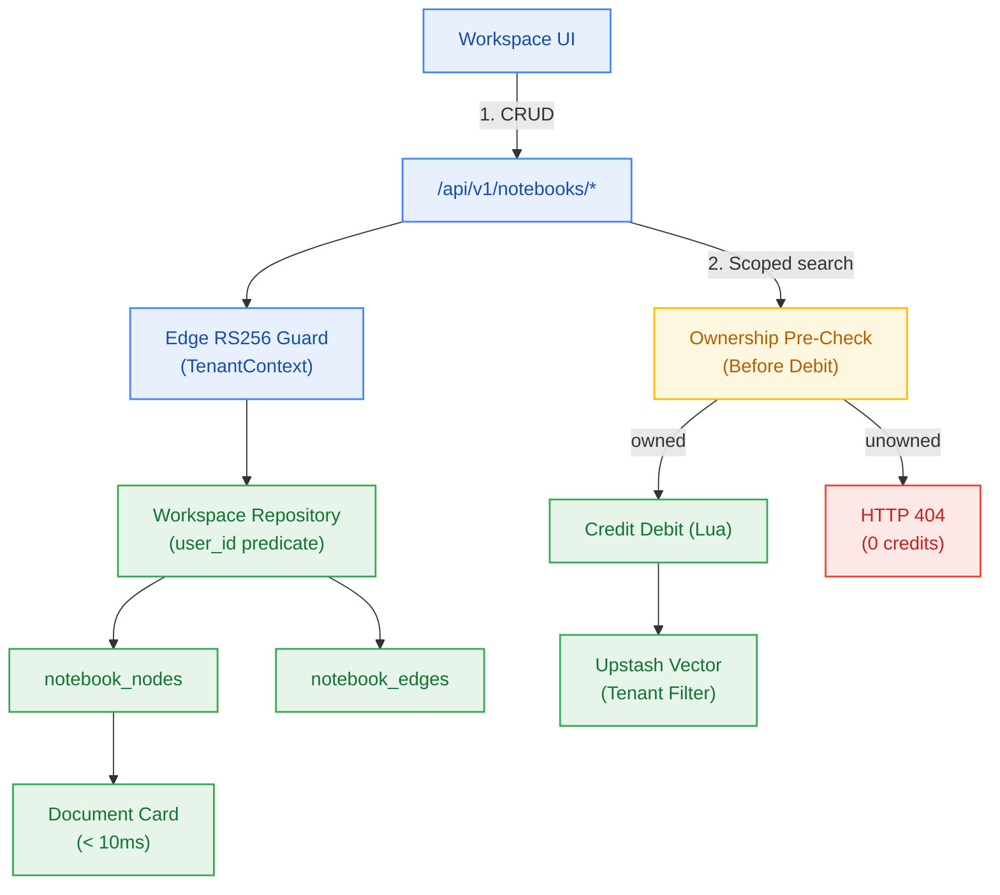
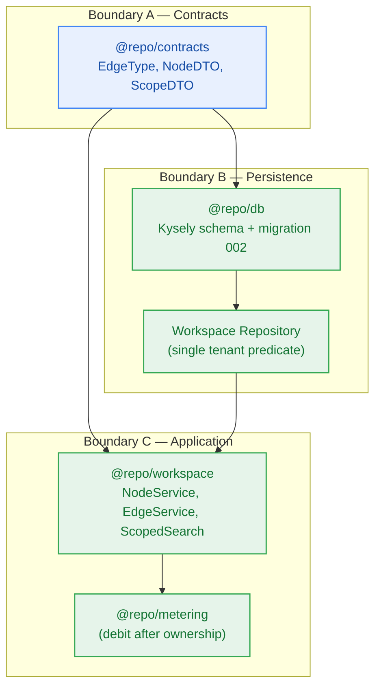
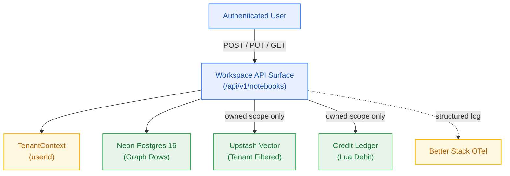
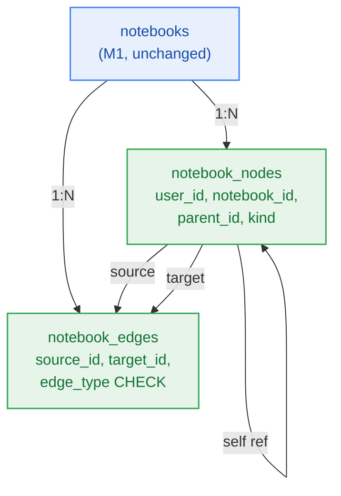
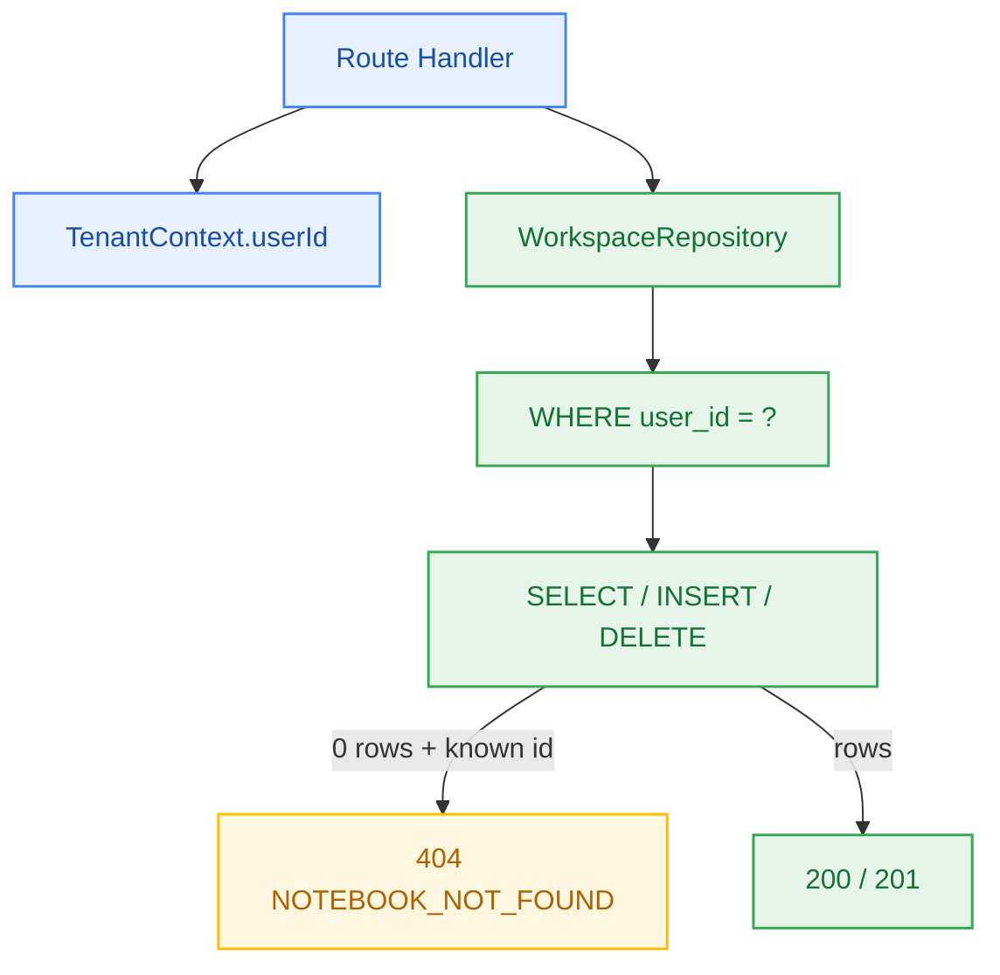
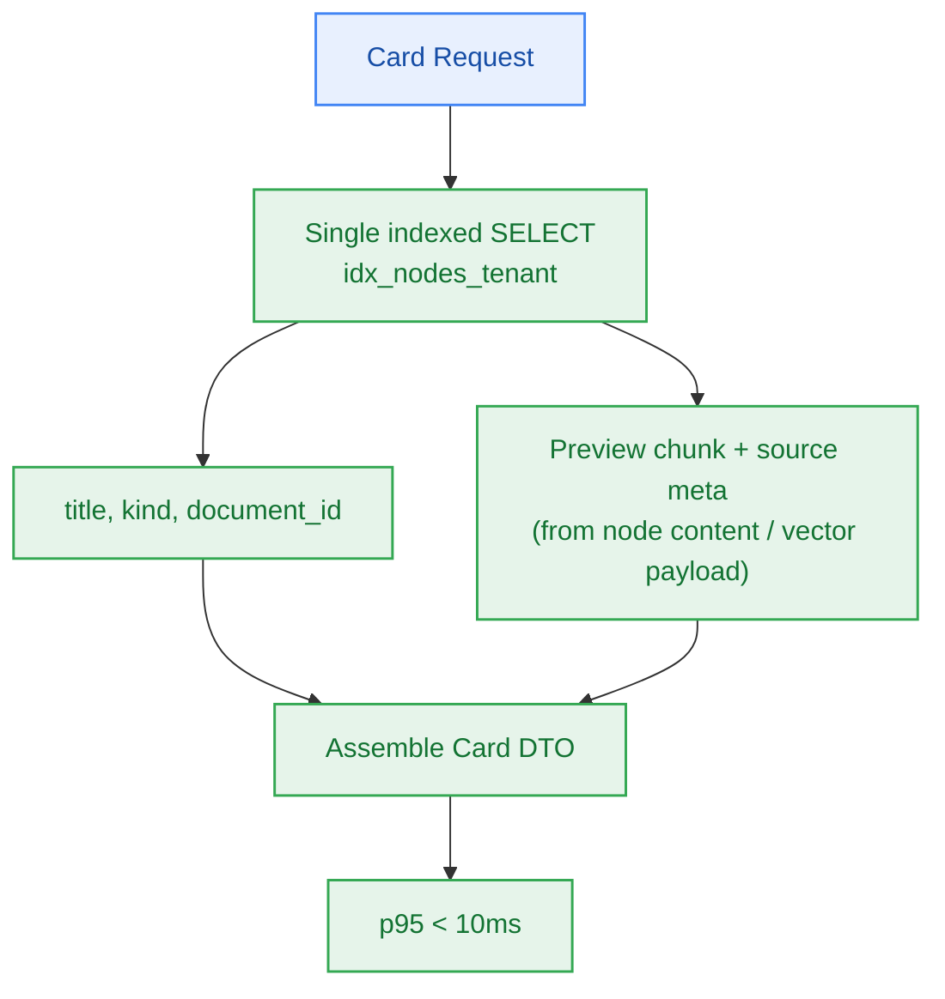
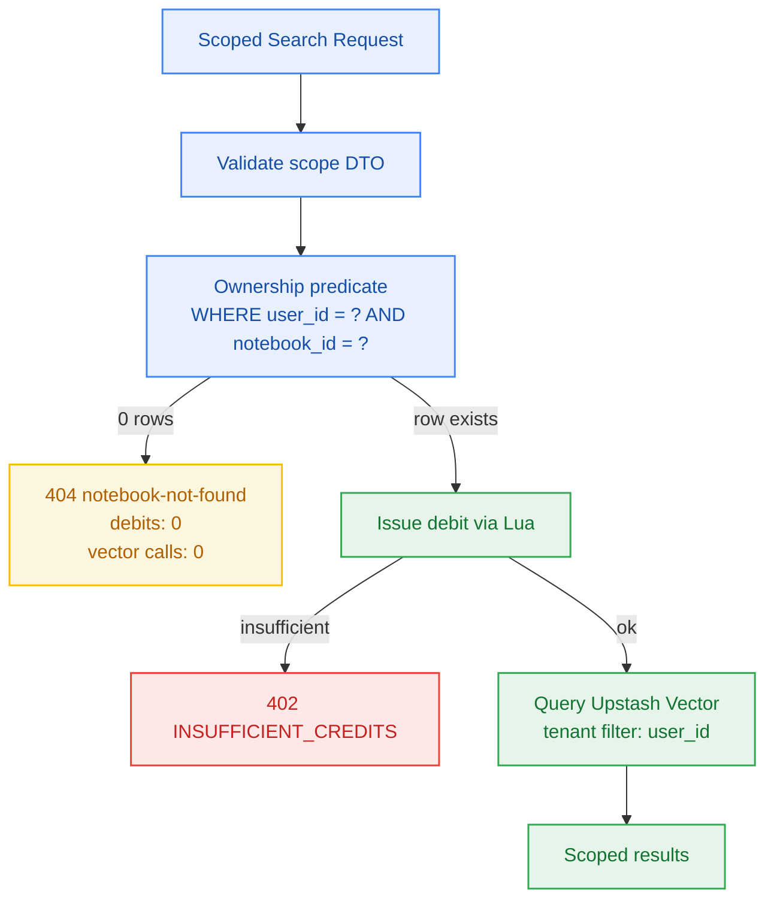
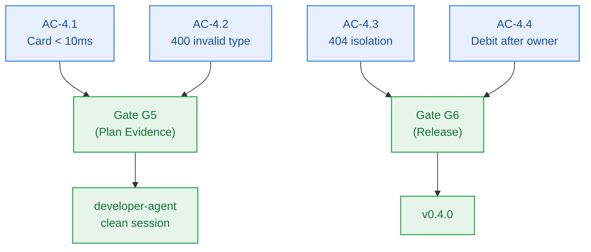

# Design — Milestone M4: Notebook Workspace & Domain Graph

> **Author:** architect-agent (Stage 3 Owner) · 2026-10-26 · **Status:** Final  
> **Grounding:** `_documentation/planning/prd.md` (FR-031..FR-034), `project-brief.md` (BR-002, BR-036, NFR-007), `_documentation/planning/milestones/m4-notebook-workspace/milestone.md`  
> **Target Version:** `v0.4.0` · **Risk Tier:** MEDIUM (one HIGH unit: WU-M4-6) · **Checkpoint:** CP3  



---

## 1. Context and Scope

Milestones M0–M3 established the monorepo, Clerk edge authentication injecting `TenantContext`, Kysely persistence for `users` / `conversation_threads` / `conversation_messages` / `notebooks`, the atomic Upstash Redis credit ledger, and the transient ingestion pipeline that writes tenant-filtered vectors into Upstash Vector.

**Milestone M4 (`v0.4.0`)** layers the personal knowledge workspace on top of that foundation:

1. **Hierarchical Notebook Nodes (`FR-031`)** — text nodes and document-backed reference nodes live inside an existing `notebooks` row (M1 already created the container; M4 adds the graph beneath it).
2. **Typed Domain Edges (`FR-032`)** — directional relations restricted to `cites` | `related`, enforced twice: a Zod/TS union at the API boundary and a `CHECK` constraint in Postgres as defence-in-depth. Any other string returns HTTP 400 `INVALID_NODE_RELATION`.
3. **Document-Backed Card Resolution (`FR-033`)** — a node pointing at an ingested document resolves title, page count, status, and a preview chunk in < 10ms p95.
4. **Scoped Retrieval with Ownership-First Metering (`FR-034`, `BR-036`)** — a retrieval request declares a scope (`node` | `branch` | `notebook`); ownership is evaluated as a SQL predicate **before** the metering debit is issued.
5. **Tenant Isolation (`BR-002`, `NFR-007`)** — every graph read and write is bounded by `user_id`; no query in this milestone can be coerced into returning another tenant's rows.

---

## 2. Goals and Non-Goals

### Goals
- **G-1 (Card Latency):** Document card metadata and preview resolve at p95 < 10ms against local compose (`FR-033`, AC-4.1).
- **G-2 (Typed Edge Integrity):** `cites` | `related` only; malformed types rejected at HTTP 400 before reaching the database (`FR-032`, AC-4.2).
- **G-3 (Enumeration-Resistant Isolation):** Foreign or unowned notebook scopes answer 404 `NOTEBOOK_NOT_FOUND` and never confirm existence (`BR-002`, `NFR-007`, AC-4.3).
- **G-4 (Ownership Before Debit):** Zero credits debited and zero downstream vector calls issued for an unowned scope (`BR-036`, AC-4.4).
- **G-5 (Whole-Graph Deletion):** Node deletion removes its edges in the same transaction so no orphan edge can outlive its endpoint.

### Non-Goals
- ❌ **Query Decomposition, HyDE & Synthesis:** M5 owns multi-step reasoning and citation generation. M4 only stores and retrieves graph structure.
- ❌ **Cross-Notebook Global Ranking:** M5 owns cross-notebook relevance ranking; M4 retrieval is scoped to one declared context.
- ❌ **User-Defined Ontologies:** Edge types are a closed union. Arbitrary properties are an explicit PRD non-goal.
- ❌ **Retention / `expires_at` Warning Sweeps & Tombstones:** M7 owns `BR-038`/`BR-039` cascade sweeps. M4 only guarantees that its own deletes are transactional.

---

## 3. The Detailed Design

### 3.1 Subsystem Decomposition



| Boundary | Contents | Contract |
|---|---|---|
| A — Contracts | `EdgeType`, node/edge DTOs, RFC 9457 binding | `@repo/contracts` exports; no DB or HTTP imports |
| B — Persistence | `notebook_nodes`, `notebook_edges`, migration `002`, repository | Kysely only; every statement carries `user_id` |
| C — Application | Validation, orchestration, metering ordering | Calls metering **only** after ownership predicate succeeded |

### 3.2 System Context Diagram



### 3.3 Relational Graph Schema (`notebook_nodes`, `notebook_edges`)

Designed with `data-architect` (DSP-017). Both tables extend the M1 `notebooks` container; `notebooks` itself is **not** altered — this is an expand-only migration.



| Table | Key Columns | Indexes | Constraints |
|---|---|---|---|
| `notebook_nodes` | `id` (uuid PK), `user_id`, `notebook_id`, `parent_id`, `kind` (`text` \| `document`), `title`, `content`, `document_id`, `position` | `idx_nodes_tenant (user_id, notebook_id)`; `idx_nodes_parent (notebook_id, parent_id)` | `FOREIGN KEY (notebook_id) REFERENCES notebooks(id) ON DELETE CASCADE`; `CHECK (kind <> 'document' OR document_id IS NOT NULL)` |
| `notebook_edges` | `id` (uuid PK), `user_id`, `notebook_id`, `source_id`, `target_id`, `edge_type` | `idx_edges_tenant (user_id, notebook_id)`; `idx_edges_source (source_id)`; `idx_edges_target (target_id)` | `CHECK (edge_type IN ('cites','related'))`; `CHECK (source_id <> target_id)`; FKs to `notebook_nodes(id) ON DELETE CASCADE`; `UNIQUE (source_id, target_id, edge_type)` |

**Design decisions:**
- **`user_id` is denormalized onto both tables** on purpose. The tenant predicate then becomes a single indexed `WHERE user_id = ?` rather than a join through `notebooks` — this is what makes AC-4.3 structurally hard to breach instead of relying on every call site joining correctly (DSP-018).
- **`ON DELETE CASCADE`** is declared once at the schema level, so node deletion cannot strand edges (FM-401) and notebook purge stays whole per `BR-039`.
- **`CHECK` constraint mirrors the API union.** The API validator gives the 400; the constraint guarantees the invariant survives any future write path (defence-in-depth).
- **No raw SQL.** All of the above is expressible in the Kysely migration builder, so `raw-sql-exceptions.md` stays at 0 rows.

**Migration sequence (expand-only):**
1. Migration `002_notebook_graph.ts` creates both tables and their indexes. No existing column is altered or dropped → backward compatible with the running M1–M3 code.
2. Code that writes the new tables deploys next.
3. Contraction (if ever needed) waits until no reader remains — none is planned for `v0.4.0`.

### 3.4 Workspace Repository & Tenant Predicate

All graph access goes through a repository contract; no route handler issues its own SQL.



Ownership is **not** implemented as a separate "does this exist?" probe followed by a second query. It is a predicate on the statement that reads the row itself — one round trip, no TOCTOU window between check and use (DSP-018).

### 3.5 Typed Edge Write Path (`FR-032`)

```mermaid
graph TD
    REQ["POST edges"] --> Z["Zod: EdgeType union"]
    Z -->|invalid| E400["400 invalid-node-relation"]
    Z -->|cites | related| OWN2["Both endpoints in user's notebook"]
    OWN2 -->|mismatch| E404["404 (0 credits)"]
    OWN2 -->|ok| TX["Transaction: insert edge"]
    TX -->|UNIQUE violation| E409["409 duplicate"]
    TX -->|CHECK violation| E500["500 (should be unreachable)"]
    TX -->|ok| R201["201 Created"]

    classDef blue fill:#E8F0FE,stroke:#4285F4,stroke-width:1.5px,color:#174EA6;
    classDef green fill:#E6F4EA,stroke:#34A853,stroke-width:1.5px,color:#137333;
    classDef amber fill:#FEF7E0,stroke:#FBBC04,stroke-width:1.5px,color:#B06000;
    classDef red fill:#FCE8E6,stroke:#EA4335,stroke-width:1.5px,color:#C5221F;
    class REQ,Z,OWN2 blue;
    class TX,R201 green;
    class E404 amber;
    class E400,E409,E500 red;
```

- Validation runs **before** any database round trip, so a malformed edge type costs zero queries.
- Both endpoints must belong to the same notebook and the same `user_id`, otherwise 404 (never 403 — see `M4-PM-001`).
- Self-edges are blocked by `CHECK (source_id <> target_id)`; duplicates by the unique index.

### 3.6 Document Card Resolution (< 10ms, `FR-033`)



**Latency budget (10ms p95):**

| Step | Budget | Mechanism |
|---|---|---|
| Index seek on `(user_id, notebook_id)` | ≤ 1ms | Composite index covers the predicate |
| Row fetch (node + preview) | ≤ 3ms | Column-limited projection, no `SELECT *` |
| Connection acquisition | ≤ 3ms | Existing pooled Kysely client from `@repo/db` |
| Serialization + response | ≤ 2ms | Flat DTO, no recursive expansion |

A single statement returns both node metadata and preview, avoiding a second round trip. Preview text is denormalized onto the node row at write time rather than read from Upstash Vector — this is the difference between a 1-query read and a network hop to a second service. The heavy retrieval path stays in vector space (M5); the card is a local read.

### 3.7 Scoped Retrieval with Ownership-First Metering (`FR-034`, `BR-036`) — HIGH tier

This is the milestone's only HIGH-tier unit, because it is the only place the graph meets the metering boundary.



**Hard sequencing contract (the CP3-critical invariant):**

```
validate DTO  →  ownership predicate  →  [if owned] debit  →  vector query
```

The ownership predicate is evaluated on the same connection, inside the repository, and its row-count result gates the debit call. There is no code path in which `debitCredits()` is reachable without the predicate having returned ≥ 1 row first. AC-4.4's test asserts **both** the 404 and a `credits_balance` unchanged from its pre-request value, plus zero vector client invocations.

**Recovery consideration:** if a debit succeeds and the subsequent vector query throws, the existing atomic `refund-credits.lua` (M3) restores the credit — the same compensation path already proven in ingestion.

### 3.8 owns/depends Contracts

| Component | Owns | Depends on | DI Severity |
|---|---|---|:---:|
| `@repo/workspace` | Node/edge/scoped-search services | `@repo/db` (repository) | FATAL |
| `@repo/workspace` | — | `@repo/contracts` (types, RFC 9457) | FATAL |
| `@repo/workspace` | — | `@repo/metering` (debit) | ERROR |
| `@repo/db` | Graph schema, migration 002, repository | `@repo/config` (env) | FATAL |
| Route handlers | HTTP binding, status mapping | `@repo/workspace`, `@repo/auth` | FATAL |
| `@repo/metering` | Ledger (unchanged in M4) | `@upstash/redis` | FATAL |

Dependency direction never inverts: `@repo/db` never imports `@repo/workspace`, and `@repo/metering` never imports workspace types.

---

## 4. Alternatives Considered

| # | Option | Buys | Costs | Verdict |
|---|---|---|---|:---:|
| 1 | **Adjacency-list tables in Postgres (chosen)** | ACID joins, composite tenant index, reuses the shipped Kysely/Neon stack, zero new infrastructure, stays at $0.00 | Recursive CTEs needed for deep branch traversal | **Adopted** |
| 2 | Dedicated graph DB (Neo4j) | Native traversal primitives | New vendor, new free-tier ceiling, new operational surface, breaks the unified-serverless posture of ADR-0004, adds cost risk to `NFR-016` | **Rejected** — strongest argument for it is traversal elegance at depths this product does not reach; lost because it trades a hard $0 invariant for a capability M4 doesn't use |
| 3 | Store the graph inside Upstash Vector payloads | No join, one service | No referential integrity, no cascade, no uniqueness, destroys `BR-039` whole-deletion, makes typed-edge validation unenforceable | **Rejected** |
| 4 | Separate existence probe, then read | Readable two-step code | Two round trips **and** a TOCTOU window between check and use | **Rejected** (DSP-018) |

---

## 5. Cross-Cutting Concerns

### 5.1 Centralized Logging & Telemetry Architecture (CP3 Gate Item)
Reuses the mechanism established in M1/M2 — structured JSON logs via the existing logger, exported through the Better Stack OTLP pipeline. No parallel system is introduced.

| Event Class | Level | Context |
|---|:---:|---|
| Scoped search rejected for unowned scope | `WARN` | `user_id`, `notebook_id`, `scope_kind` — **never** the target tenant's id |
| Edge rejected for invalid type | `INFO` | `user_id`, submitted value (truncated to 64 chars) |
| Card resolution exceeding 10ms | `WARN` | `user_id`, `notebook_id`, `elapsed_ms` |
| Graph write (node/edge) | `INFO` | `user_id`, `notebook_id`, entity id |
| Ownership predicate returned 0 rows | `WARN` | `user_id`, `scope_kind` |

- Threshold: `LOG_LEVEL` (default `info`), documented in `.env.example` alongside the other env vars.
- Redaction: no JWT, no access token, and no other tenant's identifiers are ever logged; `content` and `preview` text are excluded from logs entirely (privacy + payload size).
- Performance: logging happens outside the measured latency path for card resolution; the 10ms budget is measured on the handler, not the logger.

### 5.2 Security & Multi-Tenant Isolation (DSP-018)
- Tenant scope is a **predicate, not a check**: `WHERE user_id = ?` on every statement, sourced from the verified `TenantContext` — never from a request body or query parameter.
- **404, not 403**, for foreign/unowned resources per sealed decision `M4-PM-001` — no existence oracle for another tenant's notebook id. `403 FORBIDDEN_TENANT_ACCESS` remains reserved for tenant-scope violations carrying no resource identifier.
- Edge payloads validate both endpoint ids against the caller's tenant before insert; a foreign `document_id` yields 403 without confirming whether that document exists.
- Authorization runs before metering, so an unauthorized probe costs the attacker nothing and the platform no credit (`BR-036`).
- No raw SQL strings anywhere in this milestone → no injection surface; Kysely parameterizes every value.

### 5.3 Deployment & Runtime
No new service, container, environment variable, or vendor. The migration runs through the existing migrator on deploy. Expand-only ordering: **migration `002` → code → nothing to contract.** Feature exposure is gated by the route being present; no flag is required for an additive surface.

### 5.4 Migration & Rollout Sequencing (CP3 Gate Item)
1. Migration `002` creates `notebook_nodes` + `notebook_edges` (expansion; existing readers unaffected).
2. Deployment of code that reads/writes the new tables.
3. Contraction: **not required** — no existing column or contract is removed.

### 5.5 Breaking Change Signal (CP3 Gate Item)
**Not a breaking change.** Compatibility groups joined: HTTP API (additive paths only), relational schema (new tables only). No existing consumer is invalidated; no request/response shape, config key, or dependency pin changes. The release therefore classifies as a **minor** bump to `v0.4.0`, with no `!` / `BREAKING CHANGE:` footer on any implementing commit. `versioning-specialist` receives these stated consumer-impact facts.

### 5.6 Failure Modes (DSP-019)
Rows FM-401..FM-404 are recorded in `_documentation/planning/registers/failure-mode-register.md`: orphaned edges after node deletion, card resolution breaching the 10ms budget, debit issued before ownership validation (AP=H), and graph writes racing a cascade purge.

---

## 6. Verification Hooks & Truth Tables

| AC | Scenario | Expected | Hook |
|:---:|---|---|---|
| AC-4.1 | Resolve card for node with attached document | HTTP 200, full DTO, p95 < 10ms | latency test over ≥ 100 samples |
| AC-4.2 | `POST /notebooks/{id}/edges` with `relation_type: "author_of"` | HTTP 400 `invalid-node-relation`, **0 queries to db**, 0 credits debited | contract test |
| AC-4.3 | User B requests User A's `notebookId` (GET + scoped search) | HTTP 404 `notebook-not-found`, 0 rows, 0 credits debited | cross-tenant penetration test |
| AC-4.4 | Scoped search against unowned notebook | HTTP 404 **before** debit; `credits_balance` unchanged; 0 vector calls | balance assertion + mock client call count |


