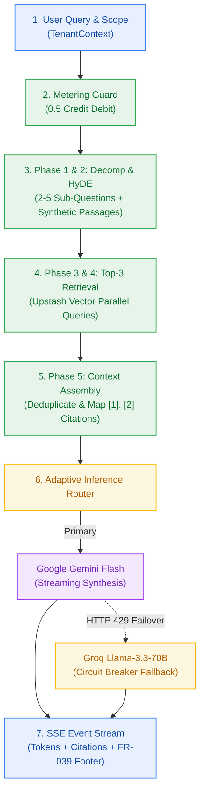
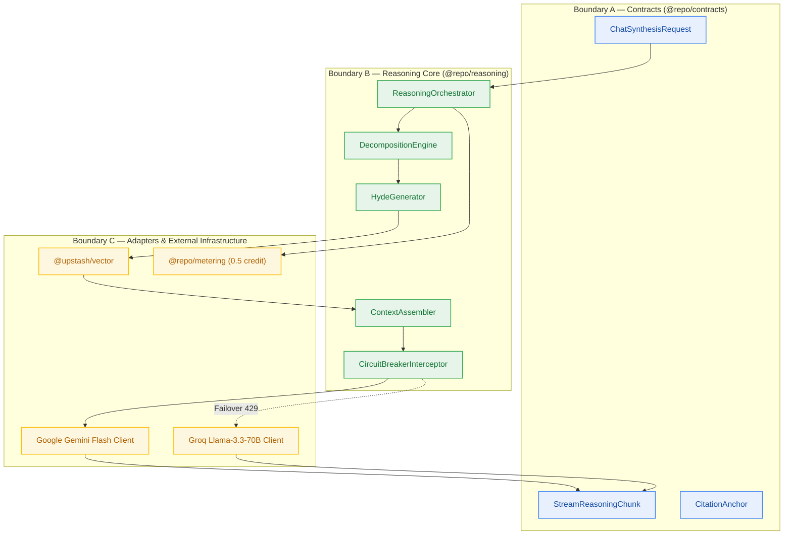

# Design — Milestone M5: 6-Phase Grounded Reasoning Engine & Dual-Provider Inference

> **Author:** architect-agent (Stage 3 Owner) · 2026-10-27 · **Status:** Final  
> **Grounding:** `_documentation/planning/prd.md` (FR-008..FR-011, FR-039), `project-brief.md` (BR-002, BR-007..BR-009, BR-027), `ADR-0004` (Unified Upstash & Groq Fallback), `_documentation/planning/milestones/m5-reasoning-engine/milestone.md`  
> **Target Version:** `v0.5.0` · **Risk Tier:** HIGH (dual external providers, circuit-breaker failover, strict latency SLAs) · **Checkpoint:** CP3  



---

## 1. Context and Scope

Milestones M0 through M4 established the authenticated multi-tenant monorepo, Clerk RS256 JWT validation injecting `TenantContext`, Neon Postgres relational persistence, the Upstash Redis atomic Lua credit ledger, the transient ingestion pipeline that streams extracted chunks into Upstash Vector, and the personal knowledge graph with notebook nodes and typed edges.

**Milestone M5 (`v0.5.0`)** delivers the platform's core intellectual capability: the **6-Phase Grounded Reasoning Engine**:

1. **Phase 1: Query Decomposition (`FR-008`, `BR-007`):** Splits complex, multi-faceted user prompts into 2 to 5 targeted sub-questions with distinct retrieval focus.
2. **Phase 2: Hypothetical Document Embeddings (HyDE) (`FR-009`):** Synthesizes concise, speculative answers to each sub-question, bridging vocabulary divergence between user queries and stored document chunks.
3. **Phase 3 & 4: Multi-Vector Top-3 Scoped Retrieval (`FR-010`, `BR-008`, `NFR-001`):** Computes dense vector embeddings and issues parallel similarity queries against Upstash Vector, retrieving strictly at most top-3 chunks per sub-question scoped by `{ user_id }` and optional notebook/node filter.
4. **Phase 5: Context Assembly & Citation Deduplication (`FR-011`, `FR-039`):** Prunes redundant chunks across sub-questions, generates deterministic numeric citation anchors `[1]`, `[2]`, compiles source chunk preview cards, and appends an explicit disclosure footer for any notebook documents still processing or failed (`FR-039`).
5. **Phase 6: Grounded Synthesis & Streaming (`FR-011`, `BR-009`, `NFR-002`):** Primary generation via Google Gemini 1.5/2.0 Flash streaming tokens to the client with sub-second Time-to-First-Token. Zero hallucinations outside retrieved context.
6. **Dual-Provider Resilience & Circuit Breaker (`NFR-022`, `ADR-0004`):** Transparent interceptor failing over to Groq Llama-3.3-70B Versatile if Google AI Studio returns HTTP 429 (`RESOURCE_EXHAUSTED`), injecting response header `x-fallback-provider: groq`.

---

## 2. Goals and Non-Goals

### Goals
- **G-1 (Semantic Decomposition):** Complex queries reliably decompose into 2–5 distinct sub-questions with paired HyDE summaries (`FR-008`, `FR-009`, AC-5.1).
- **G-2 (Bounded Retrieval Latency):** Concurrent vector queries complete with p95 < 100ms under tenant-isolated payload filters (`FR-010`, `NFR-001`, AC-5.2).
- **G-3 (Verifiable Citations):** Every factual statement cites a specific retrieved passage using `[1]`, `[2]` numeric anchors linking to document preview metadata (`FR-011`, `BR-009`, AC-5.3).
- **G-4 (Zero-Downtime Fallback):** Quota exhaustion on Google Gemini Flash triggers transparent Groq failover without 5xx errors to the client (`NFR-022`, `ADR-0004`, AC-5.4).
- **G-5 (Total Pipeline SLA):** Complete end-to-end multi-step reasoning completes within p90 < 4,500ms (`NFR-003`, AC-5.5).
- **G-6 (Processing Source Transparency):** Any document in the notebook scope with status `queued`, `processing`, or `failed` is explicitly disclosed in the answer footer (`FR-039`).

### Non-Goals
- ❌ **Long-Term Cross-Session Memory:** M6 owns the pluggable `MemoryStore` interface and Mem0 integration. M5 operates strictly on the immediate query and scoped notebook context.
- ❌ **User-Customized Fine-Tuning:** All reasoning operates via in-context retrieval augmented generation (RAG) using foundation models.
- ❌ **Model Weights Hosting:** Zero GPUs or self-hosted model weights; inference is 100% serverless API driven ($0.00/month infrastructure ceiling).
- ❌ **Retention Sweeper Crons:** M7 owns background retention purges and tombstone lifecycles.

---

## 3. The Detailed Design

### 3.1 Subsystem Decomposition



### 3.2 Phase 1: Query Decomposition (`FR-008`, `BR-007`)
- **Objective:** Break complex prompts into targeted, non-overlapping search angles.
- **Contract:** If prompt length < 50 characters or simple factual question, returns 2 sub-questions (the prompt itself plus an alternative phrasing). For complex multi-part questions, yields 3 to 5 sub-questions.
- **Implementation:** Structured decomposition prompt executed via lightweight LLM call or regex/heuristic rules with strict JSON schema:
```json
{
  "sub_questions": [
    { "id": "sq-1", "query": "Transformer multi-head self-attention mechanism complexity" },
    { "id": "sq-2", "query": "Recurrent neural networks LSTM sequential bottleneck" }
  ]
}
```

### 3.3 Phase 2: HyDE Synthesis (`FR-009`)
- **Objective:** Generate a concise, hypothetical answer snippet (50–100 words) for each sub-question to capture relevant domain vocabulary.
- **Concurrency:** Executed concurrently across sub-questions via `Promise.all` or co-generated within the decomposition prompt to maintain < 1,000ms latency.
- **Grounding Rule:** HyDE passages are purely transient search probes. They are **never** presented to the user and **never** treated as ground truth.

### 3.4 Phase 3 & 4: Multi-Vector Top-3 Scoped Retrieval (`FR-010`, `BR-008`)
- **Embedding Generation:** Each sub-question and HyDE passage is embedded via Google AI Studio (`gemini-embedding-001`, 768 dimensions), with in-process `@huggingface/transformers` ONNX fallback on Google 429 (`FM-306`).
- **Vector Search Execution:**
  - Queries Upstash Vector REST API concurrently across all sub-questions.
  - Mandatory tenant filter: `{ "user_id": ctx.userId, "notebook_id": request.notebook_id }`.
  - Cardinality constraint: Strictly top-3 results per sub-question (`BR-008`). For 3 sub-questions, at most 9 raw chunk candidates are retrieved.
  - Latency budget: Upstash Vector query p95 < 100ms (`NFR-001`).

### 3.5 Phase 5: Context Assembly, Citation Deduplication & FR-039 Footer
- **Deduplication:** Multiple sub-questions often retrieve the same document chunk. Duplicate `chunk_id` instances are coalesced, retaining the highest relevance score.
- **Citation Indexing:** Each unique chunk receives a deterministic 1-based numeric index `[1]`, `[2]`, ...
- **Metadata Card Manifest:** Each citation index is mapped to:
  - `document_id`, `document_title`, `source_type` (`pdf`, `youtube`, `web`), `page_or_timestamp`, and a 200-character text snippet preview.
- **Unavailable Sources Check (`FR-039`):**
  - Queries `@repo/db` for documents in `request.notebook_id` whose status is `queued`, `processing`, or `failed`.
  - If present, prepares the disclosure footer:
    `"\n\n---\n*Unavailable or processing sources:* Document 'Q3_Report.pdf' (processing), 'Transcript.txt' (failed)"`.

### 3.6 Phase 6: Grounded LLM Synthesis & Streaming (`FR-011`, `BR-009`)
- **Grounded Prompt Envelope:**
```text
System: You are Contextual, a deeply grounded AI reasoning engine.
Answer the user prompt strictly and exclusively using the numbered context chunks below.
Every factual assertion MUST cite its source using the exact tag [1], [2], etc.
If the context is empty or does not contain enough information to answer, state:
"Insufficient context available in your notes to answer this question."
Never hallucinate or extrapolate beyond the provided text.

Context:
[1] (Doc: Attention Is All You Need) "The multi-head attention mechanism allows..."
[2] (Doc: RNN Limitations) "LSTMs suffer from sequential dependencies..."

User Prompt: {prompt}
```
- **Streaming Output:** Streams tokens chunk-by-chunk via Server-Sent Events (SSE). The initial frame emits the citation manifest, followed by text delta tokens, ending with a completion frame containing usage and duration statistics.

### 3.7 Dual-Provider Circuit Breaker Fallback (`NFR-022`, `ADR-0004`)
- **Primary Provider:** Google Gemini 1.5/2.0 Flash via `@google/genai` (1,500 requests/day free tier).
- **Secondary Provider:** Groq Llama-3.3-70B Versatile via `groq-sdk` (1,000 requests/day free tier).
- **Switching Rule:**
  - If Google Gemini returns HTTP 429 (`RESOURCE_EXHAUSTED`, `RATE_LIMIT_EXCEEDED`) or network timeout (> 3,000ms TTFT), the `CircuitBreakerInterceptor` immediately halts the Gemini stream and dispatches the identical prompt envelope to Groq.
  - Injects response header `x-fallback-provider: groq`.
  - Zero 5xx errors thrown to the user.
  - If both providers fail or exhaust quotas, maps to RFC 9457 `SERVICE_LIMIT_REACHED` (HTTP 402) or `UPSTREAM_PROVIDER_UNAVAILABLE` (HTTP 502).

### 3.8 Metering & Compensation Integration
- **Credit Cost:** Debits 0.5 credits atomically via `@repo/metering` Lua script before downstream LLM/vector execution.
- **Short-Circuit:** If credit balance < 0.5, returns HTTP 402 `INSUFFICIENT_CREDITS` without invoking providers (`BR-015`).
- **Compensation:** If vector retrieval or both inference providers encounter an unrecoverable crash, `refundCredits` restores 0.5 credits atomically.

---

## 4. Alternatives Considered

| Alternative | Evaluation | Verdict | Rationale |
|---|---|---|---|
| **External AI Gateway (Portkey / LiteLLM)** | Proxy routing | **REJECTED** | Introduces 5th cloud vendor, latency overhead, and threatens $0.00/month architectural ceiling (`NFR-016`). |
| **Sequential HyDE Generation** | Single-threaded loop | **REJECTED** | 3 sub-questions × 800ms = 2,400ms, consuming > 50% of the 4,500ms pipeline SLA (`NFR-003`). |
| **Raw Markdown Footnotes (`[^1]`)** | Footnote syntax | **REJECTED** | Streaming token parsing requires buffering on client; numeric anchors `[1]` with manifest render instantaneously. |
| **Post-Hoc Citation Reranking Model** | Secondary cross-encoder | **REJECTED** | Heavy GPU requirement incompatible with serverless edge lambdas. |

---

## 5. Security & Tenant Isolation

1. **Authentication:** 100% of reasoning requests require valid Clerk RS256 JWT, verified by `@repo/auth`, extracting `TenantContext`.
2. **Vector Isolation (`BR-002`, `NFR-007`):** Every Upstash Vector search carries a strict metadata filter:
   `filter: { user_id: ctx.userId, notebook_id: request.notebook_id }`.
   Even if a user injects another user's `document_id` in the prompt, zero cross-tenant vectors can match.
3. **Prompt Injection Containment:** Retrieved chunks are wrapped inside fenced markdown envelopes and treated strictly as untrusted text. System prompts instruct the LLM to ignore instructions inside retrieved chunks.
4. **Secret Redaction (`BR-012`):** `GEMINI_API_KEY` and `GROQ_API_KEY` are stripped from all error traces and structured telemetry.

---

## 6. Performance & Latency Budgets

| Pipeline Stage | Target Latency | Budget Allocation | Reference |
|---|:---:|:---:|:---:|
| **1. Ingress Guard & Credit Debit** | p99 < 15ms | 50ms | `NFR-012`, `BR-014` |
| **2. Query Decomposition & HyDE** | p90 < 1,000ms | 1,200ms | `FR-008`, `FR-009` |
| **3. Multi-Vector Top-3 Retrieval** | p95 < 100ms | 200ms | `NFR-001`, `FR-010` |
| **4. Context Assembly & Deduplication** | p99 < 10ms | 50ms | Pure in-memory |
| **5. TTFT (Time-to-First-Token)** | p90 < 1,500ms | 1,500ms | `NFR-002` |
| **6. Total E2E Reasoning Latency** | **p90 < 4,500ms** | **4,500ms** | `NFR-003`, AC-5.5 |

---

## 7. Failure Modes & Circuit Breaker (FM-501..FM-505)

| Failure Mode | Trigger | Impact | Containment / Mitigation |
|---|---|---|---|
| **FM-501** | Google AI Studio 429 quota exhaustion | Reasoning fails mid-stream | In-process circuit-breaker switches request to Groq Llama-3.3-70B with `x-fallback-provider: groq` (`NFR-022`). |
| **FM-502** | Vector queries exceed 100ms p95 | E2E latency breaches 4,500ms | Queries run via `Promise.all` with strict 300ms timeout; max 5 sub-questions. |
| **FM-503** | Insufficient or empty retrieved context | Risk of hallucinated facts (`BR-009`) | Grounded system prompt outputs deterministic notice: 'Insufficient context available to answer'. |
| **FM-504** | Client drops connection mid-stream | Wasted external provider tokens | Incoming `AbortSignal` terminates token generator immediately. |
| **FM-505** | Document in notebook still processing | Omitted without disclosure | Query `@repo/db` for pending/failed documents; append explicit disclosure footer (`FR-039`). |

---

## 8. Verification Strategy & Truth Tables

| Test Case | Scenario | Expected Outcome | Hook |
|---|---|---|---|
| **TC-5.1** | Complex prompt decomposition | Returns 2 to 5 distinct sub-questions with paired HyDE passages | `tests/reasoning/decomposition.test.ts` |
| **TC-5.2** | Top-3 scoped vector search | Retrieves <= 3 chunks per sub-question with tenant filter; p95 < 100ms | `tests/reasoning/vector-retrieval.test.ts` |
| **TC-5.3** | Grounded citation streaming | Output stream emits token chunks with inline citations `[1]`, `[2]` and manifest | `tests/reasoning/synthesis-stream.test.ts` |
| **TC-5.4** | Simulated Google 429 failover | Gemini 429 triggers transparent Groq failover; emits `x-fallback-provider: groq` | `tests/reasoning/circuit-breaker.test.ts` |
| **TC-5.5** | Unavailable sources footer | Processing document causes footer: `"Unavailable or processing sources: ..."` | `tests/reasoning/unavailable-sources.test.ts` |
| **TC-5.6** | Insufficient credits short-circuit | Balance < 0.5 returns HTTP 402 with zero LLM/vector invocations | `tests/reasoning/reasoning-metering.test.ts` |
| **TC-5.7** | End-to-end pipeline latency | Full 6-phase pipeline completes in p90 < 4,500ms on mock provider | `tests/reasoning/e2e-latency.test.ts` |

---
*Sealed by architect-agent at Checkpoint 3 (Gate G4/G5).*
