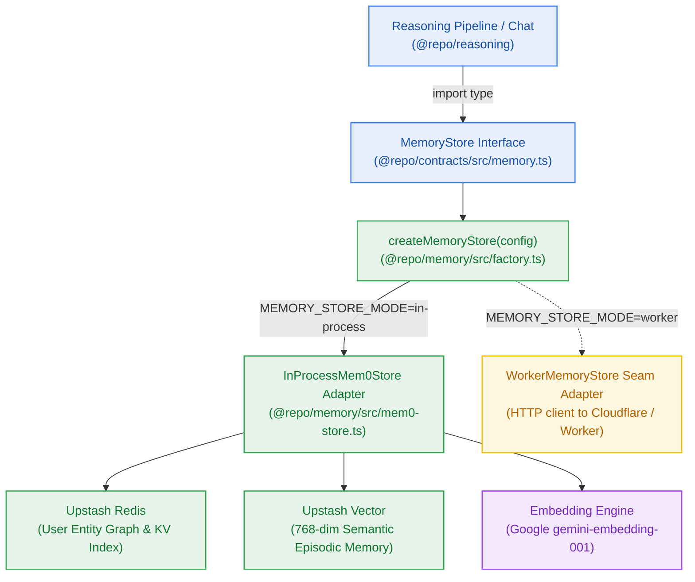
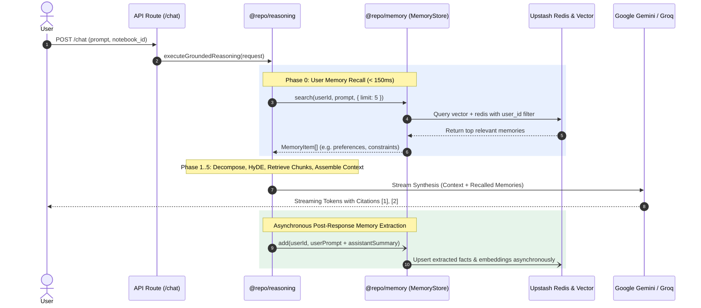

# Design — Milestone M6: Pluggable Long-Term Memory Store & Extraction Seams

> **Author:** architect-agent (Stage 3 Owner) · 2026-10-27 · **Status:** Final  
> **Grounding:** `_documentation/planning/prd.md` (FR-019, FR-020, FR-023), `project-brief.md` (BR-002, BR-018..BR-020), `ADR-0004` (Unified Upstash Serverless Ecosystem), `_documentation/planning/milestones/m6-pluggable-memory/milestone.md`  
> **Target Version:** `v0.6.0` · **Risk Tier:** MEDIUM (cross-session state, multi-tenant isolation, polymorphic extraction seam) · **Checkpoint:** CP3  



---

## 1. Context and Scope

Milestones M0 through M5 delivered the foundational multi-tenant workspace, Clerk authentication, atomic credit metering, the transient ingestion pipeline, personal notebook knowledge graph, and the 6-phase grounded reasoning engine. In M5, contextual reasoning operates strictly over immediate query scope and ingested notebook documents.

**Milestone M6 (`v0.6.0`)** introduces the platform's **Pluggable Long-Term Memory Store**:
- **Cross-Session Memory Recall (`FR-023`):** Persists salient user preferences, previous research themes, and domain constraints across sessions.
- **Strict Interface Abstraction (`FR-019`, `BR-018`):** 100% of memory interactions route exclusively through the canonical `MemoryStore` interface; domain code never imports vendor SDKs directly.
- **In-Process Mem0 Engine (`ADR-0004`):** Embeds Mem0 fact extraction and deduplication directly inside `@repo/memory` backed by `@upstash/redis` (entity graph/KV) and `@upstash/vector` (768-dim semantic search).
- **Modular Monolith Extraction Seam (`FR-020`, `NFR-019`):** Provides a polymorphic extraction seam (`WorkerMemoryStore`) allowing memory processing to run in-process or be extracted into a standalone worker without altering any caller contracts.
- **Multi-Tenant Isolation & Zero Cost (`BR-002`, `BR-019`, `NFR-014`, `NFR-016`):** Enforces strict `user_id` filtering on all memory search and cascade purge operations, maintaining the $0.00/month infrastructure ceiling.

---

## 2. Hexagonal Architecture & Extraction Seam

### 2.1 The MemoryStore Port Contract (`@repo/contracts/src/memory.ts`)

Domain packages (`@repo/reasoning`, API route handlers) depend only on the abstract `MemoryStore` interface:

```typescript
export interface MemoryItem {
  id: string;
  userId: string;
  content: string;
  category?: "preference" | "fact" | "directive" | "context";
  metadata?: Record<string, unknown>;
  score?: number;
  createdAt: string;
  updatedAt: string;
}

export interface MemorySearchOptions {
  limit?: number;
  threshold?: number;
  category?: "preference" | "fact" | "directive" | "context";
}

export interface MemoryAddResult {
  memoryId: string;
  status: "created" | "updated" | "deduplicated";
  content: string;
}

export interface MemoryDeleteResult {
  deletedCount: number;
}

export interface MemoryStore {
  add(userId: string, content: string, metadata?: Record<string, unknown>): Promise<MemoryAddResult>;
  search(userId: string, query: string, options?: MemorySearchOptions): Promise<MemoryItem[]>;
  get(userId: string, memoryId: string): Promise<MemoryItem | null>;
  delete(userId: string, memoryId: string): Promise<boolean>;
  deleteUserMemories(userId: string): Promise<MemoryDeleteResult>;
  list(userId: string, limit?: number): Promise<MemoryItem[]>;
}
```

### 2.2 Primary Adapter: In-Process Mem0 Engine (`@repo/memory/src/mem0-store.ts`)

The `InProcessMem0Store` coordinates:
1. **Entity Graph & Fast KV (`@upstash/redis`):** Stores memory metadata records, user memory ID sets, and entity associations.
2. **Semantic Vector Search (`@upstash/vector`):** Generates 768-dimensional dense embeddings for memory contents and performs similarity queries filtered by `{ user_id: userId }`.
3. **Fact Extraction & Deduplication:** When new messages are received, extracts concise declarative facts, calculates cosine similarity against existing memories, and updates existing records if similarity > 0.85 rather than creating duplicates.

### 2.3 Extraction Seam Adapter (`@repo/memory/src/worker-store.ts`)

To satisfy `FR-020` and `NFR-019`, `WorkerMemoryStore` implements `MemoryStore` by delegating calls over HTTP to a standalone worker endpoint (e.g. Cloudflare Worker or internal microservice) using the standard RFC 9457 error contracts. Callers require zero code modifications when switching modes.

### 2.4 Polymorphic Factory Seam (`@repo/memory/src/factory.ts`)

```typescript
export type MemoryStoreMode = "in-process" | "worker";

export interface MemoryStoreConfig {
  mode: MemoryStoreMode;
  redisUrl?: string;
  redisToken?: string;
  vectorUrl?: string;
  vectorToken?: string;
  workerEndpoint?: string;
  workerApiKey?: string;
}

export function createMemoryStore(overrideConfig?: Partial<MemoryStoreConfig>): MemoryStore {
  const mode = overrideConfig?.mode || (process.env.MEMORY_STORE_MODE as MemoryStoreMode) || "in-process";
  if (mode === "worker") {
    return new WorkerMemoryStore(overrideConfig);
  }
  return new InProcessMem0Store(overrideConfig);
}
```

---

## 3. Persistence Schema & Data Modeling

### 3.1 Upstash Redis Key Topology

| Key Pattern | Data Type | Purpose | TTL |
|---|---|---|---|
| `mem:user:{userId}:ids` | `Set<string>` | Set of all active memory IDs belonging to `userId` | None (Permanent until deleted) |
| `mem:entity:{userId}:{memoryId}` | `Hash / JSON` | Serialized `MemoryItem` payload (id, content, metadata, timestamps) | None |
| `mem:cache:{userId}:recent` | `List<string>` | Fast LRU cache of last 10 memory IDs accessed | 24 Hours |

### 3.2 Upstash Vector Semantic Memory Payload

When an episodic memory point is stored in Upstash Vector:
- **Vector ID:** `mem_{userId}_{memoryId}`
- **Dimensions:** 768 (standardized to Google `gemini-embedding-001` with ONNX fallback)
- **Metadata Filter Payload:**
  ```json
  {
    "user_id": "user_2test123456",
    "memory_id": "mem_01JBM9K...",
    "category": "preference",
    "updated_at": "2026-10-27T09:15:00.000Z"
  }
  ```
- **Query Filter:** `user_id = 'user_2test123456'` (enforces multi-tenant boundary at vector engine level).

---

## 4. Reasoning Integration & Execution Flow



---

## 5. Multi-Tenant Isolation & Zero-Cost Governance

1. **Isolation Invariant (`BR-002`, `BR-019`):**
   - Every read, write, and search operation requires an explicit `userId` from verified `TenantContext`.
   - Redis keys are strictly prefixed with `mem:user:{userId}:` or `mem:entity:{userId}:`.
   - Vector queries inject mandatory metadata filter `user_id = '${userId}'`.
   - User B querying a query identical to User A's seeded memory receives an empty array.
2. **Cascade Deletion Protocol (`deleteUserMemories`):**
   - Retrieves all memory IDs from `mem:user:{userId}:ids`.
   - Issues vector deletion batch for `mem_{userId}_{memoryId}`.
   - Atomically deletes Redis entity keys and clears `mem:user:{userId}:ids`.
3. **Zero-Cost Verification (`NFR-014`, `NFR-016`):**
   - In-process execution incurs $0.00 in additional hosting fees.
   - Upstash Vector and Redis usage fits well within the 10,000 queries/day and 500k commands/month free tiers.
   - No external Mem0 Platform SaaS API keys or payments are permitted.

---

## 6. Failure Modes & Degradation Handling

| Failure Mode | Impact | Mitigation / Fallback | RFC 9457 Status |
|---|---|---|---|
| **Upstash Vector Timeout (> 150ms)** | Memory retrieval exceeds SLA | Abort memory recall with timeout warning; proceed with standard grounded reasoning without memory injection | None (Transparent Degradation) |
| **Upstash Redis Connection Error** | Entity read/write failure | Fall back to ephemeral in-memory cache; log structured error with `correlation_id` | None (Transparent Degradation) |
| **Malformed Memory ID / User ID** | Client calls `/users/me/memories` with invalid input | Reject with 400 ProblemDocument | `400 BAD_REQUEST` |
| **Cross-Tenant Access Attempt** | User attempts to delete or get foreign memory ID | Return 404 NOT_FOUND (prevent ID enumeration) | `404 NOT_FOUND` |

---

## 7. Alternatives Considered & Rejection Rationale

1. **Managed Mem0 Platform SaaS:**
   - *Pros:* Hosted web UI, managed extraction infrastructure.
   - *Cons:* Monthly subscription fee ($19+/mo) requires payment cards; directly violates `NFR-014` and `NFR-016` ($0.00/month ceiling). **REJECTED.**
2. **Tightly-Coupled In-Process Implementation (No Seam):**
   - *Pros:* Omits factory and seam adapter files.
   - *Cons:* Violates `FR-020` and `NFR-019`; prevents future deployment as an independent Cloudflare Worker or background worker service. **REJECTED.**
3. **Synchronous Memory Extraction During Stream:**
   - *Pros:* Immediate consistency before next token.
   - *Cons:* Adds 500–1200ms of blocking latency to the chat synthesis stream, degrading TTFT and user responsiveness. **REJECTED.**
