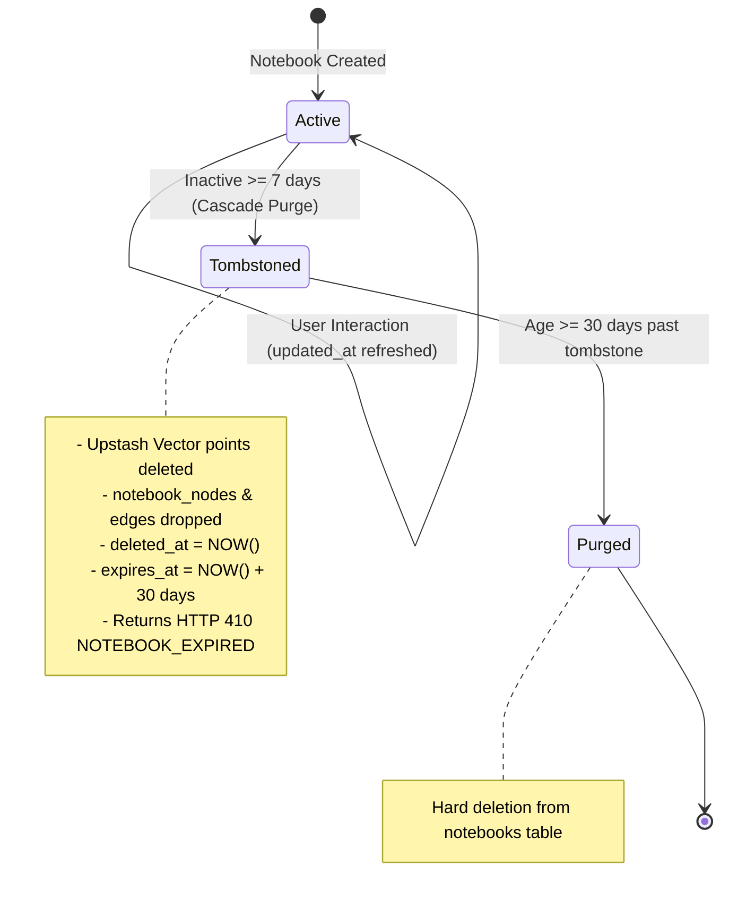

# Design — Milestone M7: Autonomous Maintenance Crons & Observability

> **Author:** `architect-agent` (Stage 3 Owner) · 2026-10-27 · **Status:** Final  
> **Grounding:** `_documentation/planning/prd.md` (FR-015, FR-040..FR-042), `project-brief.md` (BR-010..BR-012, BR-025..BR-027, BR-037..BR-040, BR-044, NFR-009, NFR-017, NFR-026, NFR-031, NFR-032), `ADR-0004` (Unified Upstash Serverless Ecosystem), `_documentation/planning/milestones/m7-maintenance-observability/milestone.md`  
> **Target Version:** `v0.7.0` · **Risk Tier:** HIGH (automated data deletion, webhook cryptography, platform-wide telemetry) · **Checkpoint:** CP3  

```mermaid
graph TD
    subgraph "Scheduled Maintenance Spine (Upstash QStash)"
        QSTASH["Upstash QStash Cron Engine<br/>(Signed HTTP Webhooks)"]
        
        QSTASH -->|Daily 08:00 UTC| CRON_RESET["/api/v1/crons/reset-credits<br/>(Idempotent Lua Credit Reset)"]
        QSTASH -->|Weekly Sun 00:00 UTC| CRON_SWEEP["/api/v1/crons/retention-sweep<br/>(7-Day Retention Cascade Sweeper)"]
        
        CRON_RESET --> VERIFY_SIG1["QStash Receiver<br/>(Verify Upstash-Signature)"]
        CRON_SWEEP --> VERIFY_SIG2["QStash Receiver<br/>(Verify Upstash-Signature)"]
        
        VERIFY_SIG1 --> LEDGER["@repo/metering<br/>executeDailyResetBatch()"]
        VERIFY_SIG2 --> SWEEPER["RetentionSweeper Service<br/>(@repo/observability / @repo/db)"]
    end

    subgraph "Retention Cascade & Tombstone Purge"
        SWEEPER --> QUERY_IDLE["Find Notebooks idle >= 7 days<br/>(updated_at < NOW - 7d AND deleted_at IS NULL)"]
        QUERY_IDLE --> PURGE_VEC["Delete Vectors in Upstash Vector<br/>(Filtered by notebook_id)"]
        PURGE_VEC --> PURGE_REL["Cascade Drop Nodes & Edges<br/>(notebook_nodes, notebook_edges)"]
        PURGE_REL --> TOMBSTONE["Set 30-Day Tombstone in Neon<br/>(deleted_at=NOW, expires_at=NOW+30d)"]
        
        USER_REQ["GET /notebooks/:id"] --> CHECK_TOMB["Check Notebook Status"]
        CHECK_TOMB -->|deleted_at IS NOT NULL| RET_410["HTTP 410 Gone<br/>NOTEBOOK_EXPIRED (RFC 9457)"]
        
        SWEEPER --> HARD_PURGE["Purge Expired Tombstones<br/>(deleted_at < NOW - 30d)"]
    end

    subgraph "Telemetry & Observability Pipeline (@repo/observability)"
        ROUTES["API Routes & Background Jobs"] --> ASYNC_CTX["AsyncLocalStorage Context<br/>(x-correlation-id & traceparent)"]
        ASYNC_CTX --> PINO["Structured JSON Logger (Pino)<br/>{ timestamp, level, correlation_id, event }"]
        PINO --> REDACT["Deep Secret & PII Redactor<br/>(Strip JWT, Keys, URIs, Passwords)"]
        REDACT --> STDOUT["Standard Output / Better Stack Logtail"]
        
        ROUTES --> OTEL_TRACER["OpenTelemetry Node Tracer<br/>(Span Lifecycle & W3C Propagation)"]
        OTEL_TRACER --> OTLP_EXP["OTLP/HTTP Span Exporter<br/>(Better Stack Ingest Endpoint)"]
        CRON_RESET & CRON_SWEEP --> HEARTBEAT["Heartbeat Liveness Monitor<br/>(NFR-031 Green Pulse)"]
    end

    classDef blue fill:#E8F0FE,stroke:#4285F4,stroke-width:1.5px,color:#174EA6;
    classDef green fill:#E6F4EA,stroke:#34A853,stroke-width:1.5px,color:#137333;
    classDef amber fill:#FEF7E0,stroke:#FBBC04,stroke-width:1.5px,color:#B06000;
    classDef red fill:#FCE8E6,stroke:#EA4335,stroke-width:1.5px,color:#C5221F;

    class QSTASH,USER_REQ,ROUTES blue;
    class VERIFY_SIG1,VERIFY_SIG2,LEDGER,SWEEPER,PINO,REDACT,OTEL_TRACER,OTLP_EXP green;
    class CRON_RESET,CRON_SWEEP,PURGE_VEC,PURGE_REL,TOMBSTONE,HEARTBEAT amber;
    class RET_410,HARD_PURGE red;
```



---

## 1. Context and Scope

Milestones M0 through M6 established the multi-tenant platform foundation, authentication, metering, transient ingestion, notebook graph, 6-phase grounded reasoning, and pluggable long-term memory store.

**Milestone M7 (`v0.7.0`)** introduces the autonomous maintenance spine and centralized observability pipeline:
- **Autonomous Maintenance Crons (`FR-015`, `FR-040`):** Automates daily 08:00 UTC credit resets (`BR-025`, `BR-026`) and weekly retention cascade sweeps (`BR-037`) using Upstash QStash scheduled HTTP webhooks with cryptographic signature verification (`Upstash-Signature`).
- **7-Day Retention Cascade Sweeper & 30-Day Tombstone Engine (`FR-041`, `BR-037..BR-040`, `BR-044`):** Purges vector embeddings from Upstash Vector for notebooks inactive for ≥ 7 days, cascades deletion through child relational nodes and edges, and sets a 30-day tombstone that returns HTTP 410 `NOTEBOOK_EXPIRED` (RFC 9457 Problem Details) before hard-purging after 30 days.
- **Centralized Structured JSON Logging (`FR-042`, `NFR-009`, `BR-010`):** Emits high-performance, structured JSON logs via Pino with mandatory schema `{ timestamp, level, correlation_id, service, event, payload }`.
- **Strict Credential & PII Redaction (`NFR-026`, `BR-012`):** Transparently sanitizes Bearer tokens, Clerk keys, database URIs, Upstash credentials, and Google API keys before stdout emission.
- **OpenTelemetry Distributed Tracing & Better Stack Export (`FR-023`, `NFR-009`):** Standard OpenTelemetry Node SDK tracer exporting traces and spans via OTLP/HTTP to Better Stack while preserving the $0.00/month infrastructure ceiling (`NFR-016`).
- **Heartbeat Health Monitoring (`NFR-031`):** Emits green heartbeat signals to monitoring endpoints upon successful execution of scheduled maintenance jobs.

*(Note: Per ADR-0004, Upstash Vector never suspends from inactivity; the artificial 48-hour Qdrant keepalive probe is officially deprecated).*

---

## 2. Package Architecture & Module Boundaries

Following the Two-Floor architecture and dependency rules:
1. **`@repo/observability` (New First-Floor Package):**
   - Pino logger singleton configured with ISO timestamp and JSON serialization.
   - `AsyncLocalStorage` correlation context storing `correlation_id` and W3C `traceparent`.
   - Secret & PII redactor transformer.
   - OpenTelemetry tracer provider and OTLP exporter wrapper.
   - QStash webhook receiver with cryptographic signature verification.
   - Retention sweeper service orchestrating vector purge and database tombstoning.
   - Heartbeat liveness monitor.
2. **`@repo/contracts` (Extended):**
   - Maintenance DTOs (`CronExecutionResult`, `RetentionSweepSummary`, `TombstoneRecord`).
   - Logging and tracing types (`LogLevel`, `LogEntry`, `SpanContext`, `QStashWebhookHeaders`).
   - Error catalogue: verified invariance of the closed 17-member RFC 9457 catalogue (`NOTEBOOK_EXPIRED` is member #13).
3. **`@repo/db` (Extended):**
   - Kysely retention queries on `notebooks` table (`findIdleNotebooks`, `tombstoneNotebook`, `hardPurgeExpiredNotebooks`).
4. **`apps/platform` (Route Handlers):**
   - `/api/v1/crons/reset-credits`: Endpoint triggered by QStash daily at 08:00 UTC.
   - `/api/v1/crons/retention-sweep`: Endpoint triggered by QStash weekly on Sundays at 00:00 UTC.

---

## 3. Upstash QStash Scheduled Crons & Webhook Security

### 3.1 Webhook Verification Specification

To prevent unauthorized triggering of credit resets or data deletion routines, all cron endpoints enforce cryptographic verification:

```typescript
export interface QStashReceiverConfig {
  currentSigningKey: string;
  nextSigningKey?: string;
}

export class QStashSignatureVerifier {
  constructor(private config: QStashReceiverConfig) {}

  async verify(headers: { signature?: string }, rawBody: string): Promise<boolean> {
    const signature = headers.signature;
    if (!signature) return false;
    // Uses HMAC SHA-256 over rawBody and timestamp using currentSigningKey or nextSigningKey
    return verifyQStashSignature(signature, rawBody, this.config.currentSigningKey, this.config.nextSigningKey);
  }
}
```

If the signature header is absent or cryptographically invalid, the endpoint immediately short-circuits with HTTP 401 `AUTHENTICATION_REQUIRED`.

### 3.2 Scheduled Crons Registry

| Cron Identifier | Schedule (Cron) | Target Route | Action | Idempotency Key |
|---|---|---|---|---|
| **Daily Credit Reset** | `0 8 * * *` (08:00 UTC) | `/api/v1/crons/reset-credits` | Executes `executeDailyResetBatch()` resetting credit ledger to 10.0 | `reset:daily:YYYY-MM-DD` |
| **Retention Cascade Sweep** | `0 0 * * 0` (Sun 00:00 UTC) | `/api/v1/crons/retention-sweep` | Sweeps idle notebooks (≥ 7 days), purges vectors, drops children, sets tombstones | `sweep:retention:YYYY-WW` |

---

## 4. 7-Day Retention Cascade Sweeper & 30-Day Tombstone Engine

### 4.1 Sweeper Lifecycle & State Machine



### 4.2 Cascade Execution Steps

1. **Identification:** Query `notebooks` where `deleted_at IS NULL` AND `updated_at < NOW() - INTERVAL '7 days'` in batches of 50.
2. **Vector Purge (`BR-039`):** Issue batch delete command to Upstash Vector filtered by `notebook_id = :id`. Guarantees zero orphaned vectors remain in vector index.
3. **Child Node & Edge Drop (`BR-040`):** Relational foreign keys enforce `ON DELETE CASCADE` or explicit batch deletion of `notebook_nodes` and `notebook_edges`.
4. **Tombstone Transition (`BR-044`):** Update `notebooks` record:
   - `deleted_at = NOW()`
   - `expires_at = NOW() + INTERVAL '30 days'`
   - `is_tombstoned = true`
5. **Hard Purge:** Query `notebooks` where `deleted_at IS NOT NULL` AND `expires_at < NOW()`; execute hard `DELETE FROM notebooks WHERE id IN (...)`.

### 4.3 Client HTTP 410 Protocol

When any client attempts to fetch, search, or mutate an expired notebook:
```json
{
  "type": "https://contextual.ai/errors/notebook-expired",
  "title": "Notebook Expired",
  "status": 410,
  "detail": "Notebook '0192e4ab-...' has expired following 7 days of inactivity and was purged per platform retention policy.",
  "instance": "/notebooks/0192e4ab-...",
  "invalid_params": [],
  "deletion_timestamp": "2026-10-27T00:00:00.000Z",
  "tombstone_expires_at": "2026-11-26T00:00:00.000Z"
}
```

---

## 5. Structured JSON Logging, Redaction & Correlation Context

### 5.1 JSON Log Schema (`FR-042`, `NFR-009`)

Every emitted log conforms strictly to the following schema:
```json
{
  "timestamp": "2026-10-27T10:45:00.123Z",
  "level": "info",
  "correlation_id": "corr_0192e4ab-...",
  "service": "platform",
  "event": "cron.daily_reset.completed",
  "payload": {
    "processed_users": 42,
    "duration_ms": 145
  }
}
```

### 5.2 AsyncLocalStorage Context

The correlation context is managed transparently via Node's `AsyncLocalStorage`:
```typescript
import { AsyncLocalStorage } from "node:async_hooks";

export interface RequestContext {
  correlationId: string;
  traceparent?: string;
  userId?: string;
}

export const contextStore = new AsyncLocalStorage<RequestContext>();

export function getCorrelationId(): string {
  return contextStore.getStore()?.correlationId ?? "none";
}
```

### 5.3 Deep Secret & PII Redactor (`NFR-026`, `BR-012`)

The redactor traverses log payloads recursively and applies regex patterns to redact sensitive tokens:
- **Bearer Tokens / JWTs:** `Bearer\s+[A-Za-z0-9\-_=]+\.[A-Za-z0-9\-_=]+\.?[A-Za-z0-9\-_=]*` → `Bearer [REDACTED]`
- **Clerk Secret Keys:** `sk_(?:live|test)_[A-Za-z0-9]+` → `sk_[REDACTED]`
- **Database Connection URIs:** `postgres(?:ql)?:\/\/[^:]+:[^@]+@[^\/]+\/[^\s]+` → `postgresql://[REDACTED]@[REDACTED]`
- **Upstash / Google API Keys:** `AIza[0-9A-Za-z-_]{35}` → `AIza[REDACTED]`
- **Password / Secret Fields:** Keys matching `/password|secret|token|credential|authorization/i` have their values replaced with `[REDACTED]`.

---

## 6. OpenTelemetry Distributed Tracing & Better Stack Export

### 6.1 Tracing Configuration

- **SDK:** `@opentelemetry/sdk-node` and `@opentelemetry/api`.
- **Propagation:** W3C `traceparent` (format: `00-{trace_id}-{parent_id}-{trace_flags}`).
- **Exporter:** OTLP HTTP exporter configured via:
  - `OTEL_EXPORTER_OTLP_ENDPOINT`: Ingest endpoint (default `http://localhost:4318`, Better Stack URL in production).
  - `BETTER_STACK_SOURCE_TOKEN`: Authentication token for Better Stack Telemetry ingest.
- **Span Hierarchy:**
  - `HTTP {METHOD} {PATH}` (Root Span)
    - `auth.verify_token` (Clerk JWT validation)
    - `metering.guard` (Rate limiting & credit debit)
    - `workspace.resolve` / `reasoning.synthesize` / `cron.retention_sweep`
    - `db.query` / `vector.search` / `llm.inference`

### 6.2 Heartbeat Monitor (`NFR-031`)

Emits a periodic liveness pulse upon successful cron completion to prevent silent failure. If the pulse is missed for `2 × cadence`, external monitoring triggers an alert.

---

## 7. Verification & Acceptance Criteria Matrix

| Criterion | Target | Verification Method |
|---|---|---|
| **AC-7.1 (Daily Credit Reset)** | QStash webhook invokes reset; user balances reset to 10 at 08:00 UTC idempotently | `tests/observability/qstash-crons.test.ts` |
| **AC-7.2 (Retention Cascade Purge)** | Idle notebook (≥ 7 days) has vectors deleted; request returns HTTP 410 Tombstone | `tests/observability/retention-cascade.test.ts` |
| **AC-7.3 (Structured Logging Format)** | 100% of logs emit valid JSON carrying `correlation_id` and W3C trace context | `tests/observability/logger-redact.test.ts` |
| **AC-7.4 (Secret Redaction Attestation)** | Injected Bearer tokens, API keys, and connection strings are redacted to `[REDACTED]` | `tests/observability/logger-redact.test.ts` |

---

## 8. Failure Modes & Containment Design (FM-701..FM-705)

| Failure Mode ID | Potential Cause | Impact | Containment Design | Action Priority |
|---|---|---|---|:---:|
| **FM-701** | QStash Webhook Signature Spoofing | Unauthorized third-party triggers credit reset or retention purge | Strict HMAC SHA-256 verification via `QStashSignatureVerifier`; rejects absent or mismatched signatures with 401 | **LOW** |
| **FM-702** | Upstash Vector Network Dropout during Retention Sweep | Relational records deleted but vectors remain orphaned | Sweeper uses two-phase commit pattern: vector deletion must acknowledge success BEFORE relational nodes are dropped and tombstone is set | **LOW** |
| **FM-703** | Log Flooding from High Concurrency | Memory exhaustion or stdout buffering bottleneck on Vercel | Pino non-blocking buffering with asynchronous transport; automatic log level throttling under load | **LOW** |
| **FM-704** | Better Stack OTLP Ingest Outage or Timeout | Unhandled promise rejection stalling HTTP request threads | Tracing exporter wrapped in non-blocking timeout guard (500ms cap); exporter errors logged locally and discarded silently without affecting user responses | **LOW** |
| **FM-705** | Premature Purge of Recently Updated Notebook | Clocks out of sync or time zone drift during idle calculation | Neon Postgres server timestamp `NOW()` used exclusively in SQL queries; prevents local client clock skew | **LOW** |

---
*Sealed by `architect-agent` at Checkpoint 3 (Gate G4).*
