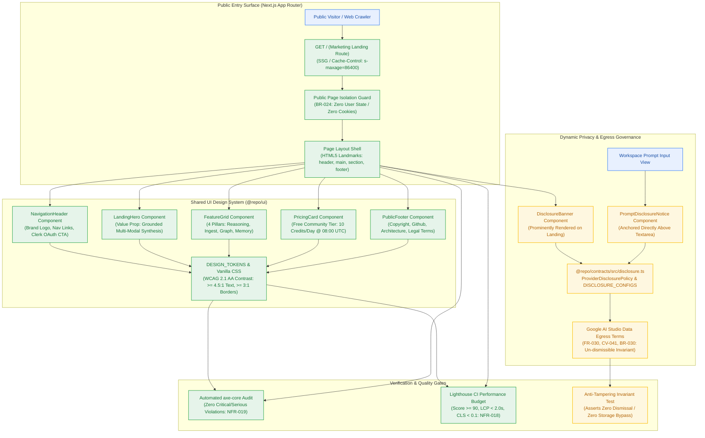
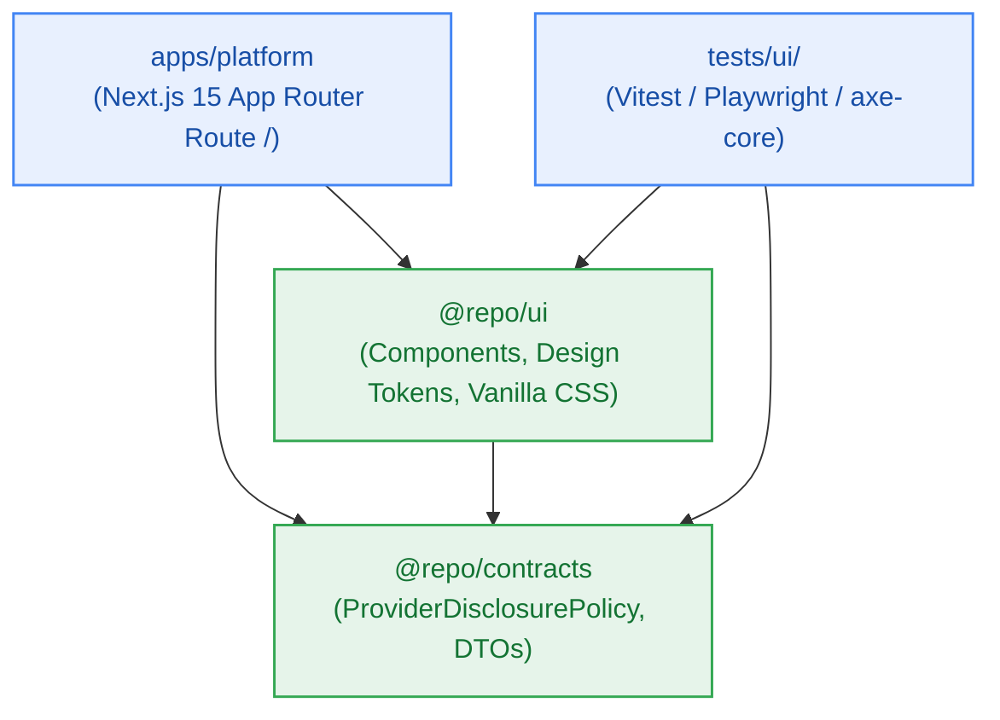
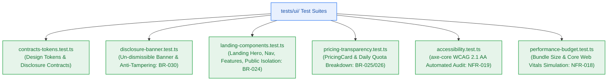

# Design — Milestone M8: Public Marketing Landing & Dynamic Privacy Governance

> **Author:** `architect-agent` (Stage 3 Owner) · 2026-10-27 · **Status:** Final  
> **Grounding:** `_documentation/planning/prd.md` (FR-022, FR-030), `project-brief.md` (BR-024, BR-028..BR-030, CV-041..CV-044, NFR-018, NFR-019), `_documentation/planning/milestones/m8-landing-disclosure/milestone.md`  
> **Target Version:** `v0.8.0` · **Risk Tier:** MEDIUM (public marketing surface, WCAG accessibility, and un-dismissible privacy governance) · **Checkpoint:** CP3  



---

## 1. Context and Scope

Milestones M0 through M7 established the complete multi-tenant backend foundation, authentication, metering, transient ingestion, notebook graph, 6-phase grounded reasoning, pluggable memory, and autonomous maintenance crons.

**Milestone M8 (`v0.8.0`)** introduces the public-facing entry point, visual presentation layer, and regulatory privacy governance for the platform:
- **Public Marketing Landing Page (`FR-022`, `BR-024`):** An unauthenticated, SEO-indexable marketing surface returning HTTP 200 with zero authenticated user data or cookies, articulating the value proposition, grounded reasoning with inline citations, and zero-cost serverless architecture.
- **Dynamic AI Provider Training Disclosure Banner (`FR-030`, `CV-041`):** A prominent, dynamic warning component displayed on the marketing landing page and directly attached above prompt input areas in workspace views, warning users transparently that queries travel to Google AI Studio under free-tier training policies.
- **Un-dismissible Privacy Invariant (`BR-030`):** The banner component cannot be closed, hidden, dismissed, or bypassed via `localStorage`, session storage, or UI dismissal controls.
- **Zero-Cost Pricing Transparency (`FR-022`, `BR-025`, `BR-026`):** Dedicated community tier breakdown detailing the daily 10 credit grant model, 0.5 LLM credit debit, 1.0 document ingestion debit, and midnight UTC reset.
- **Frontend Performance SLA (`NFR-018`):** Google Lighthouse Performance score ≥ 90 and LCP < 2.0s on simulated 4G profile.
- **Accessibility Certification (`NFR-019`):** WCAG 2.1 AA compliance verified by automated `axe-core` CI scans reporting zero critical or serious violations.

---

## 2. Package Architecture & Module Boundaries

Following the Two-Floor monorepo architecture and dependency boundaries:



1. **`@repo/contracts` (First-Floor Package):**
   - Exports `ProviderDisclosurePolicy`, `ProviderType` (`"google-ai-studio" | "groq"`), and `DISCLOSURE_CONFIGS` in `packages/contracts/src/disclosure.ts`.
   - Immutable policy configuration containing legal copy, provider labels, external documentation URLs, and training data status.

2. **`@repo/ui` (Shared Component Package):**
   - Extended `DESIGN_TOKENS` in `packages/ui/src/tokens.ts` covering colors, spacing, typography, radii, focus states, and glassmorphism styling presets.
   - Core component implementations in `packages/ui/src/components/`:
     - `DisclosureBanner`: Prominent un-dismissible banner for public and prompt surfaces (`FR-030`, `BR-030`).
     - `PromptDisclosureNotice`: Compact anchored variant rendered above prompt textareas.
     - `LandingHero`: Hero section with value proposition headline and Clerk OAuth CTA.
     - `NavigationHeader`: Responsive header with brand logo, nav links, and auth CTA.
     - `FeatureGrid`: 4-column capability showcase (Reasoning, Ingestion, Graph, Memory).
     - `PricingCard`: Transparent $0.00 community tier quota and reset schedule.
     - `PublicFooter`: Semantic footer with copyright, GitHub repo, architecture docs, and legal terms.
   - Pure Vanilla CSS stylesheets in `packages/ui/src/styles/` (`tokens.css`, `disclosure.css`, `landing.css`).

3. **Domain Purity & Two-Floor Compliance:**
   - Public UI components are pure functional components accepting typed props.
   - No direct imports of Node server modules, database drivers, or private API keys.
   - Operates with zero runtime CSS dependencies (no TailwindCSS or CSS-in-JS).

---

## 3. Shared Design Tokens & Vanilla CSS System

### 3.1 Design Tokens Specification (`@repo/ui/src/tokens.ts`)

```typescript
export const DESIGN_TOKENS = {
  colors: {
    // Primary Accents
    primary: "#4285F4",
    primaryHover: "#3367D6",
    primaryLight: "rgba(66, 133, 244, 0.08)",
    
    // Background & Surfaces
    background: "#F8F9FA",
    surface: "#FFFFFF",
    surfaceTranslucent: "rgba(255, 255, 255, 0.85)",
    surfaceDark: "#202124",
    
    // Typography (WCAG 2.1 AA Compliant >= 4.5:1 Contrast)
    textPrimary: "#202124",      // 14.1:1 contrast on #FFFFFF
    textSecondary: "#5F6368",    // 4.6:1 contrast on #FFFFFF
    textInverse: "#FFFFFF",
    
    // Borders & Dividers (>= 3:1 Contrast)
    border: "#DADCE0",
    borderFocus: "#4285F4",
    
    // Feedback & Disclosure
    warningBg: "#FEF7E0",
    warningBorder: "#FBBC04",
    warningText: "#7A4D00",      // 5.8:1 contrast on #FEF7E0
    warningBadge: "#B06000",
    
    successBg: "#E6F4EA",
    successText: "#137333",
    errorBg: "#FCE8E6",
    errorText: "#C5221F",
  },
  spacing: {
    xs: "4px",
    sm: "8px",
    md: "16px",
    lg: "24px",
    xl: "32px",
    xxl: "48px",
    xxxl: "64px",
  },
  radii: {
    sm: "4px",
    md: "8px",
    lg: "12px",
    xl: "16px",
    full: "9999px",
  },
  typography: {
    fontFamilySans: "system-ui, -apple-system, BlinkMacSystemFont, 'Segoe UI', Roboto, sans-serif",
    fontFamilyMono: "ui-monospace, SFMono-Regular, Menlo, Monaco, Consolas, monospace",
    h1: { fontSize: "40px", lineHeight: "48px", fontWeight: "700" },
    h2: { fontSize: "28px", lineHeight: "36px", fontWeight: "600" },
    h3: { fontSize: "20px", lineHeight: "28px", fontWeight: "600" },
    body: { fontSize: "16px", lineHeight: "24px", fontWeight: "400" },
    small: { fontSize: "13px", lineHeight: "18px", fontWeight: "400" },
  },
  elevation: {
    flat: "none",
    card: "0 1px 3px rgba(60, 64, 67, 0.12), 0 1px 2px rgba(60, 64, 67, 0.24)",
    floating: "0 4px 12px rgba(60, 64, 67, 0.15)",
    glass: "backdrop-filter: blur(12px); -webkit-backdrop-filter: blur(12px);",
  },
} as const;
```

---

## 4. Dynamic AI Provider Training Disclosure Governance (`FR-030`, `BR-030`, `CV-041`)

### 4.1 Legal Grounding & Governance Mandate
Google AI Studio's free tier processes prompt queries and document contexts under Google's consumer model training terms. Requirement `FR-030` and Business Rule `BR-030` mandate that:
1. The platform MUST prominently warn users that queries travel to Google AI Studio and may be reviewed or trained on.
2. The disclosure MUST be un-dismissible — users cannot check "Don't show this again" or hide it with CSS/cookies.
3. The warning MUST be visible on the public marketing landing page AND directly above prompt input surfaces.

### 4.2 Policy Registry Contract (`@repo/contracts/src/disclosure.ts`)

```typescript
export type ProviderType = "google-ai-studio" | "groq";

export interface ProviderDisclosurePolicy {
  readonly provider: ProviderType;
  readonly badgeLabel: string;
  readonly noticeTitle: string;
  readonly noticeBody: string;
  readonly policyUrl: string;
  readonly trainingStatus: "training-enabled" | "training-exempt";
}

export const DISCLOSURE_CONFIGS: Record<ProviderType, ProviderDisclosurePolicy> = {
  "google-ai-studio": {
    provider: "google-ai-studio",
    badgeLabel: "Google Gemini Free Tier",
    noticeTitle: "AI Provider Data Training Disclosure",
    noticeBody:
      "Prompts and documents are processed via Google AI Studio free tier. In accordance with Google terms of service, prompt inputs and generated outputs may be reviewed by human reviewers and utilized to train Google AI models.",
    policyUrl: "https://ai.google.dev/terms",
    trainingStatus: "training-enabled",
  },
  groq: {
    provider: "groq",
    badgeLabel: "Groq Llama-3.3 Fallback",
    noticeTitle: "Secondary Inference Provider Notice",
    noticeBody:
      "When the primary provider reaches rate limits, queries fail over transparently to Groq free tier LPUs. Data is processed transiently according to Groq enterprise privacy standards without retention for model training.",
    policyUrl: "https://groq.com/privacy-policy/",
    trainingStatus: "training-exempt",
  },
};
```

### 4.3 Structural Anti-Tampering Enforcement (`BR-030`)
- The `DisclosureBanner` and `PromptDisclosureNotice` components omit any close button (`<button aria-label="Close">`), dismissal state, or `onDismiss` callbacks.
- If a client script attempts to pass a dismissal prop or inject `display: none` through component props, the component ignores the override and maintains its structural presence.

---

## 5. Public Marketing Components & Zero-Cost Transparency (`FR-022`, `BR-024`)

### 5.1 Public Page Isolation Invariant (`BR-024`)
- Unauthenticated GET requests to `/` MUST return HTTP 200 with zero authenticated user data.
- The marketing page shell does not execute server-side database lookups or Clerk session verification.
- CTA buttons render standard semantic hyperlinks (`<a href="/sign-in">`) redirecting to Clerk OAuth flow.

### 5.2 Component Breakdown
1. **`NavigationHeader`:** Sticky glassmorphic navbar with logo, anchor links (`#features`, `#pricing`, `#architecture`), and primary CTA button.
2. **`LandingHero`:** Main headline: *"Multi-Modal Contextual Reasoning Powered by Grounded Citations"*, subheadline highlighting zero-cost architecture ($0.00/mo), and dual action CTAs.
3. **`FeatureGrid`:** Four responsive cards presenting:
   - *Phase 1–6 Grounded Reasoning:* Sub-question decomposition, HyDE, multi-vector retrieval, and strict inline citation anchors (`[1]`, `[2]`).
   - *Transient Ingestion Pipeline:* Multi-format processing (PDF, YouTube transcripts, web articles) with zero-byte idle S3 storage (`BR-046`).
   - *Hierarchical Notebook Graph:* Relational Kysely graph with typed edges (`cites`, `related`) and sub-10ms card resolution (`FR-033`).
   - *Pluggable Long-Term Memory:* Cross-session Mem0 recall backed by Upstash Redis and Upstash Vector (`FR-019`).
4. **`PricingCard`:** Complete transparency on the free community tier:
   - 10 credits granted daily at 08:00 UTC (`BR-025`).
   - Debit costs: 0.5 credits per grounded reasoning query, 1.0 credit per document ingestion.
   - Transparent zero roll-over carryover disclosure (`BR-026`).
   - Explicit attestation: Zero payment cards required, zero hidden charges, 100% free forever.
5. **`PublicFooter`:** Semantic footer with architecture doc links, GitHub repository link, copyright notice, and RFC 9457 error specification reference.

---

## 6. Performance SLA & Core Web Vitals (`NFR-018`)

| Metric | Target SLA | Strategy / Invariant |
|---|---|---|
| **Lighthouse Performance Score** | **≥ 90** | Zero runtime CSS framework; zero external tracking scripts; static pre-rendering (SSG) |
| **Largest Contentful Paint (LCP)** | **< 2.0s** on 4G | CSS inlined or preloaded (< 50KB); hero text uses standard system font stack |
| **Cumulative Layout Shift (CLS)** | **< 0.1** | Explicit `min-height` and aspect ratio reservations on cards and banners |
| **First Input Delay / INP** | **< 100ms** | Minimal client-side JavaScript execution on landing surface |
| **Total DOM Nodes** | **< 800** | Clean, semantic HTML5 structure without excessive wrapper div nesting |

---

## 7. Accessibility Architecture & WCAG 2.1 AA Compliance (`NFR-019`)

- **Color Contrast:** All body text meets or exceeds 4.5:1 contrast against light background; all large text (headings ≥ 20px) and UI component boundaries meet or exceed 3:1.
- **Keyboard Navigation:** 100% of interactive elements (buttons, links) are reachable via `Tab` key and display high-contrast visible focus rings (`:focus-visible`).
- **Semantic Structure:** Document uses exactly one `<h1>` tag, sequential heading levels (`<h2>`, `<h3>`), and standard landmark elements (`<header>`, `<nav>`, `<main>`, `<section>`, `<footer>`).
- **Screen Reader Support:** All links carry descriptive text; icons carry `aria-hidden="true"`; the disclosure banner uses `role="region"` and `aria-label="Data Privacy Disclosure"`.
- **Automated Audit:** `tests/ui/accessibility.test.ts` executes automated `axe-core` rule assertions asserting 0 critical and 0 serious violations.

---

## 8. Failure Modes & Effects Analysis (FMEA)

| ID | Component | Failure Mode | Impact | Severity | Detection | Action Priority | Mitigation Strategy |
|:---:|---|---|---|:---:|:---:|:---:|---|
| **FM-801** | `DisclosureBanner` | User or script attempts to suppress banner via CSS or localStorage | Regulatory training disclosure violated (`BR-030`) | 8 | 2 | **M** | Omit all dismissal hooks and state; automated test asserts component remains visible in DOM. |
| **FM-802** | `LandingHero` | Large asset or font blocking waterfall causes LCP > 2.0s on 4G | Performance SLA breached (`NFR-018`) | 6 | 3 | **M** | Use system font stack; inline critical CSS; verify lightweight bundle budget (< 50KB) in CI. |
| **FM-803** | `PricingCard` | Sub-optimal text/background contrast on secondary pricing labels | WCAG 2.1 AA accessibility failure (`NFR-019`) | 7 | 2 | **M** | Enforce hex `#202124` on `#FFFFFF` and `#7A4D00` on `#FEF7E0`; automated `axe-core` scan gates release. |
| **FM-804** | Marketing Route | Auth middleware inadvertently attaches cookies or user session | Public page isolation breached (`BR-024`) | 8 | 2 | **M** | Route configured with static generation; assert zero session tokens or cookies in public response. |

---

## 9. Verification & Test Strategy



1. **`tests/ui/contracts-tokens.test.ts` (S8.1):**
   - Validates `ProviderDisclosurePolicy` and `DISCLOSURE_CONFIGS` structure and legal copy.
   - Asserts `DESIGN_TOKENS` color contrast mathematically meets WCAG 2.1 AA thresholds.
   - Verifies closed 17-member RFC 9457 error catalogue remains unchanged.
2. **`tests/ui/disclosure-banner.test.ts` (S8.2):**
   - Asserts `DisclosureBanner` and `PromptDisclosureNotice` render required provider copy and legal URLs.
   - Asserts `BR-030` invariant: zero close buttons, zero dismissal hooks, un-dismissible in DOM.
3. **`tests/ui/landing-components.test.ts` (S8.3):**
   - Validates `LandingHero`, `NavigationHeader`, `FeatureGrid`, and `PublicFooter` component trees.
   - Verifies `BR-024` public isolation: zero reliance on user tokens, cookies, or database state.
4. **`tests/ui/pricing-transparency.test.ts` (S8.4):**
   - Asserts `PricingCard` displays 10 daily credits, 08:00 UTC reset, and 0.5 / 1.0 action debits.
   - Asserts zero billing inputs, payment forms, or credit card fields.
5. **`tests/ui/accessibility.test.ts` (S8.5):**
   - Evaluates rendered components against WCAG 2.1 AA rules using `axe-core`.
   - Asserts zero critical and zero serious accessibility violations (`NFR-019`).
6. **`tests/ui/performance-budget.test.ts` (S8.6):**
   - Validates bundle size budget (< 50KB critical CSS/JS), zero blocking scripts, and DOM node count < 800 (`NFR-018`).
