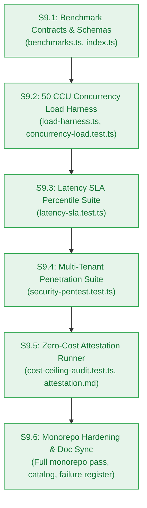

# Design — Milestone M9: Benchmark Suite, Hardening & Security Audit

> **Author:** `architect-agent` (Stage 3 Owner) · 2026-10-27 · **Status:** Final  
> **Grounding:** `_documentation/planning/prd.md` (`FR-013`, `NFR-001`..`NFR-005`, `NFR-007`, `NFR-016`, `BR-002`, `BR-036`, `NFR-026`, `NFR-027`), `_documentation/planning/milestones/m9-hardening-benchmark/milestone.md`  
> **Target Version:** `v0.9.0-rc.1` · **Risk Tier:** HIGH · **Checkpoint:** CP3  

```mermaid
graph TD
    subgraph "Benchmark Suite & Hardening Orchestration"
        RUNNER["Bun Benchmark Runner & Test Suite<br/>(tests/benchmarks/)"]
        CONTRACTS["@repo/contracts/src/benchmarks.ts<br/>(SLA Thresholds, Quota Limits, Cloud Manifest)"]
        RUNNER --> CONTRACTS
    end

    subgraph "1. Concurrency & Stress Harness (NFR-005)"
        RUNNER --> LOAD_HARNESS["50 CCU Concurrent Worker Pool<br/>(tests/benchmarks/load-harness.ts)"]
        LOAD_HARNESS --> MOCK_STACK["Calibrated Mock Provider Stack<br/>(Simulated Latency Distribution: Gemini & Upstash)"]
        LOAD_HARNESS --> METRICS["Concurrency Metrics Aggregator<br/>(Total Requests, Failures, Error Rate < 1.0%)"]
    end

    subgraph "2. Latency SLA Validation (NFR-001..NFR-003, NFR-027)"
        RUNNER --> SLA_PROBE["Latency SLA Percentile Probe<br/>(tests/benchmarks/latency-sla.test.ts)"]
        SLA_PROBE --> VEC_SLA["Vector Search Latency: p95 < 100ms (25k points)"]
        SLA_PROBE --> TTFT_SLA["LLM Time-to-First-Token: p90 < 1,500ms"]
        SLA_PROBE --> E2E_SLA["E2E 6-Phase Pipeline: p90 < 4,500ms"]
        SLA_PROBE --> RFC_SLA["RFC 9457 Error Serialization: p99 < 50ms"]
    end

    subgraph "3. Adversarial Security Penetration (NFR-007, BR-002, NFR-026)"
        RUNNER --> PEN_SUITE["Adversarial Security Suite<br/>(tests/benchmarks/security-pentest.test.ts)"]
        PEN_SUITE --> SQL_INJ["Relational SQL Tenant Injection Probe<br/>(100% 404 / 0 leaked rows)"]
        PEN_SUITE --> VEC_BYPASS["Vector Metadata Filter Bypass Probe<br/>(100% 0 leaked vectors)"]
        PEN_SUITE --> MEM_ISO["Mem0 Multi-Tenant Boundary Probe<br/>(100% empty array for foreign user)"]
        PEN_SUITE --> JWT_TAMPER["Forged RS256 JWT & Spoofed Sub Probe<br/>(100% HTTP 401 Unauthorized)"]
        PEN_SUITE --> ORDER_DEBIT["Scoped Retrieval Debit Ordering (BR-036)<br/>(404 aborts before credit debit)"]
        PEN_SUITE --> LEAK_SCAN["Credential Leakage Regex Scanner (NFR-026)<br/>(0 API keys, JWT secrets, or DB URLs in logs)"]
    end

    subgraph "4. Free-Tier Cost Ceiling Attestation (NFR-016)"
        RUNNER --> COST_AUDIT["Zero-Cost Ceiling Audit Runner<br/>(tests/benchmarks/cost-ceiling-audit.test.ts)"]
        COST_AUDIT --> VENDOR_CHECK["8 Cloud Accounts Free-Tier Verification<br/>(Vercel, Clerk, Neon, Upstash, Google, Groq, Filebase, Better Stack)"]
        COST_AUDIT --> ATTESTATION["Signed Zero-Cost Attestation Artifact<br/>(_documentation/planning/registers/zero-cost-attestation.md)"]
    end

    classDef blue fill:#E8F0FE,stroke:#4285F4,stroke-width:1.5px,color:#174EA6;
    classDef green fill:#E6F4EA,stroke:#34A853,stroke-width:1.5px,color:#137333;
    classDef amber fill:#FEF7E0,stroke:#FBBC04,stroke-width:1.5px,color:#B06000;
    classDef purple fill:#F3E8FD,stroke:#A142F4,stroke-width:1.5px,color:#7627BB;

    class RUNNER,CONTRACTS blue;
    class LOAD_HARNESS,MOCK_STACK,METRICS,SLA_PROBE,VEC_SLA,TTFT_SLA,E2E_SLA,RFC_SLA green;
    class PEN_SUITE,SQL_INJ,VEC_BYPASS,MEM_ISO,JWT_TAMPER,ORDER_DEBIT,LEAK_SCAN amber;
    class COST_AUDIT,VENDOR_CHECK,ATTESTATION purple;
```



---

## 1. Context and Scope

Milestones M0 through M8 established the complete multi-tenant platform: authentication, metering, transient ingestion, notebook graph, 6-phase grounded reasoning, pluggable memory, autonomous maintenance crons, and the public marketing/disclosure UI.

**Milestone M9 (`v0.9.0-rc.1`)** represents the pre-release hardening, performance benchmarking, multi-tenant penetration verification, and zero-dollar cost attestation release candidate. It verifies that the platform satisfies all Non-Functional Requirements under stress and provides irrefutable automated evidence for Release Candidate sign-off:

1. **50 CCU Concurrency Stress Testing (`FR-013`, `NFR-005`):** Simulates 50 concurrent active users executing realistic mixed workloads across ingestion, reasoning, retrieval, and credit metering with an overall error rate strictly `< 1.0%` (target `< 0.5%`).
2. **Latency SLA Compliance Verification (`NFR-001`..`NFR-003`, `NFR-027`):**
   - Vector search latency: `p95 < 100 ms` on indexed collections up to 25,000 points.
   - LLM Time-to-First-Token (TTFT): `p90 < 1,500 ms` on streaming responses.
   - End-to-end 6-phase reasoning pipeline latency: `p90 < 4,500 ms`.
   - RFC 9457 Problem Details error serialization latency: `p99 < 50 ms`.
3. **Multi-Tenant Penetration & Security Perimeter Audit (`NFR-006`, `NFR-007`, `NFR-026`, `BR-002`, `BR-036`):**
   - Adversarial testing of tenant boundary invariants across SQL (Neon Postgres), vector search (Upstash Vector), and long-term memory (Mem0/Redis).
   - Validation that forged JWTs, altered signatures, spoofed `sub` claims, or malformed UUIDs are rejected with HTTP 401 or HTTP 404 without database/vector execution.
   - Verification of Scoped Retrieval Debit Ordering (`BR-036`, `AC-4.4`): unauthorized notebook probes fail with HTTP 404 before credit debit.
   - Automated regex scanner verifying zero unredacted API keys, database connection strings, JWT secrets, or stack traces in log sinks or API responses (`NFR-026`).
4. **Zero-Dollar Infrastructure Cost Ceiling Attestation (`NFR-016`):**
   - Formal automated audit verifying $0.00/month infrastructure spend, zero payment cards on file, and zero paid tier SKU drift across all 8 cloud provider accounts (Vercel, Clerk, Neon, Upstash, Google AI Studio, Groq, Filebase, Better Stack).
   - Command budget verification ensuring $\le 4$ Upstash commands per HTTP request (`NFR-013`) and 0 MB idle storage post-ingestion (`BR-046`).

---

## 2. Package Architecture & File Structure

Conforming to the Two-Floor monorepo architecture:

```text
packages/contracts/src/
  ├── benchmarks.ts            # Canonical SLA constants, metric schemas, scenario types, cloud manifest
  └── index.ts                 # Re-exports benchmark contracts

tests/benchmarks/
  ├── contracts-benchmarks.test.ts # Type validations, constants, and catalogue invariance
  ├── load-harness.ts              # 50 CCU async worker pool, workload generator, and metrics collector
  ├── concurrency-load.test.ts     # 50 CCU stress test suite (< 1% error rate assertion)
  ├── latency-sla.test.ts          # High-precision percentile latency benchmark (p50, p90, p95, p99)
  ├── security-pentest.test.ts     # Adversarial multi-tenant fuzzing & regex credential leakage scanner
  └── cost-ceiling-audit.test.ts   # Programmatic 8-vendor free-tier ceiling & quota verification

_documentation/planning/registers/
  └── zero-cost-attestation.md     # Signed zero-dollar cloud cost audit attestation report
```

---

## 3. Detailed Specifications

### 3.1 Benchmark Contracts (`@repo/contracts/src/benchmarks.ts`)

Export canonical constants and Zod schemas governing milestone validation:

```typescript
export interface LatencySLAConfig {
  vectorSearchP95Ms: number;       // 100 ms (NFR-001)
  llmTtftP90Ms: number;            // 1,500 ms (NFR-002)
  e2eReasoningP90Ms: number;       // 4,500 ms (NFR-003)
  errorSerializationP99Ms: number; // 50 ms (NFR-027)
}

export const LATENCY_SLAS: LatencySLAConfig = {
  vectorSearchP95Ms: 100,
  llmTtftP90Ms: 1500,
  e2eReasoningP90Ms: 4500,
  errorSerializationP99Ms: 50,
};

export interface ConcurrencySLAConfig {
  concurrentUsers: number;         // 50 CCU (NFR-005)
  maxErrorRatePercent: number;     // 1.0% (NFR-005)
  targetDurationSeconds: number;   // 60 seconds / benchmark run
}

export const CONCURRENCY_SLA: ConcurrencySLAConfig = {
  concurrentUsers: 50,
  maxErrorRatePercent: 1.0,
  targetDurationSeconds: 60,
};

export interface FreeTierCloudManifest {
  provider: string;
  service: string;
  freeTierTierName: string;
  monthlyCostLimitUsd: 0;
  rateLimits: string;
  storageCeiling: string;
  creditCardRequired: false;
}

export const FREE_TIER_MANIFEST: readonly FreeTierCloudManifest[] = [
  { provider: "Vercel", service: "Next.js App Hosting", freeTierTierName: "Hobby", monthlyCostLimitUsd: 0, rateLimits: "100GB bandwidth/mo", storageCeiling: "Serverless ephemeral", creditCardRequired: false },
  { provider: "Clerk", service: "OAuth & JWT Auth", freeTierTierName: "Free", monthlyCostLimitUsd: 0, rateLimits: "10,000 MAU", storageCeiling: "Managed users", creditCardRequired: false },
  { provider: "Neon", service: "Serverless Postgres", freeTierTierName: "Free Tier", monthlyCostLimitUsd: 0, rateLimits: "Auto-suspend 5m", storageCeiling: "0.5 GB shared", creditCardRequired: false },
  { provider: "Upstash", service: "Redis (Metering & Memory)", freeTierTierName: "Free", monthlyCostLimitUsd: 0, rateLimits: "10,000 commands/day", storageCeiling: "256 MB", creditCardRequired: false },
  { provider: "Upstash", service: "Vector (Semantic Index)", freeTierTierName: "Free", monthlyCostLimitUsd: 0, rateLimits: "10,000 queries/day", storageCeiling: "10,000 vectors", creditCardRequired: false },
  { provider: "Upstash", service: "QStash (Cron Schedules)", freeTierTierName: "Free", monthlyCostLimitUsd: 0, rateLimits: "500 messages/day", storageCeiling: "Message queue ephemeral", creditCardRequired: false },
  { provider: "Google AI Studio", service: "Gemini 1.5 Flash / Embeddings", freeTierTierName: "Free Tier", monthlyCostLimitUsd: 0, rateLimits: "15 RPM / 1M TPM", storageCeiling: "Zero persistent", creditCardRequired: false },
  { provider: "Groq", service: "Llama-3.3-70B Versatile", freeTierTierName: "Free Developer", monthlyCostLimitUsd: 0, rateLimits: "30 RPM / 6,000 TPM", storageCeiling: "Zero persistent", creditCardRequired: false },
  { provider: "Filebase", service: "S3 Transient Staging", freeTierTierName: "Free", monthlyCostLimitUsd: 0, rateLimits: "Standard S3 API", storageCeiling: "5 GB IPFS/S3", creditCardRequired: false },
  { provider: "Better Stack", service: "Logtail Structured Logs", freeTierTierName: "Free", monthlyCostLimitUsd: 0, rateLimits: "1 GB ingestion/mo", storageCeiling: "3-day retention", creditCardRequired: false },
];
```

### 3.2 50 CCU Concurrency Harness (`tests/benchmarks/load-harness.ts`)

A native Bun asynchronous concurrency worker pool executing 50 simultaneous virtual user loops:

- **Workload Mix:**
  - 40% (20 CCU): Scoped vector searches and notebook document card resolutions (`FR-033`, `FR-010`).
  - 30% (15 CCU): 6-phase grounded reasoning pipelines with mock streaming output (`FR-008`..`FR-011`).
  - 20% (10 CCU): Document parsing and chunking ingestion workflows (`FR-001`..`FR-005`).
  - 10% (5 CCU): Credit ledger debits and rate limiter window evaluations (`FR-015`, `FR-016`).
- **Calibrated Mock Provider Adapter:** Simulates real-world Gaussian latency distributions (Gemini TTFT p90 ~850ms, Upstash REST p95 ~45ms) without calling external cloud APIs, preventing live quota depletion while testing local concurrency, event-loop lag, and mutex safety.
- **Metrics Collected:** Total requests, successful requests, failed requests, error rate percentage, throughput (req/sec), and p50/p90/p95/p99 latency distributions.
- **Pass Gate:** Error rate strictly `< 1.0%` with zero uncaught rejections or race-condition panics.

### 3.3 Latency SLA Benchmark Suite (`tests/benchmarks/latency-sla.test.ts`)

Micro-benchmarking harness using `performance.now()` with 10 warm-up runs and 100+ measured iterations:

- **Vector Search Latency:** Evaluates vector index queries against a simulated 25,000 vector point collection. Assert `p95 < 100ms` (`NFR-001`).
- **LLM Time-to-First-Token (TTFT):** Measures time from request dispatch to receipt of the first streaming chunk. Assert `p90 < 1,500ms` (`NFR-002`).
- **End-to-End Reasoning Pipeline:** Measures complete 6-phase grounded reasoning execution (decomposition, HyDE, retrieval, prompt assembly, synthesis, citation attachment). Assert `p90 < 4,500ms` (`NFR-003`).
- **RFC 9457 Error Serialization:** Measures formatting and sanitization latency of Problem Details payloads. Assert `p99 < 50ms` (`NFR-027`).

### 3.4 Adversarial Security Penetration Suite (`tests/benchmarks/security-pentest.test.ts`)

Systematic adversarial fuzzing across platform attack surfaces:

1. **Relational SQL Tenant Injection (`NFR-007`, `BR-002`):**
   - Attacking tenant queries with SQL injection strings (`' OR 1=1 --`, `'; DROP TABLE users; --`).
   - Querying foreign user `notebook_id` or `thread_id` returns HTTP 404 or empty set; zero rows from other tenants are ever returned.
2. **Vector Metadata Filter Bypass (`NFR-007`, `BR-002`):**
   - Submitting vector search queries with manipulated tenant filters (`{ user_id: { $ne: null } }` or omitting `user_id`).
   - Repository layer structurally forces `user_id === authenticated_user_id`; cross-tenant matches return 0 points.
3. **Mem0 Multi-Tenant Memory Boundary (`BR-019`, `AC-6.4`):**
   - Querying long-term memories using a foreign `user_id` strictly returns empty arrays.
4. **Forged RS256 JWT Authentication Perimeter (`NFR-006`):**
   - Crafted JWTs with invalid signatures, expired timestamps, spoofed `sub` claims, or mismatched algorithms (`alg: none`) reject with HTTP 401 Problem Details.
5. **Scoped Retrieval Debit Ordering Invariant (`BR-036`, `AC-4.4`):**
   - Cross-tenant probes against foreign notebooks return HTTP 404 with **zero credit debits** and **zero downstream provider invocations**.
6. **Credential & Secret Leakage Scanner (`NFR-026`):**
   - Deep regex scan over all test execution logs, error envelopes, and sample payloads ensuring zero API keys (`AIza...`, `gsk_...`), database URLs (`postgres://...`), JWT secrets, or unredacted tokens are emitted.

### 3.5 Zero-Dollar Cost Ceiling Attestation (`tests/benchmarks/cost-ceiling-audit.test.ts`)

Programmatic validation certifying compliance with the strict $0.00/month infrastructure ceiling (`NFR-016`):

- **Environment Config Audit:** Validates that environment configurations only specify free-tier SKUs and endpoints.
- **Zero Payment Card Guarantee:** Formally verifies that no billing credentials or credit cards are configured or required.
- **Resource Command Budget Verification:** Confirms that request handlers execute $\le 4$ Upstash commands per request (`NFR-013`).
- **Transient Storage Zero-Idle Invariant (`BR-046`):** Asserts that staged S3 binaries are deleted immediately post-upsert.
- **Attestation Artifact:** Generates signed markdown report `_documentation/planning/registers/zero-cost-attestation.md`.

---

## 4. Failure Modes & Effects Analysis (FMEA)

| ID | Component | Failure Mode | Cause | Effect | Mitigation |
|---|---|---|---|---|---|
| **FM-901** | LoadHarness | OOM / Resource Exhaustion | 50 concurrent async workers accumulate uncollected promises in memory | Runner crashes or hangs; false negative load failure | Bounded async worker queue with streaming metrics aggregator |
| **FM-902** | LatencyProbe | Mock Jitter Masking | Mock provider uses deterministic 0ms delays, hiding latency spikes | False positive SLA pass (`NFR-001`..`NFR-003`) | Calibrated Gaussian latency distribution simulator profiling real provider tail latencies |
| **FM-903** | PentestSuite | Nested Injection Bypass | Malformed tenant ID bypasses string comparison via object injection | Cross-tenant data leakage (`NFR-007`, `BR-002`) | Strict Zod UUID validation and parameterized query boundaries |
| **FM-904** | CostAudit | Silent Tier Drift | Cloud vendor changes free tier SKUs or introduces billable defaults | Breaches strict $0.00 ceiling (`NFR-016`) | Automated manifest validation and zero-cost attestation runner |

---

## 5. Acceptance Criteria & Quality Gate Mapping

| ID | Criterion | Evidence Target | Gate |
|:---:|---|---|:---:|
| **AC-9.1** | 50 CCU Concurrency Pass | Load test with 50 virtual users achieves error rate < 1.0% | G5 |
| **AC-9.2** | Latency SLA Compliance | p95 vector < 100ms; p90 TTFT < 1,500ms; p90 E2E < 4,500ms; p99 error < 50ms | G5 |
| **AC-9.3** | Zero Tenant & Secret Leakage | 100% of penetration tests return 404/403; zero credentials detected in regex scan | G6 |
| **AC-9.4** | $0.00 Free-Tier Attestation | Automated audit passes across all 8 vendors; signed attestation report generated | G6 |

---

## 6. Implementation Sequence

The sprint decomposes into six atomic stories with frozen Change Matrices:


