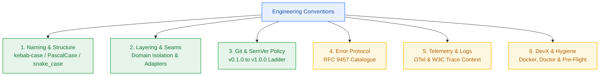
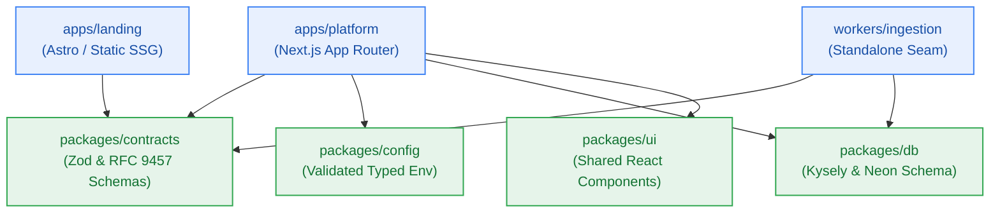
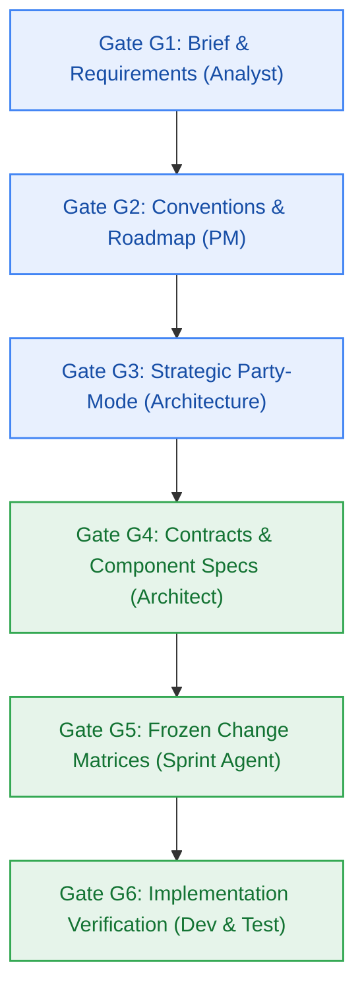

# Engineering Conventions & Technical Governance Standards

> **Project:** Contextual AI Platform (`contextual`)  
> **Owner:** pm-agent (Technical Standards Governor)  
> **Status:** Active Canonical Standard · **Target Release:** v0.1.0 through v1.0.0  
> **Source Baseline:** DBW Framework v1.3 & `project-brief.md` (Rules `BR-001` to `BR-048`, Conventions `CV-001` to `CV-055`)  



---

## 1. Naming Standards & Code Identifiers

All codebase symbols, files, database objects, and API endpoints must adhere strictly to these case conventions across all workspace packages:

| Symbol Type | Case Convention | Example | Notes / Constraints |
|---|---|---|---|
| **Files & Directories** (TS / JS) | `kebab-case` | `credit-ledger.ts`, `rate-limiter.ts`, `auth-middleware.ts` | Subsystem prefix optional, no dots except extension |
| **Classes & Interfaces** | `PascalCase` | `CreditLedgerService`, `MemoryStore`, `TenantContext` | Matches §12 Domain Glossary identifiers verbatim |
| **Type Aliases & Enums** | `PascalCase` | `ProblemDetails`, `IngestionStatus`, `QuotaPeriod` | Enums must be closed string literal unions |
| **Functions & Methods** | `camelCase` | `debitCredits()`, `evaluateRateLimit()`, `decomposeQuery()` | Verb-noun prefix structure |
| **Variables & Class Properties** | `camelCase` | `remainingCredits`, `tenantId`, `retryAfterSeconds` | Descriptive, no single-character variables |
| **Constants & Env Vars** | `UPPER_SNAKE_CASE` | `CREDIT_RESET_TZ`, `RATE_LIMIT_RPS`, `UPLOAD_MAX_BYTES` | Reserved for immutable configuration constants |
| **Database Tables** | `snake_case` (plural) | `user_accounts`, `notebook_nodes`, `credit_transactions` | Relational tables in Neon Postgres |
| **Database Columns** | `snake_case` | `user_id`, `created_at`, `expires_at`, `is_tombstoned` | Primary keys always `{entity}_id` or `id` (UUIDv7) |
| **API Endpoints (REST)** | `kebab-case` (plural nouns) | `/api/v1/notebooks`, `/api/v1/ingestions/progress` | Versioned under `/api/v1/`, noun-based hierarchy |
| **Vector DB Collections** | `kebab-case` | `contextual-knowledge-v1` | Single collection with tenant payload filtering |
| **Redis Keys** | `snake_case` (namespaced) | `credits:{user_id}`, `rl:{user_id}:{window}`, `reset:{date}:{user_id}` | Colon-delimited namespaces |

---

## 2. Structural Layering & Architecture Boundaries

The codebase is organized as a Turborepo monorepo (`CV-023`, `FR-021`) enforcing strict dependency inversion and domain purity:



### 2.1 Core Architectural Rules
- **Domain Purity:** Domain logic (credit calculations, prompt decomposition, citation graph building) MUST NOT import web transport libraries (`next/server`, `express`, `hono`) or vendor client SDKs directly (`CV-001`).
- **Adapter Inversion:** All external persistence, AI inference, and storage systems MUST be hidden behind abstract interfaces:
  - `MemoryStore` for long-term user memories (`BR-018`, `FR-019`).
  - `VectorStore` for Qdrant embeddings and searches (`BR-004`, `BR-047`).
  - `ObjectStagingStore` for Filebase S3 operations (`BR-046`, `ADR-0003`).
  - `LLMProvider` for Gemini primary and Cloudflare Workers AI fallback (`BR-027`, `D-01`).
  - `CacheLedgerStore` for Upstash Redis atomic Lua scripts (`BR-014`).
- **Extraction Seam (`FR-020`, `NFR-019`):** Background ingestion and reasoning adapters must be designed so they can execute either in-process on Next.js serverless functions or be extracted as standalone BullMQ workers without modifying caller code.
- **Cross-Module Imports:** Package imports must exclusively use declared workspace paths (`@repo/contracts`, `@repo/db`, `@repo/config`). Relative imports climbing outside package boundaries (`../../`) are forbidden.

---

## 3. Git History Standards & Release SemVer Policy

All repository branches, commits, and tags follow `git-history-standards.md` and `semver-release-policy.md`:

### 3.1 Git Branching Model
- `master` / `main`: Production-stable code only. Protected branch.
- `milestone/m{N}`: Milestone integration branches (e.g. `milestone/m2-metering`).
- `<type>/<story-id>-<slug>`: Short-lived topic branches per atomic story (e.g. `feat/s2-1-lua-debit-script`, `fix/s3-4-pdf-page-boundary`).
- Merging to milestone branches requires Gate G6 approval and clean test evidence.

### 3.2 Conventional Commit Format
Every commit message must be imperative and ≤ 72 characters on the subject line:
```text
<type>(<scope>): <imperative outcome>

Context: [Why this change is required]
Changes:
- [Itemized change]
Validation: [Explicit command and verified output, or NOT_VERIFIED]
Refs: [FR-xxx, BR-xxx, or Story ID]
```
- **Allowed Types:** `feat`, `fix`, `refactor`, `perf`, `test`, `docs`, `build`, `ci`, `chore`, `revert`.
- Commits must be atomic: exactly one logical change per commit.

### 3.3 Release Versioning Policy: v0 to v1 Progression
Contextual follows Semantic Versioning 2.0.0 (`v<MAJOR>.<MINOR>.<PATCH>`) with a formal progression ladder from initial foundation (`v0.1.0`) to General Availability (`v1.0.0`):


- **Pre-1.0 Conventions (`0.y.z`):**
  - `0.y.0` (Minor Bumps): Cohesive functional milestone releases (M0/M1 through M8) delivering end-to-end verified capabilities.
  - `0.y.z` (Patch Bumps): Internal bug fixes, security patches, and performance optimizations within a milestone cycle that preserve existing contracts.
- **Release Candidate (`v0.9.0-rc.1`):** Complete feature freeze, execution of the full benchmark and verification suite (FR-013, NFR-001..NFR-032), 48-hour soak testing on mock provider harnesses.
- **Production GA (`v1.0.0`):**
  - Requires all 42 Functional Requirements and 32 Non-Functional Requirements certified.
  - Zero open high-priority defects.
  - Zero violations of the $0.00/month infrastructure cost ceiling (`NFR-016`).
  - Strict contract immutability for RFC 9457 error endpoints and public REST APIs.
- **Tag Policy:** Release tags are immutable annotated tags (`git tag -a v1.0.0 -m "Release v1.0.0 GA"`). Tag creation is executed exclusively by `deployment-agent` at Checkpoint 5 after PM approval.

---

## 4. Error Handling Protocol & Closed Catalogue

All HTTP error responses must format strictly as RFC 9457 `application/problem+json` (`FR-025`, `BR-028`..`BR-032`).

### 4.1 Required Top-Level Members
```json
{
  "type": "https://contextual.ai/errors/insufficient-credits",
  "title": "Insufficient Credits",
  "status": 402,
  "detail": "Action requires 1.0 credits, but account has 0.5 credits remaining.",
  "instance": "/api/v1/ingestions"
}
```

### 4.2 Mandatory Quota Extension Members
When provider or platform quota limits are reached (`HTTP 402` or `HTTP 429`), responses must include:
- `service`: Upstream provider identifier (`google-ai-studio`, `cloudflare-workers-ai`, `upstash-redis`, `qdrant-cloud`).
- `quota_period`: Canonical window string (`daily` or `monthly`).
- `quota_used`: Consumed units in the current window.
- `quota_limit`: Configured ceiling.
- `resets_in_seconds`: Integer seconds until quota reset.
- `credits_remaining`: Current account balance.

### 4.3 Closed Error Catalogue (17 Members)
1. `authentication-required` (401)
2. `forbidden-tenant-access` (403)
3. `insufficient-credits` (402)
4. `service-limit-reached` (402) — Reserved exclusively for provider quota exhaustion (`BR-028`)
5. `rate-limit-exceeded` (429) — Emits `Retry-After` header (`BR-016`)
6. `upload-size-exceeded` (413) — Files > 5 MB (`BR-045`)
7. `unsupported-media-type` (415)
8. `document-parsing-failed` (422)
9. `password-protected-pdf` (422)
10. `no-text-layer-pdf` (422)
11. `progress-stream-unavailable` (503) — SSE pool saturated (`BR-035`)
12. `progress-stream-timeout` (504) — Stream capped at 280s (`BR-034`)
13. `notebook-expired` (410) — 30-day tombstone lookup (`BR-044`)
14. `notebook-not-found` (404)
15. `invalid-node-relation` (400) — Only `cites` or `related` allowed (`FR-032`)
16. `upstream-provider-unavailable` (502)
17. `internal-server-error` (500)

---

## 5. Telemetry, Logging & Observability

- **Structured JSON Only:** All logs emitted to `stdout` must be structured JSON strings containing at minimum:
  `{ "timestamp", "level", "correlation_id", "service", "event", "payload" }` (`NFR-009`, `BR-010`).
- **W3C Distributed Tracing:** All inbound HTTP requests without a `traceparent` receive a generated trace context. The `trace-id` / `correlation_id` is propagated downstream to BullMQ background jobs and external telemetry spans (`W3C Trace Context`).
- **Zero Plaintext Credentials:** API keys, database URLs, JWT tokens, and user credentials MUST NEVER appear in application logs, database tables, or vector payloads (`NFR-026`, `BR-012`). All logged payloads must be passed through a redaction pipeline before output.
- **OTel OTLP Export:** Spans and metric counters are pushed directly via OTLP/HTTP to Better Stack's free tier endpoint.

---

## 6. Developer Experience, Tooling & Pre-Flight Standards

- **Runtime & Toolchain (`ADR-0002`):**
  - **Toolchain:** Bun v1.1+ for package installation, scripting, and local test runners.
  - **Runtime:** Node.js 22 LTS for production execution on Vercel and background workers.
- **Environment Configuration:**
  - The repository root must maintain an `.env.example` file declaring every required environment variable with safe local defaults (`NFR-010`).
  - Developers initialize local setups with `cp .env.example .env`.
  - Zero secrets committed to version control.
- **Local Developer Diagnostic (`FR-012`, `NFR-010`):**
  - `npm run dev:doctor` runs an 8-layer diagnostic health check validating Docker, Redis, Postgres, and local mock endpoints, completing in < 5 minutes.
- **Pre-Flight Sanity & Clean-Baseline Hygiene:**
  - Build scripts must check whether target directories exist and ensure idempotent creation (`mkdir -p`).
  - Local rebuild scripts must prune dangling containers, release bound ports (5432, 6379, 6333), and clear intermediate caches before restarts.
  - Bash automation scripts must enable safety flags (`set -euo pipefail`) and exit traps (`trap cleanup EXIT ERR`).

---

## 7. Testing & Quality Gate Governance

To achieve release readiness from v0.1.0 to v1.0.0, every story and milestone must satisfy progressive quality gates:



- **Unit Tests:** Fast, isolated in-memory tests for pure business logic (Zod validation, credit calculations, query decomposition logic). Must run in < 15 seconds.
- **Integration Tests:** Adapter contract verification using local Docker containers (`infra/compose.yaml`) for Redis, Postgres, and Qdrant.
- **Mock Provider Harnesses:** In-memory or local WireMock stubs for Google AI Studio and Cloudflare Workers AI to ensure tests run offline without consuming live free-tier daily quotas.
- **Visual Performance Presentation:** All benchmark reports and latency telemetry must present visual ASCII/Markdown distribution plots and threshold curves alongside raw metrics (`NFR-001` < 100ms vector search, `NFR-003` < 4.5s e2e pipeline).

---
*Sealed by pm-agent at Checkpoint 2 (Gate G2).*
