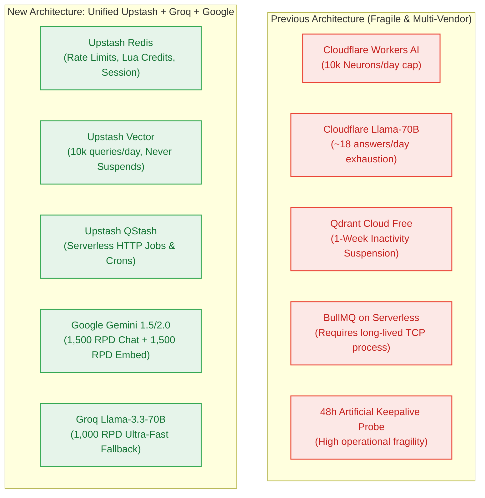

# ADR-0004: Unified Upstash Serverless Ecosystem (Redis, Vector, QStash) & Groq Fallback

> **Status:** Accepted  
> **Date:** 2026-10-23  
> **Author:** architect-agent (Stage 3 Owner)  
> **Supersedes:** ADR-0001 (Qdrant Cloud Free & Cloudflare Workers AI)  
> **Context:** Architectural Validation & Technology Stack Rationalization for $0.00/Month Operational Ceiling  

---

## 1. Context and Problem Statement

The initial requirements baseline (ADR-0001) proposed using **Cloudflare Workers AI** for dense embeddings (`@cf/baai/bge-m3`) and fallback generation (`@cf/meta/llama-3.1-70b-instruct`), paired with **Qdrant Cloud Free** for vector storage and **BullMQ** for background job processing.

Architectural stress analysis identified four severe operational failure modes under free-tier production constraints:
1. **Cloudflare Free Quota Cliff:** Cloudflare Workers AI free tier limits execution to **10,000 Neurons per day**. While BGE-M3 embeddings are lightweight, running Llama-3.1-70B costs ~267 Neurons per 1,000 tokens. As a secondary fallback LLM, 10,000 Neurons provides only **~37,400 tokens (~18 multi-step answers)** before hard failure, rendering the fallback circuit-breaker ineffective.
2. **Qdrant 1-Week Idle Suspension:** Qdrant Cloud Free automatically suspends clusters with zero API calls for 7 consecutive days, and destroys them permanently after 28 days. This required building and maintaining an artificial 48-hour keepalive probe (`BR-043`).
3. **Serverless Worker Mismatch:** BullMQ requires a persistent, long-running Node.js process with a TCP connection to Redis. On serverless hosting (Vercel Hobby), background worker processes cannot run persistently, and functions face strict execution ceilings (10s hobby / 300s edge).
4. **Multi-Vendor Fragmentation:** Managing separate developer accounts, credentials, and API SDKs across Cloudflare, Qdrant, Upstash, Google, and Filebase increases credential blast radius and onboarding friction.

---

## 2. Decision

We supersede ADR-0001 and adopt a **Unified Upstash Serverless Architecture** augmented with **Google AI Studio** and **Groq**:

1. **Vector Storage:** Adopt **Upstash Vector** (Free Tier: 10,000 queries/day, 10,000 updates/day, 10 indexes, up to 1,536 dimensions, REST API) as the primary and only vector database, replacing Qdrant Cloud Free.
   - **Zero Idle Suspension:** Upstash Vector is completely serverless HTTP and **never suspends from inactivity**. The 48-hour keepalive probe (`BR-043`) is deprecated.
2. **State & Rate Limiting:** Retain **Upstash Redis** (500,000 commands/month) for the atomic Lua credit ledger, sliding window rate limiter, and Mem0 session state.
3. **Asynchronous Jobs & Crons:** Adopt **Upstash QStash** (Free Tier: 500 messages/day) as the serverless background task queue and cron scheduler, replacing BullMQ. Ingestion tasks and maintenance runs execute via signed HTTP webhooks directly into Next.js Route Handlers.
4. **Embeddings:** Adopt **Google AI Studio (`gemini-embedding-001`)** (1,500 RPD, 768-dim, free tier) with local in-process fallback via **`@huggingface/transformers` (`bge-small-en-v1.5` / ONNX)**, replacing Cloudflare Workers AI.
5. **Inference & Fallback:** Retain **Google Gemini 1.5/2.0 Flash** as primary generation (1,500 RPD free), and adopt **Groq Free Tier (Llama-3.3-70B Versatile, 1,000 RPD / Llama-3.1-8B, 14,400 RPD)** as the ultra-fast secondary fallback circuit breaker, replacing Cloudflare Workers AI.
6. **Long-Term Memory:** Run **Mem0 in-process** using its native Upstash Redis and Upstash Vector storage adapters, eliminating the need for a standalone Cloudflare Worker deployment.

---

## 3. Comparative Evaluation & Options Considered

| Evaluation Criterion | Cloudflare + Qdrant + BullMQ (Superseded) | Unified Upstash + Groq + Gemini (Adopted) | Rationale |
|---|---|---|---|
| **Vector Idle Suspension** | Suspends after 7 days; requires 48h keepalive | **Zero suspension (Serverless HTTP)** | Eliminates artificial probe crons and cluster destruction risks. |
| **Fallback LLM Capacity** | ~18 answers/day (10,000 CF Neurons) | **1,000 answers/day (Groq 70B) or 14.4k (8B)** | 55× higher fallback headroom; sub-second TTFT. |
| **Serverless Job Execution** | BullMQ requires long-lived server/container | **QStash HTTP webhooks & workflows** | 100% native serverless fit for Vercel without persistent servers. |
| **Vendor Footprint** | 6 external vendors (CF, Qdrant, Upstash, Google, Clerk, Neon) | **4 vendors (Upstash, Google, Clerk, Neon)** | Upstash unifies cache, vectors, and queues under 1 free account. |
| **Monthly Infrastructure Cost** | $0.00 / month | **$0.00 / month** | Strictly preserves $0.00 ceiling (`NFR-016`) with zero payment cards. |

---

## 4. Consequences

### Positive:
- **Major Simplification:** Single `@upstash/redis`, `@upstash/vector`, and `@upstash/qstash` client stack.
- **Resilience:** Groq fallback provides 1,000 daily 70B requests vs Cloudflare's ~18 requests.
- **Serverless Native:** Ingestion jobs run via QStash webhook callbacks (`/api/v1/ingestions/process`) with automatic retries and dead-letter queues.
- **Elimination of Tech Debt:** Removed artificial 48-hour keepalive probe and cluster wake-up routines.

### Negative / Trade-Offs:
- Upstash Vector free tier has a 1,536-dimension limit (Google's 768-dim embeddings and BGE-small's 384-dim embeddings fit comfortably; 3072-dim models are unsupported on the free tier).
- Upstash QStash is limited to 500 messages/day on the free tier, which supports up to 50 DAU × 10 ingestion jobs/day.

---
*Sealed by architect-agent at Checkpoint 3 (Gate G4).*
