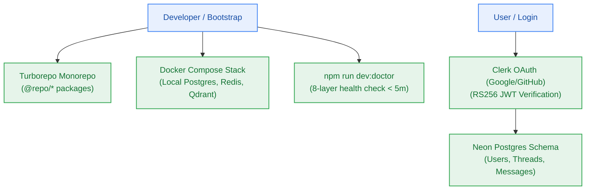

# EPIC-001: Workspace Foundation, Toolchain & Core Authentication

> **Milestone:** M0 & M1 (`v0.1.0`) · **Status:** Planned · **Risk Tier:** LOW  
> **Business Outcome:** Developers can bootstrap a local containerized stack in < 5 minutes, and users can securely authenticate via Clerk OAuth with tenant data isolated across Neon Postgres.  

## 1. Scope
- Turborepo monorepo structure with `@repo/contracts`, `@repo/config`, `@repo/db`, `@repo/ui`.
- Bun toolchain configuration and Node 22 LTS runtime compatibility (`ADR-0002`).
- Containerized local stack (`infra/compose.yaml`) with Redis, Postgres, and Qdrant.
- `npm run dev:doctor` diagnostic script running in < 5 minutes (`NFR-010`).
- Clerk authentication integration supporting Google and GitHub OAuth (`FR-001`).
- Multi-tenant session verification middleware rejecting unauthenticated requests with HTTP 401 (`FR-003`, `BR-001`).
- Neon Postgres schema migrations for user accounts, conversation threads, and messages (`FR-002`).

## 2. Out of Scope
- Credit debiting or rate limiting (owned by `EPIC-002`).
- Document ingestion or vector storage (owned by `EPIC-003`).

## 3. Requirements Covered
- `FR-001`: Social OAuth Authentication
- `FR-002`: Conversation Thread Persistence
- `FR-003`: Multi-Tenant Session Isolation
- `FR-012`: Local Developer Setup & dev:doctor
- `FR-021`: Turborepo Monorepo Layout
- `NFR-006`: Auth Verification (100% 401 rejection on invalid JWT)
- `NFR-010`: Developer Bootstrap SLA (< 5 minutes)

## 4. Acceptance Criteria
1. `bun run build` succeeds across all monorepo packages with zero type errors.
2. `npm run dev:doctor` checks 8 health layers and passes with 100% green status.
3. Protected endpoint `/api/v1/threads` returns HTTP 401 when called without a valid Clerk JWT.
4. Authenticated request creates thread row in Neon Postgres tagged with `user_id`.
