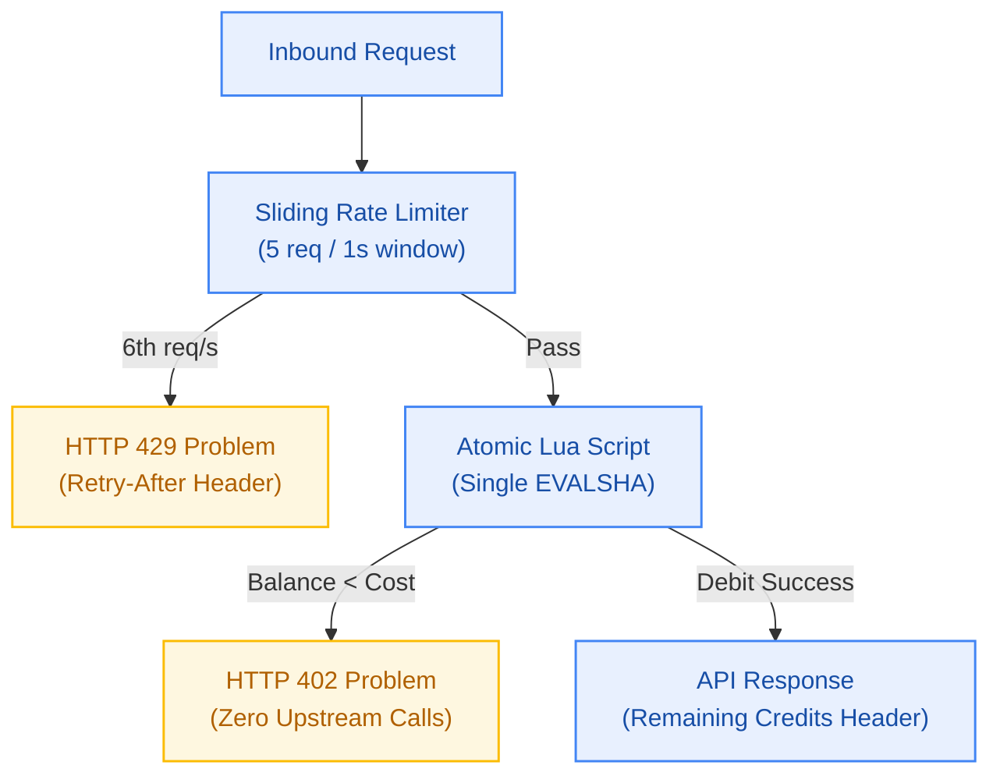

# EPIC-002: Metering Spine, Rate Limiting & RFC 9457 Error Protocol

> **Milestone:** M2 (`v0.2.0`) · **Status:** Active · **Risk Tier:** HIGH  
> **Business Outcome:** Platform operations are strictly guarded at the ingress by atomic Upstash Redis Lua scripts, enforcing daily credit budgets and 5 RPS rate limits while surfacing RFC 9457 errors with zero cloud spend.  

## 1. Scope
- Daily credit allocation (10 credits/day per user) resetting idempotently at 08:00 UTC (`FR-014`, `FR-024`).
- Atomic Redis Lua script executing debit operations and balance checks in a single roundtrip (`FR-015`, `FR-018`, `BR-014`).
- Insufficient credit short-circuiting returning HTTP 402 `INSUFFICIENT_CREDITS` with zero calls to LLMs or workers (`FR-016`, `BR-015`).
- Per-user sliding window rate limiting (5 req/sec) returning HTTP 429 with `Retry-After` header (`FR-017`, `BR-016`).
- Closed 17-member RFC 9457 `application/problem+json` error catalogue (`FR-025`, `FR-027`).
- Quota classifier and upstream provider limit reporting in error payloads and headers (`FR-026`, `FR-028`, `FR-029`).

## 2. Out of Scope
- Paid top-up checkout or commercial credit purchasing.
- Rollover or carry-over of unspent daily credits across days (`BR-024`).

## 3. Requirements Covered
- `FR-014` to `FR-018`: Credit allocation, Lua debit, HTTP 402 short-circuit, 5 RPS rate limiting, Redis state layer
- `FR-024`: Daily 08:00 UTC reset without carry-over
- `FR-025` to `FR-029`: RFC 9457 problem details, service limit reporting, 17-member catalogue, quota detection, quota headers
- `NFR-011` to `NFR-013`: Debit concurrency safety, decision latency, Redis command budget
- `NFR-020`, `NFR-023` to `NFR-030`: Headroom alignment, idempotent reset, zero carry-over, error serialization safety

## 4. Acceptance Criteria
1. Parallel execution of 100 concurrent debit requests against a 10.0 balance results in exactly 0 negative balances and 0 lost updates.
2. 6th request within 1s receives HTTP 429 with `Retry-After: 1` and debits 0 credits (`BR-017`).
3. Request with 0 credits returns HTTP 402 without triggering any mock LLM invocation.
4. Error responses across all platform routes format as RFC 9457 with immutable `type` URIs.
