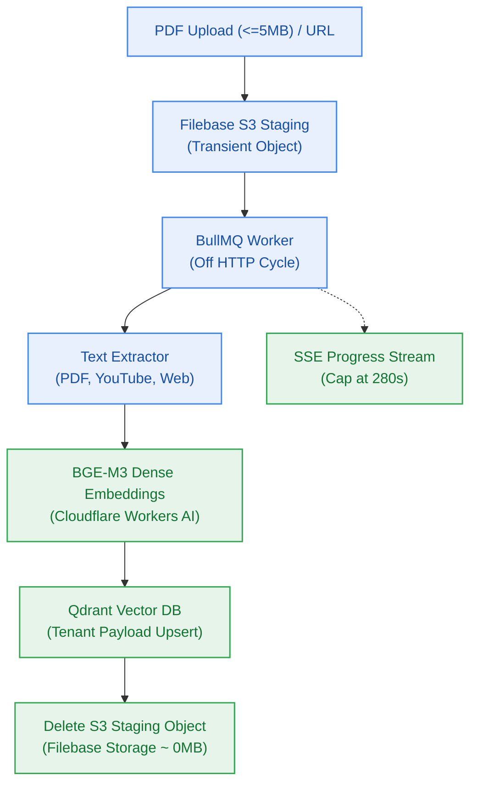

# EPIC-003: Transient Ingestion Pipeline & Multi-Source Extraction

> **Milestone:** M3 (`v0.3.0`) · **Status:** Planned · **Risk Tier:** HIGH  
> **Business Outcome:** Users can upload PDFs or submit YouTube/web URLs; background workers parse, chunk, embed with BGE-M3, and index points into Qdrant, streaming deterministic progress via SSE while immediately deleting transient S3 files.  

## 1. Scope
- Direct browser-to-S3 pre-signed upload flow to Filebase S3 for PDFs ≤ 5MB (`FR-004`, `CV-045`, `ADR-0003`).
- Asynchronous BullMQ background worker off the HTTP cycle with exponential retry (3 attempts max) (`BR-005`).
- PDF text extraction, YouTube subtitle extraction with timestamps, and website crawler with boilerplate removal (`FR-004`–`FR-006`).
- Dense vector embedding using `@cf/baai/bge-m3` via Cloudflare Workers AI (`FR-007`).
- Qdrant Cloud Free upsert with mandatory payload `{ user_id, document_id, notebook_id }` (`BR-004`, `BR-047`).
- Immediate deletion of staged S3 files post-upsert (`BR-046`).
- Server-Sent Events (SSE) progress streaming with deterministic percentage, capped at 280s (`FR-035`, `FR-036`, `BR-034`).
- Automatic credit refund on terminal worker failure (`FR-037`, `BR-033`).

## 2. Out of Scope
- Synchronous file processing on the HTTP request cycle.
- Storing raw chunk text in Neon Postgres or permanent S3 storage (`BR-047`).

## 3. Requirements Covered
- `FR-004` to `FR-007`: PDF, YouTube, Web crawling, Qdrant vector population
- `FR-035` to `FR-038`, `FR-040`: SSE progress, deterministic reporting, credit refund integrity, structured failure union, non-debiting retry
- `NFR-004`: Ingestion throughput (> 5 pages/sec for text PDF; < 30s for 1-hr YouTube)
- `NFR-008`: Worker retry policy (exponential backoff)
- `BR-045` to `BR-048`: 5MB upload ceiling, transient S3 purge, Qdrant sole record, third-party data loss policy

## 4. Acceptance Criteria
1. 35-page text PDF uploads and completes embedding in < 7 seconds.
2. S3 bucket contains 0 objects once ingestion jobs complete.
3. Client reconnecting to SSE stream with `Last-Event-ID` receives replayed events without losing progress.
4. Terminal job failure (corrupted PDF) returns structured reason `NO_TEXT_LAYER` and refunds debited credit atomically via Redis Lua.
