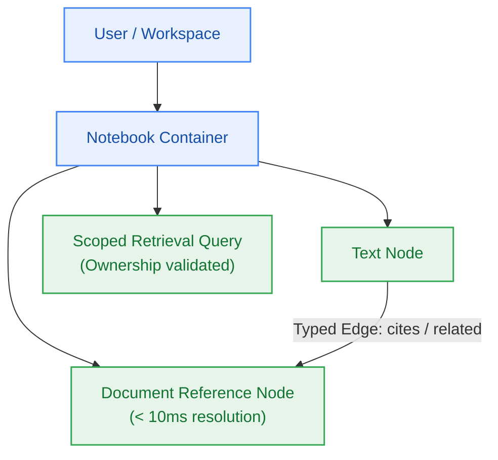

# EPIC-004: Notebook Workspace & Typed Domain Graph

> **Milestone:** M4 (`v0.4.0`) · **Status:** Planned · **Risk Tier:** MEDIUM  
> **Business Outcome:** Users can organize knowledge into personal notebooks with hierarchical cards and typed relations (`cites` and `related`), enabling scoped cross-note semantic discovery with sub-10ms card resolution.  

## 1. Scope
- Notebook CRUD management with multi-tenant ownership enforcement (`FR-031`, `BR-002`).
- Notebook node management supporting both text notes and document reference nodes (`FR-031`, `FR-033`).
- Document-backed nodes resolving attached document metadata in < 10 ms (`FR-033`).
- Typed node relations restricted strictly to `cites` or `related`; arbitrary edge strings rejected with HTTP 400 (`FR-032`).
- Scoped cross-note retrieval queries validating user ownership before any credit debit is committed (`FR-034`, `BR-036`).

## 2. Out of Scope
- Arbitrary user-defined ontology schemas or unbounded graph properties.
- Cross-user collaborative sharing (deferred post-v1.0.0).

## 3. Requirements Covered
- `FR-031`: Notebook and Hierarchical Node Workspace
- `FR-032`: Typed Node Relations (`cites` and `related` only)
- `FR-033`: Document-Backed Nodes (< 10ms resolution)
- `FR-034`: Scoped Cross-Note Retrieval
- `BR-002`: Multi-Tenant Isolation
- `BR-036`: Scope Ownership Validation

## 4. Acceptance Criteria
1. Creating a node relationship with type `author_of` returns HTTP 400 with RFC 9457 error `invalid-node-relation`.
2. Attaching a document to a node allows title, page count, and status resolution in < 10 ms.
3. Submitting a scoped search pointing to another user's notebook fails with HTTP 403 `forbidden-tenant-access` and debits 0 credits.
