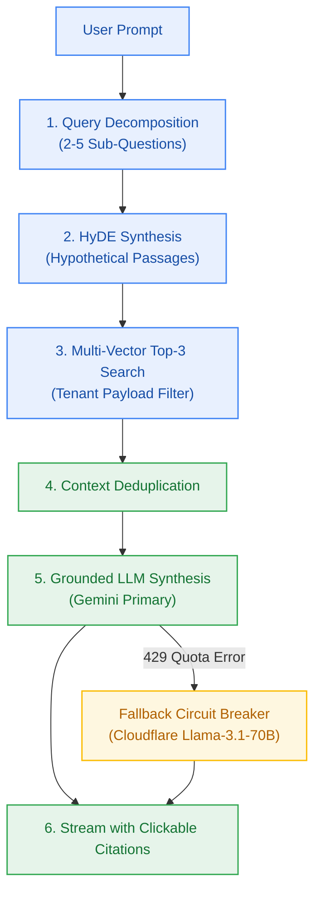

# EPIC-005: 6-Phase Grounded Reasoning Engine & Dual-Provider Inference

> **Milestone:** M5 (`v0.5.0`) · **Status:** Planned · **Risk Tier:** HIGH  
> **Business Outcome:** Users receive streamed, deeply synthesized answers to complex questions through automated query decomposition, HyDE passage generation, top-3 vector retrieval, and grounded synthesis with inline citations and transparent fallback.  

## 1. Scope
- Complex prompt decomposition into 2 to 5 targeted sub-questions with semantic dependencies (`FR-008`, `BR-007`).
- Hypothetical Document Embeddings (HyDE) passage generation for each sub-question (`FR-009`).
- Similarity vector search retrieving at most 3 contextual chunks per sub-question (`FR-010`, `BR-008`).
- Context deduplication and assembly into a grounded prompt envelope (`FR-011`).
- Primary inference streaming via Google Gemini Flash 1.5/2.0 (`BR-009`, `BR-027`).
- Secondary circuit-breaker fallback to Cloudflare Workers AI (`@cf/meta/llama-3.1-70b-instruct`) on Gemini 429 quota exhaustion (`D-01`, `NFR-022`).
- Streaming response generation with clickable inline citations mapped to source document chunks (`FR-011`).
- Explicit listing of unavailable or still-processing sources in the answer footer (`FR-039`).

## 2. Out of Scope
- Model fine-tuning or custom weight training.
- Fabricating facts outside the retrieved vector context (`BR-009`).

## 3. Requirements Covered
- `FR-008` to `FR-011`: Decomposition, HyDE, Top-3 retrieval, Grounded synthesis
- `FR-039`: Unavailable sources named in answer footer
- `NFR-001` to `NFR-003`: Vector search p95 < 100ms, TTFT p90 < 1,500ms, E2E pipeline p90 < 4,500ms
- `NFR-022`: Transparent fallback switching
- `BR-007` to `BR-009`: Mandatory decomposition, HyDE ceiling, zero hallucinations

## 4. Acceptance Criteria
1. Complex prompt "Compare transformer attention with recurrent networks in NLP" yields 3 distinct sub-questions and HyDE summaries.
2. Vector retrieval returns at most 3 chunks per sub-question with tenant filter matching authenticated user.
3. Every factual statement in synthesized answer includes an inline citation anchor `[^doc_1_chunk_3]` linking to retrieved passage.
4. Simulating HTTP 429 on Google AI Studio causes synthesis to complete seamlessly via Cloudflare Workers AI with response header `x-fallback-provider: cloudflare-workers-ai`.
