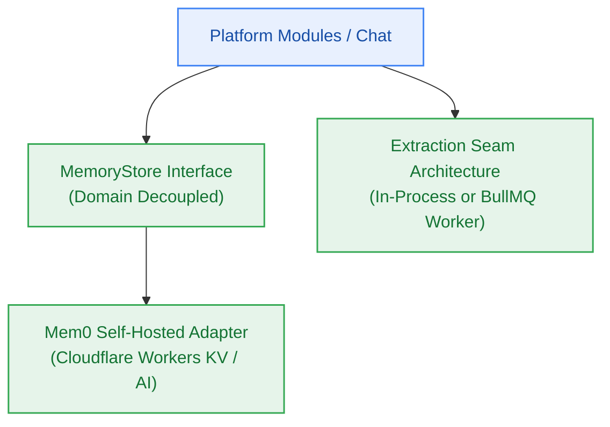

# EPIC-006: Pluggable Long-Term Memory Store & Extraction Seams

> **Milestone:** M6 (`v0.6.0`) · **Status:** Planned · **Risk Tier:** MEDIUM  
> **Business Outcome:** Platform modules access user memory via an abstract `MemoryStore` interface backed by self-hosted mem0 on Cloudflare Workers, maintaining zero vendor fees and permitting standalone worker extraction.  

## 1. Scope
- Abstract `MemoryStore` interface isolating domain logic from vendor memory SDKs (`FR-019`, `BR-018`).
- Self-hosted mem0 implementation deployed on Cloudflare Workers AI maintaining $0.00/month vendor fees (`NFR-014`).
- Monolith extraction seam allowing ingestion and memory adapters to run in-process or out-of-process with identical contracts (`FR-020`, `NFR-019`).

## 2. Out of Scope
- Commercial Mem0 Platform SaaS subscriptions.
- Cross-tenant memory sharing.

## 3. Requirements Covered
- `FR-019`: Pluggable Memory Store
- `FR-020`: Modular Monolith & Extraction Seam
- `NFR-014`: Memory Vendor Independence ($0.00 fee)
- `NFR-019`: Adapter Portability (in-process vs worker)
- `BR-018`: Domain Memory Isolation

## 4. Acceptance Criteria
1. Domain modules import only `import type { MemoryStore } from '@repo/contracts'`; zero direct imports of mem0 SDK.
2. Memory read/write latency p95 < 150 ms running on Cloudflare Workers free tier.
3. Switching configuration from `in-process` to `standalone-worker` passes integration tests without code changes to caller routes.
