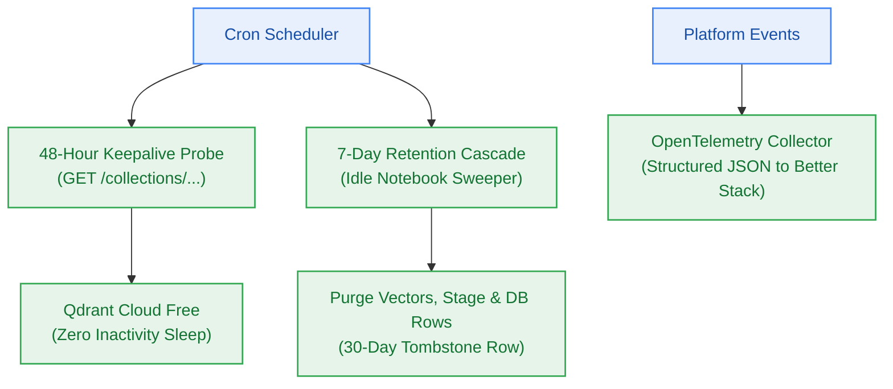

# EPIC-007: Autonomous Maintenance Crons, Keepalive & Observability

> **Milestone:** M7 (`v0.7.0`) · **Status:** Planned · **Risk Tier:** HIGH  
> **Business Outcome:** Autonomous maintenance routines keep Qdrant Cloud Free alive through 48-hour probes, enforce 7-day cascade retention with 30-day tombstones, and export structured OpenTelemetry traces to Better Stack.  

## 1. Scope
- Independent 48-hour keepalive probe against Qdrant collection to prevent vendor 7-day idle suspension (`BR-043`, `NFR-017`).
- Scheduled cron runner with heartbeat health monitoring alerting if missed in `2 × cadence` (`FR-041`, `NFR-031`).
- Weekly retention cascade identifying notebooks with no user activity for ≥ 7 days (`FR-042`, `BR-037`).
- Idempotent all-or-nothing cascade deletion removing Qdrant vector points, staging files, relational notebook rows, and chat history (`BR-039`, `BR-040`).
- 30-day tombstone preservation returning HTTP 410 `NOTEBOOK_EXPIRED` rather than 404 (`BR-044`).
- Structured JSON logging and OpenTelemetry OTLP export to Better Stack's free tier (`FR-023`, `NFR-009`, `BR-010`).

## 2. Out of Scope
- Point-in-time recovery (PITR) of deleted notebooks.
- Commercial APM tools incurring monthly SaaS fees.

## 3. Requirements Covered
- `FR-023`: Metering Telemetry & OTel
- `FR-041`: Scheduled Maintenance Crons with Heartbeats
- `FR-042`: Retention Cascade Deletion (7-day rule)
- `NFR-009`: Structured Telemetry (100% requests tagged with `correlation_id`)
- `NFR-017`: Idle Suspension Prevention (48h probe)
- `NFR-031`, `NFR-032`: Maintenance Liveness & Cascade Footprint
- `BR-037` to `BR-044`: Retention, disclosure warning, all-or-nothing deletion, idempotency, batch limit, rollback, keepalive probe, tombstone

## 4. Acceptance Criteria
1. Keepalive probe pings Qdrant collection endpoint every 48 hours and logs green heartbeat.
2. Inactive notebook (age 8 days) is deleted by cascade cron; associated Qdrant vectors and relational records are cleanly removed.
3. Querying deleted notebook returns HTTP 410 with RFC 9457 type `notebook-expired` and deletion timestamp.
4. Telemetry spans with `traceparent` appear in Better Stack dashboard within 5 seconds of request completion.
