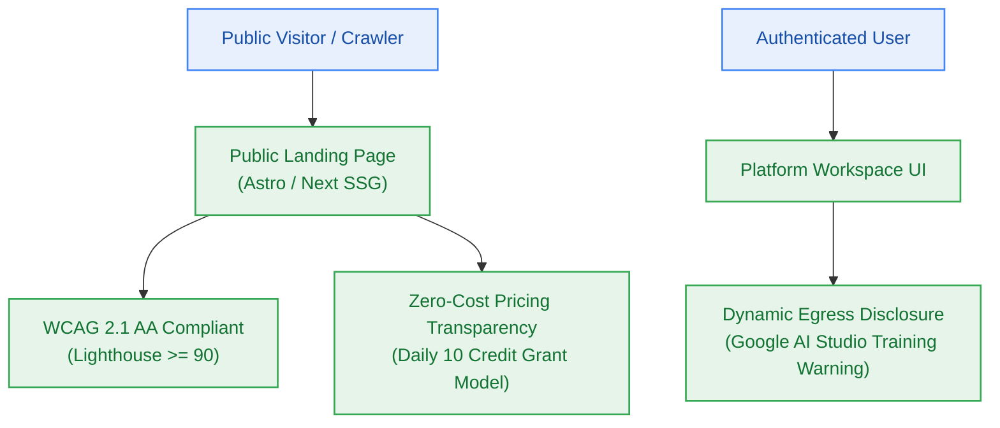

# EPIC-008: Public Marketing Landing & Dynamic Privacy Governance

> **Milestone:** M8 (`v0.8.0`) · **Status:** Planned · **Risk Tier:** MEDIUM  
> **Business Outcome:** Public visitors access a fast, accessible, SEO-indexed marketing landing page with transparent credit pricing, and authenticated users receive un-dismissible dynamic disclosure of AI provider training terms.  

## 1. Scope
- Public marketing landing page (`apps/landing`) requiring zero authentication and returning HTTP 200 with zero user data (`FR-022`, `BR-024`).
- Google Lighthouse Performance score ≥ 90 and LCP < 2.0s on simulated 4G profiles (`NFR-018`).
- WCAG 2.1 AA compliance verified with `axe-core` reporting 0 critical/serious violations (`memo-001` §2.4).
- Prominent dynamic AI provider data training disclosure banner on landing page and all workspace prompt input views (`FR-030`, `CV-041`, `Q-002`).

## 2. Out of Scope
- Marketing email tracking pixels or aggressive third-party ad scripts.
- Hiding or providing an opt-out to dismiss the AI provider training disclosure banner.

## 3. Requirements Covered
- `FR-022`: Marketing Landing Page
- `FR-030`: AI Provider Data Handling Disclosure
- `NFR-018`: Frontend Landing Performance (Lighthouse ≥ 90)
- `BR-024`: Public Page Isolation
- `CV-041` to `CV-044`: Disclosure Banner UI Standards

## 4. Acceptance Criteria
1. Unauthenticated GET to landing page returns HTTP 200 with zero user credentials or cookies.
2. Lighthouse CI audit reports Performance ≥ 90 and SEO score 100.
3. `axe-core` accessibility audit runs clean with 0 accessibility violations.
4. Prompt input box in workspace UI carries permanent, high-contrast disclosure notice explaining that inputs travel to Google AI Studio and may be reviewed or trained on.
