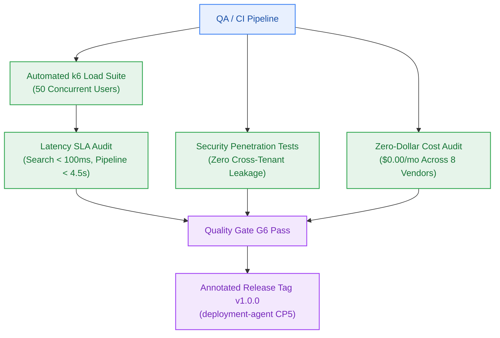

# EPIC-009: Benchmark Suite, Multi-Tenant Hardening & GA Release

> **Milestone:** M9 & GA (`v0.9.0-rc.1` & `v1.0.0`) · **Status:** Planned · **Risk Tier:** HIGH  
> **Business Outcome:** Platform is certified production-ready through automated load testing (50 CCU), multi-tenant penetration verification, and formal attestation of the $0.00/month cloud ceiling, enabling the General Availability `v1.0.0` release.  

## 1. Scope
- Automated benchmark load suite (k6/autocannon) validating p95 latency and error thresholds under 50 concurrent users (`FR-013`, `NFR-005`).
- Multi-tenant security penetration tests validating zero cross-tenant vector or relational data leakage (`NFR-007`, `BR-002`).
- Verification of vector search latency (p95 < 100 ms) and end-to-end reasoning pipeline latency (p90 < 4,500 ms) (`NFR-001`, `NFR-003`).
- Zero-dollar cloud cost verification verifying zero payments across all 8 vendors (`NFR-016`).
- Authoring curated `CHANGELOG.md` entry and migration guide for `v1.0.0` release.
- Production readiness verification and ratification of annotated git tag `v1.0.0` created by `deployment-agent`.

## 2. Out of Scope
- Adding new feature capabilities during the RC hardening freeze.
- Relaxing latency thresholds or security baselines.

## 3. Requirements Covered
- `FR-013`: Benchmark Suite
- `NFR-001` to `NFR-003`: Vector search, LLM TTFT, E2E pipeline latencies
- `NFR-005`: Concurrency (≥ 50 CCU with < 1% error rate)
- `NFR-007`: Zero Cross-Tenant Data Leakage
- `NFR-016`: Strict $0.00/Month Cost Ceiling
- `BR-002`: Tenant Segregation Invariant

## 4. Acceptance Criteria
1. k6 load test runs for 10 minutes at 50 virtual users with error rate < 0.5% and zero crashes.
2. Vector search p95 latency measures < 95 ms across 25,000 indexed test vectors.
3. Automated penetration tests attempting cross-tenant vector search return zero matching points and zero leaked texts.
4. Formal infrastructure audit verifies zero active credit cards stored across all 8 cloud provider accounts.
5. Release tag `v1.0.0` created, signed, and pushed at Checkpoint 5.
