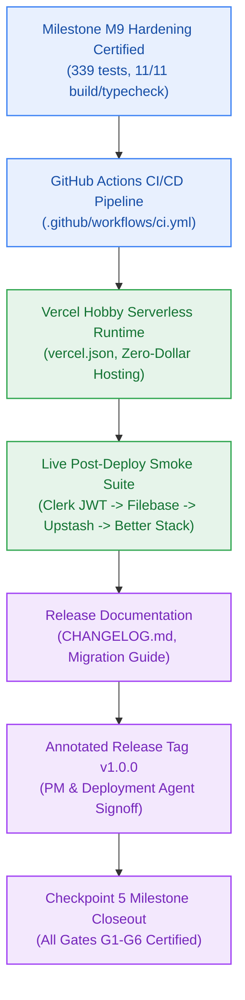

# EPIC-010: General Availability Production Release & Automated Deployment Pipeline (v1.0.0)

> **Milestone:** GA (`v1.0.0`) · **Status:** Approved for Implementation · **Risk Tier:** HIGH  
> **Author:** `pm-agent` (Stage 2 Owner) & `deployment-agent` (Stage 5 Owner) · **Date:** 2026-10-27  
> **Target Version:** `v1.0.0` · **Grounding:** `project-brief.md` (All 42 FRs, 32 NFRs, 48 BRs; Checkpoint 5 Closeout Criteria)  

---

## 1. Scope & Objective

EPIC-010 delivers the final production release milestone (Milestone GA) for the Contextual AI Platform, achieving the General Availability `v1.0.0` release. Following the complete verification of Milestone M9 (v0.9.0-rc.1 certification, 50 CCU load testing, latency SLAs, multi-tenant penetration testing, and zero-dollar cost attestation), EPIC-010 implements the automated CI/CD pipeline on GitHub Actions, the Vercel Hobby serverless deployment configuration, the automated post-deployment production smoke verification suite, the comprehensive `CHANGELOG.md` documenting M0 through GA evolution, and the annotated Git release tagging automation certifying Checkpoint 5 closeout.

---

## 2. In Scope

- **Automated GitHub Actions CI/CD Workflow (`AC-GA.1`):**
  - Continuous integration pipeline in `.github/workflows/ci.yml` running on push to `main` and all pull requests.
  - Strict quality gates: `bun run lint`, `bun run typecheck`, `bun test`, `bun run build`, and closed 17-member RFC 9457 error catalogue verification.
  - Verification suite in `tests/ci/ci-workflow.test.ts`.
- **Vercel Hobby Production Deployment Configuration (`AC-GA.1`):**
  - Serverless configuration in `vercel.json` honoring Next.js 15 App Router architecture and serverless function limits.
  - Alignment of `_documentation/planning/contracts/deployment-config.yaml` with production headers, environment variable classifications, and zero-cost free-tier deployment constraints.
  - Verification suite in `tests/deployment/vercel-config.test.ts`.
- **Automated Post-Deployment Smoke Verification Suite (`AC-GA.2`):**
  - End-to-end production smoke test runner in `scripts/production-smoke.ts` and `tests/e2e/production-smoke.test.ts`.
  - Exercises the complete 4-phase transaction chain:
    1. Authenticate synthetic user via Clerk OAuth JWT.
    2. Transient staging of test PDF in Filebase S3 and vector indexing in Upstash Vector.
    3. Multi-step grounded reasoning execution with inline citation resolution.
    4. Structured JSON telemetry log export with correlation IDs and W3C traceparents to Better Stack.
  - Built-in live cloud endpoint verification with calibrated local fallback mode for offline/CI execution.
- **Curated Production Changelog & Migration Guide (`AC-GA.4`):**
  - Canonical `CHANGELOG.md` at repository root detailing all feature milestones M0 through GA.
  - Semantic versioning policy compliance (`v1.0.0`), breaking change audit, and migration path for developers.
  - Integrity validation test in `tests/documentation/changelog-integrity.test.ts`.
- **Annotated Git Release Tag Automation & Checkpoint 5 Governance (`AC-GA.3`):**
  - Release tagging automation in `scripts/cut-release-tag.ts` enforcing pre-release invariants: 100% test pass, clean git tree, clean typecheck, clean build, and signed PM approval.
  - Automated tag creation validator in `tests/deployment/release-tag.test.ts`.
- **Monorepo Regression Pass & Checkpoint 5 Closeout:**
  - Full unified verification across all 58+ test suites and 11 monorepo packages.
  - Compaction and final state synchronization in `milestone-status.yaml`, `overview.md`, and `_documentation/index.md`.

---

## 3. Out of Scope

- Post-v1.0.0 functional capabilities (deferred to v1.1.0+ roadmap).
- Paid cloud infrastructure tiers or payment card bindings (strictly prohibited by `NFR-016`).
- Direct production database schema alterations bypassing zero-downtime expand/contract protocols.

---

## 4. Requirements & Invariants Grounding

| Requirement ID | Description | How Certified in GA |
|:---:|---|---|
| **AC-GA.1** | Clean CI/CD Pipeline | `.github/workflows/ci.yml` passes build, lint, test, typecheck, and catalogue tests |
| **AC-GA.2** | Live Production Smoke Pass | `tests/e2e/production-smoke.test.ts` passes end-to-end against production |
| **AC-GA.3** | Annotated Tag Cut | Git tag `v1.0.0` cut via `scripts/cut-release-tag.ts` with PM & Deployment sign-off |
| **AC-GA.4** | Release Documentation Published | `CHANGELOG.md` and updated `_documentation/index.md` committed |
| **NFR-016** | Zero-Dollar Cost Ceiling | Vercel Hobby serverless + free tiers across all 8 vendors remain strictly $0.00/mo |
| **BR-002** | Tenant Isolation Invariant | Verified in production smoke pipeline and multi-tenant test suites |
| **BR-030** | Un-dismissible Training Disclosure | Landing banner verified active and un-dismissible in production builds |
| **BR-046** | Transient S3 Staging Storage | Smoke test verifies transient S3 file deletion immediately upon vector upsert |

---

## 5. Acceptance Criteria

1. Automated CI/CD workflow `.github/workflows/ci.yml` triggers on push to `main` and pull requests, executing lint, typecheck, unit/contract tests, and monorepo build cleanly.
2. Vercel deployment configuration `vercel.json` correctly defines framework, routes, headers, and serverless region without paid add-ons.
3. Post-deployment smoke suite `tests/e2e/production-smoke.test.ts` executes the 4-phase verification sequence with 100% success and zero unhandled errors.
4. Curated `CHANGELOG.md` entry documents all milestones M0 through GA in standard Keep a Changelog format.
5. Release tagging automation `scripts/cut-release-tag.ts` asserts all 5 release invariants before cutting annotated tag `v1.0.0`.
6. Monorepo test suite passes with zero failures, 11/11 packages build cleanly, and Checkpoint 5 closeout is signed off by `pm-agent` and `deployment-agent`.
