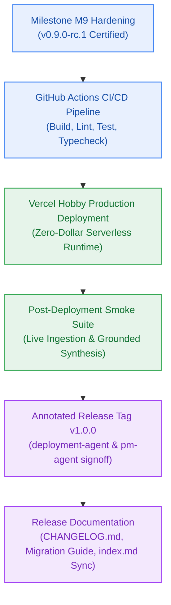

# Milestone Charter — GA: General Availability Production Release (v1.0.0)

> **Status:** Planned (Final Production Release Milestone)  
> **Author:** pm-agent (Stage 2 Owner) & deployment-agent (Stage 5 Owner) · **Date:** 2026-10-23  
> **Target Version:** `v1.0.0` · **Risk Tier:** HIGH  
> **Grounding:** `project-brief.md` (All 42 FRs, 32 NFRs, 48 BRs; Checkpoint 5 Closeout Criteria)  

---

## 1. Executive Summary & Outcome

Milestone GA delivers the General Availability production release of the Contextual AI Platform (`v1.0.0`). It certifies complete operational readiness across all 42 Functional Requirements and 32 Non-Functional Requirements. Owned jointly by `pm-agent` (Stage 2) and `deployment-agent` (Stage 5), GA establishes automated CI/CD deployment pipelines on Vercel Hobby, executes post-deployment smoke tests, publishes the curated `CHANGELOG.md` and migration notes, cuts the annotated Git tag `v1.0.0`, and completes formal Checkpoint 5 closeout.

---

## 2. In Scope

- **Automated CI/CD Pipeline (`deployment-agent`):**
  - GitHub Actions workflow running `bun run build`, `bun run lint`, and `bun run test` on all pull requests.
  - Automated preview deployments and production branch cutover to Vercel Hobby.
- **Production Deployment & Smoke Verification:**
  - Production environment configuration with encrypted secrets.
  - Automated smoke test suite running against production endpoints:
    1. Authenticate test user via Clerk JWT.
    2. Ingest 1-page test PDF via Filebase S3 staging and Upstash Vector.
    3. Execute synthesized reasoning query and verify inline citations.
    4. Validate structured logs arriving in Better Stack.
- **Release Governance & Versioning (`versioning-specialist`):**
  - Annotated Git release tag `v1.0.0` created and pushed.
  - Curated `CHANGELOG.md` entry documenting feature milestones M0 through M9.
  - Migration guide and user documentation updated in `_documentation/index.md`.
- **Milestone Closeout & Hygiene (`hygiene-agent`):**
  - Execution of R0–R9 milestone clean-out rules.
  - Compaction of `sprint-status.yaml` boards and archiving of temporary logs.

---

## 3. Out of Scope

- Post-v1.0.0 feature expansions (deferred to v1.1.0+ roadmap).
- Paid infrastructure tier provisioning.

---

## 4. Acceptance Criteria & Gate Status

| ID | Criterion | Evidence Target | Gate |
|:---:|---|---|:---:|
| **AC-GA.1** | Clean CI/CD Pipeline | GitHub Actions workflow completes green on main branch | G5 |
| **AC-GA.2** | Live Production Smoke Pass | Production smoke test passes end-to-end with zero errors | G6 |
| **AC-GA.3** | Annotated Tag Cut | Git tag `v1.0.0` pushed with PM and Deployment agent signoff | G6 |
| **AC-GA.4** | Release Documentation Published | `CHANGELOG.md` and updated `_documentation/index.md` committed | G6 |

---

## 5. Next Steps & Pipeline Handoff

1. Follows completion and sign-off of Milestone M9 (Hardening & Benchmarks).
2. `deployment-agent` executes deployment automation and tag creation.
3. `pm-agent` and `test-agent` certify Checkpoint 5 closeout.
