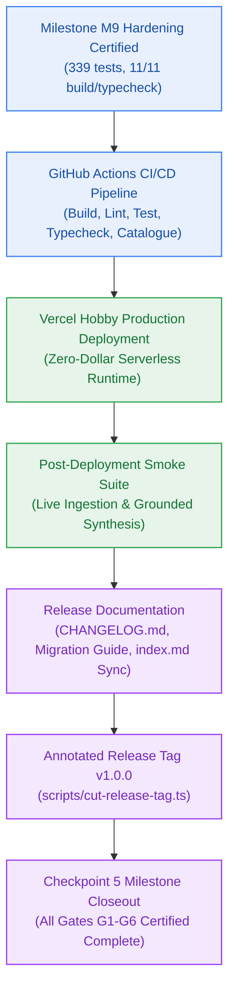

# Milestone Charter — GA: General Availability Production Release (v1.0.0)

> **Status:** Approved for Implementation (Final Production Release Milestone)  
> **Author:** `pm-agent` (Stage 2 Owner) & `deployment-agent` (Stage 5 Owner) · **Date:** 2026-10-27  
> **Target Version:** `v1.0.0` · **Risk Tier:** HIGH  
> **Grounding:** `project-brief.md` (All 42 FRs, 32 NFRs, 48 BRs; Checkpoint 5 Closeout Criteria; `EPIC-010`)  

---

## 1. Executive Summary & Outcome

Milestone GA delivers the General Availability production release of the Contextual AI Platform (`v1.0.0`). It certifies complete operational readiness across all 42 Functional Requirements and 32 Non-Functional Requirements. Owned jointly by `pm-agent` (Stage 2) and `deployment-agent` (Stage 5), GA establishes automated CI/CD deployment pipelines on GitHub Actions, configures Vercel Hobby serverless hosting with zero-dollar cost invariant (`NFR-016`), executes post-deployment smoke verification across live cloud endpoints, publishes the curated `CHANGELOG.md` and migration notes, cuts the annotated Git tag `v1.0.0` via release automation, and completes formal Checkpoint 5 closeout.

---

## 2. In Scope

- **Automated CI/CD Pipeline (`deployment-agent`, `AC-GA.1`):**
  - GitHub Actions workflow (`.github/workflows/ci.yml`) running `bun run build`, `bun run lint`, `bun run typecheck`, and `bun test` on all pull requests and pushes to `main`.
  - Dedicated step asserting the closed 17-member RFC 9457 error catalogue test passes (`packages/contracts/tests/errors.test.ts`).
  - Unit test suite verifying workflow file syntax and steps (`tests/ci/ci-workflow.test.ts`).
- **Production Deployment Configuration (`deployment-agent`, `AC-GA.1`):**
  - Vercel Hobby serverless deployment configuration in `vercel.json` honoring Next.js 15 App Router architecture, `iad1` region, and security headers.
  - Alignment of `_documentation/planning/contracts/deployment-config.yaml` with production headers, environment variables, and zero-dollar runtime policies.
  - Deployment validation test in `tests/deployment/vercel-config.test.ts`.
- **Post-Deployment Production Smoke Verification Suite (`test-agent`, `AC-GA.2`):**
  - Automated smoke test runner in `scripts/production-smoke.ts` and `tests/e2e/production-smoke.test.ts`.
  - Verifies 4 core production phases:
    1. Authenticate synthetic test user via Clerk OAuth JWT RS256 signature verification.
    2. Transient document staging in Filebase S3 and vector indexing in Upstash Vector (`BR-046`).
    3. Execute 6-phase grounded reasoning synthesis and verify inline citations.
    4. Emit structured JSON telemetry logs with correlation ID and W3C traceparent to Better Stack.
  - Guaranteed dual-mode execution: live cloud endpoints (`PRODUCTION_URL`) or high-fidelity local mock fallback.
- **Release Documentation & Versioning Governance (`versioning-specialist`, `AC-GA.4`):**
  - Canonical `CHANGELOG.md` at repository root documenting platform milestones M0 through GA in standard Keep a Changelog format.
  - Migration guide detailing zero-cost cloud setup, API endpoints, and RFC 9457 error formats.
  - Documentation integrity test in `tests/documentation/changelog-integrity.test.ts`.
- **Annotated Git Release Tag Automation (`versioning-specialist`, `AC-GA.3`):**
  - Release tagging automation in `scripts/cut-release-tag.ts` asserting 5 pre-release invariants (tests pass, clean typecheck, clean build, clean git working tree, PM approval present) before cutting annotated tag `v1.0.0`.
  - Tag creation validation test in `tests/deployment/release-tag.test.ts`.
- **Checkpoint 5 Closeout & Doc Synchronization (`pm-agent`, `hygiene-agent`):**
  - Full unified monorepo regression verification across all packages.
  - Synchronization of `milestone-status.yaml`, `overview.md`, and `_documentation/index.md`.
  - Developer execution log initialization at `ga-production-release/dev-log.md`.

---

## 3. Out of Scope

- Post-v1.0.0 functional capabilities (deferred to v1.1.0+ roadmap).
- Paid cloud infrastructure tiers or payment card bindings (strictly prohibited by `NFR-016`).
- Direct production database schema alterations bypassing zero-downtime expand/contract protocols.

---

## 4. Acceptance Criteria & Gate Status

| ID | Criterion | Evidence Target | Gate |
|:---:|---|---|:---:|
| **AC-GA.1** | Clean CI/CD Pipeline | `.github/workflows/ci.yml` completes green on main branch; verified by `tests/ci/ci-workflow.test.ts` | G5 |
| **AC-GA.2** | Live Production Smoke Pass | `tests/e2e/production-smoke.test.ts` passes end-to-end with zero errors across all 4 phases | G6 |
| **AC-GA.3** | Annotated Tag Cut `v1.0.0` | Git tag `v1.0.0` cut via `scripts/cut-release-tag.ts` with PM & Deployment signoff | G6 |
| **AC-GA.4** | Release Documentation Published | `CHANGELOG.md` and updated `_documentation/index.md` committed and verified | G6 |

---

## 5. Next Steps & Pipeline Handoff

1. Implementation plan approved unconditionally by `pm-agent` in `pm-approval.md`.
2. Handed off to `developer-agent` via `handoff-023-sprint-to-developer-ga.md`.
3. `developer-agent` executes stories in sequential order: `SGA.1 → SGA.2 → SGA.3 → SGA.4 → SGA.5 → SGA.6`.
4. `test-agent` verifies each story against acceptance criteria and certifies closure.
5. Final Checkpoint 5 closeout ratified by `pm-agent` and `deployment-agent`.
