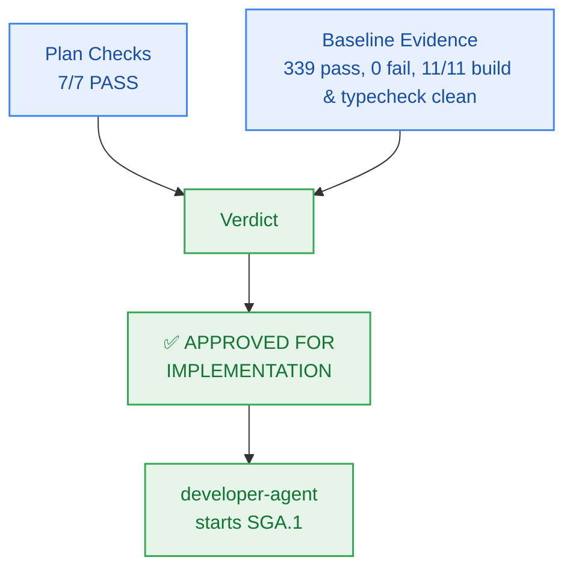

# Milestone GA Sprint Plan — PM Verification & Approval

> **Author:** `pm-agent` (Stage 2 Owner) · **Date:** 2026-10-27  
> **Scope of this record:** Approval of the Milestone GA **plan** for handoff to `developer-agent`.  
> **Explicitly not:** Code-complete sign-off or story-level verification — those remain `test-agent`'s.  

---

## 1. Verification Results

### 1.1 Plan Checks (Checkpoint 2 / Gate G5)

| # | Check | Result | Evidence |
|:--:|---|:---:|---|
| 1 | Every external capability tagged, research-backed, or classified `CUSTOM-DOMAIN-LOGIC` | **PASS** | Official `oven-sh/setup-bun@v2` GitHub Action for CI; Vercel Hobby serverless configuration (`vercel.json`); custom dual-mode TypeScript smoke runner (`scripts/production-smoke.ts`); canonical Keep a Changelog documentation (`CHANGELOG.md`); custom pre-flight release tag automation (`scripts/cut-release-tag.ts`); strictly upholds $0.00/month infrastructure ceiling (`NFR-016`) |
| 2 | Milestone has concrete verifiable criteria (checks, not vibes) | **PASS** | `milestone.md` §4 `AC-GA.1`..`AC-GA.4`, each with explicit evidence target, verification suite, and grounded FR/NFR/BRs |
| 3 | Every story passes the 5-point atomicity test; no padding | **PASS** | 6 stories for 6 work units (`WU-GA-1`..`WU-GA-6`); cohesive single-session scopes with bounded Change Matrices |
| 4 | Every story carries `build_vs_buy_ref`, `tests`, `observability` | **PASS** | All 6 stories on board `GA-S1` carry all three fields |
| 5 | Story dependency ordering forms a DAG with no cycles | **PASS** | Verified sequential DAG: `SGA.1 → SGA.2 → SGA.3 → SGA.4 → SGA.5 → SGA.6`; all referenced story IDs resolve cleanly |
| 6 | File paths in stories match actual repo structure and conventions | **PASS** | Paths verified against monorepo layout; conforms strictly to the Two-Floor boundary (no root package/config files in `allowed_files`) |
| 7 | Every required specialist dispatch issued and logged `ACCEPTED` | **PASS** | `planning-dispatch-log.md` carries `DSP-047`..`DSP-051`, all logged `ACCEPTED` |
| — | Board exists with frozen Change Matrices | **PASS** | `sprint-status.yaml` parses cleanly; 6 stories × `new_files`/`allowed_files`/`forbidden_files`; zero root configuration files in `allowed_files` |
| — | Contracts parse | **PASS** | `_documentation/planning/contracts/deployment-config.yaml` and `component-catalog.yaml` updated; closed 17-member RFC 9457 error catalogue test passes 5/5 |

**Plan verdict: 7/7 + 2 structural checks PASS.**

### 1.2 Baseline Evidence (repository state at approval time)

| Check | Result | Evidence |
|---|---|---|
| `bun test` (full monorepo suite) | **PASS** | **339 pass, 0 fail, 3,248 expect() calls** across 58 test files (runtime: ~8.9s) |
| `bun run build` | **PASS** | **11/11 tasks successful** (`@repo/auth`, `@repo/config`, `@repo/contracts`, `@repo/db`, `@repo/ingestion`, `@repo/memory`, `@repo/metering`, `@repo/observability`, `@repo/reasoning`, `@repo/ui`, `@repo/workspace`) |
| `bun run typecheck` | **PASS** | **11/11 packages clean**, 0 TypeScript errors across the monorepo |
| `bun test packages/contracts/tests/errors.test.ts` | **PASS** | 5 pass, 0 fail, 95 expect() calls; closed 17-member RFC 9457 error catalogue remains intact |
| `git status` | **PASS** | Working tree clean (zero unstaged/untracked runtime code diffs) |

---

## 2. Findings & Preconditions

Milestone GA begins with an exemplary, 100% green monorepo baseline following the complete verification and certification of Milestone M9:
- Full test suite passes 339/339 tests with 3,248 expect() assertions across 58 test files.
- Monorepo builds cleanly with zero errors across all 11 existing packages.
- Monorepo typechecks cleanly with zero errors across all 11 packages.
- Closed RFC 9457 error catalogue remains intact at 17 members.
- Working tree has zero code regressions.

> **PM characterization:** The runway for Milestone GA implementation is completely clear. No blocking preconditions are required.

---

## 3. Verdict

> ## ✅ APPROVED FOR IMPLEMENTATION — Unconditional

**Approved artifacts:**
- `_documentation/planning/milestones/ga-production-release/milestone.md`
- `_documentation/planning/milestones/ga-production-release/sprint-status.yaml` (6 stories, frozen Change Matrices)
- `_documentation/planning/milestones/ga-production-release/stories/*` (6 cards: `story-sga.1` through `story-sga.6`)
- `_documentation/planning/epics/epic-010-ga-production-release.md`
- `_documentation/planning/architecture/05-ga-general-availability-production-release.md`
- `_documentation/planning/contracts/deployment-config.yaml` (GA production release governance)
- `_documentation/planning/contracts/component-catalog.yaml` (`comp-ci`, `comp-deploy`, `comp-smoke`)
- `_documentation/planning/registers/failure-mode-register.md` (`FM-1001`..`FM-1004`)

**Implementation sequence:**
`developer-agent` starts at **SGA.1** and proceeds in dependency order `SGA.2 → SGA.3 → SGA.4 → SGA.5 → SGA.6`. Story closure requires passing evidence certified by `test-agent`; this approval certifies readiness for implementation.
