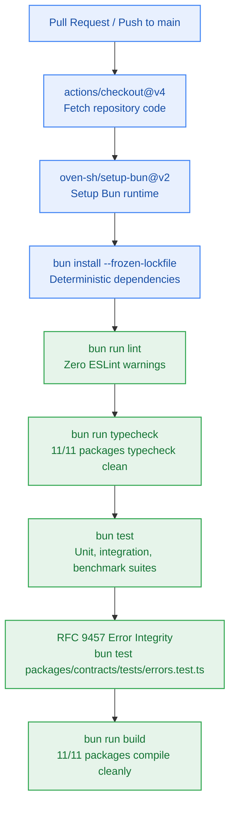

# SGA.1 — GitHub Actions CI/CD Pipeline Workflow & Automated Pre-Merge Verification Suite

> **Work Unit:** WU-GA-1 · **Effort:** 3 · **Priority:** p0 · **Risk Tier:** LOW  
> **Owner:** `developer-agent` · **Depends on:** — (sprint entry point)  



---

## 1. Goal & Context

Establish the continuous integration workflow `.github/workflows/ci.yml` to automate quality gate verification (Gate G5 / G6) on every pull request and push to the `main` branch. The pipeline executes linting, strict TypeScript typechecking, test suites, RFC 9457 error catalogue verification, and monorepo compilation using the official Bun action (`oven-sh/setup-bun@v2`). Author `tests/ci/ci-workflow.test.ts` to validate the workflow configuration file integrity.

---

## 2. Acceptance Criteria

1. Create `.github/workflows/ci.yml` defining the CI job `verify` running on `ubuntu-latest`.
2. Configure triggers on push to `main` and pull requests targeting `main`.
3. Install dependencies via `bun install --frozen-lockfile` ensuring deterministic reproducibility.
4. Run strict sequential quality checks:
   - `bun run lint`
   - `bun run typecheck`
   - `bun test`
   - `bun test packages/contracts/tests/errors.test.ts` (explicit error catalogue assertion)
   - `bun run build`
5. Author `tests/ci/ci-workflow.test.ts` asserting:
   - Workflow file exists at `.github/workflows/ci.yml`.
   - YAML syntax is valid and parses correctly.
   - Triggers include `push` and `pull_request` on `main`.
   - All 5 required execution steps are present and properly ordered.
   - Error catalogue test is explicitly mandated.
6. Verify workflow does not require external cloud secrets for standard PR test runs.

---

## 3. Change Matrix (frozen)

| Class | Paths |
|---|---|
| **new_files** | `.github/workflows/ci.yml`, `tests/ci/ci-workflow.test.ts` |
| **allowed_files** | `.github/workflows/**`, `tests/ci/**` |
| **forbidden_files** | `packages/**`, `tests/benchmarks/**`, `tests/reasoning/**`, `tests/workspace/**`, `tests/ui/**`, `tests/memory/**`, `tests/observability/**`, `infra/**`, `apps/**`, `_documentation/**`, `package.json`, `turbo.json`, `bunfig.toml` |

---

## 4. Verification Hook

```bash
bun test tests/ci/ci-workflow.test.ts && bun test packages/contracts/tests/errors.test.ts && bun run typecheck
```

---

## 5. Rollout / Compatibility

Non-breaking CI automation. Adds GitHub Actions configuration without altering any existing runtime packages or public interfaces.
