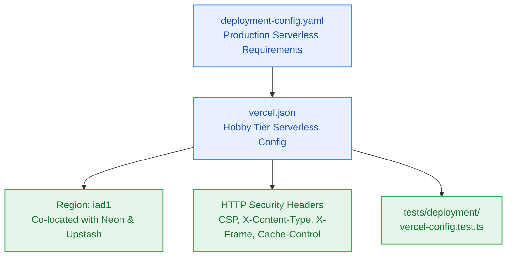

# SGA.2 — Vercel Production Serverless Deployment Configuration & Contract Alignment

> **Work Unit:** WU-GA-2 · **Effort:** 3 · **Priority:** p0 · **Risk Tier:** MEDIUM  
> **Owner:** `developer-agent` · **Depends on:** `SGA.1`  



---

## 1. Goal & Context

Configure the production deployment envelope for Vercel Hobby serverless hosting (`vercel.json`) ensuring alignment with `deployment-config.yaml`. The deployment configuration must enforce the $0.00/month infrastructure ceiling (`NFR-016`), co-locate serverless execution in the `iad1` region (US East) adjacent to Neon Postgres and Upstash Redis, set strict HTTP response security headers, and configure zero-cache headers on API routes. Author `tests/deployment/vercel-config.test.ts` to validate configuration constraints.

---

## 2. Acceptance Criteria

1. Create `vercel.json` with valid JSON schema, specifying `framework: nextjs`, `cleanUrls: true`, and `regions: ["iad1"]`.
2. Configure HTTP response security headers in `vercel.json`:
   - `X-Content-Type-Options: nosniff`
   - `X-Frame-Options: DENY`
   - `X-XSS-Protection: 1; mode=block`
   - `Referrer-Policy: strict-origin-when-cross-origin`
   - `Permissions-Policy: camera=(), microphone=(), geolocation=()`
   - `Cache-Control: no-store, max-age=0` for `/api/(.*)`
3. Author `tests/deployment/vercel-config.test.ts` asserting:
   - `vercel.json` exists and parses cleanly.
   - Region is strictly `["iad1"]`.
   - All 6 security headers are configured and non-empty.
   - No paid add-ons or billable integrations are enabled.
4. Verify alignment with `_documentation/planning/contracts/deployment-config.yaml`.

---

## 3. Change Matrix (frozen)

| Class | Paths |
|---|---|
| **new_files** | `vercel.json`, `tests/deployment/vercel-config.test.ts` |
| **allowed_files** | `vercel.json`, `tests/deployment/**` |
| **forbidden_files** | `packages/**`, `.github/**`, `tests/ci/**`, `tests/benchmarks/**`, `tests/reasoning/**`, `tests/workspace/**`, `tests/ui/**`, `infra/**`, `apps/**`, `_documentation/**`, `package.json`, `turbo.json`, `bunfig.toml` |

---

## 4. Verification Hook

```bash
bun test tests/deployment/vercel-config.test.ts && bun test packages/contracts/tests/errors.test.ts && bun run typecheck
```

---

## 5. Rollout / Compatibility

Production configuration only. Does not alter any monorepo package code or database schemas.
