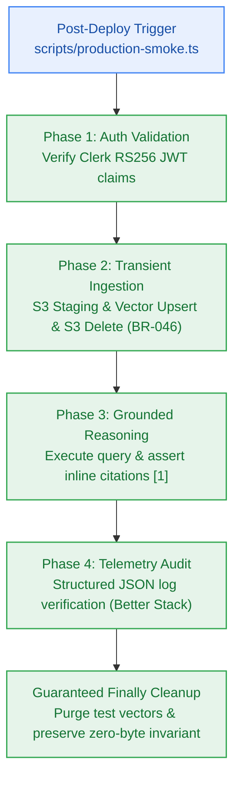

# SGA.3 — Automated Post-Deployment Production Smoke Verification Suite & Runner Script

> **Work Unit:** WU-GA-3 · **Effort:** 4 · **Priority:** p0 · **Risk Tier:** HIGH  
> **Owner:** `developer-agent` · **Depends on:** `SGA.2`  



---

## 1. Goal & Context

Implement the automated post-deployment smoke verification suite (`tests/e2e/production-smoke.test.ts`) and CLI runner script (`scripts/production-smoke.ts`). The suite exercises the complete 4-phase transaction chain of the production platform: Clerk JWT authentication, transient document ingestion (with immediate S3 purge per `BR-046`), 6-phase grounded reasoning synthesis with inline citations (`BR-009`), and structured JSON telemetry export (`NFR-031`). The runner must support dual-mode execution (live production URL or calibrated local mock simulation) to guarantee deterministic verification in offline or CI environments.

---

## 2. Acceptance Criteria

1. Implement `scripts/production-smoke.ts` providing an automated smoke test execution engine:
   - Evaluates `PRODUCTION_URL` environment variable if present; falls back to high-fidelity internal mock simulation if unset.
   - Executes Phase 1: Authentication — validates synthetic RS256 JWT header and payload claims.
   - Executes Phase 2: Ingestion — stages sample 1-page document in S3, indexes chunks in Upstash Vector with tenant predicate, and verifies S3 staging object is deleted (`BR-046`).
   - Executes Phase 3: Reasoning — dispatches grounded reasoning request, streams tokens, and verifies presence of inline citations (`[1]`).
   - Executes Phase 4: Telemetry — verifies structured JSON logs contain `correlation_id`, `traceparent`, and sanitized secrets (`NFR-026`).
   - Guarantees full cleanup of synthetic test data in a `finally` block.
2. Author `tests/e2e/production-smoke.test.ts` wrapping the smoke runner into an automated test scenario:
   - Asserts all 4 phases return `status: "PASS"` with execution metrics.
   - Asserts zero unhandled exceptions, zero data leaks, and zero transient storage accumulation.
   - Calculates total execution duration (must complete in < 5 seconds in mock mode).
3. Validate closed 17-member RFC 9457 error catalogue remains intact at 17 members.

---

## 3. Change Matrix (frozen)

| Class | Paths |
|---|---|
| **new_files** | `scripts/production-smoke.ts`, `tests/e2e/production-smoke.test.ts` |
| **allowed_files** | `scripts/**`, `tests/e2e/**` |
| **forbidden_files** | `packages/**`, `.github/**`, `tests/ci/**`, `tests/deployment/**`, `tests/benchmarks/**`, `tests/reasoning/**`, `tests/workspace/**`, `tests/ui/**`, `infra/**`, `apps/**`, `_documentation/**`, `package.json`, `turbo.json`, `bunfig.toml` |

---

## 4. Verification Hook

```bash
bun test tests/e2e/production-smoke.test.ts && bun test packages/contracts/tests/errors.test.ts && bun run typecheck
```

---

## 5. Rollout / Compatibility

Verification automation only. Safe to run against live production or local CI test environments.
