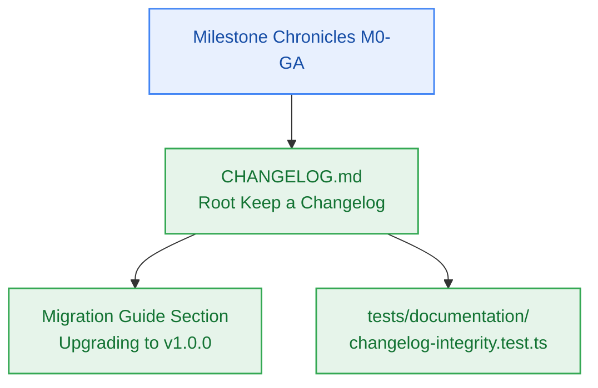

# SGA.4 — Curated Production Release Changelog & Migration Guide Documenting M0 Through GA

> **Work Unit:** WU-GA-4 · **Effort:** 3 · **Priority:** p0 · **Risk Tier:** LOW  
> **Owner:** `developer-agent` · **Depends on:** `SGA.3`  



---

## 1. Goal & Context

Author the canonical `CHANGELOG.md` at the repository root documenting the comprehensive development history of the Contextual AI Platform from `v0.1.0-alpha.1` (M0) through `v1.0.0` (GA). The document must follow standard Keep a Changelog conventions and Semantic Versioning principles (`references/semver-release-policy.md`). Include a detailed developer migration guide explaining configuration prerequisites, zero-cost cloud service credentials, Docker setup, and the closed 17-member RFC 9457 error details catalogue. Author `tests/documentation/changelog-integrity.test.ts` to enforce documentation presence and SemVer format assertions.

---

## 2. Acceptance Criteria

1. Create `CHANGELOG.md` at repository root following Keep a Changelog format.
2. Document all 10 platform milestones:
   - `[1.0.0]` — Milestone GA: Production Release & CI/CD Deployment Pipeline
   - `[0.9.0-rc.1]` — Milestone M9: Benchmark Suite, Hardening & Security Audit
   - `[0.8.0]` — Milestone M8: Public Marketing Landing & Dynamic Privacy Governance
   - `[0.7.0]` — Milestone M7: Autonomous Maintenance Crons & Observability
   - `[0.6.0]` — Milestone M6: Pluggable Long-Term Memory Store
   - `[0.5.0]` — Milestone M5: 6-Phase Grounded Reasoning Engine
   - `[0.4.0]` — Milestone M4: Notebook Workspace & Domain Graph
   - `[0.3.0]` — Milestone M3: Transient Ingestion Pipeline & Multi-Source Extraction
   - `[0.2.0]` — Milestone M2: Metering Spine & Quota Throttling
   - `[0.1.0]` — Milestone M1: Developer Golden Path & Core Authentication
   - `[0.1.0-alpha.1]` — Milestone M0: Workspace Foundation & Monorepo Scaffolding
3. Include explicit Migration Guide section for v1.0.0:
   - Zero-Dollar Cloud Accounts configuration (.env checklist for all 8 providers)
   - Local development workflow via `infra/compose.yaml` and `dev:doctor`
   - Strict RFC 9457 Problem Details error handling format
4. Author `tests/documentation/changelog-integrity.test.ts` verifying:
   - `CHANGELOG.md` exists and is non-empty.
   - Contains headings for `[1.0.0]`, `[0.9.0-rc.1]`, through `[0.1.0-alpha.1]`.
   - Contains migration guide section.
   - Contains no broken relative links or placeholder TODOs.

---

## 3. Change Matrix (frozen)

| Class | Paths |
|---|---|
| **new_files** | `CHANGELOG.md`, `tests/documentation/changelog-integrity.test.ts` |
| **allowed_files** | `CHANGELOG.md`, `tests/documentation/**` |
| **forbidden_files** | `packages/**`, `.github/**`, `scripts/**`, `tests/ci/**`, `tests/deployment/**`, `tests/e2e/**`, `tests/benchmarks/**`, `tests/reasoning/**`, `tests/workspace/**`, `tests/ui/**`, `infra/**`, `apps/**`, `_documentation/**`, `package.json`, `turbo.json`, `bunfig.toml` |

---

## 4. Verification Hook

```bash
bun test tests/documentation/changelog-integrity.test.ts && bun test packages/contracts/tests/errors.test.ts && bun run typecheck
```

---

## 5. Rollout / Compatibility

Documentation addition only. Zero runtime code modifications.
