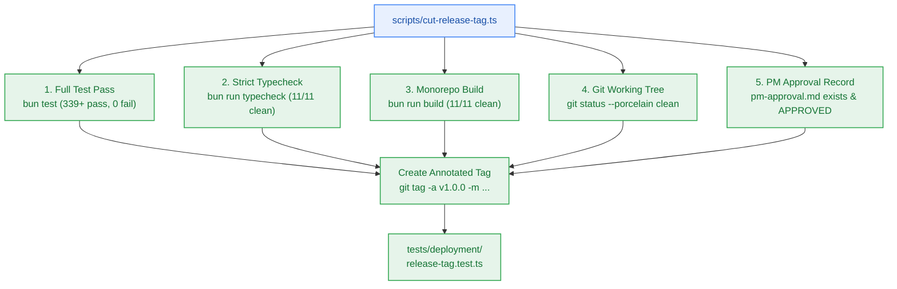

# SGA.5 — Annotated Git Release Tagging Automation Script & Checkpoint 5 Governance Assertions

> **Work Unit:** WU-GA-5 · **Effort:** 3 · **Priority:** p0 · **Risk Tier:** MEDIUM  
> **Owner:** `developer-agent` · **Depends on:** `SGA.4`  



---

## 1. Goal & Context

Implement the release automation script `scripts/cut-release-tag.ts` to govern the formal creation of the annotated Git tag `v1.0.0` at Checkpoint 5. The script enforces 5 mandatory pre-flight invariant assertions: full monorepo test pass, strict TypeScript compilation, monorepo build success, clean git working tree, and presence of an unconditional PM approval artifact. Provide support for `--dry-run` to enable automated verification without altering git repository history. Author `tests/deployment/release-tag.test.ts` to validate release automation logic.

---

## 2. Acceptance Criteria

1. Implement `scripts/cut-release-tag.ts`:
   - Validates target version (defaults to `v1.0.0`).
   - Executes pre-flight check 1: verifies `bun test` passes with 0 failures.
   - Executes pre-flight check 2: verifies `bun run typecheck` reports 0 errors.
   - Executes pre-flight check 3: verifies `bun run build` compiles cleanly.
   - Executes pre-flight check 4: verifies working tree is clean (`git status --porcelain`).
   - Executes pre-flight check 5: verifies `_documentation/planning/milestones/ga-production-release/pm-approval.md` contains `APPROVED FOR IMPLEMENTATION`.
   - Formulates annotated release message with PM & Deployment signoffs, commit SHA, and milestone summary.
   - Respects `--dry-run` flag: outputs release message and status without calling `git tag`.
2. Author `tests/deployment/release-tag.test.ts`:
   - Validates script exports invariant verification helpers.
   - Asserts dry-run execution succeeds when preconditions are met.
   - Asserts script rejects execution when any precondition check fails.
   - Validates release message format against standard template.

---

## 3. Change Matrix (frozen)

| Class | Paths |
|---|---|
| **new_files** | `scripts/cut-release-tag.ts`, `tests/deployment/release-tag.test.ts` |
| **allowed_files** | `scripts/**`, `tests/deployment/**` |
| **forbidden_files** | `packages/**`, `.github/**`, `tests/ci/**`, `tests/e2e/**`, `tests/documentation/**`, `tests/benchmarks/**`, `tests/reasoning/**`, `tests/workspace/**`, `tests/ui/**`, `infra/**`, `apps/**`, `_documentation/**`, `package.json`, `turbo.json`, `bunfig.toml` |

---

## 4. Verification Hook

```bash
bun test tests/deployment/release-tag.test.ts && bun test packages/contracts/tests/errors.test.ts && bun run typecheck
```

---

## 5. Rollout / Compatibility

Operational automation script only. Safe for execution in developer sessions and CI pipelines.
