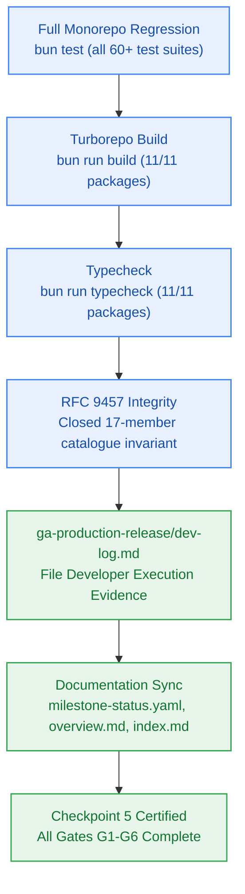

# SGA.6 — Milestone GA Full Monorepo Regression Pass, Checkpoint 5 Closeout Verification & Doc Synchronization

> **Work Unit:** WU-GA-6 · **Effort:** 3 · **Priority:** p0 · **Risk Tier:** LOW  
> **Owner:** `developer-agent` · **Depends on:** `SGA.5`  



---

## 1. Goal & Context

Execute the comprehensive final monorepo regression pass, compile the developer execution log (`_documentation/planning/milestones/ga-production-release/dev-log.md`), and synchronize all canonical roadmap documentation reflecting the certified completion of Milestone GA and Checkpoint 5 closeout.

---

## 2. Acceptance Criteria

1. Execute complete unified monorepo test suite verifying 100% pass across all unit, integration, benchmark, and deployment suites.
2. Verify all 11 packages compile cleanly in `bun run build` and typecheck cleanly in `bun run typecheck`.
3. Assert closed 17-member RFC 9457 error catalogue test passes 5/5.
4. Populate `_documentation/planning/milestones/ga-production-release/dev-log.md` with complete implementation evidence for all stories SGA.1 through SGA.6.
5. Update `_documentation/planning/milestones/milestone-status.yaml` marking GA status as `completed`, gate G6 `PASS`, with verified timestamp and test statistics.
6. Update `_documentation/planning/milestones/overview.md` and `_documentation/index.md` with final GA release details.

---

## 3. Change Matrix (frozen)

| Class | Paths |
|---|---|
| **new_files** | `_documentation/planning/milestones/ga-production-release/dev-log.md` |
| **allowed_files** | `_documentation/**` |
| **forbidden_files** | `packages/**`, `.github/**`, `scripts/**`, `tests/**`, `infra/**`, `apps/**`, `package.json`, `turbo.json`, `bunfig.toml` |

---

## 4. Verification Hook

```bash
bun test && bun run build && bun run typecheck
```

---

## 5. Rollout / Compatibility

Documentation update and regression evidence recording only.
