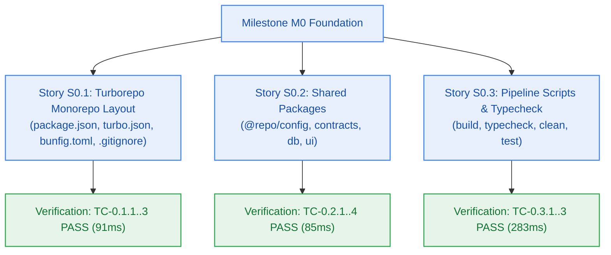

# Developer Log — Milestone M0: Workspace Foundation & Scaffolding

> **Milestone:** M0 (Workspace Foundation & Scaffolding) · **Target Version:** `v0.1.0-alpha.1`  
> **Author:** developer-agent · **Status:** Verify-Ready for Gate G6 Sign-off · **Risk Tier:** LOW  
> **Conventions:** `_documentation/planning/conventions.md`  

---

## 1. Technical Implementation Summary

### Story S0.1: Turborepo Monorepo Root Scaffolding & Bun Toolchain
- **Root Configuration:** Configured root `package.json` with `"private": true`, `"type": "module"`, `"packageManager": "bun@1.2.22"`, and workspaces `["apps/*", "packages/*"]`.
- **Turborepo Pipeline:** Defined `turbo.json` with task pipelines for `build` (with `^build` dependency and `dist/**` output caching), `typecheck`, `lint`, and un-cached `clean`.
- **Bun Runtime:** Created `bunfig.toml` with `exact = true`, `lockfile = true`, and root test directory.
- **Git Hygiene:** Updated `.gitignore` excluding `node_modules`, `.turbo`, `.next`, `dist`, `.env*.local`, `*.tsbuildinfo`, while strictly preserving the DBW control block and agent configurations.
- **Verification:** `tests/monorepo-layout.test.ts` passed (3/3 tests).

### Story S0.2: Internal Shared Packages Foundation
- **`@repo/config`:** Established strict TypeScript configurations (`tsconfig.base.json`, `tsconfig.node.json`, `tsconfig.react.json`) enforcing `strict: true`, `noUncheckedIndexedAccess: true`, and `isolatedModules: true`.
- **`@repo/contracts`:** Authored canonical RFC 9457 structured error types, 17-member closed catalogue, `ProblemDocument`, `ValidationErrorItem`, and `QuotaExtension` interfaces with zero third-party dependencies (`CV-001`, `FR-025`, `BR-028`).
- **`@repo/db`:** Stubbed Kysely database schema contracts for `users`, `threads`, and `notebooks` tables adhering to `snake_case` naming conventions and UUIDv7 primary keys (`FR-002`).
- **`@repo/ui`:** Defined core design tokens (`colors`, `spacing`, `radii`, `typography`) and component interface stubs (`ButtonProps`, `CardProps`, `BadgeProps`, `DisclosureBannerProps`).
- **Verification:** `tests/package-exports.test.ts` passed (4/4 tests).

### Story S0.3: Toolchain Scripts, Strict Typecheck & Monorepo Build Pipeline
- **Monorepo Tasks:** Wired pipeline scripts (`build`, `typecheck`, `lint`, `clean`) across root and all workspace packages.
- **Topological Compilation:** Verified that `bun run build` and `bun run typecheck` execute cleanly across all 4 packages in topological dependency order in < 1 second.
- **Clean Hygiene:** Verified `bun run clean` purges intermediate build artifacts and cache states.
- **Verification:** `tests/monorepo-build.test.ts` passed (3/3 tests).

---

## 2. Integrated Verification Evidence

| Story ID | Scenario | Command | Result | Gate |
|:---:|---|---|---|:---:|
| **S0.1** | TC-0.1.1, TC-0.1.2, TC-0.1.3 (Monorepo Layout) | `bun test tests/monorepo-layout.test.ts` | 3 pass, 0 fail (91ms) | G6 |
| **S0.2** | TC-0.2.1, TC-0.2.2, TC-0.2.3, TC-0.2.4 (Package Exports) | `bun test tests/package-exports.test.ts` | 4 pass, 0 fail (85ms) | G6 |
| **S0.3** | TC-0.3.1, TC-0.3.2, TC-0.3.3 (Build & Typecheck) | `bun test tests/monorepo-build.test.ts` | 3 pass, 0 fail (283ms) | G6 |
| **Integrated** | Full Test Suite Execution | `bun test` | **10 pass, 0 fail, 44 expect() calls (236ms)** | G6 |
| **Integrated** | Monorepo Turbo Build & Strict Typecheck | `bun run build && bun run typecheck` | **Tasks: 4 successful, 4 total (0 errors)** | G6 |

---

## 3. Configuration & Secret Audit

- Planned configuration variables inspected: zero hardcoded literals or credentials committed (`NFR-026`).
- `.gitignore` active with `.env*` coverage.
- Change matrix strictly adhered to: zero forbidden files (`apps/**`, `infra/**`) touched.
