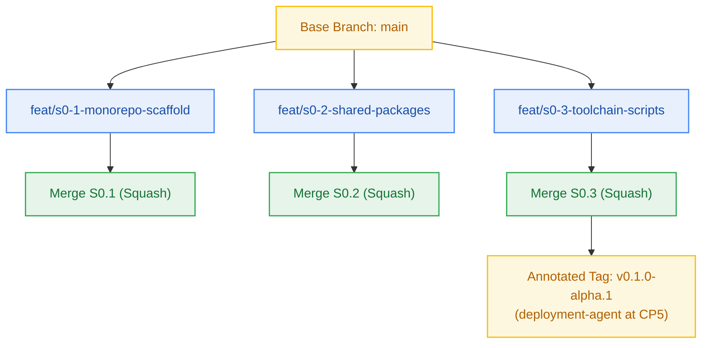

# Git Plan — Milestone M0: Workspace Foundation & Scaffolding

> **Author:** git-planner-agent · **Date:** 2026-10-23 · **Status:** Final  
> **Base Branch:** `main` (or active iteration branch) · **Convention Source:** `_documentation/planning/conventions.md`  
> **Target Release Tag:** `v0.1.0-alpha.1` · **Derived Version Impact:** Pre-release (`0.0.0` → `0.1.0-alpha.1`)  

---

## 1. Branch Topology

| Story ID | Branch Name | Base Branch | Merge Strategy | PR Title | Breaking |
|---|---|---|---|---|:---:|
| **S0.1** | `feat/s0-1-monorepo-scaffold` | `main` | squash | `feat(workspace): turborepo layout and bun toolchain` | no |
| **S0.2** | `feat/s0-2-shared-packages` | `main` | squash | `feat(workspace): shared internal packages @repo/*` | no |
| **S0.3** | `feat/s0-3-toolchain-scripts` | `main` | squash | `feat(workspace): toolchain build and verification scripts` | no |

---

## 2. Commit Sequences

### Story S0.1: Turborepo Monorepo Root Scaffolding
- **Commit 1:** `chore(workspace): initialize root package.json and turbo.json monorepo configuration`
- **Commit 2:** `chore(toolchain): configure bunfig.toml and .gitignore for hermetic builds`

### Story S0.2: Internal Shared Packages Foundation
- **Commit 1:** `feat(config): establish shared strict tsconfig presets in packages/config`
- **Commit 2:** `feat(contracts): scaffold @repo/contracts with rfc9457 error types`
- **Commit 3:** `feat(db): stub @repo/db package for kysely schemas`
- **Commit 4:** `feat(ui): stub @repo/ui shared component package`

### Story S0.3: Toolchain Scripts, Strict Typecheck & Verification
- **Commit 1:** `chore(scripts): configure root build, typecheck, lint, and clean npm/bun scripts`
- **Commit 2:** `test(workspace): add automated verification test for monorepo package layout`

---

## 3. Release Tag Specifications

- **Tag Name:** `v0.1.0-alpha.1`
- **Tag Type:** Annotated (`git tag -a v0.1.0-alpha.1 -m "..."`)
- **Sign-off:** Approved by `pm-agent` upon clean Gate G6 verification.
