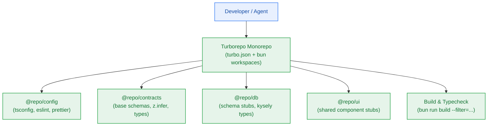

# Milestone Charter — M0: Workspace Foundation & Scaffolding (v0.1.0-alpha.1)

> **Status:** Active (Gate G2 Ready · Scheduled for Architecture Gate G3/G4 & Story Breakdown)  
> **Author:** pm-agent (Stage 2 Owner) · **Date:** 2026-10-23  
> **Target Version:** `v0.1.0-alpha.1` · **Risk Tier:** LOW  
> **Grounding:** `project-brief.md` (FR-012, FR-021; CV-001..CV-012, CV-023; NFR-007, NFR-010)  

---

## 1. Executive Summary & Outcome

Milestone M0 establishes the root monorepo architecture and build foundation for the Contextual platform. Prior planning passes prematurely marked this milestone as completed without executing scaffolding. M0 delivers a clean, hermetic Turborepo workspace governed by the Bun toolchain, TypeScript strict mode, and core internal package boundaries (`@repo/contracts`, `@repo/config`, `@repo/db`, `@repo/ui`) before application services or infrastructure containers are introduced in Milestone M1.

---

## 2. In Scope

- Root monorepo scaffolding (`package.json`, `turbo.json`, `bunfig.toml`, `.gitignore`).
- Workspace package configuration:
  - `packages/config`: Canonical TypeScript configurations (`tsconfig.base.json`, `tsconfig.node.json`, `tsconfig.react.json`), linting and styling presets.
  - `packages/contracts`: Empty type boundary ready for DTOs and RFC 9457 schemas.
  - `packages/db`: Persistence boundary package stub for Kysely/Postgres definitions.
  - `packages/ui`: Shared UI token and primitive package stub.
- Root scripts:
  - `bun run build`: Turbo pipeline build with dependency caching.
  - `bun run typecheck`: Workspace-wide TypeScript validation (`tsc --noEmit`).
  - `bun run lint`: Zero lint error enforcement.
  - `bun run clean`: Cache and build output cleanup.

---

## 3. Out of Scope

- Docker Compose container orchestration (deferred to Milestone M1, `infra/compose.yaml`).
- Authentication middleware and Clerk OAuth integration (deferred to Milestone M1, `FR-001`).
- Neon Postgres migrations and live connections (deferred to Milestone M1, `FR-002`).
- Metering, Lua scripts, or Redis connections (deferred to Milestone M2, `EPIC-002`).

---

## 4. Acceptance Criteria & Gate Status

| ID | Criterion | Evidence Target | Gate |
|:---:|---|---|:---:|
| **AC-0.1** | Clean Turborepo Monorepo Layout | Root `package.json` with `workspaces: ["apps/*", "packages/*"]` and `turbo.json` | G5 |
| **AC-0.2** | Shared Packages Initialized | `@repo/contracts`, `@repo/config`, `@repo/db`, and `@repo/ui` present in `packages/` | G5 |
| **AC-0.3** | Strict Typecheck Passes | `bun run typecheck` succeeds across all workspace packages with 0 errors | G6 |
| **AC-0.4** | Clean Monorepo Build | `bun run build` completes in < 15 seconds with zero circular dependencies | G6 |

---

## 5. Next Steps & Pipeline Handoff

1. **Gate G2 Certified:** Charter, overview, and roadmap tracker aligned.
2. **Phase 4 Implementation Planning:** Invoke `sprint-agent` to author `sprint-status.yaml` and story cards for Milestone M0 (`S0.1`..`S0.3`).
3. **Execution:** `developer-agent` implements workspace scaffolding following the frozen Change Matrices.
