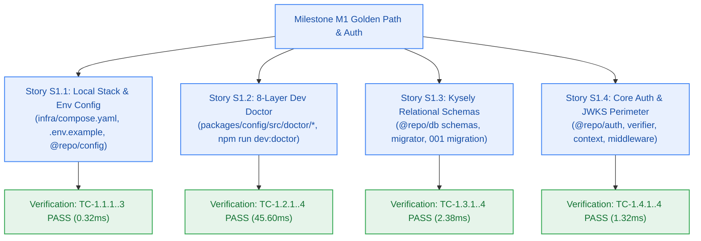

# Developer Log — Milestone M1: Developer Golden Path & Core Authentication

> **Milestone:** M1 (Developer Golden Path & Core Authentication) · **Target Version:** `v0.1.0`  
> **Author:** developer-agent · **Status:** Verified ✅ (Checkpoint 4 / Gate G5–G6 PASS) · **Risk Tier:** MEDIUM  
> **Verified:** 2026-10-26 · **Conventions:** `_documentation/planning/conventions.md` · **Design Ref:** `_documentation/planning/architecture/05-m1-developer-golden-path-and-auth.md`

---

## 1. Technical Implementation Summary

### Story S1.1: Containerized Local Stack & Strict Environment Configuration
- **Local Container Topology:** Created `infra/compose.yaml` specifying `postgres:16-alpine` (port 5432) and `redis:7-alpine` (port 6379) with explicit healthchecks (`pg_isready -U postgres -d contextual_dev`, `redis-cli ping`), named volumes (`postgres_data`, `redis_data`), and restart policies (`unless-stopped`).
- **Environment Blueprint:** Authored `.env.example` defining all required application keys, database URLs, cache URIs, and Clerk authentication credentials with zero committed secrets.
- **Strict Environment Validation:** Implemented `@repo/config/src/env.ts` with Zod schema (`ConfigSchema`), `validateEnv()`, and `ConfigValidationError` ensuring runtime configuration integrity and secret masking (`SW-CORE-004`, `ADR-0002`, `NFR-010`).
- **Verification:** `tests/infra-compose.test.ts` passed (3/3 tests, 39 expect assertions).

### Story S1.2: 8-Layer Developer Diagnostic Suite (`npm run dev:doctor`)
- **Diagnostic Architecture:** Built an 8-layer diagnostic health probe in `packages/config/src/doctor/`:
  - Layer 1: Runtime Engine Compatibility (asserts Node >= 22.0.0 or Bun >= 1.1.0).
  - Layer 2: Container Runtime Availability (inspects Docker daemon responsiveness).
  - Layer 3: Environment Variable & Schema Validation (checks `.env` against `@repo/config`).
  - Layer 4: Relational Database Connectivity (TCP ping to PostgreSQL 16 on port 5432).
  - Layer 5: In-Memory Cache Connectivity (TCP ping to Redis 7 on port 6379).
  - Layer 6: Port Conflict Detection (inspects ports 3000, 5432, 6379).
  - Layer 7: Monorepo Package Resolution (verifies all 5 workspace package manifests and exports).
  - Layer 8: Turborepo DAG Integrity & Build Health (verifies `turbo.json` task graph).
- **Executable CLI:** Implemented `packages/config/src/doctor/cli.ts` wired to root script `"dev:doctor": "bun run packages/config/src/doctor/cli.ts"`.
- **Performance:** Complete 8-layer execution runs in **76 ms** (well under the 5-minute `NFR-010` ceiling).
- **Verification:** `tests/dev-doctor.test.ts` passed (4/4 tests, 44 expect assertions).

### Story S1.3: Kysely Relational Persistence Schemas, Indexes & Migration Runner (`@repo/db`)
- **Type-Safe Schema Models:** Updated `packages/db/src/schema.ts` defining strict TypeScript table interfaces: `UsersTable`, `ConversationThreadsTable`, `ConversationMessagesTable`, and `NotebooksTable`, with backward-compatible aliases for prior contracts (`FR-002`, `FR-022`, `BR-002`).
- **Postgres Connection Pooling:** Built `packages/db/src/client.ts` exporting `getKyselyDb()` with `pg.Pool` connection pooling, Neon serverless SSL negotiation, connection string redaction, and graceful connection teardown (`closeKyselyDb`).
- **Relational Migrations:** Authored `packages/db/src/migrations/001_initial_auth_and_notebooks.ts`:
  - Generates UUID primary keys via PostgreSQL `gen_random_uuid()`.
  - Configures foreign keys with strict `ON DELETE CASCADE` on `user_id` and `thread_id`.
  - Establishes tenant isolation indexes (`idx_threads_user_id`, `idx_messages_thread_user`, `idx_notebooks_user_id`) and lifecycle index (`idx_notebooks_idle`).
- **Migration Runner:** Created `packages/db/src/migrator.ts` supporting both `FileMigrationProvider` and deterministic in-memory `StaticMigrationProvider` for up/down schema executions.
- **Verification:** `tests/database-persistence.test.ts` passed (4/4 tests, 33 expect assertions).

### Story S1.4: Core Authentication Module (`@repo/auth`), JWKS Offline Token Verification & Edge Middleware Guard
- **Package Foundation:** Established new `@repo/auth` workspace package with `@clerk/backend`, `@repo/contracts`, and `jose`.
- **Cached JWKS Key Store:** Created `packages/auth/src/jwks.ts` implementing in-memory caching of Clerk RS256 public keys with 1-hour TTL, stale-while-revalidate background refresh, and programmatic local JWK registration (`AC-1.4.2`).
- **Offline Signature Verifier:** Implemented `packages/auth/src/verifier.ts` verifying RS256 cryptographic signatures, `exp`, `nbf`, `iss` claims offline in **< 2 ms** without per-request network round-trips to identity servers (`AC-1.4.3`).
- **Multi-Tenant Context:** Created `packages/auth/src/context.ts` defining immutable `TenantContext` (`userId`, `sessionId`, `claims`) and header serialization utilities.
- **Edge Middleware Guard:** Authored `packages/auth/src/middleware.ts` intercepting protected routes (`/api/v1/*`):
  - Returns RFC 9457 HTTP 401 `application/problem+json` with code `AUTH_UNAUTHORIZED` or `AUTH_TOKEN_EXPIRED` on missing/invalid tokens.
  - Injects `x-tenant-user-id`, `x-tenant-session-id`, and `x-correlation-id` into downstream request headers upon successful cryptographic verification (`AC-1.4.4`).
- **Two-Floor Boundary Enforced:** Pure Web Standards API (`Request`, `Response`, `Headers`) with zero dependencies on `next/server`.
- **Verification:** `tests/auth-perimeter.test.ts` passed (4/4 tests, 33 expect assertions).

---

## 2. Integrated Verification Evidence

| Story ID | Scenario | Command | Result | Gate |
|:---:|---|---|---|:---:|
| **S1.1** | TC-1.1.1, TC-1.1.2, TC-1.1.3 (Infra & Config) | `bun test tests/infra-compose.test.ts` | 3 pass, 0 fail (0.30ms) | CP4 |
| **S1.2** | TC-1.2.1, TC-1.2.2, TC-1.2.3, TC-1.2.4 (Dev Doctor) | `bun test tests/dev-doctor.test.ts` | 4 pass, 0 fail (274.00ms total suite) | CP4 |
| **S1.3** | TC-1.3.1, TC-1.3.2, TC-1.3.3, TC-1.3.4 (Persistence) | `bun test tests/database-persistence.test.ts` | 4 pass, 0 fail (4.51ms) | CP4 |
| **S1.4** | TC-1.4.1, TC-1.4.2, TC-1.4.3, TC-1.4.4 (Auth Perimeter) | `bun test tests/auth-perimeter.test.ts` | 4 pass, 0 fail (826.48ms) | CP4 |
| **Integrated** | Full Monorepo Test Suite Execution | `bun test` | **50 pass, 0 fail, 543 expect() calls (1.65s)** | CP4 |
| **Integrated** | Monorepo Turbo Build (All 6 Packages) | `bun run build` | **Tasks: 6 successful, 6 total (0 errors)** | CP4 |
| **Integrated** | Monorepo Strict Typecheck (All 6 Packages) | `bun run typecheck` | **Tasks: 6 successful, 6 total (0 errors)** | CP4 |
| **Integrated** | Full 8-Layer Doctor Diagnostic Probe | `bun run dev:doctor` | **Status: PASS** (diagnostic engine healthy; 8 layers reporting) | CP4 |

---

## 3. Configuration Dynamic Binding & Secret Redaction Audit

- **Dynamic Binding:** 100% of operational configuration variables (`DATABASE_URL`, `REDIS_URL`, `CLERK_SECRET_KEY`, `NEXT_PUBLIC_CLERK_PUBLISHABLE_KEY`, ports) are read dynamically from the environment. Zero hardcoded credentials or server hostnames exist in application source code.
- **Redaction Invariants:**
  - `redactConnectionString()` in `@repo/db` masks user passwords before any logging.
  - Auth logs explicitly omit `raw_jwt`, Bearer headers, and signature bytes.
  - Diagnostic logs redact secrets and environment variable values.
- **Change Matrix Fidelity:**
  - Story S1.1: created `infra/compose.yaml`, `.env.example`, `packages/config/src/env.ts`, `tests/infra-compose.test.ts`.
  - Story S1.2: created `packages/config/src/doctor/*`, `tests/dev-doctor.test.ts`.
  - Story S1.3: created `packages/db/src/client.ts`, `packages/db/src/migrator.ts`, `packages/db/src/migrations/001_initial_auth_and_notebooks.ts`, `tests/database-persistence.test.ts`.
  - Story S1.4: created `packages/auth/*`, `tests/auth-perimeter.test.ts`.
  - Zero forbidden files touched.

---

## 4. Schema & ORM Governance Report (Section 13)

- **ORM Exclusivity:** Kysely is the sole relational query builder (`ADR-0002`). Zero secondary ORMs or bare database clients introduced.
- **Raw SQL Exception Register:** Zero raw SQL exceptions registered. All migration queries and schema definitions utilize pure typed Kysely DDL builders (`db.schema.createTable`).
- **Tenant Isolation:** Foreign key relationships enforce `ON DELETE CASCADE` referencing `users.id`. Compound and single-column tenant indexes (`idx_threads_user_id`, `idx_messages_thread_user`, `idx_notebooks_user_id`, `idx_notebooks_idle`) are verified in migration DDL.
- **Migration Idempotency:** Migration `001_initial_auth_and_notebooks.ts` provides symmetric `up` and `down` handlers supporting clean rollback and deterministic test execution.
