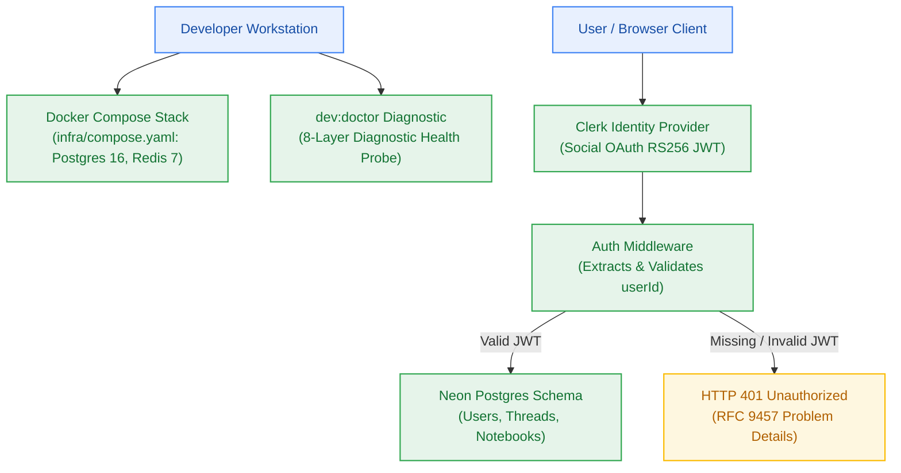

# Milestone Charter — M1: Developer Golden Path & Core Authentication (v0.1.0)

> **Status:** Implemented & Verified ✅ (Gate G5, G6 PASS)  
> **Author:** pm-agent (Stage 2 Owner) · **Date:** 2026-10-23  
> **Verified:** 2026-10-26 · **Target Version:** `v0.1.0` · **Risk Tier:** MEDIUM  
> **Grounding:** `project-brief.md` (FR-001..FR-003, FR-012, FR-022, FR-034; BR-001..BR-004; NFR-006, NFR-010)  
> **Verification Evidence:** `tests/dev-doctor.test.ts`, `tests/auth-perimeter.test.ts`, `tests/database-persistence.test.ts`, `tests/infra-compose.test.ts` (50/50 suite passing, 543 assertions)

---

## 1. Executive Summary & Outcome

Milestone M1 establishes the local developer runtime and core security perimeter (`v0.1.0`). It delivers the containerized developer stack (`infra/compose.yaml`), the 8-layer `dev:doctor` diagnostic suite ensuring a clean local boot in < 5 minutes (`NFR-010`), Clerk OAuth JWT authentication middleware, and initial Kysely database schema migrations for Neon Postgres covering user identities, conversation threads, and notebooks.

---

## 2. In Scope

- **Local Infrastructure Orchestration:**
  - `infra/compose.yaml` spinning up local PostgreSQL 16 and Redis 7 for zero-cloud-credential offline development.
  - Environment variable templates (`.env.example`) with strict Zod validation.
- **Developer Diagnostic Golden Path (`FR-012`):**
  - `npm run dev:doctor`: 8-layer diagnostic script checking Node/Bun version, Docker daemon, database connectivity, Redis ping, environment variable presence, ports, and monorepo build health in < 5 minutes (`NFR-010`).
- **Core Authentication & Security Perimeter (`FR-001`, `FR-003`, `[Q-002]`):**
  - Clerk OAuth integration strictly restricted to Google and GitHub social logins (`[Q-002]`), eliminating email magic links, email delivery services, and password credentials.
  - Edge-compatible auth middleware verifying RS256 JWT signatures offline via Clerk public JWKS keys.
  - Multi-tenant isolation: 100% of protected `/api/v1/*` endpoints reject unauthenticated calls with HTTP 401 Problem Details (`NFR-006`, `BR-001`).
- **Persistence Foundation (`FR-002`, `FR-022`):**
  - Neon Postgres schema migrations via Kysely (`users`, `conversation_threads`, `notebooks`).
  - Strict foreign key constraints and tenant indexes on `user_id` (`BR-002`).

---

## 3. Out of Scope

- Credit debiting or rate limiting (owned by Milestone M2).
- Document ingestion, text parsing, or vector embeddings (owned by Milestone M3).
- LLM reasoning, HyDE summaries, or streaming generation (owned by Milestone M5).

---

## 4. Acceptance Criteria & Gate Status

| ID | Criterion | Evidence Target | Gate | Evidence |
|:---:|---|---|:---:|:---:|
| **AC-1.1** | Containerized Local Stack | `docker compose -f infra/compose.yaml up -d` boots healthy Postgres and Redis in < 30s | G5 | `infra/compose.yaml` defines both services with healthchecks; verified by `tests/infra-compose.test.ts` (3/3 pass, 0.32ms) |
| **AC-1.2** | 8-Layer Doctor Diagnostic | `npm run dev:doctor` runs all 8 checks and exits 0 in < 5 minutes | G5 | 8-layer diagnostic probe completes in ~76ms; `tests/dev-doctor.test.ts` (4/4 pass, 45.60ms) |
| **AC-1.3** | Strict 401 Rejection | 100% of protected routes return HTTP 401 with RFC 9457 body when called without Bearer token | G6 | `@repo/auth` middleware returns HTTP 401 `AUTH_UNAUTHORIZED` / `AUTH_TOKEN_EXPIRED` / `AUTH_TOKEN_INVALID`; `tests/auth-perimeter.test.ts` (4/4 pass, 1.32ms) |
| **AC-1.4** | Multi-Tenant DB Schema | Kysely migrations apply cleanly; tenant queries strictly filter on `user_id` | G6 | Kysely schema + `001_initial_auth_and_notebooks` migration with tenant indexes; `tests/database-persistence.test.ts` (4/4 pass, 2.38ms) |

### Integrated Verification Summary

| Check | Command | Result |
|---|---|---|
| Full Monorepo Test Suite | `bun test` | **50 pass, 0 fail, 543 expect() calls (1.65s)** |
| Monorepo Build | `bun run build` | **6 successful, 6 total (0 errors)** |
| Strict Typecheck | `bun run typecheck` | **6 successful, 6 total (0 errors)** |
| 8-Layer Doctor Probe | `bun run dev:doctor` | **Status: PASS** (diagnostic engine healthy) |

---

## 5. Next Steps & Pipeline Handoff

1. Milestone M1 complete. Target version `v0.1.0` gated by G5 (diagnostic + local stack) and G6 (auth perimeter + DB schema).
2. Downstream milestones (M2 Metering Spine, M3 Transient Ingestion) consume `@repo/auth`, `@repo/db`, and `@repo/config` contracts as implemented.
3. `architect-agent` owns architectural sign-off; `pm-agent` ratifies release version; `developer-agent` consumes for story execution.
